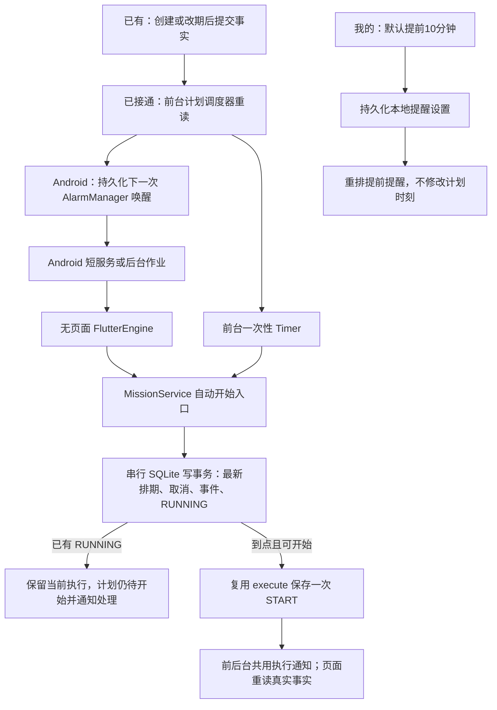

# 计划任务自动开始与提醒设置

2026-10-26 用户修改需求：固定任务到点自动开始；到点前可调整；“我的”页设置全局提前提醒，默认 10 分钟。到点遇到另一个 RUNNING 时，用户明确选择保留当前任务并提醒处理。自选时间任务仍手动开始。

以下为本轮源码已接通的路径；Android 的冷启动、锁屏、重启和 HyperOS 省电行为仍须目标设备验收。超级岛仍只有[接入调研](小米超级岛计时通知接入调研.md)，本轮未接入。

## 业务规则与边界

- FIXED：`fixedStartAt <= now < fixedStartAt + plannedDurationMinutes` 且尚未开始/取消时，允许自动 START；提前开始被事务拒绝，开始前仍可修改任务和追加排期版本。开始后锁定原计划、排期和方案。
- 全局已有 RUNNING 时，保留它的时间线，不写隐式 PAUSE。该计划保留待开始并提醒用户；用户可在详情处理当前执行冲突或重新安排。后续再次对账时，仍在计划时段内且已经没有 RUNNING 的任务可开始。
- 多项同时到点，按开始时刻、任务编号稳定选择第一项；其他任务按同一冲突规则处理，不同时计时。
- 延迟唤醒只记录真实事务提交时刻，不把过去计划时刻倒填成投入。错过整个计划时段后保持待开始，可手动开始或改期，不补造一串历史 START，不自动延期或失败。此为本轮对未指定边界采用的保守处理。
- 事务查询也可能跨过计划结束边界：在写 START 前重新检查时段，校验与事件复用同一次事务内捕获的时刻。自动开始与手动执行复用同一个私有执行核心，手动开始仍允许处理错过时段的任务。
- 新规则只约束新操作；已经保存的历史 START 不重写，旧版本提前开始的记录仍可正常读取。
- START 后不会因计划时段结束自动 END。结束报告、材料和失败规则保持原定义。
- 提前提醒可选关闭、开始时、5/10/15/30/60 分钟；只调整提醒，不改变 fixedStartAt、日期或时长。关闭提前提醒不关闭自动开始和到点执行冲突提醒。
- 原通知“延后 15 分钟”已移除；旧 payload 的延后动作拒绝并要求刷新。需要晚点执行时修改排期。历史 JSON 的 snoozedUntil 仍可读取，当前调度不再使用它。

## 目录与职责

| 类型 | 文件 | 职责 |
| --- | --- | --- |
| 新增 | `lib/application/missions/planned_mission_scheduler.dart` | 前台一次性计时、到点重读、重排下一次系统唤醒 |
| 新增 | `lib/application/missions/planned_mission_background.dart` | Android 无页面引擎入口，打开相同数据库、执行相同事务、刷新通知 |
| 新增 | `lib/data/notifications/planned_alarm_bridge.dart` | 下一次唤醒与后台提交回执的平台通道 |
| 新增 | `android/app/src/main/kotlin/chat/liuxin/mission_book/PlannedAlarm.kt` | 闹钟、重启恢复、短服务与作业降级、无页面引擎生命周期 |
| 新增 | `lib/application/notifications/execution_reminder.dart` | 前后台共用的执行通知投影与动作身份 |
| 修改 | MissionRepository、DriftMissionRepository、MissionService | 单个串行写事务中重读到期任务，复用 execute 和唯一时间线规则 |
| 修改 | ReminderStore、AppNotificationService、AndroidNotificationDispatcher | 全局提醒设置持久化、改期/取消清理、冲突提醒、运行时刷新精确提醒授权 |
| 修改 | App、AppShell、main、MePage、任务表单和详情 | 装配与释放；设置原位选择；固定任务未到点时说明自动开始 |
| 仅参考 | `execution_event_rules.dart`、`execution_time_rules.dart`、八张领域表 | 原事件校验、Focus 计算和领域存储继续复用，无新业务表/迁移 |

图中“已接通”表示源码及其调用关系，不表示系统真机验收通过。

前台先保留本地到点计时，再提交外部系统唤醒；系统调度失败使用独立恢复计时，不用30秒重试替换已经计算好的到点唤醒。通知更新失败单独提示，继续安排系统自动开始；缺少预分配通知编号影响通知呈现，不改变任务事实。两类计时都随调度器释放。

## Android 实现依据

[Android 闹钟文档](https://developer.android.com/develop/background-work/services/alarms)区分精确与非精确唤醒。获得精确提醒授权时，定时动作使用 AlarmManager 的精确闹钟；否则使用非精确闹钟并转后台作业，可能延迟。权限从系统设置返回后重新查询，后续调度使用新结果。

精确闹钟触发的用户定时动作属于[后台启动前台服务的例外](https://developer.android.com/develop/background-work/services/fgs/restrictions-bg-start)。短服务只在写入与通知对账期间存活；Android 14+ 声明 shortService，按[短服务约束](https://developer.android.com/develop/background-work/services/fgs/service-types#short-service)及时停止。没有精确授权或服务启动被拒绝时，转交 JobScheduler，不声称仍可准点。

无页面 [FlutterEngine](https://api.flutter.dev/javadoc/io/flutter/embedding/engine/FlutterEngine.html) 执行保留的 Dart 入口，仍使用 MissionService/DriftMissionRepository；Kotlin 不另写业务状态机。主引擎与后台引擎可能并存，SQLite 写锁、START 唯一及事务重验负责互斥。平台同步编号避免较旧查询覆盖较新闹钟安排。

提醒 JSON 只由前台写入。前台预先分配执行与冲突通知 id；后台只读这些编号、使用同一执行通知投影，避免后台覆盖用户刚保存的设置。后台提交后向仍存活的主引擎发重读通知；否则重开按事件恢复。系统重启、升级和时间修改后恢复最近唤醒并重新查数据库，绝对排期时刻不随时区变化重排。

## 验收

自动化覆盖：到点边界、提前拒绝、改期旧时刻失效、取消、自选、错过整个时段、真实开始时刻、单个 RUNNING、重复唤醒、文件数据库并发与重开；默认设置、旧 JSON 兼容、持久化与失败回滚；提前提醒重排、关闭后的冲突提醒；320 宽双倍字体设置操作。实际运行结果见[学习进度](../教学/学习进度.md)：全量391/391通过，静态/格式检查通过，随后调度边界9项复验通过；Android完整调试构建通过。未安装或启动该APK，不把打包成功等同于后台送达通过。

提交前复审补充：跨过结束边界与系统调度失败保留本地唤醒两项回归修复前均失败、修复后通过；当前相关11/11、全量398/398，静态/格式及差异检查通过，Android ARM64离线调试构建通过（57秒）。没有新增设备运行证据。

目标设备仍需验证：前台/桌面/其他应用/锁屏、进程回收、系统重启、授权与撤权、省电限制、到点与改期/取消竞争、冲突通知、进入任务后的暂停和 END。强行停止、关机与厂商限制下不承诺准点。Windows/浏览器只在应用可执行期间自动开始，本轮没有新增它们的退出后唤醒机制。
