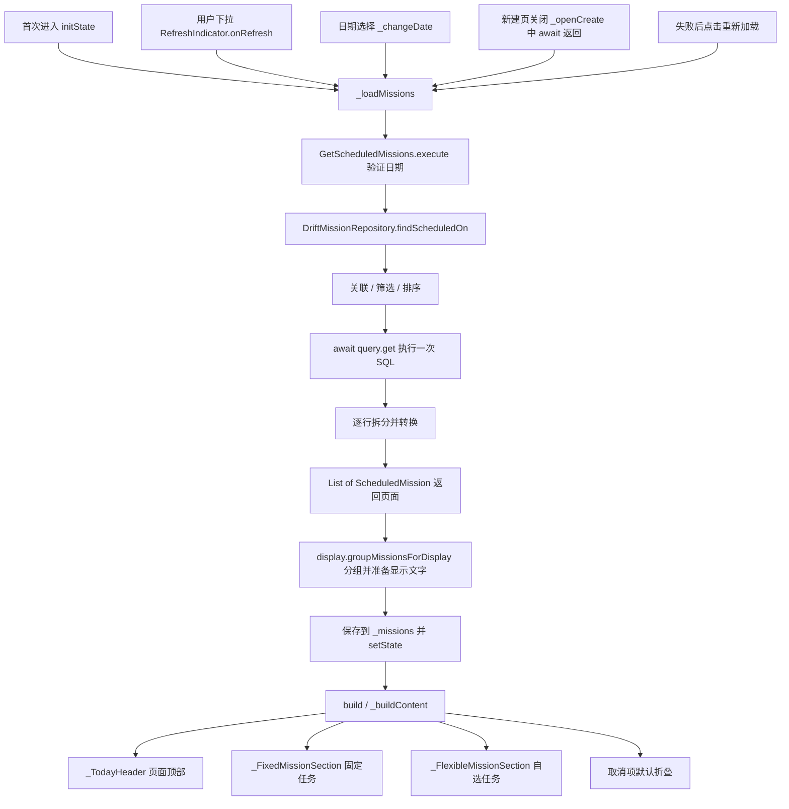
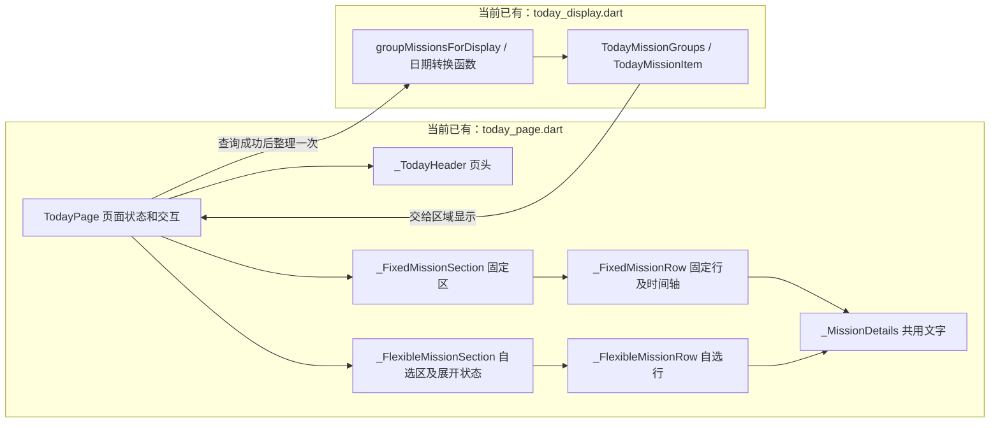

# U06：今天页的一次查询与主动刷新

2026-10-22 当前实现。今天页采用一次查询：首次进入、下拉、切日期、重试及新建页返回时调用相同加载方法。页面按顶部、固定任务、自选任务三个区域组织；查询结果每次返回后，由 today_display.dart 的函数统一准备一次显示文字和分组，Widget 重建时直接使用。SQL 和数据库行转换规则沿用。

## 先认清调用链



这里的箭头是方法调用或数据返回。`App` 在启动时通过普通构造函数创建对象并保存引用，再经 `AppShell` 传给 `TodayPage`；没有额外的“注册后自动查询”机制。

## 文件与阅读顺序

查询入口此前已从 `watch_scheduled_missions.dart` 改名为 `get_scheduled_missions.dart`。本轮将 today 目录收拢为两个文件：today_page.dart 集中 UI、局部组件及交互，today_display.dart 集中显示转换方法和结果类型。原来单独的页头、固定区、自选区和共用文字四份文件已合并删除；没有新增文件、数据库表或数据迁移。

| 文件 | 现在负责什么 |
| --- | --- |
| [mission_repository.dart](../../lib/domain/repositories/mission_repository.dart) | `Future<List<ScheduledMission>> findScheduledOn(String scheduledDate)`，约定一次查询 |
| [get_scheduled_missions.dart](../../lib/application/get_scheduled_missions.dart) | 今天页调用的业务入口，检查日期后调用仓储 |
| [drift_mission_repository.dart](../../lib/data/repositories/drift_mission_repository.dart) | 按关联→筛选→排序→执行→转换的顺序，给每一阶段命名和说明 |
| [scheduled_mission.dart](../../lib/domain/entities/scheduled_mission.dart) | 一项结果携带任务及当前排期，标题来自任务、日期与分钟来自排期 |
| [mission_schedule_revision.dart](../../lib/domain/entities/mission_schedule_revision.dart)（修改） | 排期对象及 validateScheduledDate；创建/查询共用不受设备时区影响的日历日期校验 |
| [today_page.dart](../../lib/presentation/today/today_page.dart)（修改） | 全部 UI：页面加载与交互、页头、固定区、自选区、任务行、共用文字和时间轴；局部组件均为私有类 |
| [today_display.dart](../../lib/presentation/today/today_display.dart)（修改） | 顶层函数负责日期、时区、显示文字及固定/自选/取消分组；同文件保留两个显示结果类型，不依赖 Flutter |
| [app.dart](../../lib/app.dart)、[app_shell.dart](../../lib/app_shell.dart) | 创建并传递共享对象；此处不发起任务查询 |
| [create_mission_page.dart](../../lib/presentation/missions/create_mission_page.dart)（仅参考） | 继续使用现有保存过程；今天页等待它关闭后重新读取 |

文件合并不等于把所有布局塞进一个 build。TodayPage 是对外页面入口，其余 Widget 在同一文件内分担布局和局部展开状态，外部不能直接引用；复用的任务行和文字使用 StatelessWidget。布局尺寸、主题与文字缩放留在 UI 文件，日期和业务结果的显示转换留在转换文件。



第一次阅读先只跟 `_loadMissions → execute → findScheduledOn`，再看仓储方法最后的转换部分。布局细节和查询表达式不要求在同一轮全部掌握。

## 仓储最后怎样转换数据

`findScheduledOn` 的前面已经构造好 query。`await query.get()` 执行 SQL 并取得 `List<TypedResult>`：每一项包含任务表和排期表关联到一起的字段。

同一方法的最后一段现在逐步展开，和源码一致：

```dart
final rows = await query.get();
final result = <ScheduledMission>[];
for (final row in rows) {
  final missionRow = row.readTable(missions);
  final scheduleRow = row.readTable(schedules);

  final mission = missionFromRow(missionRow);
  final schedule = scheduleFromRow(scheduleRow);
  final item = ScheduledMission(mission: mission, schedule: schedule);
  result.add(item);
}
return result;
```

以“09:00 阅读 Flutter”为例：一项关联结果先拆成 MissionRow 和 MissionScheduleRevisionRow；两个转换函数分别还原 Mission 和 MissionScheduleRevision；ScheduledMission 把两个对象放在一起，最后加入返回列表。构造这些对象只发生在内存中，不会重新保存任务。

## 用户引用的旧 watch/map 代码做了什么

这段是旧版回顾，当前源码已经改成上面的 get/for：

| 旧表达式 | 实际输入与输出 |
| --- | --- |
| `query.watch()` | 得到 `Stream<List<TypedResult>>`，监听后先提供一次结果；相关表变化时可以再提供整份查询结果 |
| `.map((rows) => ...)` | 这是 Stream.map；每收到一份列表就执行回调，rows 是那一份 List<TypedResult>，并非一行 |
| `for (final row in rows)` | 从本次列表逐一取出关联结果 |
| `row.readTable(missions/schedules)` | 分别取出任务行和排期行 |
| `missionFromRow / scheduleFromRow` | 两行分别还原成两个业务对象 |
| `ScheduledMission(...)` | 把两对象组合成列表的一项 |
| `List<ScheduledMission>.unmodifiable(...)` | 把本次所有项装成只读列表，防止调用者增删；它不查询或写库 |

所以旧链路是“结果列表流 → 每份列表转换 → 业务列表流”。watch 不会按时间间隔不停轮询，但会持有订阅，关联表变化后可能重查。主动刷新是本页的交互选择，并非仅凭 watch 就能判定性能有问题。依据：[Drift 查询流说明](https://drift.simonbinder.eu/dart_api/streams/)。

## 今天页中的方法如何关联

| 方法/组件 | 谁调用 | 处理与结果去向 |
| --- | --- | --- |
| `initState` | Flutter 创建 State 时 | 默认选上海今天，调用 _loadMissions |
| `_loadMissions` | 初始化、下拉、切日、重试、新建返回 | 取日期→等待业务入口→显示转换函数整理一次→存 _missions→setState |
| `_pickDate → _changeDate` | 日期按钮或回到今天 | 更换日期并清除旧结果，再调用同一个加载方法 |
| `_openCreate` | 加号或空状态按钮 | 打开表单，await 等待路由关闭，再调用加载方法；取消返回也会读取一次 |
| `build` | Flutter 重建界面时 | 组装 RefreshIndicator、页头和内容；不会发起数据库查询 |
| `_TodayHeader` | build | 仅显示准备好的日期文字和加号，并绑定点击回调 |
| `_buildContent` | build | 根据等待、错误、空、已有列表四种状态选择组件 |
| `_FixedMissionSection / _FlexibleMissionSection` | _buildContent 正常列表分支 | 分别接收 _missions.fixed / flexible，直接排版，不查库、不分组、不换算时区 |
| `display.groupMissionsForDisplay` | _loadMissions 成功后 | 业务结果→TodayMissionItem 显示数据→TodayMissionGroups 三个分区；保持查询顺序 |

GetScheduledMissions.execute 与 CreateMission.execute 都调用 validateScheduledDate。函数先检查精确的 YYYY-MM-DD 格式，再拆出年月日，用 UTC 日历逐项核对；UTC 对象只用于判断日期是否存在，不把排期写成 UTC 午夜。两个业务入口都通过 Future 返回失败，页面使用 try/await/catch 统一接收。

四类页面数据是 `_selectedDate`、`_missions`、`_isLoading`、`_errorText`。额外的 `_loadRequest` 只防止快速切日期时旧请求迟到，覆盖当前日期的数据。页面销毁后通过 mounted 判断不再更新。

## 转换放在哪里，什么时候执行

数据库转换与显示处理有各自的边界：

| 边界 | 位置 | 本轮处理 |
| --- | --- | --- |
| 数据库行 → Mission / 排期 | 既有 DriftMissionRepository 中的 missionFromRow / scheduleFromRow | 保留已有规则，Widget 不接触数据库行 |
| 业务结果 → 分区与显示文字 | display.groupMissionsForDisplay | 每次查询成功后执行一次；时区、取消文字、时长只在这一处准备 |
| 日期 → 查询键 / 页头文字 | display.scheduleDateKey / scheduleDateLabel | 同一个工具提供规则，页面无需自己 padLeft 或拼星期 |
| 显示数据 → 布局 | 三个区域及共用文字排版 | 读取 title、startTime、durationLabel；节点高度、文字缩放仍属于布局 |

以“09:00 阅读 Flutter，计划 20 分钟”为例，仓储先返回 ScheduledMission，`_loadMissions` 再走下面这段完整调用：

```dart
final result = await widget.getMissions.execute(scheduledDate: date);
if (!mounted || request != _loadRequest) return;
final missions = display.groupMissionsForDisplay(result);
setState(() {
  _missions = missions;
  _isLoading = false;
});
```

这里的 `date` 和 `request` 都在 `_loadMissions` 开头取得。工具把固定任务准备成 `startTime: '09:00'`、`durationLabel: '计划 20 分钟'`，放进 `missions.fixed`。正常内容分支随后调用 `_FixedMissionSection(items: _missions.fixed)`；任务行直接显示这些字段。普通重建复用同一份显示数据。

TodayMissionGroups 与 TodayMissionItem 都只是不可变的显示结果，不拥有数据库或页面回调，不作为新业务模型写回数据库。没有新增 Controller、订阅或状态管理框架，也没有合并两种性质不同的转换成通用 Utils。

## 查询和刷新约定

- 每次调用执行一次 SQL。写入完成后不会自行订阅重查；回到今天页、下拉或其他明确事件负责重新调用。
- 每任务取最大版本排期，再筛计划日期；不先筛日期再找版本，避免旧日期误读旧排期。
- 固定按开始时间升序在前，自选按创建时间升序随后，同值按任务 id 稳定排序。取消项仍由页面默认折叠。
- 选择的日期保留；默认是打开页面当天的上海日期。下拉刷新当前所选日期，跨日后可点“回到今天”，页面没有后台计时器自动切日。
- 固定时刻按排期时区显示。列表为空或很短时仍允许下拉；刷新已有列表时保留当前内容，失败可重试。
- 自选区域默认只显示前 3 项；超过 3 项时可展开全部或收起。_expanded 只属于 _FlexibleMissionSection 的局部显示状态，展开、收起不查询或重新转换。切日期会先清空内容，新日期默认折叠。
- 计划日程右侧的“全部任务”暂为禁用入口：用户尚未决定列表范围，本轮不接跳转或新增页面。
- 固定时间录入、执行事件、材料与全部任务页面仍属于后续实现。

## 验证与历史

2026-10-22 业务自检修复后的静态检查通过；当前环境及命令级 TZ=Pacific/Apia 下全量分别 39/39 通过。2026-10-21 原版本为 34/34 通过。保留原有创建/事务、最新排期、排序、取消、窄屏、真实内存数据库创建返回等检查；补充显示整理的分区、跨日、夏令时、固定取消行，以及父组件重建后仍显示已有数据且不再次查询；自选前三项、展开/收起不查库、三项无展开入口及全部任务禁用位置均有覆盖。设备核对记录以[学习进度](学习进度.md)为准；本轮重构尚未重新安装到设备。

[旧查询细图](U06-任务查询链路.md)和其中的 watch 标识保留接通前快照，不代表当前 API。历史版本采用订阅，当前版本按用户本轮反馈使用 Future 一次查询；不把本次修改和测试通过记作用户已理解全部代码。
