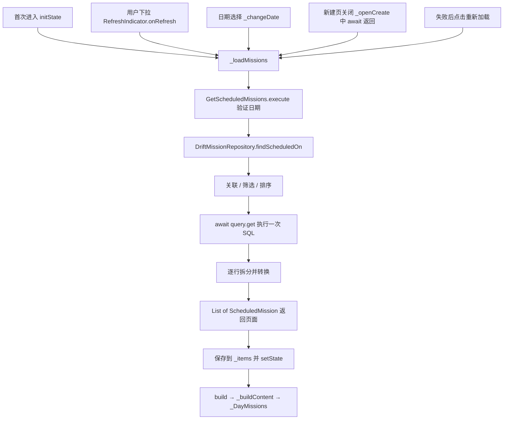

# U06：今天页的一次查询与主动刷新

2026-10-21 当前实现。按用户反馈，今天页改为一次查询：首次进入、下拉、切日期、重试及新建页返回时调用相同加载方法。SQL、行转换及显示规则沿用，取消持续订阅和自动跨日计时器。

## 先认清调用链



这里的箭头是方法调用或数据返回。`App` 在启动时通过普通构造函数创建对象并保存引用，再经 `AppShell` 传给 `TodayPage`；没有额外的“注册后自动查询”机制。

## 文件与阅读顺序

本轮将原 `watch_scheduled_missions.dart` 改名为 `get_scheduled_missions.dart`。其他主要文件修改，无新增目录、数据库表或数据迁移。

| 文件 | 现在负责什么 |
| --- | --- |
| [mission_repository.dart](../../lib/domain/repositories/mission_repository.dart) | `Future<List<ScheduledMission>> findScheduledOn(String scheduledDate)`，约定一次查询 |
| [get_scheduled_missions.dart](../../lib/application/get_scheduled_missions.dart) | 今天页调用的业务入口，检查日期后调用仓储 |
| [drift_mission_repository.dart](../../lib/data/repositories/drift_mission_repository.dart) | 按关联→筛选→排序→执行→转换的顺序，给每一阶段命名和说明 |
| [scheduled_mission.dart](../../lib/domain/entities/scheduled_mission.dart) | 一项结果携带任务及当前排期，标题来自任务、日期与分钟来自排期 |
| [today_page.dart](../../lib/presentation/today/today_page.dart) | 事件触发加载、保存结果、选择当前显示状态，下面的组件负责布局 |
| [app.dart](../../lib/app.dart)、[app_shell.dart](../../lib/app_shell.dart) | 创建并传递共享对象；此处不发起任务查询 |
| [create_mission_page.dart](../../lib/presentation/missions/create_mission_page.dart)（仅参考） | 继续使用现有保存过程；今天页等待它关闭后重新读取 |

第一次阅读先只跟 `_loadMissions → execute → findScheduledOn`，再看仓储方法最后的转换部分。布局细节和查询表达式不要求在同一轮全部掌握。

## 仓储最后怎样转换数据

`findScheduledOn` 的前面已经构造好 query。`await query.get()` 执行 SQL 并取得 `List<TypedResult>`：每一项包含任务表和排期表关联到一起的字段。

同一方法的最后一段现在逐步展开，和源码一致：

```dart
final rows = await query.get();
final result = <ScheduledMission>[];
for (final row in rows) {
  final missionRow = row.readTable(missions);
  final scheduleRow = row.readTable(schedules);

  final mission = missionFromRow(missionRow);
  final schedule = scheduleFromRow(scheduleRow);
  final item = ScheduledMission(mission: mission, schedule: schedule);
  result.add(item);
}
return result;
```

以“09:00 阅读 Flutter”为例：一项关联结果先拆成 MissionRow 和 MissionScheduleRevisionRow；两个转换函数分别还原 Mission 和 MissionScheduleRevision；ScheduledMission 把两个对象放在一起，最后加入返回列表。构造这些对象只发生在内存中，不会重新保存任务。

## 用户引用的旧 watch/map 代码做了什么

这段是旧版回顾，当前源码已经改成上面的 get/for：

| 旧表达式 | 实际输入与输出 |
| --- | --- |
| `query.watch()` | 得到 `Stream<List<TypedResult>>`，监听后先提供一次结果；相关表变化时可以再提供整份查询结果 |
| `.map((rows) => ...)` | 这是 Stream.map；每收到一份列表就执行回调，rows 是那一份 List<TypedResult>，并非一行 |
| `for (final row in rows)` | 从本次列表逐一取出关联结果 |
| `row.readTable(missions/schedules)` | 分别取出任务行和排期行 |
| `missionFromRow / scheduleFromRow` | 两行分别还原成两个业务对象 |
| `ScheduledMission(...)` | 把两对象组合成列表的一项 |
| `List<ScheduledMission>.unmodifiable(...)` | 把本次所有项装成只读列表，防止调用者增删；它不查询或写库 |

所以旧链路是“结果列表流 → 每份列表转换 → 业务列表流”。watch 不会按时间间隔不停轮询，但会持有订阅，关联表变化后可能重查。主动刷新是本页的交互选择，并非仅凭 watch 就能判定性能有问题。依据：[Drift 查询流说明](https://drift.simonbinder.eu/dart_api/streams/)。

## 今天页中的方法如何关联

| 方法/组件 | 谁调用 | 处理与结果去向 |
| --- | --- | --- |
| `initState` | Flutter 创建 State 时 | 默认选上海今天，调用 _loadMissions |
| `_loadMissions` | 初始化、下拉、切日、重试、新建返回 | 取日期→等待业务入口→把列表存 _items→setState |
| `_pickDate → _changeDate` | 日期按钮或回到今天 | 更换日期并清除旧结果，再调用同一个加载方法 |
| `_openCreate` | 加号或空状态按钮 | 打开表单，await 等待路由关闭，再调用加载方法；取消返回也会读取一次 |
| `build` | Flutter 重建界面时 | 组装 RefreshIndicator、页头和内容；不会发起数据库查询 |
| `_buildHeader` | build | 仅显示日期和加号，并绑定点击回调 |
| `_buildContent` | build | 根据等待、错误、空、已有列表四种状态选择组件 |
| `_DayMissions → _MissionSection → _MissionTile` | 内容分支绘制列表时 | 将同一份数据分区，然后为每项生成显示行；没有独立查询 |

四类页面数据是 `_selectedDate`、`_items`、`_isLoading`、`_errorText`。额外的 `_loadRequest` 只防止快速切日期时旧请求迟到，覆盖当前日期的数据。页面销毁后通过 mounted 判断不再更新。

## 查询和刷新约定

- 每次调用执行一次 SQL。写入完成后不会自行订阅重查；回到今天页、下拉或其他明确事件负责重新调用。
- 每任务取最大版本排期，再筛计划日期；不先筛日期再找版本，避免旧日期误读旧排期。
- 固定按开始时间升序在前，自选按创建时间升序随后，同值按任务 id 稳定排序。取消项仍由页面默认折叠。
- 选择的日期保留；默认是打开页面当天的上海日期。下拉刷新当前所选日期，跨日后可点“回到今天”，页面没有后台计时器自动切日。
- 固定时刻按排期时区显示。列表为空或很短时仍允许下拉；刷新已有列表时保留当前内容，失败可重试。
- 固定时间录入、执行事件、材料与全部任务页面仍属于后续实现。

## 验证与历史

本次静态检查通过，30/30 测试通过。保留原有创建/事务、最新排期、排序、取消、窄屏、真实内存数据库创建返回等检查，改为验证一次查询快照、主动下拉、普通重建不重复查库、旧请求不覆盖新日期。设备核对记录以[学习进度](学习进度.md)为准。

[旧查询细图](U06-任务查询链路.md)和其中的 watch 标识保留接通前快照，不代表当前 API。历史版本采用订阅，当前版本按用户本轮反馈使用 Future 一次查询；不把本次修改和测试通过记作用户已理解全部代码。
