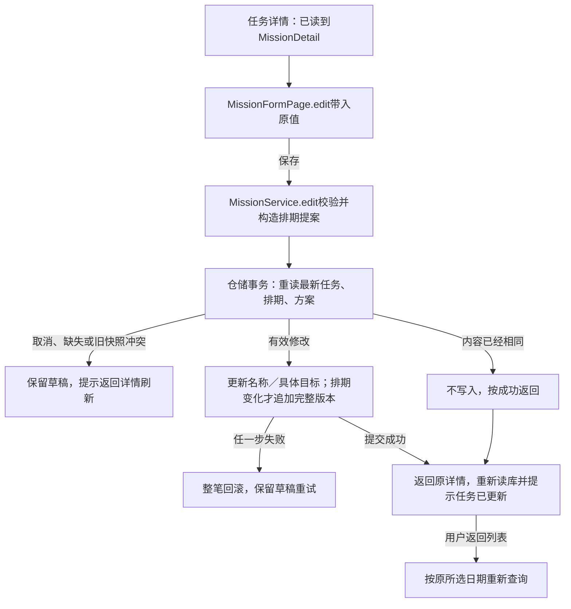

# U07：编辑任务与保留排期历史

2026-10-23。承接已经理解的创建、读取与取消流程，本次实现当前独立自报任务的名称、具体目标和排期编辑。步骤、说明、Why、验证策略等其余字段保留原值，本切片不开放这些编辑控件。没有新增表、迁移或依赖；执行事件尚未接入。

## 1. 一个实际例子

原任务今天自选时间、计划20分钟。打开详情点击“编辑任务与排期”，名称和具体目标分别带入原值；改成明天、35分钟后保存，直接返回原详情并重新读取。返回今天列表后任务消失，切到明天出现；原来今天20分钟的版本仍在数据库中。

如果只修改名称或具体目标，排期没有变化，就不会增加版本。名称和目标是两个独立值，修改名称不会悄悄改写已经保存的具体目标。

## 2. 文件与职责

| 位置 | 本轮变化 |
| --- | --- |
| [MissionFormPage](../../lib/presentation/missions/mission_form_page.dart) | 原create_mission_page.dart改名，创建与编辑共用布局；普通构造创建，`.edit`接收原快照。编辑时增加具体目标输入，等待成功后返回原详情 |
| [详情页](../../lib/presentation/missions/mission_detail_page.dart) | 传入已读取的快照；编辑返回后重新查询，不用表单里的值伪造详情 |
| [MissionService](../../lib/application/missions/mission_service.dart) | `edit`校验名称、目标与排期；创建和编辑共用日期、时区、时长与固定时间规则，构造完整排期提案 |
| [仓储接口](../../lib/domain/repositories/mission_repository.dart) | `edit`约定快照检查、原子更新和追加版本 |
| [真实仓储](../../lib/data/repositories/drift_mission_repository.dart) | 同一事务重读，判断无改动、冲突与有效改期，再更新字段或追加版本 |
| [MissionDetail](../../lib/domain/entities/mission_detail.dart) | 继续表示三对象快照；同文件的MissionEditConflict表示原任务已变化，不新增异常目录 |
| [今天页](../../lib/presentation/today/today_page.dart) | 只调整表单类引用；复用详情关闭后刷新原日期的过程 |

新增两个测试文件和本文，没有增加生产目录。原创建页面测试文件保留名称，所有页面引用已随类名修改。

## 3. 原快照为什么要一起传

详情页传入的`detail`是打开表单时的一次读取结果。表单用它填入名称、具体目标、日期、时长和钟面时间；保存时又作为`original`交给业务入口。

用户编辑期间，任务可能已经取消或被另一处修改。仓储在事务内重新调用`findDetail`取得`current`，检查取消事实、原排期ID、任务和方案的更新时间以及实际名称和目标。除了时间戳也比较字段值，可以防止同一毫秒内的文字修改漏检。

已有内容与本次提案完全相同则直接成功：这让无改动保存、重复点击和同一内容重试都不会制造多余版本。内容不同且原快照过时则抛`MissionEditConflict`，页面显示原因并保留输入；返回详情会重新读取，之后用户可以基于新事实编辑。

## 4. 提案与保存的区别

Service构造的`MissionScheduleRevision`只是提案，有新ID、候选版本号和操作时间，还没有写入数据库。仓储将日期、时区、策略、固定时刻、时长和截止值与当前快照比较，变化时才执行insert。

事务内更新名称与任务更新时间；具体目标变化时才更新方案的目标与更新时间。说明、Why、步骤、验收方向、备注、创建时间和身份信息都不在这次更新列中。新排期插入失败时，前面更新的名称与目标也一起回滚。

当前编辑沿用原排期时区，不用设备时区重新解释原时刻。固定钟面时间按记录时区带入，只改文字时还会保留原时刻的秒和毫秒；切为自选后，新版本的固定时刻为空。

## 5. 页面与验证边界

从今天列表进入详情、进入编辑、保存返回原详情，共三次页面跳转就得到反馈；日历在表单内展开。未改内容可以直接返回；有改动时，系统返回与顶部返回共用丢弃确认。保存期间阻止返回与重复提交，错误不清空输入。

自动检查覆盖无改动、纯元数据编辑、完整排期追加、原日期移除和新日期出现、固定转自选、重复与并发、同毫秒冲突、取消与缺失、事务回滚及文件库关闭重开。页面覆盖原值带入、保留草稿、错误重试、原时区与秒精度、320宽双倍字体，以及真实列表→编辑→改期→返回→切日路径。

浏览器只创建并修改`【改期验收】阅读计划`样本，改为`【改期验收】明天阅读`、2026-10-24自选35分钟和明确具体目标；没有修改原生用户数据库。预览见[表单](../开发/assets/web-edit-form-20261023.jpg)、[详情](../开发/assets/web-edit-detail-20261023.jpg)、[改期后列表](../开发/assets/web-edit-rescheduled-list-20261023.jpg)。原生设备仍未更新或验收；本次由助手实现，不把此前用户对旧流程的理解扩展为已掌握新增编辑代码。

U08/U09增加START后，编辑和取消都必须在同一写事务内检查尚未开始，不能仅靠隐藏按钮。材料策略和截止编辑、其余元数据控件以及排期历史阅读入口尚未接通，不能据本切片宣称全部目标功能完成。
