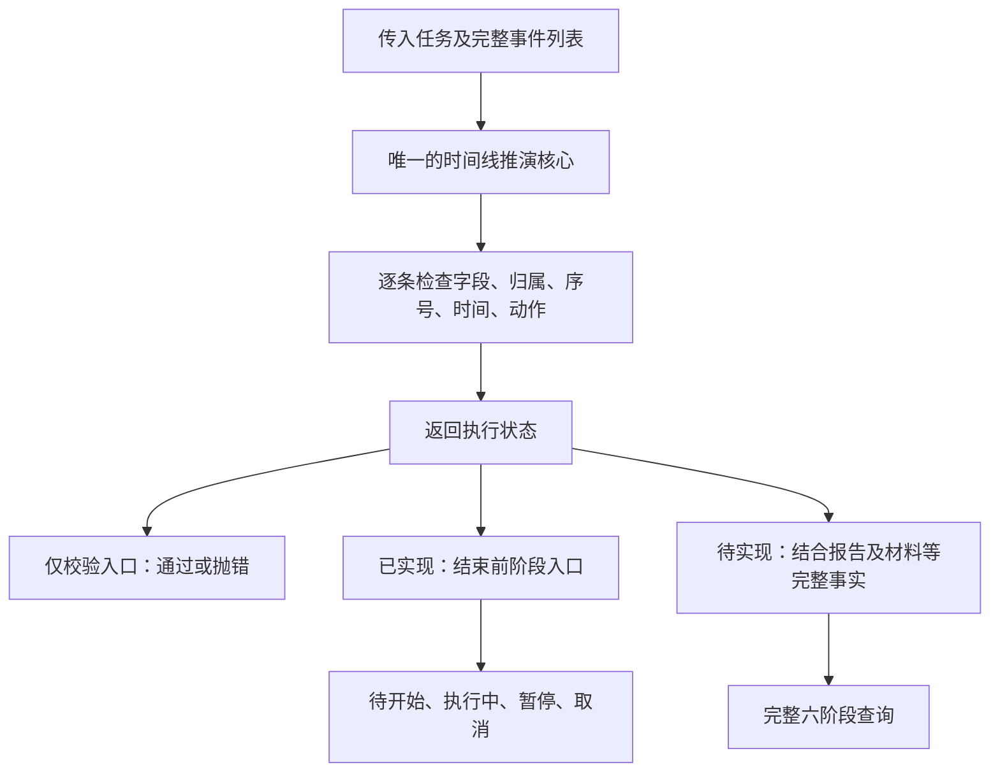

# U08 执行事实与阶段设计审查

日期：2026-10-23。已完成设计审查及本轮代码收敛；完整任务闭环仍按后续切片推进。用户要求继续推导，避免后续 AI 接入或 AI 接手开发时误解模型。当前代码证据见[学习进度](学习进度.md)。

业务定义仍以[领域模型](../需求文档v1.0/领域模型.md)、[数据模型](../需求文档v1.0/数据模型.md)为唯一来源；本文说明实现如何遵守它们，不另立状态规则。AI 部分的提案仍受[未来方向](../需求文档v1.0/未来方向.md)约束，本轮不提前建立 AI 接口、表或通用框架。

## 1. 审查结论及现有缺口

事件记录事实、阶段从事实计算的方向成立。审查发现的重复推演已收敛；完整阶段所需事实尚未接齐，不是“一个任务有多个事件”本身过度设计。

| 当前证据 | 问题或边界 | 收敛方式 |
| --- | --- | --- |
| [单条与时间线规则](../../lib/domain/rules/execution_event_rules.dart) | 已有唯一私有核心 `_replayExecutionHistory` | 校验入口与结束前阶段入口各调用核心一次，共用字段和动作规则 |
| [结束前阶段入口](../../lib/domain/rules/execution_event_rules.dart) | 已改名 `derivePreEndMissionPhase`，删除旧阶段规则文件及重复循环 | 当前能力从名称和注释明确；没有保留旧入口或只转发的空文件 |
| [阶段枚举](../../lib/domain/entities/mission_phase.dart) | 已按现行规格列全六种；这不等于六阶段功能全部完成 | `evidencePending`、`closed` 需在关联事实接入后由完整查询计算，不在本轮猜测返回 |
| 结束前阶段函数只接收 Mission 和事件 | 明确只支持结束前四阶段，合法 END 抛 UnsupportedError | 完整查询必须在一致快照中读取相关事实，不能猜测不存在的事实 |
| 当前 schema v1 只有三表 | 规则测试通过不能证明真实写入保护成立 | 先加事件表和保数据迁移，再接统一事务写入；U09/U10/U12/U13分别联验相关事实 |

本轮已完成上述代码收敛，领域规则47项测试及静态分析通过。未更改数据库或页面，不宣称六阶段闭环、真实事务写入或 AI 已接入。声明现行规格中的六个枚举值用于明确领域词汇，不增加未来AI状态、占位表或未接入的材料写入口。

## 2. 先区分四件事

| 概念 | 例子 | 谁提供、保存在哪里 |
| --- | --- | --- |
| 操作意图 | “给任务增加10分钟” | 页面或通知发起；未来获准的外部入口也只能提出意图 |
| 原始事实 | 已成功保存的 EXTEND 事件 | 事务验证通过后追加；用户报告、材料、失败记录各用规定事实保存 |
| 派生结果 | 执行中、暂停、专注时长、任务阶段 | 确定性规则读取事实计算；当前不另存可写 phase |
| AI 判断 | “这次材料不足以证明掌握” | 未来独立分析记录；不是用户报告，不覆盖 END 或材料 |

ExecutionEvent 对象可以在内存中先构造为待保存候选，只有事务提交成功才成为已保存事实。不能把“创建了对象”表述为“动作已发生并保存”。

ExecutionHistory 是同一 Mission 下按 sequence 有序的事件集合，不新增一张历史表或另一个可写状态对象。这里保留任务执行事件，不把所有元数据修改、材料、通知都硬塞进执行事件，也不引入完整事件溯源框架。

## 3. 一套执行推演，两个合理入口

结构如下；时间线核心及两个结束前入口已实现，完整材料阶段查询仍待实现：

时间线核心保留现有私有执行状态含义：未开始、执行中、暂停、执行已结束。它们只描述执行动作能否发生，不是另一套持久化 MissionPhase。

MissionPhase 的六个值描述整个任务流程，包括材料；执行已结束仍可能待补材料。因此“执行状态”和“任务阶段”的区别有必要，两个地方重复编写 START/PAUSE/RESUME 切换没有必要。

具体实现：`_replayExecutionHistory` 返回私有 `_ExecutionState`；`validateExecutionHistory` 调用核心并忽略返回值；`derivePreEndMissionPhase` 直接调用核心取得结果，再映射为阶段，不先调用校验包装再重新循环。核心和使用者都在 `execution_event_rules.dart`，没有为共享私有类型增加公开内部对象或循环依赖。原 `deriveMissionPhase` 和原独立阶段规则文件已移除，仓库调用方同步更新。

单次调用按事件数线性处理。独立调用校验和查询仍会各自计算，不能为了去重跨事务缓存旧状态。当前没有性能证据要求增加状态缓存表、全局事件总线或状态机依赖；有实测瓶颈后再设计可重建投影。

## 4. 完整阶段必须读取完整事实

| 需要回答 | 必要事实 |
| --- | --- |
| 是否取消 | Mission.cancelledAt，并验证没有执行/材料/失败事实 |
| 执行是否开始、暂停、结束 | 该任务的完整合法执行时间线 |
| 报告完成还是未完成 | END.userReportedResult |
| 是否要求材料 | Mission.verificationPolicy 与 END.submitOptionalEvidence |
| 材料是否已提交 | 正式 Evidence；草稿不算，修正不改变首次提交结果 |
| 是否主动跳过 | Mission.evidenceWaivedAt，仅允许符合条件的可选材料任务 |
| 是否已超时关闭 | 对应 FailureRecord；不能只用当前时间猜测 |
| 必要失败记录是否完整 | END报告未完成对应的记录；强制材料超时对应的记录 |
| START 是否使用正确计划、材料截止 | START绑定的排期版本及其任务归属；不是任取最新一条 |

未来完整查询由仓储在一致快照中装配以上已实现的事实，再交给纯计算规则。不能把来自页面或模型的 hasEvidence、hasTimedOut 等布尔参数当作可信事实，也不能把“未加载”默认为“数据库里没有”。

相关表、字段或查询尚未实现时，完整阶段能力就仍未完成。当前 `derivePreEndMissionPhase` 不得作为完整任务详情、全局执行判断或 AI 上下文的生产来源；后续新增完整查询时同步调用方和测试，不能把当前函数的 UnsupportedError 当作完整查询处理正常 END 的最终行为。

时间到了但还未保存超时记录时，由补算业务执行并提交事实后重读；纯阶段查询不暗中写库。尚未开始或正在执行的强制材料任务不会因材料截止自动结束。完整规则见[截止时间与失败记录](../需求文档v1.0/领域模型.md#8-截止时间与失败记录)。

## 5. 写入保护放在提交事实的位置

页面禁用按钮改善体验，事务边界保证事实正确。现有 MissionService 继续作为应用入口，不增加与之并行的 AI 专用写入通道。

一次执行动作的目标流程：

1. 应用入口接收动作意图和必要输入，固定本次候选事件 id；重试复用该 id。用户看到的 expectedSequence、START排期版本随命令带入，不接受外部指定最终 sequence 和 occurredAt。
2. 仓储取得写权限，在事务内先按 id 查重并核对原动作输入。已成功的同次操作返回原结果，不能先用新状态拒绝旧请求，也不能重新增加额度。
3. 新请求在事务内重读任务、排期、事件及本动作所需关联事实；核对 expectedSequence，校验关系和动作。START/RESUME还检查其他任务是否执行中。
4. 在写事务内捕获时刻、分配下一序号，构造候选事件，调用同一套纯规则。END等操作同时检查并准备必要失败记录，不能只靠事件合法就保存半条业务链。
5. 原子保存全部必要事实；提交后返回结果，再刷新页面、对账通知。通知失败不回滚执行事实。

具体串行化/写权限取得机制要在实现时用真实数据库并发测试证明，不能把“使用 transaction”本身当作并发验证通过。进程内锁不能替代数据库边界。

只追加一个事件的公开存储接口如果不承担完整原子规则，不能被页面、通知或未来外部入口直接调用。最终方法签名随真实开始/暂停/继续等入口落地确定，本轮不提前写通用命令框架。

## 6. AI 接入与 AI 接手开发分别怎样约束

### 6.1 产品中的 AI

以下为既有未来方向的边界细化，仍不纳入当前实现：

- 分析读取原始事实及其来源；阶段、时长是由规则生成的结果，不让模型凭文字自行更新 phase。
- 用户自报完成、正式提交材料、AI判断达到标准是三个不同概念。AI评价失败或认为未达标，不重写用户报告、不重开任务、不制造用户未完成记录。
- 新评价保留旧评价及明确替代关系；记录模型/评价来源。具体上下文协议、输入快照标识、生成时刻和版本字段随真实评价功能一起定稿，不能现在随意预埋字段。
- AI依据旧sequence或旧材料提出的建议，在用户决定采用时重新读取事实并检查前置条件。过期建议不能越过“开始后锁定方案/排期”的规则。
- 重规划、拆分、再次尝试由用户确认；已结束任务保持历史。当前只有 RETRY，其他血缘以后连同入口和规则再实现。
- 提交给模型的用户说明和材料是待分析内容，不能当成授予数据库写入权限的指令；允许哪些工具动作、由谁确认随将来的接入协议明确。

例如：任务已报告完成并关闭，AI评价“证据不足”只新增分析，不把任务变成未完成；如建议再练一次，用户确认后创建新任务，原任务不复活。

### 6.2 以后接手本仓库的 AI 开发者

接手时先读业务规格和学习进度，明确当前公开接口支持范围，再核对源码；不能看到六值枚举就推断六阶段已全部实现，也不能把结束前阶段入口当成完整查询。实现新动作必须复用时间线核心、统一事务入口和相关测试，不能在页面或通知中补一套 if/else 阶段逻辑。

修改规则时同步相关规格及测试。声称迁移/并发/设备路径通过必须有对应证据，不把47项纯规则测试当成数据库事务或完整产品验收。

## 7. 用场景检验设计

下列为后续联验要求，不是本轮已通过结果；业务预期均来自现行规格。

| 场景 | 必须得到的结果 | 负责验证的切片 |
| --- | --- | --- |
| 开始→暂停→延长→继续 | 延长不恢复，继续后才执行中 | U08规则，U09真实写入 |
| 两个任务同时开始，或开始与取消竞争 | 最多一个执行中；取消与START不共存 | U09数据库并发 |
| 同一个延长请求响应丢失后重试 | 同id同输入只增加一次；旧序号新id拒绝 | U08身份规则、U09写入 |
| 旧排期页面开始与改期竞争 | START只绑定事务校验通过的当前版本 | U09真实事务 |
| END报告未完成，失败记录写入出错 | 全部回滚，不能只留下END | U10 |
| 执行结束并选择稍后提交材料 | 执行计时结束，任务仍待补材料 | U10分流、U12完整接入 |
| 草稿存在或正式材料修正 | 草稿不关闭任务；修正不重置首次提交时刻 | U12/U14 |
| 到期与首次材料提交竞争 | 正式提交或唯一超时记录二选一 | U13 |
| AI评价超时、重试或改变判断 | 原执行、用户报告、材料及关闭结果保持 | 未来AI功能 |
| 新AI开发者从旧文档接手 | 先识别实现缺口，不能直接暴露不完整阶段函数 | 每次开发交接 |

## 8. 后续执行顺序

唯一时间线推演核心已收敛并保留既有规则；下一步做事件表、v1→v2迁移和真实仓储路径。U09联验操作身份及并发，U10接END与必要失败记录，U12/U13接材料及完整阶段事实。在统一阶段查询接生产前补齐其支持契约，不把当前结束前专用入口扩散为完整页面、通知或AI查询。

保留事件不可变、六阶段派生、用户决定与AI判断分离的主线；不删除用户事实，不改写既有表或历史，不现在实现AI。本轮代码重构及相关规则验证已完成，数据库迁移、并发与完整阶段验收仍待执行。
