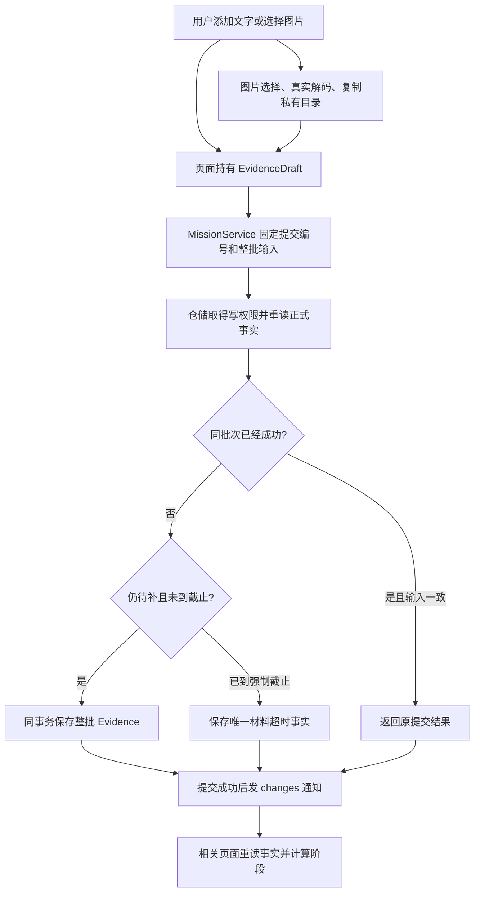
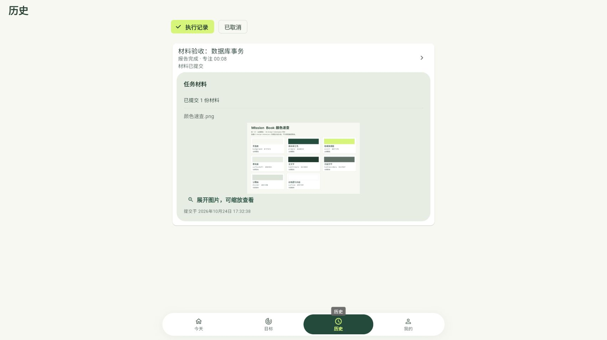

# U12：文本、图片与任务材料闭环

日期：2026-10-24。本文按真实调用顺序解释本轮实现；自动验证、平台实测和用户理解分别记录在[学习进度](学习进度.md)。

## 1. 用户操作与实际结果

用户希望顺手留下文本、截图，也允许普通任务不提交；只有明确要求材料的任务才必须提交。图片不要求填写解释，文本与图片可以混合保存。

新建页面默认“可选提交”，不强制材料说明；“必须提交”要求非空材料要求及明确截止时间。“仅自报”保留轻量路径和旧记录含义。策略与要求只在开始前编辑，不能在任务结束后改写历史要求。

| 用户操作 | 已保存的事实 | 页面结果 |
| --- | --- | --- |
| 任意策略报告未完成 | END + 未完成记录，同事务 | 执行结束，不要求补材料 |
| 仅自报，报告完成 | END | 查看执行记录 |
| 可选材料，选择直接结束 | END，submitOptionalEvidence=false | 任务结束，无欠交提示 |
| 可选材料，选择提交材料 | END，submitOptionalEvidence=true | 同一工作区整理材料，也可放弃 |
| 强制材料，截止前报告完成 | END | 执行已结束 · 待提交材料 |
| 待补时提交文本、图片或混合批次 | 同批全部 Evidence | 显示正式材料和提交回执 |
| 可选材料明确放弃 | Mission.evidenceWaivedAt | 任务结束，完成报告保留 |
| 强制材料到期未交 | 唯一材料超时 FailureRecord | 材料超时，完成报告保留 |

END 已保存就停止累计执行时间。整理材料的时间不加入 Focus。已关闭且没有正式材料的任务，不重新开放首批补交；选择稍后提交的可选任务可以一直待补，或者明确放弃。

## 2. 从哪里读代码

| 文件 | 本轮职责 |
| --- | --- |
| [evidence.dart](../../lib/domain/entities/evidence.dart) | 草稿、正式材料、稳定提交批次与结果类型 |
| [evidence_rules.dart](../../lib/domain/rules/evidence_rules.dart) | 文本/图片字段组合与材料要求校验 |
| [execution_event_rules.dart](../../lib/domain/rules/execution_event_rules.dart) | 复用唯一时间线核心，完整推导任务阶段 |
| [mission_service.dart](../../lib/application/missions/mission_service.dart) | 准备提交身份、图片准备、调用仓储、提交后通知 |
| [drift_mission_repository.dart](../../lib/data/repositories/drift_mission_repository.dart) | 写锁、事务重读、批次幂等、截止与跳过 |
| [evidence_mapping.dart](../../lib/data/repositories/evidence_mapping.dart) | 行对象与材料对象转换、重试输入比较 |
| [evidence_records.dart](../../lib/data/local/tables/evidence_records.dart) | 正式材料的 SQLite 列、外键与约束 |
| [app_database.dart](../../lib/data/local/app_database.dart) | schema v5，保留 v1—v4 原数据升级 |
| [evidence_image_service.dart](../../lib/application/evidence/evidence_image_service.dart) | 系统选择 → 大小/解码校验 → 私有副本 |
| [原生图片适配器](../../lib/data/attachments/evidence_image_native.dart) / [浏览器图片适配器](../../lib/data/attachments/evidence_image_web.dart) | 原生文件与浏览器 OPFS，平台差异留在 data |
| [mission_evidence_section.dart](../../lib/presentation/missions/evidence/mission_evidence_section.dart) | 共用草稿、图片预览、提交、放弃与正式阅读区域 |
| [mission_evidence_fields.dart](../../lib/presentation/missions/form/mission_evidence_fields.dart) | 表单材料策略、要求及截止输入 |
| [mission_inline_workspace.dart](../../lib/presentation/missions/execution/mission_inline_workspace.dart) | 今天任务行展开真实办理区，复用原执行组件 |
| [app.dart](../../lib/app.dart) | 装配图片适配器，前台生命周期与最近截止调度 |

按表格从业务对象往下读，再回到页面调用；不用先阅读生成的 app_database.g.dart。

## 3. 一次提交怎样流动



以上节点均有本轮实现。未来 AI 评价仍属于后续范围，当前提交成功只说明原材料保存成功。

具体例子：用户给任务 A 添加一段文字和一张截图。页面先保存两个草稿对象，文字可以继续改，图片已经复制进私有目录。点击提交时，prepareEvidenceSubmission 复制为不可修改的列表并固定批次编号。仓储统一捕获一次 UTC 提交时间，写入两条正式材料。保存失败时事务回滚，页面保留原草稿；点击重试沿用原编号和原内容。

构造对象、准备文件、保存数据库是三个不同步骤。只有事务成功才属于正式历史。

## 4. 为什么草稿与正式材料分开

EvidenceDraft 没有正式提交时刻；可以编辑或删除。Evidence 复用相同的内容结构，额外包含 missionId、submissionId、submittedAt。它们分别说明属于哪次任务、哪次批量提交、何时正式保存。

一张图片的 content 是可空说明；文本的 content 必须包含非空正文。EvidenceSource 只描述输入渠道，不证明作者或独立完成程度。

页面保存结果未确认时冻结该批输入，允许重试或重新读取。仓储先识别成功批次，再检查当前阶段和截止，因此已经成功的批次不会因为任务现在已关闭或后来超时而被错误拒绝。相同编号携带不同输入会冲突。

submittedAt 由取得写权限后的事务提供，同批相同；capturedAt 只有来源可确认时才有值，不用提交时刻猜截图产生时间。

## 5. 图片怎样保存

```text
正式数据库记录
  missionId: 任务 A
  type: IMAGE
  source: FILE_SYSTEM
  attachmentStorageKey: attachments/<任务编号>/<唯一图片编号>.png
  attachmentFileName: 运行结果.png
  content: null 或可选说明

私有文件
  原生：应用支持目录 / attachments / ...
  浏览器：当前访问来源的 OPFS / attachments / ...
```

先检查声明大小，再检查实际读取大小，单张最多 20 MiB；文件扩展名不能代替真实图片解码。成功写完副本才加入草稿，正式提交只写引用，不再复制一次。原文件被移动或删除不影响已经保存的副本。

每个副本使用唯一键，拒绝覆盖已有文件。文件名只用于展示，不能用它直接拼路径。原生适配器拒绝路径跳转和符号链接；Android 使用现有系统文件入口，复制移到后台并限制实际字节。

图片存储初始化在新草稿创建前完成：先读取正式引用，再清理应用附件目录中无引用的遗留副本。同一服务缓存初始化 Future，保证同会话的新草稿不会与初始化清理并发。主动丢弃只删除当前会话准备且没有正式引用的副本。浏览器不可持久存图时明确失败，文本仍可使用。

文件和 SQLite 不能共用一个物理事务。因此文件在事务前准备，数据库失败不立刻删除草稿副本；用户重试仍可使用。非正常退出留下的无引用副本，后续启动准备时回收。多进程/多浏览器标签并发编辑不作为本轮已验收能力。

可靠性补查：正式提交与草稿副本清理在同一 MissionService 内串行执行，避免“刚检查图片存在，另一个入口就把它删掉”的交错。清理排在提交之后时会重新读取正式引用；提交失败也会释放队列，后续重试或清理仍能继续。此保护补充数据库事务，不替代 SQLite 的跨连接写入保护。

## 6. 阶段与截止的关键保护

完整阶段通过 deriveMissionPhase 计算，继续调用原来的 _replayExecutionHistory。没有增加第二套开始/暂停/继续状态机，也没有写 phase 列。

仓储在同一读事务加载任务、排期、方案、全部执行事件、失败事实和正式材料；“未加载”不当作“没有材料”。查询只计算阶段；补算方法承担超时写入。

提交、放弃和超时都先取得 SQLite 写权限，再重读事实。两个入口竞争时只能依据最新事实成功一种结果。截止比较用 now >= deadline；恰好到期也不能再提交首批材料。发现已到期时正常返回 deadlineMissed，让超时事实提交，不能抛出异常把超时也回滚。

晚 END 同时写 END 和超时事实。超时发生时刻取 max(截止, END)，实际落库时刻另存 createdAt。未开始、仍执行、暂停、报告未完成或已经提交材料的任务，不因材料截止自动结束。

App 启动、回到前台及材料查询时补算；前台只针对最近的待补截止安排一次 Timer。切页或关闭应用不写 PAUSE/END；Focus 的每秒重绘不查库、不写时长。

## 7. 界面和路径

材料区复用现有暖白、森林绿、柑橘强调面及语义字号。文本有输入边界，图片有预览，说明标为选填；窄屏使用可换行操作区，正文可滚动。图片可原位放大与缩放，预览限制解码尺寸，正式原图字节保留。

- 最坏起点切到今天页 → 原任务行展开并开始/报告/整理 → 系统选择 → 返回该行提交：顶层切换一次，系统往返两次，共三次；原位展开不新增应用路由。
- 从当前执行快捷入口进入工作区 → END 后同区整理 → 系统选择 → 返回同区提交：最多三次必要跳转。
- 切到历史 → 在待补行展开 → 系统选择 → 返回该行：最多三次。
- 今天页提供跨日待补区，材料入口不受所选排期日期限制；详情也能继续整理。
- 提交回执和正式内容原位显示，不强制再跳一页。刷新保留编辑组件身份和草稿，超时或外部写入也先保留当前输入，让用户明确处理。

草稿只在当前会话保证；有内容离开会确认，进程退出不承诺恢复。系统选择取消、权限/读取/保存失败均回原上下文显示具体错误。

## 8. 验证与本轮边界

必要验证包括 v1—v4 真文件旧库保全升级、整批回滚、成功重试与输入冲突、独立连接竞争、截止等值、晚 END 原子性、页面广播与草稿保留、图片独立磁盘读取、无效/超限/缺失文件，以及窄屏交互。最终结果见[学习进度](学习进度.md)，不以文字约定代替运行证据。

本轮交付 U12、U13 及 U14 的图片选择/副本/预览部分。正式材料修正、其他材料类型、Android 拍照、目标归属、备份、AI 评价后续分单元完成；不把当前切片宣布为整版本地产品交付。

本轮静态检查及全量 233 项测试通过；Web 构建与 Android Kotlin 编译通过。隔离浏览器真实选择 PNG、不填说明提交，刷新后在历史读回图片的截图如下（测试任务及素材，不是用户学习成果）：



原五表研究基线保留在[成长数据与开发规划](面向Agent的成长数据与开发规划.md)。现在首先能可靠留下文本和图片，未来 Agent 才能引用真实产出；是否独立完成、是否掌握仍需额外依据。

实现沿用项目现有职责分层；职责分离参考 [Flutter 官方架构指南](https://docs.flutter.dev/app-architecture/guide)，迁移策略与验证参考 [Drift 官方迁移文档](https://drift.simonbinder.eu/migrations/)。这些指南按项目规模使用，不要求引入另一套状态管理框架。
