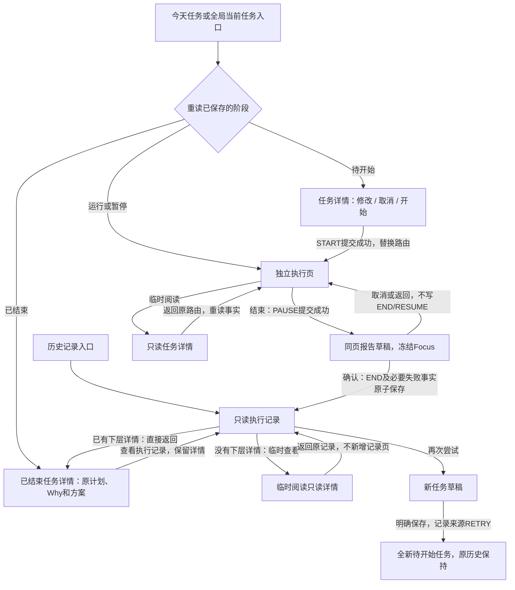

# 任务页面与执行状态流转

更新：2026-10-24。这里说明当前自报任务的真实实现；材料、目标树和AI评价仍待后续开发。设计图用于视觉参考，不提供业务数据。

## 三个页面各做什么

| 页面 | 内容 | 可以做什么 |
| --- | --- | --- |
| 任务详情 | 名称、阶段、排期、Why、方案，有内容才展示材料要求 | 待开始直接修改、取消、开始；已结束可查看记录；从执行/记录临时进入则返回原页面 |
| 执行任务 | 真实Focus、额度、延长、当前目标、可选暂停说明 | 运行时暂停/结束，暂停时继续/结束；结束报告在本页切换 |
| 执行记录 | 用户报告、冻结摘要、真实时间线，有填写才显示失败原因 | 只读；再次尝试创建新任务；没有材料/评价事实就省略相关区块 |

START成功以执行页替换详情；END成功以记录页替换执行页，因此该操作链返回直接到来源列表。之后从今天再次点击已结束任务，先读完整详情，“查看执行记录”使用普通压栈，返回仍为原详情。从执行或记录临时阅读详情只压入一层，返回复用原页面实例，不创建第二份执行/记录页，也不再次写START或END。页面入口意图不是另一个持久化任务阶段。

## 页面间怎样保持一致

1. `MissionService.execute/edit/cancel/create` 等待仓储事务提交后才广播 `changes`。通知表示“事实有变，需要重读”，不携带另一份可写阶段。
2. 今天、当前任务栏、详情、执行页和历史按各自职责重读。日期快速切换忽略旧响应，FutureBuilder也不会让旧Future覆盖新Future。
3. `MissionDetail.phase` 使用同一套时间线核心推导；列表的阶段和事件来自同一次读事务。页面不根据按钮点击或本地布尔值宣布开始/完成。
4. `calculateExecutionTimes` 是唯一时间计算入口。运行按事件与now计算；暂停/结束冻结Focus。实时标签只重绘，不每秒查库或追加事件。隐藏页及后台停止标签刷新，恢复后按真实时刻追上。
5. 退出执行页只是导航，不会暂停或结束。今天行显示执行阶段和Focus；全局当前任务栏不按所选日期过滤。运行/暂停点击直接进入执行页，已结束的今天任务先进入完整详情再查看记录；历史记录则直达结果。信息来源相同，阅读入口的意图不同。

## 报告与失败恢复

- 打开报告前先保存PAUSE，失败时仍留执行布局；已暂停不重复写PAUSE。
- 初始不代选完成情况，原因可留空。报告保留打开时的事件序号；其它入口恢复或延长后，不自动将旧草稿当成新报告提交。
- 自动状态同步保留草稿并禁用过期提交；明确刷新且仍暂停时才接受新序号。取消草稿不写RESUME，运行必须明确点击继续。
- 未确认的动作保留同一个事件编号和输入，“重试原操作”只确认或执行同一次动作，不重复延长/开始/结束。
- 另一个运行任务冲突不静默暂停。明确暂停对方成功后，仍由用户手动开始或恢复当前任务。
- 记录页以END时刻作为计算上界，不启动计时器。原因未填写就不造“未完成原因”空区块。
- 取消记录从历史的“已取消”找回，只显示真实取消时间、排期和没有执行记录。

## 数据与实现位置

schema v4在既有五表上增加Mission的来源编号与RETRY类型；v1/v2/v3按版本增量升级，旧任务新增列为空，旧事件和失败原因保持。重试来源在创建事务内验证为已结束或已取消；原任务不复活，新的事件序号从1开始。

- [详情与入口分派](../../lib/presentation/missions/mission_detail_page.dart)
- [执行与报告](../../lib/presentation/missions/mission_execution_page.dart)
- [只读记录](../../lib/presentation/missions/mission_record_page.dart)
- [动作等待、冲突与幂等重试](../../lib/presentation/missions/mission_action_controller.dart)
- [列表实时标签](../../lib/presentation/missions/mission_live_status.dart)
- [事务仓储](../../lib/data/repositories/drift_mission_repository.dart)
- [跨页面行为测试](../../test/presentation/mission_navigation_sync_test.dart)

自动测试与静态检查不能代替用户的浏览器/原生设备验收；当前没有正式材料、AI评价、目标路径或完整历史筛选，不把图中的例子显示成真实记录。
