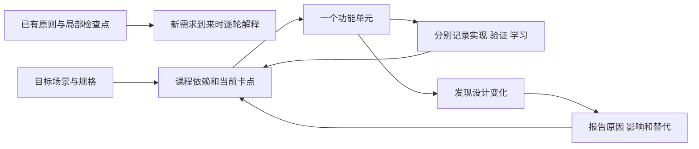

# MissionBook 教学与流程变更记录

## 2026-10-24：紧凑材料阅读与待做优先排序

- 用户反馈：历史图片占据过多空间，放大入口应在图片本身；记录与材料页文字层级不清，自选前三项可能被已结束任务占满。
- 实现：新增共用图片预览组件，历史112×104小图、记录双列；点击直接打开可缩放查看层。正式材料突出内容，文件名/要求/时间收起；结束工作区以森林绿摘要突出Focus，记录材料先于过程时间线。自选显示层按未开始、执行中/暂停、待补、已结束稳定分组。
- 追加反馈：图片查看层统一主页暖白底和深色文字/关闭按钮；背景铺满状态栏与底部区域，内容独立避让安全区，系统图标使用深色，避免灰色遮罩造成上下断层。带上下系统留白的组件测试检查查看层确实覆盖整屏；系统栏真实设备表现仍待用户设备验证。
- 边界：不更改数据库、文件引用、提交批次或执行事实，固定日程顺序保持；草稿与待补操作沿用原组件，不新增存储框架。实现、调用与截图见[U12说明](U12-文本图片材料实现.md#7-界面和路径)。
- 验证：静态检查无问题，全量239项通过、Web构建成功；390宽隔离浏览器验证历史/记录的小图、点击放大、关闭返回及展开信息。未构建新设备包或执行Android实机验收，未新增学习掌握结论。

## 2026-10-24：修复材料提交与草稿清理交错导致的图片丢失

- 实际复现：通过真实 SQLite 与独立临时目录，把提交停在文件检查后；另一入口清理草稿可删除图片，随后正式引用仍提交成功。
- 修复：MissionService 对材料提交与草稿删除使用同一串行边界，清理在提交后重读引用；失败不阻塞后续操作。保留原仓储事务、批次身份和界面流程。
- 回归：新增正常提交/并发清理保全图片、提交失败后仍可清理两项业务测试；前者修复前失败、修复后通过。完整检查结果见学习进度。

## 2026-10-24：实现文本图片材料、强制截止与 Today 原位办理

- 授权：用户要求开始实施，沿现有架构逐步完成，补足中文注释、完整思路及 UI/流程审查。前一轮 Git 保存和五表研究基线保留。
- 实现：schema v5 新增 Evidence 及材料放弃时刻，兼容 v1—v4；文本/图片、稳定批次重试、整批事务、放弃、强制材料补算和完整事实阶段查询接入。平台图片由 App 注入业务服务，SQLite 与文件职责分开；原生私有副本，浏览器 OPFS，Android 后台限量复制。
- 交互调整：新任务界面默认可选材料，可选验收说明选填，强制要求和截止必填，图片说明不强制。原 Today→详情→执行→选择器往返会超过三跳，因此增加原行工作区并复用同一执行组件；标题和独立详情路径保留。历史/待补区原位办理，刷新、超时、滚出屏幕及结果未知时保护草稿。
- 关键修复：Web encoded ImageDescriptor 不支持尺寸读取，改用跨平台首帧解码并保持原图；可选说明去掉必填星号；材料区独立辅助输入语义；END 后停止工作区每秒重绘；待补清空后原位回执使用“刚处理的材料”。
- 说明与范围：[文本图片材料实现](U12-文本图片材料实现.md)包含目录职责、实际调用图、对象来源、失败/重试、文件与事务、三步路径。提前接入 U14 图片基础是为满足用户本次真实提交方式，原课程编号保留；正式修正、拍照、其余类型及目标/备份/AI 不计为本轮完成。
- 验证：静态检查无问题，全量 233 项测试通过；Web 构建、Android Kotlin 离线编译通过。隔离浏览器来源验证图片真实选择、空说明提交与刷新后读回；其余平台实测边界见[学习进度](学习进度.md)。不把代码或测试结果写成用户已掌握。

## 2026-10-24：确认低负担材料入口与结束后的待补提示

- 用户取向：材料可以是文本、图片或两者一起；非强制材料可以不交。选择两种主要入口是为了便于持续留记录，不要求图片优先或每次填写解释。强制材料任务结束执行后未交，任务项应有提示。
- 约定与影响：在[交互规格](../需求文档v1.0/界面与交互.md#8-材料编辑)明确待补任务项文案、提交入口、同源查询、跨日找回及超时后的提示；可选材料明确选择稍后提交才进入待补。开发规划优先文本与图片的实际入口，图片说明可空。
- 保留与替代：用可选材料承接“可以交但不强制”，保留自报、强制材料、不可变 END、截止与阶段推演；不把图片作为唯一或强制默认入口，不新增系统推送承诺，也不放开已关闭任务补交首批材料。
- 验证边界：仅同步四份文档并检查差异空白与本轮新增链接目标；未修改业务代码、数据库或运行数据，未运行 Flutter/设备测试。讲解与需求确认不代表材料对象已落地或用户已独立掌握。

## 2026-10-24：从未来 Agent 的判断需求审查成长数据与开发顺序

- 授权与目的：用户要求先提交全部 Git，再详细理解项目与个人思路，研究数据如何支撑未来水平、经历判断与规划，给出可供后续安排的计划。
- 已完成：原改动提交 `f7fe078`；核对五表、应用服务、真实事务与一致查询，新增[研究与开发规划](面向Agent的成长数据与开发规划.md)，并同步文档入口和当前检查点；根 README 的历史页面占位说明按现状修正。
- 建议与原因：U12 后提前 U15 的目标/归属核心，使新材料拥有稳定方向关联；再完善强制材料、附件与备份，未来按真实入口增加帮助/上下文、可追溯评价和用户确认后的规划。特别标明现行正式材料分流不覆盖未完成任务的过程证据，未来须以真实入口补足；通知、导入等本地配套不冒充只读 Agent 的技术前置。原课程编号和现行前置保留，该推荐供用户安排，执行提前单元时再同步正式前置，避免误当全部顺序已经采纳。
- 替代与影响：原 U12→U13→U14→U15 仍可交付本地产品，但目标关联更晚；推荐方案需要在 U15 核心提前时联验自报与可选材料任务，补充节点语义变更边界。保留现有 SQLite、事件事实、唯一时间线核心、原子事务和用户决定权，不预建 AI 或空表。
- 验证边界：本轮仅源码/规格研究与文档检查，未改业务代码或用户数据，未重跑原有192项 Flutter 测试、Android 构建及设备验收；正式材料和 Agent 仍未实现，学习掌握不变。

## 2026-10-24：收拢普通组件，完成本轮开始任务与状态同步整理

- 授权：用户认可继续处理 missions 过细拆分，并明确本轮开始任务在处理后收尾。
- 调整：mission_schedule_card.dart 合回详情正文，名称／目标输入组件合回表单页面，移除 mission_form_fields.dart；已有输入样式和标签移至排期输入文件末尾供两处使用，不新建辅助文件，不引入页面与子组件的循环引用。功能目录、复杂排期输入、独立圆环绘图及多页共享代码保留。
- 保留：输入控制器的持有和释放、草稿、保存、返回保护、排期卡片布局和读屏语义保持；本轮未修改事件、事务、通知、查询和阶段推导，也未更改测试断言。
- 验证：flutter analyze --no-pub 无问题；flutter test --no-pub --reporter expanded 全量192项通过。设备实测仍采用用户之前“未发现问题”的反馈，不扩大成全部平台／重启／升级验收；本轮未新增功能。
- 收尾：本轮“开始任务＋状态同步＋文件可定位性”实现和自动验证完成。用户已理解整体原理和流程；数据库方法尚未细读，不记录为已独立实现或已掌握全部数据库细节。

## 2026-10-24：纠正今天页过度拆文件

- 用户澄清：分文件夹为了解决文件平铺导致找不到页面；普通页面区域应放在一起，只有状态复杂或独立性很高时再考虑拆文件。今天页保留显示转换文件，是为了避免大量转换函数遮挡页面主流程，不是为了追求文件更短。
- 调整：将本轮额外拆出的 today_date_header.dart 和 flexible_mission_section.dart 合回 today_page.dart，恢复文件内私有组件；保留 today_display.dart、schedule_section.dart 及 missions 的功能目录。页面查询、通知监听、导航、区域展开行为保持。
- 约定：取舍合并到开发执行计划第1节，索引、教纲和当前进度同步更新；不据此强制合并其他复杂页面，也不建立每次必须拆组件的规则。
- 验证：flutter analyze --no-pub 无问题；今天页、显示转换、日程组件和跨页同步相关31项测试全部通过；git diff --check 通过。未做新的设备验收。

## 2026-10-24：按页面归类目录并拆分完整界面区域

- 用户授权：任务相关文件平铺、页面过长导致难以定位，明确要求执行拆分。沿已讨论的 form／detail／execution／record／history／shared 目录组织，不引入新业务层。
- 调整：移动 missions 原有11个文件；今天页拆出日期头部与自选区域；详情拆出正文及排期卡片；表单拆出名称／目标和排期输入；执行页拆出圆环及双按钮展示。小组件留在所属区域文件，不要求每个 Widget 单独建文件。目录和中文职责见[页面代码索引](../../lib/presentation/README.md)。
- 状态边界：日历展开由排期输入区域管理，日期与时间策略通过回调立即交回页面；输入控制器、保存、错误及返回保护仍由页面负责。自选展开仍由自选区域管理。没有复制 MissionPhase、另建广播或改写事务、事件及时间推导。
- 配套：更新 AppShell、页面、测试的引用和教学文档源码链接，旧U06结构说明标明历史范围，保留已有未提交修改。
- 验证：flutter analyze --no-pub 无问题；flutter test --no-pub --reporter expanded 全量192项通过，含表单日历／固定时间、丢弃保护、详情和跨页执行同步。没有运行新的浏览器或原生设备验收，不改变用户掌握结论。

## 2026-10-23：新建与详情统一公共返回顶栏

- 用户授权：确认采用presentation/widgets公共UI目录，要求完成后查看；本轮只提取真实复用的顶栏，不增加业务或改其他页面主体。
- 调整：新增AppTopBar，一个文件统一圆形48返回按钮、24白色箭头、左边距24、80工具栏及16/24居中标题。新建页替换局部AppBar并传入原_requestClose和保存禁用状态；详情替换默认AppBar，使用maybePop普通返回。
- 原因与替代：替代两页各自维护样式，防止按钮对比色、位置、尺寸及标题对齐继续分叉；颜色仍取既有主题，不另建按钮组件、样式层或通用框架。
- 保留：页面返回保护、原表单和详情内容、路由跳数、SQL及数据库都保持，用户已有注释保留。widgets目录是项目组织约定，不冒充Flutter强制标准。
- 验证与学习：静态检查、已有页面测试补充公共几何和返回保护验证、浏览器检查见学习进度；本轮授权代写，不新增用户掌握结论。

## 2026-10-23：补齐新建固定排期并单独校准表单样式

- 原因与顺序：用户已能复述基本调用链，指定先完善新建任务，缺少具体开始时刻且字号、布局、选择框对齐不符合当前稿；本轮回到U06，不推进取消或第二个页面。
- 调整：创建页原位选择日期和自选／固定，固定小时／分钟按上海时区转UTC；MissionService.create增加有默认值的timePolicy及可空fixedStartAt，检查策略／时刻组合和当地日期归属，再复用原子创建。保留默认自选兼容原调用，不新增业务类、生产文件、表或依赖。
- 取舍：采用当前表单内展开的日历与24小时制时分输入，替代另开系统选择器，今天入口→创建（1）→原位反馈（仍1），返回查看列表为第2跳。完整目标树创建按已有第3跳表单原位办理，节点关联未实现，不能以展示样例路径假装已保存归属。创建不自动开始，也未接通提醒。
- 样式：标签／单位14、输入值18、设置名称／主操作16；日期和时长可见边框等高，时间胶囊选项与标签居中对齐，圆形返回的箭头明确白色。窄屏大字体纵排、键盘下保留滚动；未新增未接通的下拉和方案按钮。
- 用户补充：归属应由真实节点关联决定；临时任务隐藏节点，节点创建带入并保存，编辑读取原关联。返回按钮目前跨页仍未统一，本轮仅校准创建页，不将建议的公共样式冒充已全局落地。
- 验证与学习：最终命令、浏览器观察及设备边界见学习进度；本轮授权代写，不新增用户掌握结论。

## 2026-10-23：仅修正详情页绿色排期条

- 用户指出：绿色排期区域的文字和布局没有对齐已有设计稿；本轮范围限定为此区域。
- 修正：以日历＋固定/自选日期、时钟＋计划分钟数两栏替代四行信息列表，中间竖线分隔；去掉条内版本号和时区文字，文案与字体角色按详情设计稿。窄屏和大字体改为上下排列，保留完整文字；组件和格式化函数留在现有详情文件，无新增生产文件或目录。
- 保留：当前查询、记录时区换算、自选日历日期、其他详情区域和业务架构保持；不修改用户数据或加入未接通动作。同步界面规格 §5.2。
- 验证：详情及今天页24/24测试通过，包含常规手机左右对齐、窄屏双倍字体、记录时区和既有导航回归；静态分析无问题。本设备浏览器已实际看到真实任务的“自选时间／10月23日”和“计划／90 分”两栏。目标实物设备及用户掌握仍待确认。

## 2026-10-23：合并任务应用入口，entities 仅用注释区分对象职责

- 原因：创建、日期查询、详情查询都依赖同一仓储，逐操作定义类使装配和页面参数重复；同时 entities 中的单个业务实体与多表查询组合缺少明显说明，影响阅读。
- 用户约束：保留现有分层，以架构安全为先；所有业务对象仍放 entities，不建立 read_models 目录或额外抽象层。
- 调整与替代：以 application/missions/mission_service.dart 的 MissionService 直接承接 create、findScheduledOn、findDetail，删除原三个入口类；不再增加一个只转发旧类的包装。App 只构造一个服务并传给页面。五个 entities 类只增加中文分类及数据来源说明，位置、字段和类型保持。
- 保留与影响：原三个方法体逐一与修改前快照核对一致；模型去除注释后的定义也一致。表结构、生成代码、schema v1、仓储接口和事务规则未因本次聚合改变，用户已有详情页和其他未提交修改保留。页面行为及课程顺序保持，未新增页面、依赖、数据库表、编辑/取消动作。
- 验证：flutter analyze --no-pub 无问题，全量 flutter test --no-pub 66/66 通过；最终格式与差异检查见学习进度。测试覆盖既有创建校验和原子保存、列表/详情读取、文件库关闭重开、表单及导航等；不替代实物设备验收。用户理解待确认。

## 2026-10-23：U07 按单页面推进，先接通只读任务详情

- 原因与范围：用户明确要求一次只完成一个页面，通过 Git 看修改，并使用就近中文注释理解调用。U07 先落实任务详情阅读，不同时实现编辑页、改期表单或执行操作。
- 实现与取舍：今天页传入被点任务的唯一编号，GetMissionDetail 经现有仓储用一条关联查询取得任务、最大版本排期和方案；新增 MissionDetail 仅组合已有业务对象，替代直接把列表显示字段传入详情的做法。无新表、新依赖、迁移或状态管理框架。详情区域和格式化函数留在同一个页面文件，空的可选区域不展示。
- 交互与保留：详情是可选阅读页，不作为将来执行或材料链的必经中转；今天页进入、返回共两次跳转。固定、自选、取消项均可打开；重复点击只开一页，返回读取原所选日期。保留原今天页布局、时间轴、主动刷新、数据与全部保存逻辑。
- 边界：未提供尚未接通的开始、编辑、改期、取消动作。当前无执行事件，详情仅依据取消事实区分待开始/已取消；U08 接入事件时须改接统一阶段推导。后续完整动作规格保持。
- 验证：相关 30/30、全量 66/66 测试通过，覆盖最新排期、方案转换、缺失/异常、真实保存后阅读、四类任务入口、重复点击、读屏动作、窄屏大字体及原时间轴。目标设备未验收，用户 Git 阅读和理解待确认；最终检查见学习进度。

## 2026-10-22：空数据时两个区域标题常驻

- 原因：所选日期没有固定任务时，“计划日程”标题和“全部任务”入口整体消失；用户确认区域结构不应随数据有无变化。
- 调整：查询成功后计划日程、自选时间两个区域常驻渲染，空的一侧保留标题和头部入口，列表位置显示一行弱化提示（“这一天还没有固定任务/自选任务”）；移除整页“这一天还没有任务”空态与“这一天没有未取消的任务”替换文案，创建入口统一为页头加号。固定区空列表不启动每秒时钟，切回有任务的日期随重建恢复。
- 保留与验证：排序、折叠、时间轴、主动刷新和日期交互不变；同步界面规格 §4.1。静态分析无问题，全量55/55测试通过，含新增的区域常驻与空固定列表不读秒级时钟回归；未验收目标实物设备，无新增用户掌握结论。

## 2026-10-22：自选区同步紧凑文字与比例

- 用户要求：自选时间的文字大小与整体比例同步计划日程。标题改为14/20、时长12/18、两行间距2，图标底32、图标20、图标列48、行间距8；展开/收起文字12/18、图标18，触控高度保持48。取消区自选项复用，固定取消项排版保持。
- 保留与验证：不更改前三项预览、展开/收起、排序或数据；静态分析通过，全量48/48测试通过，浏览器已目视核对紧凑比例。未验收目标实物设备，无新增用户掌握结论。

## 2026-10-22：时间线首项从圆点起笔

- 用户指出首个圆点上方仍有线头；首段灰线和绿色进度改从圆点中心起笔，后续段继续从顶部接续。卡片与轨道的布局边界、伸缩和进度规则保持。
- 验证：静态分析通过，今天页12/12测试通过；像素回归同时检查首个圆点上方为背景，以及从圆点至激活项连线连续。浏览器已目视核对，无数据修改或新增学习掌握结论。

## 2026-10-22：计划日程向两端递减并收拢非激活项

- 原因：用户认为计划日程占据过多高度，希望当前激活项最大、向上下两端逐级递减。原来仅缩小12%且始终两行，压缩效果不足。
- 调整：固定标题从两端12递增到焦点16；非激活项标题与时长并排一行，上下留白2–6；激活项展开两行并保留上下12留白。两端分别归一化距离，重叠激活项均保持最大。时长先下移再左移，反向收拢，避免中间帧文字相撞；窄屏或系统大字体空间不足时保留两行。
- 保留与影响：沿用单一280ms动画和卡片/轨道逐帧等高，时间线保持直线连续，辅助字号不低于12；沿用真实计划区间、完整标题、时长、排序、主动刷新和所有数据，不新增执行事实。仅修改今天页UI、相关测试及说明，无新依赖或数据库变更。
- 验证：静态分析无问题，全量48/48测试通过；新增七项日程的双向递减、两端最小、激活切换和总高度检查，伸缩逐帧补充标题/时长不相撞与不越出卡片检查。窄屏双倍字体及绿色连续像素回归通过。当前浏览器实见紧凑渐变布局，未验收目标实物设备，无新增用户掌握证据。

## 2026-10-22：消除绿色连线断点并补当前激活样本

- 原因：灰色细连接与节点外白边造成绿色轨道视觉中断；原激活样本到期导致现场看不到高亮。
- 修复：已到达节点间连接使用相同绿色与2.5线宽，未来底轨1.5，删除节点外白边；到点先接通本项节点，之后在节点以下按本项计划时间推进。保留卡片/轨道等高动画、单行标题和真实时钟。
- 样本与验证：补入16:00–17:30的单条测试任务并移除临时写入脚本；静态分析及全量47/47测试通过，新增真实像素检查已到达轨道无灰白断点。浏览器实见连续绿线和激活卡片，不新增业务执行事实或掌握结论。

## 2026-10-22：每项轨道段与卡片共享伸缩布局

- 原因：用户明确激活段长度要与增高的卡片一致，关注左右布局联动，之前仅按相邻开始节点连接不能表达“一任务一段”的对应关系。
- 调整：每段从本项卡片顶部延伸到底部，二者共用 cardHeight；独立8像素段间连接。统一动画控制卡片留白、行高、透视焦点和轨道段高度，替代各自调整；内部文字保留轻透视。每段按本项计划时长填充，最后一项也有完整段。
- 保留与验证：既定计划时段高亮、字号、省略、排序、数据库和数据均保留；同步界面规格、设计参数与课程说明。静态分析无问题，全量46/46测试通过，包含放大/缩回各4帧等高与相邻位移检查；未验收目标实物设备，不新增掌握结论。

## 2026-10-22：直线时钟进度与克制的任务透视

- 原因：用户希望计划日程随当前时间出现绿色进度和时段高亮，随后要求更紧凑字号及轻透视；最新选择是时间线保持笔直，只让任务项表现远近和缓动。
- 调整：已有 today_display.dart 补时间投影，today_page.dart 固定区域负责时钟生命周期及显示；计划高亮用开始至计划分钟数的半开区间，允许重叠项各自高亮。标题16/22、辅助12/18，远端标题最低88%，最大倾角0.045弧度，焦点过渡280ms并遵循减少动效；轨道不随任务透视偏移。
- 影响与保留：扩展计划视觉，不改变执行状态、开始操作、数据库结构、已保存名称、查询排序、主动刷新和日期/自选交互；没有伪造执行/完成事实或空按钮。同步界面规格、设计参数与实装说明；旧PNG保留为原设计参考。
- 验证：静态分析及全量44/44测试通过，覆盖时间边界、重叠、回拨、恢复、无额外查询、窄屏大字体和连线；浏览器已观察计划高亮和透视；最终直线版预览服务已重启，浏览器控制连接不可用，待刷新核对最后画面。新增当前时段测试任务的临时脚本已移除；未验收Windows/Android实物，无新增学习掌握证据。

## 2026-10-22：任务名称改为单行省略

- 原因：用户在浏览器测试中要求固定和自选任务名称一行显示，溢出显示省略号。
- 调整与替代：共用任务文字组件限制一行并采用 TextOverflow.ellipsis，替代长标题自动换行；取消区沿用相同排版。数据库与读屏语义保留完整名称，没有新增输入长度限制。
- 影响与保留：保持时间轴连续、日期切换、排序、主动刷新和自选折叠；界面规格同步该显示约束。测试样本通过真实表单或一次性仓储脚本写入浏览器存储，临时脚本已移除，没有启动时造数逻辑。
- 验证：静态分析无问题，今天页 7/7 Widget 测试通过；当前浏览器已观察固定和自选名称省略，移除脚本后热重启及切换明天仍读回样本。未验收目标实物设备，不新增用户掌握结论。

配套入口：[教纲](教纲.md) · [学习进度](学习进度.md)。此文件记录教学路线、架构与业务流程的调整，不代替领域规格。

## CHG-009：按反馈修订新建目标的归属、视觉与返回路径

- 日期：2026-10-20；状态：原型候选和设计规格已修订，未实现应用交互。
- 原问题：把已有Flutter目标及节点统计放在新建表单上方，引起未创建目标已有节点的误读；重复方框、两个大标题及底部深色动作/导航造成视觉堆叠。仅替换配色没有处理用户要求的动画演进。
- 调整：独立手动表单仅呈现新目标草稿，以开放书写、下划线、按需展开和浅柑橘动作组织内容。JSON从目标页新建菜单直接选择，导入区仍在目标页；不让文件路径额外经过手动表单。手动保存成功返回来源列表，最坏起点计3跳；JSON文件仍为目标1、选择2、返回3。
- 动效设计：选填高度与后续内容联动，保存成功后标题衔接新卡；失败保留输入，减少动效时直接切换结果。它们是图片配套的设计说明，不是已运行证据。
- 取舍与保留：撤回在列表中展示无关已有目标的创建布局；保留字段、ACTIVE默认、明确确认、原子保存、校验和丢稿确认。课程依赖、数据库及现有业务源码不变。
- 交付：遵守用户仅生成图片的要求，本次修订只生成一张853×1844并替换同名图；误扩展新增的HTML小样已移除，历史其他预览保留。当时的“13-新建目标页设计说明.md”后来已移除，本条仅保留当时交付历史；当前入口和范围见[UI手册](../ui设计手册/README.md)，不以其他文件冒充原说明。
- 验证：已目视核对图片与尺寸、原图复制哈希；未开展运行、键盘、平台选择器或动效验收，不更新用户掌握状态。无需用户额外决定。

## CHG-001：把教学原则落为可执行课程

- 日期：2026-10-19；原因类别：教学组织缺口；状态：本轮已落地。
- 原状：已有教学原则、局部检查点和问题复盘，但没有覆盖成品的逐课依赖、每课验收及独立学习状态。
- 新证据：用户指出仅“从结果反推”不足以保证路径正确，并要求教纲、进度、设计解释与变更报告；自述能读部分代码、需要逐步解释。
- 调整：建立 U00—U20 共 21 个单元；当前定位 U03；每课列目标、前置、理由、取舍和验收；增加实现/验证/学习三条记录及两张解释图。
- 理由：让路线能被审查，让下一步取决于明确依赖与学习证据；避免代码通过就跳课、为教学不断替换可预见结构。
- 影响：教学文档、入口与后续协作约定；没有改变产品范围、数据库结构或运行代码。现有未提交的开发执行计划内容保留。
- 验收：课程 ID 与进度行一一对应；当前课承接已知卡点；新增文档可从入口找到；图片已核对。文档全量检查受既有缺口影响，见 G01/G03。



上图上行概括原先缺少显式课程控制的方式，下行为本次新增的教学记录流程；不表示历史上没有做过任何设计或验证。

## CHG-002：提前设置范围与交互决策门

- 日期：2026-10-19；原因类别：既有规格缺口与已新增的交互约束；状态：教纲已设置决策门，业务方案仍待收敛。
- 原状：多个文档引用缺失的本地应用规格；界面规格仍含多页结束/材料路径，而三步原则已指出它们超限。
- 调整：U00 先建立可追溯的课程验收映射；明确 G01 不能冒充补回正式规格；创建、结束、材料、导入、备份在实施前分别审查所有必经跳转。
- 影响：U06、U10、U12—U14、U16、U19 的交互；U17 的统计口径；U20 的交付基线。数据库配置与三表仓储可以继续，不必因此冻结全部学习。
- 保留：任务事件、材料、截止的既有业务规则；不能为了少跳转删掉确认、原子保存和错误反馈。
- 尚未决定：完整新交互路由及逐分支跳数。没有在本轮实施新的执行/材料页面，也不宣称已满足三步原则。

## 待解决事项

本轮图解表达的补充见 CHG-003；G01—G06 的原实现与规格状态不因图片生成而自动关闭。

| 编号 | 已观察事实 | 影响与处理时点 | 关闭所需证据 |
| --- | --- | --- | --- |
| G01 | 已于2026-10-23修复文档缺口：历史底稿经审阅后恢复为[现行本地应用规格](../需求文档v1.0/本地应用规格.md) | 当前范围、日期口径、三步路径与U08验收有正式基线；实现仍按课程推进 | 来源与修订原因见本轮记录；文档存在不代表功能已交付 |
| G02 | 结束、材料、文件选择等完整路线未证明符合三步原则 | U00 预审；各页面动工前画具体正常/取消/失败路径 | 前后流程图＋全部必经跳数＋目标平台实际操作；不是只看最短路径 |
| G03 | 已于2026-10-23修复本轮文档链接缺口；原历史检查曾有50条断链 | 已统一目录、恢复规格、标明已移除历史来源，并接通孤立制作记录 | 全量52份Markdown、527处本地链接与锚点通过，从根入口均可达；不代表平台功能验收 |
| G04 | 执行计划描述去除重复顶栏，源码仍有空 AppBar | U01/U06 的真实界面核对 | 确认最终页头职责，修复后在设备检查，不靠注释判断 |
| G05 | pubspec 的临时约束说明提到 Flutter 3.41，本次环境为 3.47.4 | 后续工具链维护；本轮不改锁定依赖 | 验证约束仍否必要、生成兼容性和测试，不能只因说明旧就删依赖 |
| G06 | Windows 分发方式与部分平台通知能力尚未形成本轮实测证据 | 平台接入前先做小型能力核验；U18/U20 收敛 | 分发方式、系统版本、权限与通知行为证据；不得只按插件依赖推断 |

## 本轮教学材料复查

- 教纲、进度、首课及配图由独立审阅再次核对源码与领域规格；开库过程还对照了项目锁定的 Drift 2.34.0 实现。
- 已修正新增材料链接锚点；已把“草稿保留”限定为当前提交失败场景，进程退出不保证恢复。
- 新增文档纳入 `tool/check_docs.py` 的链接、锚点、可达性与规格检查；最终全量检查仍有原先的 50 条断链，没有新增教学文档错误。G01/G03 没有被标记已修复。
- 交互课程地图包含 U00—U20；已实测 U04/U13 选择会更新前置、目标、理由、验收和三项状态，736 px 和 320 px 下已检查排版。地图默认当前课程 U03，不提供自动勾选掌握。
- 两张解释图使用内置生图工具生成并视觉复核，文件及完整提示词见[配图说明](配图说明.md)。

## 以后怎样报告一次变更

普通实现细节可在授权范围内继续，不为每个变量名请求确认。涉及产品范围、用户数据处置或不可推断的设计选择时，先把方案、影响和建议做成可审阅结果，再问真正缺失的信息。无需把所有教学拆分都变成审批流程。

```text
CHG 编号 / 日期 / 状态：建议、已决定、已实施、已验证（按实际填写）
原因类别：新需求 / 实际平台限制 / 原设计遗漏 / 教学粒度调整
原方案：
新证据或出现的问题：
调整方案与理由：
一个主要替代方案及为何未采用：
影响：代码 / 数据与迁移 / 页面路径 / 课程顺序 / 验收
保留内容与回退方式：
需要用户决定的事项：没有则写无，不额外审批。
实施与验证结果：
```

业务流程改变时同步领域、数据、交互及验收中的相关来源；教纲只链接它们。图应有变更前后、适用课程和实际状态；没有验证的新图标为方案。

## CHG-003：完整功能图与架构图采用图片生成

- 日期：2026-10-19；原因类别：用户澄清图解交付范围；状态：七张定稿已生成并逐张视觉核验，已接入教纲。
- 原状：只有一张三层基础与待接通链路图、一张教学推进图，完整课程主要以文字及交互卡呈现。
- 新证据：用户明确需要通过图片生成完整功能流程、架构关系，尽可能图形化，帮助理解整版产品与具体分支。
- 调整：以一张完整功能总图加六张分图覆盖任务生命周期、结束与材料、目标大纲、完整技术架构、本地系统流程及图形化开发教纲。教纲优先展示生成图片，文字保留设计理由与验收，交互课程卡作为辅助入口。
- 理由：总图帮助定位功能；分图展开正常、取消、失败、截止、修正与重试的具体去向。避免把所有细节塞进一张难读的大图，也避免只提供当前局部骨架。
- 影响：教学图片、图解入口、提示词记录和协作约定。没有新增业务范围、数据迁移、页面路由或学习通过记录。
- 图中业务步骤不直接等于独立页面；三步路由仍须结合系统选择器、必要返回和实际设备审查。没有通过图解绕过 G02。
- 视觉复核修正：结束确认不重复 PAUSE；开始后不再调整排期；纯元数据编辑不增加排期版本；取消任务也可重试；目标保存不自动创建临时任务；运行中不能直接 RETRY；domain 不依赖 data；查询覆盖来源与读写箭头准确；教学循环按 1→2→3→4→5→6 推进。
- 定稿图片及阅读顺序见[完整功能图解](完整功能图解.md)；完整初始与编辑提示词见[生成提示词](制作记录/功能图解-生成提示词.md)。
- 最终核验：七张均为内置生图生成的 1586×992 PNG；完整材料图按三个独立触发过程展示，提交区的三条通道无交叉，超时通道不写正式材料。定稿与提示词已保存在仓库，未采用的草图保留在被忽略的本地 output 目录。
- 文档复查：图集引用与新增教学文档没有新增断链；全仓库仍保留既有 50 处断链，G01/G03 的状态不变。`git diff --check` 通过。本轮未改运行代码，没有重新执行或扩大应用测试，也没有把图解核验算成用户掌握。

## CHG-004：按职责统一文档与图片目录

- 日期：2026-10-20；原因：用户要求整理、归一化目录结构；状态：目录与引用已更新。
- 调整：开发执行计划从 docs 根目录移入教学目录；UI 初稿和正稿移入 UI 手册的 assets 下，保留原版本名称；修正旧图片引用、协作入口和颜色生成工具的资源目录。
- 理由与替代：按现有职责归并，避免说明与图片平铺；未采用全仓目录改名或重新分层，保留 Flutter 默认平台结构、源码分层、生成代码位置及结构快照路径，不引入无使用者的目录。
- 影响与保留：只调整文档资源路径与生成工具输入输出路径；已有用户修改、图片内容、业务规则、课程顺序和 U03 当前卡点保留。可按反向移动及相对路径更新回退。
- 验证：文档检查从 50 处断链减少到 28 处，图片相关路径已修正；其余为缺失本地应用规格和 output/ui-prototypes 说明，G01/G03 仍未关闭，不为通过检查虚构来源。未执行 Windows PowerShell 调色板生成，未开展应用设备验收。
- 学习：本轮为目录维护，没有用户复述或独立操作证据，不改变掌握状态。

## CHG-005：课程正文与生图制作记录分开

- 日期：2026-10-20；原因：用户指出教学目录仍混有工程提示词。
- 调整：完整功能图提示词移入制作记录子目录；基础配图说明中的生成过程、核验与原始 Prompt 单独归档。保留课程图、文字语义与当前学习入口，更新全部引用及后续存放约定。
- 取舍：归档保留生图复现依据，不在课程正文平铺制作过程；不删除原始资料，不改变业务架构或课程顺序。
- 验证：本地文档检查仍为原有 28 处缺失来源，无新增断链；本轮未改业务代码或开展学习验收。

## CHG-006：删除工具及临时输出目录

- 日期：2026-10-20；依据：用户明确要求删除 tool、output。
- 实施：删除检查、图标、色板及博客配图脚本，删除本地生图草稿；正式图片、应用资源、源码及数据库快照保留。移除现行文档的工具命令、目录约定和临时输出链接；历史检查记录保留，所列工具已删除。
- 影响：仓库不再提供原文档检查和资源生成工具；需要重新制作资源时使用新的明确任务。保留 output 忽略规则，防止以后临时输出误提交。
- 验证：删除前临时留在仓库外的检查器用于本轮核验，剩余 16 处均指向原缺失本地应用规格；目录已不存在，git diff --check 通过。未运行应用测试，未变更课程或掌握状态。

## CHG-007：前次教学规则修订（历史，已由 CHG-008 统一）

- 日期：2026-10-20；依据：用户要求渐进讲解、保持代码逻辑，并将教学规则写入文档。
- 实际过程：助手先拆分代码块，后改为完整函数注释，又将规则缩成“一句用途”等要求，多次局部追加均未解决用户反馈。用户指出拆散函数无法理解；“主要靠注释”“固定句数”等是助手当时采取或概括的办法，不能据此宣称是用户确认的教学方案。
- 已有结果：入口、执行计划与进度曾被修改；Mission 转换函数后来获授权写入并通过该文件静态检查。没有新增用户掌握证据。
- 本次处理：将重复补充合并为此历史摘要；当前执行规则及修订范围见 CHG-008，不能继续按本记录中的旧办法教学。

## CHG-008：根据完整反馈统一教学约定和当前状态

- 日期：2026-10-20；用户要求：切换模型后重新理解需求并更新文档；状态：8 份文档已统一修订并完成核验。
- 原因：此前只围绕最近一句抱怨追加局部规则，产生机械拆代码、只靠注释和限制句数等过度概括；教纲同时要求固定交付、复述和先回 U03，进度顶部还声称没有代写实现。
- 统一理解：以完整功能单元和真实调用为主线，渐进展开业务需要、结构依据、输入处理及结果；代码与必要解释就近衔接，保留完整逻辑。精简靠去重复和聚焦，不省略前提，也不固定代码块数量或只允许注释。
- 取舍：直接整合入口、执行计划、教纲及进度，替换冲突正文，合并重复聊天记录；未另建一份规则清单。取消强制附加问答或替代方案，但保留有助于当前理解的必要澄清、练习和设计比较。
- 状态修正：当前是 U04 的 Mission 转换函数；函数存在且此前静态检查通过，仓储与事务未实现，用户理解仍未讲通。U03 保留回查资料，原图和历史检查点注明快照时间，当前位置以学习进度为准。
- 影响与保留：只修订教学表达、衔接和记录口径。U00—U20 的功能依赖、业务规格、架构、三步原则、图片资产及现有源码保留；没有改数据库或应用行为，不需同步业务规格或重做架构图。
- 验证：独立只读复核确认规则及当前状态一致；本轮扫描全仓 Markdown 的本地链接和标题锚点，没有新增问题（此扫描口径下原有 13 项）；教纲及进度 U00—U20 编号齐全，lib/test 文件哈希与本轮开始时一致，git diff --check 通过。未运行应用测试，不将文档修订记成用户掌握。

## 2026-10-21：U06 今天页真实查询与学习侧重点

- 用户意图：先实现今天页，理解数据流程和大概处理，不以逐行手写或背 API 为目标。保留用户已经添加的任务反向转换，由助手接通当前页面所需链路。
- 实现：新增 ScheduledMission 结果结构与 WatchScheduledMissions 查询入口；既有 MissionRepository 增加一个按计划日期订阅的方法，真实仓储关联任务及最大版本排期并排序。App 共享数据库，今天页接 StreamBuilder，显示固定/自选任务、加载/空/错误、取消折叠和日期选择；表单沿用所选日期。
- 设计取舍：两种安排共用一个日期查询，按 timePolicy 分区；结果同时携带任务与当前排期，避免页面访问 Drift 行类型。单独的查询入口保留既有创建职责；查询流在事务提交后更新，页面不手动拼接新记录。相关结构都是本轮真实调用所需，不提前增加通用仓储框架或数据库表。
- 影响与保留：没有修改 schema 或用户数据库；保留当前创建校验、三表事务及用户 missionFromRow。旧查询图标明接通前快照，新说明补实际类名、状态和验证。固定时间录入、执行事件、材料及历史入口未扩展；页面不使用示例任务、虚构计数或空按钮冒充功能。
- 验证：flutter analyze --no-pub 无问题；flutter test --no-pub 29/29 通过。新增覆盖最新版本与改期、排序及同值、查询流、真实内存数据库创建返回后更新、异常重试、日期切换、窄屏和订阅释放。未做设备或跨进程文件持久化验收。
- 教学材料：[今天页真实列表](U06-今天页真实列表.md)。下一轮聚焦查询接口一行签名，再沿调用解释；实现通过不自动记录为用户掌握。

## 2026-10-21：U06 一次查询与主动刷新

- 原因：用户无法从嵌套 watch/map 和整页重写中理解转换顺序、页面方法关系，并提出下拉和新增后的刷新方式。
- 调整：用 Future/findScheduledOn/GetScheduledMissions 表达一次读取，按查询阶段和逐行转换展开仓储；页面统一加载入口并由明确事件调用，布局组件只展示。取消原持续订阅、生命周期观察和午夜切日计时器，所选日期由用户保留/切换。
- 替代与影响：watch 是数据变化驱动而非轮询；保留为后续需要多处实时写入响应时可考虑的方案。本轮选择主动刷新，关闭新建页后刷新一次；取消返回也刷新。三层职责、当前排期规则、日期/排序、表单保护、测试数据及 schema 均保留。
- 说明与小图：U06-今天页真实列表.md 改为当前调用链，另列旧 watch/map 的逐层类型解释。旧图片为历史快照，不以图片中的旧类名作为当前事实。
- 验证：flutter analyze --no-pub 无问题，flutter test --no-pub 30/30 通过；Android x64 debug 构建、覆盖安装及冷启动列表通过，现有全部 44 行数据保留。未据此标记用户掌握或实物设备验收。

## 2026-10-21：今天页对齐当前正稿的颜色、字阶与时间轴

- 根据用户提供的实际页面和参考截图，对齐既有 design-tokens.json，不更改业务规则或架构。
- 修复旧配色与默认大区块标题；固定日程从孤立圆点改为连续竖线，行高跟随真实文字内容，首尾不伸出多余尾线；统一自选图标、日期/区块间距和胶囊导航。
- 仅渲染层修改。查询、主动刷新和数据保持，未以静态原型中的“当前任务”或材料数冒充业务能力。
- 验证：30/30 测试及静态检查通过，颜色角色与正稿 JSON 契约一致；模拟器实际画面已核对，覆盖安装前后全部 44 行应用数据一致。

## 2026-10-21：按页面区域组织代码，集中准备显示数据

- 原因：用户指出 TodayPage 难以直接对应顶部、固定任务、自选任务三个视觉区域；通用分区和通用任务行包含多种布局判断，时区、日期、文字与分组处理散在 Widget 中。
- 调整：TodayPage 保留加载状态及交互；新增 TodayHeader、FixedMissionSection、FlexibleMissionSection 三个区域；共用文字排版单独复用。移除 _DayMissions / _MissionSection / _MissionTile 的多层组织；时间轴绘制留在固定区域内部。
- 转换边界：今天页专用 TodayDisplay 在每次查询成功后，将业务结果整理一次为 TodayMissionGroups / TodayMissionItem。日期键、星期、固定时刻的时区换算、计划时长文字和取消优先分组集中处理。重建布局复用已保存结果；字体缩放和节点尺寸继续由布局处理。
- 取舍：引入两个只含显示字段的不可变结果类型，换取 Widget 不再反复遍历分组和换算时区。没有引入通用 Utils、Controller 或状态管理框架；既有数据库行转换保留在 data 层，避免存储规则与显示规则混合。图示与调用例子同步至 U06-今天页真实列表.md。
- 影响与保留：只调整表现层组织，业务规格、schema、数据库读写接口和实际用户数据不变；主动刷新、日期选择、请求乱序保护、创建返回、取消折叠、文字样式与连续时间轴保留。用户原有“构建元素”注释保留。
- 验证：静态检查无问题，33/33 测试通过；补充显示分区、跨日/夏令时、取消固定行及父组件重建复用已有显示数据。未重新构建或安装设备包，不把此前设备截图或本轮测试当作重构版的设备验收，也不标记用户已掌握。

## 2026-10-21：自选任务默认前三项，补全部任务入口

- 用户要求：自选时间默认折叠显示 3 个，计划日程右侧补全部任务按钮；随后明确全部任务的范围还没想好，先不实现。
- 调整：FlexibleMissionSection 仅新增本区域的展开状态，默认取前 3 项，超过时提供展开全部和收起；完整显示数据仍保留，展开不重新查询或转换。固定区域标题右侧补禁用的全部任务入口，不接空回调或临时页面。
- 影响：仅调整今天页局部展示，沿用数据排序、查询和取消折叠；需求说明同步记录本轮确认及暂缓范围，没有扩展到跨日期查询、阶段或 Goal 筛选。
- 验证：静态检查无问题，34/34 测试通过，覆盖默认前三项、展开/收起、三项无需折叠、父组件重建保留展开状态、点击不查库及禁用入口位置。未更新设备包，用户实际验收待确认。


## 2026-10-22：今天页 UI 与显示转换按两个文件组织

- 原因：用户要求减少今天页的文件拆分，将 UI 和用到的转换方法明确区分。
- 调整与替代：保留 today_page.dart 和 today_display.dart。页头、固定区、自选区、任务行、共用文字及时间轴集中于 UI 文件，内部组件私有；复用界面由 StatelessWidget 承接，替代跨文件 build 函数。显示转换改为顶层函数，通过 display 导入前缀调用，替代只有静态成员的 TodayDisplay 类；分组与行显示结果仍同文件保存。
- 影响与保留：仅改变表现层文件组织及内部封装，没有改变应用/领域/数据层的职责或业务路径。主动刷新、日期切换、请求乱序保护、创建返回、取消折叠、自选前三项与展开、禁用全部任务入口、配色及连续时间轴均保留；数据库、业务接口、排期规则和用户数据不变。业务规格无需调整；教纲、当前课说明与关系图、学习进度同步实际源码。
- 验证：flutter analyze --no-pub 无问题，flutter test --no-pub 全量 34/34 通过，格式与 git diff --check 通过。页面测试检查公开行为，不再引用内部区域 Widget 类型。未构建安装设备包或新增设备验收，也不据代写标记用户掌握。


## 2026-10-22：修复日期及无障碍语义问题，统一错误契约和可读性

- 原因：自检已复现设备跳日时区下合法日期被拒绝、导航语义缺少点击动作、填写后的输入节点缺少用途标签；用户要求修复并保持代码易理解，避免为压缩代码使用不必要简写。
- 调整：日期校验放入现有排期模型文件，由创建/查询共用；以年月日和 DateTime.utc 的普通字段比较替代设备本地 DateTime 解析。UTC 对象仅用于验证日期合法性，排期事实仍为原始 YYYY-MM-DD 字符串。没有创建通用 Utils 或额外目录。查询入口统一用 async/await 传递错误；旧的同步抛错断言相应改为等待 Future。
- UI 修复：导航的触屏与读屏共用真实切页回调；表单保留视觉布局，将外置标签从读屏树排除，再为输入节点提供用途标签，不屏蔽编辑动作。用普通 if/else 代替嵌套按钮文案表达式，补充契约说明及格式整理；教学执行计划合并可读性要求。
- 影响与保留：输入/异常及无障碍行为得到修正，三表事务、查询排序、最新排期、主动刷新、两文件 UI/转换组织、自选展开和用户数据均保留。现有领域/数据规格已经要求日历日期不冒充绝对时刻，本轮是实现对齐，无新增业务规格或课程顺序变化。
- 验证：静态分析无问题；当前环境及命令级 TZ=Pacific/Apia 下全量分别 39/39 通过；格式与 git diff --check 通过。新增五项正式回归检查，并补充非法日期边界、Future 错误、无障碍状态及动作断言。文件持久化在临时目录中验证关闭重开，不替代真机重启、TalkBack 或 Windows 辅助技术验收；不标记用户掌握。


## 2026-10-22：本设备浏览器开发预览与独立本地存储

- 原因与授权：用户希望在本设备通过浏览器预览当前应用，并要求提交已有修改；先提交 `5d15f38`，再适配 Web。
- 调整：在既有 AppDatabase 中补充 Web 连接配置；Worker 和 WASM 作为 Web 运行资源提交，新增实际使用的 Worker 编译入口和启动说明。原生文件与浏览器 OPFS/IndexedDB 使用同一 schema、转换及事务；两端存储独立，不提供同步。
- 替代与依据：没有另建 HTTP 后端、Web 仓储或 UI 分支。官方旧 Worker 的内嵌 SQLite 接口与当前 lock 里的 sqlite3 3.5.2 不匹配，因此使用当前依赖编译 Worker；补齐现有通知插件所需的 SDK 注册库。拒绝纯内存回退；不以临时保存冒充持久化。升级依赖后按开发说明重编译资源。
- 影响与保留：增加当前创建、查询和刷新功能的本机 Web 预览，不扩大 Windows/Android 正式交付或未实现功能。原生数据库、schema v1、用户数据、主动刷新、日期校验、无障碍语义、两文件 UI/转换组织及课程顺序保留。数据落地与平台规格补充预览范围；README、开发说明及学习进度同步，说明包含当前平台连接图。
- 验证：静态分析和 39/39 测试通过；Web release / WASM dry run 通过。内置浏览器真实表单保存、返回刷新、整页刷新及关闭后重开读回通过；仅创建带【Web验收】标题的浏览器样本。资源 GET 与哈希检查通过；未执行公网发布、跨端同步或原生设备安装，也不标记用户掌握。

## 2026-10-23：提取公共确认框并个性化丢弃提示

- 原因与授权：用户确认公共组件方案后要求实施并查看效果；原新建页内嵌 AlertDialog 采用默认排版。
- 调整：新增 presentation/widgets/AppConfirmDialog，以 Dialog 保留框架弹层、焦点和读屏角色，自行排列标题、正文与双按钮；同文件 show 方法统一把未确认的关闭转换成 false。新建页仅替换弹框调用，hasInput、保存保护、防重入和 mounted 判断继续留在页面。
- 外观与响应：使用现有主题白色面、森林绿主按钮及描边次按钮，24圆角、20/28标题；390宽等宽横排，窄屏或大字体纵排，内容可滚动。参数和范围同步颜色与布局规范。
- 保留：不改变领域、数据库、表单保存和用户输入；不改本轮开始前已有的 today_display.dart、today_page.dart 本地修改。没有增加第三方依赖或全局弹框配置。
- 自动验证：flutter analyze --no-pub 无问题；flutter test --no-pub 全量76/76通过。覆盖确认结果、遮罩/系统返回保留表单、空表单直退、读屏名称、390宽等宽及320宽双倍字体矮视口滚动。设备验收及用户理解另行记录。
- 浏览器验证：本机8085预览实测390宽横排、320宽纵排；输入“阅读 Flutter”后继续填写保留标题，明确放弃才回今天页，列表未新增任务。截图：[标准宽度](../开发/assets/web-confirm-dialog-20261023.jpg)、[窄屏](../开发/assets/web-confirm-dialog-narrow-20261023.jpg)。该证据为浏览器实测，不替代Android/Windows设备验收。

## 2026-10-23：任务详情接通取消业务

- 原因与授权：用户选择由助手实现完整取消流程，再结合真实代码学习。新增取消仓储接口及 MissionService 方法，保留现有分层与实体目录，不新增表、依赖或生产业务类。
- 事实与事务：重读任务后首次取消只改取消/更新时间，已取消直接返回；原任务、全部排期版本、方案和其他任务保留。不存在或写入失败明确报错，事务失败可重试。当前三表没有执行事实；接入 START 时须在同一写事务中补开始/取消互斥，不提前宣称已支持执行后的阶段限制。
- 页面与结果：详情增加取消次级操作，公共框提供保留/确认；遮罩和系统返回不写入。忙碌状态防重入和离页，请求序号隔离换任务的旧结果。保存失败保留原详情供重试，成功后读取真实取消事实。快速查询错误在 FutureBuilder 下一帧订阅前也有接收者，仍显示正常读取错误，不伪报取消失败。
- 保留与范围：今天页原有关闭详情后按原日期重新查询，以及按 cancelledAt 分组的行为直接复用，未修改今天页生产文件。取消记录显示取消时间和没有执行记录；取消后移除取消入口。编辑、改期和执行仍待后续。规格、教纲、学习进度与 U07 讲解同步。
- 验证：静态分析无问题，全量88/88测试通过，git diff --check通过；真实仓储覆盖字段/全历史保留、重复并发、错误回滚与文件库重开，详情覆盖异步与失败分支，完整Widget路径使用真实仓储。浏览器只新建并取消明确标注的验收样本，保留/确认/列表折叠/整页刷新后读回均通过。Android/Windows安装包与实物未验收，不标记用户已掌握。

## 2026-10-23：弱化今天页已取消分区的默认控件样式

- 原因：用户指出原取消区域的边线和划线标题太突兀。
- 调整：仅修改 today_page.dart 内已取消折叠区的局部样式，展开/折叠都不画上下框线，14次级色标题、18箭头、至少48头部触控高度；取消行移除删除线，次级色500字重，取消自选图标与页面融合。沿用现有主题，不新增组件或全局主题配置。
- 保留：取消状态、分组、读取、折叠状态与详情入口不变；普通任务样式、用户已有日期选择和留白修改保留。设计规范同步记录。
- 验证：静态检查无问题，今天页20/20测试通过，浏览器实际展开核对并保存截图；未更新或验收Android/Windows安装包。

## 2026-10-23：已取消头部按压形状与反馈颜色修正

- 用户指出标题交互时直角灰块难看。保留 ExpansionTile 的折叠与语义，在局部 Theme 设置内部 ListTile 的圆角形状和品牌色低透明反馈，头部留白12；作用范围仅已取消分区，不更改全局控件样式。继续保留原来的无边框与弱化文字。
- 静态检查和今天页20项测试通过；浏览器600ms长按验证展开，已保存交互反馈截图。无业务或数据库改动。

## 2026-10-23：按原稿收拢已取消底部入口

- 原因：整行折叠标题增加内边距后偏离页面文字基线，用户指定参考原稿底部左右分组入口。
- 替代：today_page.dart 用页内私有取消分区替代 ExpansionTile；上方细线贯穿内容区，紧凑图标、文字、数量徽标与箭头靠右，左侧留白。局部圆角按钮仅在自身范围反馈；展开列表仍为整行，保留语义、默认折叠和刷新后的显示状态。无新增目录、公共组件或业务接口。
- 验证：静态检查无问题，今天页20/20测试通过。浏览器核对默认折叠、展开、600ms长按和320宽手机布局，未溢出；开发预览已更新。Android/Windows安装包未更新，用户认可及掌握待确认。

## 2026-10-23：创建页日历在小数逻辑宽度下的渲染断言修复

- 用户日志指向 CalendarDatePicker，月份页宽378.6666666666667、总滚动宽45435456.00011881，触发 RenderSliverFixedExtentBoxAdaptor 的倍数精度断言。用1280物理宽、像素比3精确复现同一数值；1至9999年的月份范围与小数页宽组合使滚动长度累计产生浮点误差。
- 最小修复：仅在创建页原位日历外通过 LayoutBuilder 读取可用宽度，向下取整后 SizedBox 约束并居中，最多减少不到1逻辑像素。保留完整日期范围、上海日期转换、选择后收起和保存锁定；无SDK修改、无依赖或数据库变更。
- 验证：新增真实屏幕比例的回归测试，修复前出现用户原断言，修复后覆盖打开、翻月、选日、再次打开和未提前写库。静态检查无问题，全量89/89测试通过，开发Web预览已热重启。未重新安装或实测Android/Windows安装包，不据测试结果声明实机验收完成。

## 2026-10-23：时间轴改为连续的当前时间进度

- 原因：用户指出只有一个未来任务时没有实际当前时间，也没有绿色经过段。原实现把绿色分别绑定每条任务的计划时长，“现在”仅在计划时段内出现；这无法完整表达整条时间轴的时间经过。取消单项竖线的建议不适用，旧规格中的首项起笔和逐任务填充规则由本条替代。
- 实现：today_page.dart 的固定分区接收所选日期，统一轨道绘制器用任务开始时刻与当前帧节点位置投影真实时钟；当天上下边界各留36，段间8像素和原卡片动画测量保留。绿色在唯一的当前时间短针结束，之后为浅色；临近节点保留12像素最小间距，避免把未来空心节点误看成已到达。实际“现在 HH:mm”在区域标题下持续显示，仅查看当天有固定任务时显示当前时间与短针。过往日期显示已流逝的绿轨，未来日期不填绿。
- 保留：计划时段卡片高亮、原任务点击/详情、固定与自选分组、取消、时区说明、字号/缩放和减少动效逻辑；绿色只表示时间经过，不产生执行或完成记录。默认所选日期与轨道使用同一注入时钟和上海时区，便于真实边界验证。不新增公共框架、数据表或依赖。
- 验证：静态检查无问题，全量91/91通过（今天页22项）。新增单个未来任务的真实像素回归，覆盖首项之前绿轨推进、未来空心节点不被当前指针覆盖、末项之后、跨日、回拨和不重复查询；新增两项空档唯一当前时间验证。更新旧逐任务/首节点起笔断言，保留稳定时段任务文字不重建、绿色实际推进、节点连续及动画逐帧几何检查。
- 浏览器：仅新增明确标注的两个验收样本，14:00/20分钟和16:30/30分钟；分别核对单个未来项及两项空档，390和320宽显示无溢出。截图见单项和空档效果；未修改用户原有任务，未安装或验收原生设备，用户认可及理解待确认。

### 2026-10-23：同步云端并接通编辑与改期切片

- 用户自述已理解此前流程并要求提交、同步云端后继续。提交`98f7547`推送后，本地与远端main一致；本轮按此前约定承接编辑与改期。
- 创建表单改名MissionFormPage，普通构造继续创建，`.edit`带入原快照；详情以同一个服务打开编辑，保存返回原详情重读。这样复用已验收布局、日历和草稿保护，不复制第二份表单或增加中转结果页。
- 编辑名称、具体目标和排期；创建/编辑共用输入校验。写事务内重读并检测取消、旧快照、同毫秒文字冲突；相同内容不写入，纯文字更新不制造版本，有效改期追加完整快照。任何后续插入失败都回滚名称与目标；保留其他字段、关联与旧版本。原时区及未修改固定时刻的秒精度保持。
- 验证：新增15项，最新全量106/106通过；浏览器真实表单改期、原日期移除、新日期读回和刷新保留通过，截图与说明见[编辑任务与改期](U07-编辑任务与改期.md)。静态检查与差异空白检查通过。未操作原生用户数据库，未更新或验收原生安装。
- 范围：本轮新增代码尚未提交／推送；新增编辑实现不等于用户已掌握。说明、Why、步骤及材料策略等控件仍待后续，START接入时必须补写事务内锁定校验；不宣称完整U07或执行闭环已交付。


### 2026-10-23：统一任务页面的字体层级与排布

- 原因：用户指出今天、详情和创建页观感不一致。今天页局部缩至12、自选标题14，表单主要输入18而具体目标14；详情裸Text与编辑按钮继承默认样式，原主题titleLarge16却titleMedium18，难以按角色复用。
- 新增 `lib/core/theme/app_typography.dart` 与 `app_layout.dart`，集中定义文字角色及三页阅读宽度、边距、区块间距；AppTheme统一文字按钮主题。三个页面和公共顶栏、确认框改为选择角色，不在页面局部写字号。
- 任务名/区块/顶栏16/24、正文/计划/时间14/20、输入/计划主值18/24、短辅助12/16；详情主体28/36与弹框20/28保留清晰层级。今天页移除按焦点缩字的参数链，保留高亮、留白和轨道动画；辅助字号增长后时间列按实际字体重新测量。
- 排布统一最大宽792、普通边距24、窄屏16、区块间距24；创建页正文与底部操作保持同一列，返回按钮与正文同边界。更新设计规范和令牌，旧图中的缩字例外由此条取代。
- 验证：106/106测试通过。既有七任务回归改为全程16字号，保留焦点留白递减、单/双行切换和逐帧轨道对齐检查。390宽浏览器核对三页，320宽创建页可滚动；不改变业务、数据、既有编辑与取消流程。未更新/验收原生安装包，尚未提交或推送；不据验证标记用户掌握。


### 2026-10-23：今天页紧凑日程窗口

- 按用户新参考图落地白色分区、七天日期选择、紧凑节点与当前时段浅柑橘色高亮。移除原透视倾斜、逐帧文字测量和整条时间轴绿色经过线；本条替代此前今天页透视及轨道推进规范。
- 首页按屏高和字号展示2–4项（不足时只显示真实项），围绕当前或下一项保留一项前情；全部结束展示末尾。40%为常规屏幕的窗口预算，不裁切大字体或重叠时段内容。首尾省略量合计显示“另有 N 项”，查看全部进入所选日期的完整固定日程。
- 空态保留标题、数量和新建入口；单项只有一个节点，自然收缩；多项连线只表达顺序。重叠时段独立高亮，其他项显示待到时/时段已过。所有日程均可进入现有详情继续编辑、改期或取消。
- 动效采用240ms easeOutCubic的高度、底色与进度过渡，减少动态效果时为0；没有循环装饰。每秒检查时钟，仅分钟或时段边界变化重建，空列表、隐藏、后台停止计时。
- 当前数据只有排期和取消事实，所以主动作是“查看”，进度只表达计划时段经过比例；安排概览统计固定、自选数量与计划分钟。执行中/暂停/完成/待补材料不从时间推断。
- 用户补充的状态设计：开始/返回执行/继续任务分别绑定真实START/执行/暂停；Focus采用累计实际专注时长，超计划仅显示超出量，不自动结束；材料超期独立于完成报告；已取消进入取消记录。上述执行与材料状态尚未接通数据，当前不放假按钮。后续实现须以正式业务规格为准。
- 用户要求自行验收，本轮最终版本未继续跑测试、浏览器或实机检查；回归用例已按新窗口和状态语义调整，等待用户执行。没有新增用户掌握记录。


### 2026-10-23：移除底部已取消入口，修正单项日程竖线

- 按用户要求删除今天页底部“已取消”分区及其专用展开组件；已有详情中的取消状态和数据保留，固定/自选列表继续沿用既有过滤规则。
- 单项同时为首尾，旧布局把竖线高度设为0；改为首尾各收进12像素、中间行连接到边界，单项也有穿过节点的竖线。节点中心按时间文字行高对齐。移除不再使用的showTimeline开关，用isFirst/isLast表达位置。
- 仅格式化并调整已有相关断言，按用户要求未运行测试或界面验收，等待用户审查。


### 2026-10-23：需求文档修缮与 U08 基线闭环

- 授权与原因：用户要求完善第一版设计、确保逻辑闭环。现行规格目录已为需求文档v1.0，入口仍含旧路径；本地应用规格缺失，今天页正文保留过时透视、取消分区和禁用入口。
- 范围基线：审阅 `23f55ae^:docs/v1.0/本地应用规格.md`，以其为底稿恢复到现行目录，改用任务工作区/三步路径、当日日程与全部任务分离、最终取消查询入口、当前进度入口及U08专项验收。保留原本地双端与非AI范围，不原样恢复旧路由。
- 新增明确约定：执行事件 id 复用作单次操作身份；命令携带 expectedSequence，START同时校验排期版本。事务内先按id比较输入查重，再验证旧序号、合法阶段、时间和全局RUNNING；重试不重复EXTEND。无额外请求表或阶段列，现有ExecutionEvent类字段保持。通知同步稳定动作身份。
- 结束边界：打开报告前成功PAUSE是第一笔提交；确认报告才原子写END及必要FailureRecord。取消报告保持暂停；迟到报告不能结束已恢复任务；明确首版暂无执行历史纠错，材料仍追加修正。
- 规格与实现分开：今天页布局按用户已验收源码收敛，未来执行/材料/统计/全部任务取消查询入口仍标规划。U08不暴露缺少FailureRecord的END生产入口。代码、数据库、数据及原课程顺序不变。
- G01现行文档缺口已修复；G02三步路径仍需随实际页面与平台联验，不以文字闭环判定交付。G03链接结果以本轮复查记录为准，原历史计数保留。
- 最终复查：52份Markdown、527处本地文件链接/章节锚点检查通过，无断链、无从根入口不可达的文档；设计令牌JSON可解析。人工交叉核对六阶段、END分流、暂停后延长、取消与开始互斥、重复/迟到命令和新装/升级验收，未发现本轮规格间冲突。git diff --check通过。本轮没有运行应用测试或更改业务代码，不以文档检查替代实现验收。

## 2026-10-23：暂停扩展，审查执行推演与阶段完整性

- 原因：用户提出实现笨重，要求认真推导并防止后续AI接入或接手时出现问题。源码核对发现时间线校验和阶段推导重复计算动作切换，且现阶段只支持结束前四阶段；Mission＋事件并不足以覆盖正式材料、跳过与失败记录。
- 设计结论与替代：保留单条校验及事实不可变，计划收敛为唯一时间线推演核心；阶段查询复用核心并结合完整一致事实，不再独立维护第二套执行转换。具体边界、案例和后续次序见[U08设计审查](U08-执行事实与阶段设计审查.md)。
- 保留与影响：六阶段产品语义、用户报告与AI判断分离、现有用户数据和学习路线主线保持。当前四阶段函数仅是未接生产的切片；向页面/通知/AI发布完整查询前须补齐支持契约。AI相关对象和接口不提前实现。
- 验证边界：本轮只新增审查与导航说明，不改业务代码/数据库，不宣称重构、六阶段、事务并发或未来AI能力已验收；当前已有45项纯规则测试基线保留，后续改代码再验证。
## 2026-10-23：执行规则收敛完成，明确结束前查询契约

- 原因与授权：承接设计审查，用户要求完整更新后再继续；原校验和阶段函数各有一套动作转换，原deriveMissionPhase命名可能被误认为完整六阶段查询。
- 调整：同一规则文件内保留唯一私有_replayExecutionHistory核心；校验和阶段入口复用其返回值。删除原重复阶段规则文件，不新增转发层；阶段入口更名derivePreEndMissionPhase，当前只支持结束前四阶段，合法END的未支持与非法时间线分别报错。
- 领域契约：MissionPhase按当前产品规格列全六值，公开枚举不等于完整阶段能力已完成。报告、材料及失败记录事实接入后才提供完整查询，不用来自页面或AI的布尔值模拟闭环。六阶段业务定义、用户事实和现有数据库保持。
- 影响与验证：仅有的调用方是规则测试，已同步；代码中文注释、设计审查、教纲、进度和数据事实来源同步。47项领域规则及静态分析通过，数据库、迁移和设备路径未在本轮更动。下一步进入事件表/保数据迁移，不提前实现AI。

## 2026-10-23：U08 事件存储与首次增量迁移

- 原因与范围：承接用户同意继续U08，将已定义并通过规则校验的事件补齐持久化结构；只增加当前事件表，不提前建材料/AI表或独立状态列。
- 调整：保留且重新核对v1快照，新增v2快照、ExecutionEvents与生成代码；AppDatabase升版本2，原三表保持。任务内序号组合唯一、START/END部分唯一索引与外键作为数据库兜底，复杂业务校验继续复用现有规则，后续统一接入事务；不使用任务+动作整体唯一，以允许多次暂停/继续/延长。
- 恢复边界：升级事务内一起建表、建索引、标记版本。Drift默认在开库回调后写版本，若结构先提交而开库中断，可能重复建索引；本轮提前原子提交版本并以开库中断测试验证恢复。未知版本或迁移失败报错，保留原数据，无删库分支。
- 验证与保留：10项新增数据库测试、静态分析及全量158项通过；独立旧文件库逐字段比对、新装/升级结构对照、失败回滚、重试和提交后开库中断恢复均通过。原v1快照哈希保持；未操作用户数据库、设备安装或Git提交。已有Drift独立实例及页面点击调试警告保持可见，无测试失败。
- 教学与后续：新增[迁移讲解](U08-事件表与保数据迁移.md)，同步设计审查、教纲和进度。用户自述理解推演去重；迁移及新SQL语法的掌握待确认。下一步接真实仓储/应用事务路径，U09联验动作身份与全局竞争，不把存储结构通过当作完整执行功能完成。

## 2026-10-23：自报执行闭环及任务详情回归原稿

- 用户授权离席期间完成执行流程，已有工作先提交2577c06；自报任务的开始/暂停/继续/延长/结束、失败原子链、时长、恢复与记录入口随后落地，材料/目标/AI仍保持后续范围。新增失败事实使用schema v3保数据迁移，保留旧快照。功能基线175项自动测试通过。
- 用户自行验收时指出详情布局不符原稿。原实现把开始按钮与执行控制插在排期之后，编辑/取消也在正文，破坏主次与操作位置。修正为原稿的标题状态徽标、Why、行动方案、材料卡和底部固定开始按钮；编辑取消移回更多菜单，已开始后才显示执行区域。
- 执行组件只增加布局出口，让详情安排滚动正文与固定主按钮；事件校验、重试身份、事务与报告两个提交边界保持一份。材料内容和归属严格来自真实字段，不照抄原型示例，不新增业务字段。
- 更新菜单交互及几何位置的现有回归，相关35项通过。用户保留浏览器操作与最终外观验收，未代替其测试；新阶段实现不记为用户已掌握。

## 2026-10-24：三页职责、直接可见操作与实时状态同步

- 原因：用户指出编辑/取消被隐藏，详情混入计时与结束结果，未仔细处理各状态；补充设计图仅参考视觉，实际编排必须合理，退出执行页后今天仍要显示运行并能直接回去。
- 替代：详情负责阅读及开始前维护，恢复直接可见的修改/取消；新增独立执行与记录页。START与END成功替换同一任务路由，返回直接到来源；从执行页临时阅读只读详情再回原执行实例。报告仍在执行页切换，打开前先暂停，取消不恢复；结果使用冻结卡和真实时间线。
- 同步：提交成功才广播事实变化，各入口重读；阶段及时间都来自同一事实规则。今天固定/自选行和全局活动栏共用实时标签，Timer仅重绘，可见/后台受控；离开页面不暂停、不结束，活动入口跨日期。自动同步不替旧报告换序号，冲突保留草稿。
- 补齐：历史增加取消记录入口；自报再次尝试打开新草稿，明确保存后创建新身份与RETRY来源，原历史保持。schema v4仅追加已使用的来源字段，v1/v2/v3逐版本增量升级；新增冻结v3文件验证，事件/报告/失败原因逐字段保持。没有正式材料、评价或原因不制造空卡或假数据。
- 保留：共享时间线核心、固定事件编号与expectedSequence、写事务重读、单一RUNNING、END/FailureRecord原子链和原不可变历史。删除原把全部状态拼入详情的执行面板，不新增第二套业务状态机。
- 验证：功能全量189项及执行/跨页面15项重点回归通过；最新检查与平台边界见[学习进度](学习进度.md)。本轮用户浏览器/原生外观与后台验收待完成，没有代替用户执行其任务；新实现不记为已经掌握。

## 2026-10-24：已结束任务保留完整详情入口

- 原因：统一按closed阶段跳转记录，导致今天任务的原排期、Why和方案被跳过。入口意图与业务阶段应分别表达，不能用同一条自动跳转覆盖全部阅读场景。
- 调整：今天点击已结束任务先读完整详情，再进入记录并返回原详情；运行/暂停任务仍直达执行，确认END仍替换成结果，历史仍直达记录。记录页增加任务详情入口；已有详情直接返回，来自历史则临时读详情后回原记录，避免相互导航无限叠页。
- 保留与验证：只修改页面入口、返回方式和对应读屏提示，所有任务/执行事实及计时规则不变。38项相关页面回归与静态检查通过，覆盖今天与历史差异、原详情/原记录实例复用、快速重复触发和终态不可编辑。用户设备外观验收仍待完成。

## 2026-10-24：聚焦开始任务的数据组合与广播讲解

- 原因：用户已实测软件未发现问题，但尚未理解排期为何参与查询、五类数据怎样组成详情、_notify/listen如何连接和阶段如何推导。
- 调整：保持现有功能与规则，查询局部命名区分行对象和业务对象，给五类数据、计划绑定、广播与订阅补就近中文注释；说明文档增加同一任务的贯穿例子，修正通知携带内容的表述和数据模型过期实现说明。未增加新层、框架、表或第二套阶段状态。
- 验证与学习：补充3项直接通知断言，重点32项、全量192项和静态检查通过；用户反馈记为测试未发现问题，平台范围未指定。新数据流仍停在理解阶段，不标记掌握；详见[学习进度](学习进度.md)。
