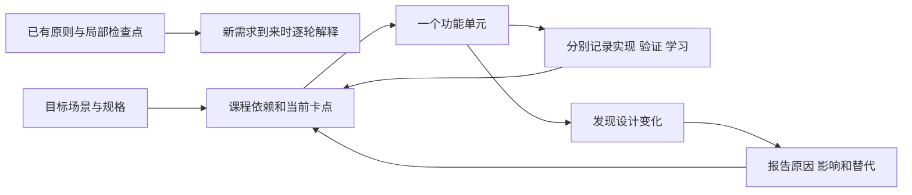

# MissionBook 教学与流程变更记录

配套入口：[教纲](教纲.md) · [学习进度](学习进度.md)。此文件记录教学路线、架构与业务流程的调整，不代替领域规格。

## CHG-009：按反馈修订新建目标的归属、视觉与返回路径

- 日期：2026-10-20；状态：原型候选和设计规格已修订，未实现应用交互。
- 原问题：把已有Flutter目标及节点统计放在新建表单上方，引起未创建目标已有节点的误读；重复方框、两个大标题及底部深色动作/导航造成视觉堆叠。仅替换配色没有处理用户要求的动画演进。
- 调整：独立手动表单仅呈现新目标草稿，以开放书写、下划线、按需展开和浅柑橘动作组织内容。JSON从目标页新建菜单直接选择，导入区仍在目标页；不让文件路径额外经过手动表单。手动保存成功返回来源列表，最坏起点计3跳；JSON文件仍为目标1、选择2、返回3。
- 动效设计：选填高度与后续内容联动，保存成功后标题衔接新卡；失败保留输入，减少动效时直接切换结果。它们是图片配套的设计说明，不是已运行证据。
- 取舍与保留：撤回在列表中展示无关已有目标的创建布局；保留字段、ACTIVE默认、明确确认、原子保存、校验和丢稿确认。课程依赖、数据库及现有业务源码不变。
- 交付：遵守用户仅生成图片的要求，本次修订只生成一张853×1844并替换同名图；误扩展新增的HTML小样已移除，历史其他预览保留。图、提示词、逐项跳转和动效说明见[13新建目标](../ui设计手册/prototypes/13-新建目标页设计说明.md)。
- 验证：已目视核对图片与尺寸、原图复制哈希；未开展运行、键盘、平台选择器或动效验收，不更新用户掌握状态。无需用户额外决定。

## CHG-001：把教学原则落为可执行课程

- 日期：2026-10-19；原因类别：教学组织缺口；状态：本轮已落地。
- 原状：已有教学原则、局部检查点和问题复盘，但没有覆盖成品的逐课依赖、每课验收及独立学习状态。
- 新证据：用户指出仅“从结果反推”不足以保证路径正确，并要求教纲、进度、设计解释与变更报告；自述能读部分代码、需要逐步解释。
- 调整：建立 U00—U20 共 21 个单元；当前定位 U03；每课列目标、前置、理由、取舍和验收；增加实现/验证/学习三条记录及两张解释图。
- 理由：让路线能被审查，让下一步取决于明确依赖与学习证据；避免代码通过就跳课、为教学不断替换可预见结构。
- 影响：教学文档、入口与后续协作约定；没有改变产品范围、数据库结构或运行代码。现有未提交的开发执行计划内容保留。
- 验收：课程 ID 与进度行一一对应；当前课承接已知卡点；新增文档可从入口找到；图片已核对。文档全量检查受既有缺口影响，见 G01/G03。



上图上行概括原先缺少显式课程控制的方式，下行为本次新增的教学记录流程；不表示历史上没有做过任何设计或验证。

## CHG-002：提前设置范围与交互决策门

- 日期：2026-10-19；原因类别：既有规格缺口与已新增的交互约束；状态：教纲已设置决策门，业务方案仍待收敛。
- 原状：多个文档引用缺失的本地应用规格；界面规格仍含多页结束/材料路径，而三步原则已指出它们超限。
- 调整：U00 先建立可追溯的课程验收映射；明确 G01 不能冒充补回正式规格；创建、结束、材料、导入、备份在实施前分别审查所有必经跳转。
- 影响：U06、U10、U12—U14、U16、U19 的交互；U17 的统计口径；U20 的交付基线。数据库配置与三表仓储可以继续，不必因此冻结全部学习。
- 保留：任务事件、材料、截止的既有业务规则；不能为了少跳转删掉确认、原子保存和错误反馈。
- 尚未决定：完整新交互路由及逐分支跳数。没有在本轮实施新的执行/材料页面，也不宣称已满足三步原则。

## 待解决事项

本轮图解表达的补充见 CHG-003；G01—G06 的原实现与规格状态不因图片生成而自动关闭。

| 编号 | 已观察事实 | 影响与处理时点 | 关闭所需证据 |
| --- | --- | --- | --- |
| G01 | `docs/v1.0/本地应用规格.md` 缺失；Git 显示在 `23f55ae` 被删除，删除前内容可从该提交父版本读取 | U00 对照历史与现存规格，确定恢复还是重建；删除原因不能仅靠提交标题推断，旧文不能自动当新约束下的定稿；U17/U20 前必须收敛 | 可读取正式范围、日期口径与完成定义；新决定明示；所有引用恢复 |
| G02 | 结束、材料、文件选择等完整路线未证明符合三步原则 | U00 预审；各页面动工前画具体正常/取消/失败路径 | 前后流程图＋全部必经跳数＋目标平台实际操作；不是只看最短路径 |
| G03 | 原文档检查有 50 条断链 | 文档维护任务；旧 assets 引用与 output 临时说明不能当事实入口 | 对照真实图片改引用；缺失文档恢复或明确替代；全量检查通过 |
| G04 | 执行计划描述去除重复顶栏，源码仍有空 AppBar | U01/U06 的真实界面核对 | 确认最终页头职责，修复后在设备检查，不靠注释判断 |
| G05 | pubspec 的临时约束说明提到 Flutter 3.41，本次环境为 3.47.4 | 后续工具链维护；本轮不改锁定依赖 | 验证约束仍否必要、生成兼容性和测试，不能只因说明旧就删依赖 |
| G06 | Windows 分发方式与部分平台通知能力尚未形成本轮实测证据 | 平台接入前先做小型能力核验；U18/U20 收敛 | 分发方式、系统版本、权限与通知行为证据；不得只按插件依赖推断 |

## 本轮教学材料复查

- 教纲、进度、首课及配图由独立审阅再次核对源码与领域规格；开库过程还对照了项目锁定的 Drift 2.34.0 实现。
- 已修正新增材料链接锚点；已把“草稿保留”限定为当前提交失败场景，进程退出不保证恢复。
- 新增文档纳入 `tool/check_docs.py` 的链接、锚点、可达性与规格检查；最终全量检查仍有原先的 50 条断链，没有新增教学文档错误。G01/G03 没有被标记已修复。
- 交互课程地图包含 U00—U20；已实测 U04/U13 选择会更新前置、目标、理由、验收和三项状态，736 px 和 320 px 下已检查排版。地图默认当前课程 U03，不提供自动勾选掌握。
- 两张解释图使用内置生图工具生成并视觉复核，文件及完整提示词见[配图说明](配图说明.md)。

## 以后怎样报告一次变更

普通实现细节可在授权范围内继续，不为每个变量名请求确认。涉及产品范围、用户数据处置或不可推断的设计选择时，先把方案、影响和建议做成可审阅结果，再问真正缺失的信息。无需把所有教学拆分都变成审批流程。

```text
CHG 编号 / 日期 / 状态：建议、已决定、已实施、已验证（按实际填写）
原因类别：新需求 / 实际平台限制 / 原设计遗漏 / 教学粒度调整
原方案：
新证据或出现的问题：
调整方案与理由：
一个主要替代方案及为何未采用：
影响：代码 / 数据与迁移 / 页面路径 / 课程顺序 / 验收
保留内容与回退方式：
需要用户决定的事项：没有则写无，不额外审批。
实施与验证结果：
```

业务流程改变时同步领域、数据、交互及验收中的相关来源；教纲只链接它们。图应有变更前后、适用课程和实际状态；没有验证的新图标为方案。

## CHG-003：完整功能图与架构图采用图片生成

- 日期：2026-10-19；原因类别：用户澄清图解交付范围；状态：七张定稿已生成并逐张视觉核验，已接入教纲。
- 原状：只有一张三层基础与待接通链路图、一张教学推进图，完整课程主要以文字及交互卡呈现。
- 新证据：用户明确需要通过图片生成完整功能流程、架构关系，尽可能图形化，帮助理解整版产品与具体分支。
- 调整：以一张完整功能总图加六张分图覆盖任务生命周期、结束与材料、目标大纲、完整技术架构、本地系统流程及图形化开发教纲。教纲优先展示生成图片，文字保留设计理由与验收，交互课程卡作为辅助入口。
- 理由：总图帮助定位功能；分图展开正常、取消、失败、截止、修正与重试的具体去向。避免把所有细节塞进一张难读的大图，也避免只提供当前局部骨架。
- 影响：教学图片、图解入口、提示词记录和协作约定。没有新增业务范围、数据迁移、页面路由或学习通过记录。
- 图中业务步骤不直接等于独立页面；三步路由仍须结合系统选择器、必要返回和实际设备审查。没有通过图解绕过 G02。
- 视觉复核修正：结束确认不重复 PAUSE；开始后不再调整排期；纯元数据编辑不增加排期版本；取消任务也可重试；目标保存不自动创建临时任务；运行中不能直接 RETRY；domain 不依赖 data；查询覆盖来源与读写箭头准确；教学循环按 1→2→3→4→5→6 推进。
- 定稿图片及阅读顺序见[完整功能图解](完整功能图解.md)；完整初始与编辑提示词见[生成提示词](制作记录/功能图解-生成提示词.md)。
- 最终核验：七张均为内置生图生成的 1586×992 PNG；完整材料图按三个独立触发过程展示，提交区的三条通道无交叉，超时通道不写正式材料。定稿与提示词已保存在仓库，未采用的草图保留在被忽略的本地 output 目录。
- 文档复查：图集引用与新增教学文档没有新增断链；全仓库仍保留既有 50 处断链，G01/G03 的状态不变。`git diff --check` 通过。本轮未改运行代码，没有重新执行或扩大应用测试，也没有把图解核验算成用户掌握。

## CHG-004：按职责统一文档与图片目录

- 日期：2026-10-20；原因：用户要求整理、归一化目录结构；状态：目录与引用已更新。
- 调整：开发执行计划从 docs 根目录移入教学目录；UI 初稿和正稿移入 UI 手册的 assets 下，保留原版本名称；修正旧图片引用、协作入口和颜色生成工具的资源目录。
- 理由与替代：按现有职责归并，避免说明与图片平铺；未采用全仓目录改名或重新分层，保留 Flutter 默认平台结构、源码分层、生成代码位置及结构快照路径，不引入无使用者的目录。
- 影响与保留：只调整文档资源路径与生成工具输入输出路径；已有用户修改、图片内容、业务规则、课程顺序和 U03 当前卡点保留。可按反向移动及相对路径更新回退。
- 验证：文档检查从 50 处断链减少到 28 处，图片相关路径已修正；其余为缺失本地应用规格和 output/ui-prototypes 说明，G01/G03 仍未关闭，不为通过检查虚构来源。未执行 Windows PowerShell 调色板生成，未开展应用设备验收。
- 学习：本轮为目录维护，没有用户复述或独立操作证据，不改变掌握状态。

## CHG-005：课程正文与生图制作记录分开

- 日期：2026-10-20；原因：用户指出教学目录仍混有工程提示词。
- 调整：完整功能图提示词移入制作记录子目录；基础配图说明中的生成过程、核验与原始 Prompt 单独归档。保留课程图、文字语义与当前学习入口，更新全部引用及后续存放约定。
- 取舍：归档保留生图复现依据，不在课程正文平铺制作过程；不删除原始资料，不改变业务架构或课程顺序。
- 验证：本地文档检查仍为原有 28 处缺失来源，无新增断链；本轮未改业务代码或开展学习验收。

## CHG-006：删除工具及临时输出目录

- 日期：2026-10-20；依据：用户明确要求删除 tool、output。
- 实施：删除检查、图标、色板及博客配图脚本，删除本地生图草稿；正式图片、应用资源、源码及数据库快照保留。移除现行文档的工具命令、目录约定和临时输出链接；历史检查记录保留，所列工具已删除。
- 影响：仓库不再提供原文档检查和资源生成工具；需要重新制作资源时使用新的明确任务。保留 output 忽略规则，防止以后临时输出误提交。
- 验证：删除前临时留在仓库外的检查器用于本轮核验，剩余 16 处均指向原缺失本地应用规格；目录已不存在，git diff --check 通过。未运行应用测试，未变更课程或掌握状态。

## CHG-007：前次教学规则修订（历史，已由 CHG-008 统一）

- 日期：2026-10-20；依据：用户要求渐进讲解、保持代码逻辑，并将教学规则写入文档。
- 实际过程：助手先拆分代码块，后改为完整函数注释，又将规则缩成“一句用途”等要求，多次局部追加均未解决用户反馈。用户指出拆散函数无法理解；“主要靠注释”“固定句数”等是助手当时采取或概括的办法，不能据此宣称是用户确认的教学方案。
- 已有结果：入口、执行计划与进度曾被修改；Mission 转换函数后来获授权写入并通过该文件静态检查。没有新增用户掌握证据。
- 本次处理：将重复补充合并为此历史摘要；当前执行规则及修订范围见 CHG-008，不能继续按本记录中的旧办法教学。

## CHG-008：根据完整反馈统一教学约定和当前状态

- 日期：2026-10-20；用户要求：切换模型后重新理解需求并更新文档；状态：8 份文档已统一修订并完成核验。
- 原因：此前只围绕最近一句抱怨追加局部规则，产生机械拆代码、只靠注释和限制句数等过度概括；教纲同时要求固定交付、复述和先回 U03，进度顶部还声称没有代写实现。
- 统一理解：以完整功能单元和真实调用为主线，渐进展开业务需要、结构依据、输入处理及结果；代码与必要解释就近衔接，保留完整逻辑。精简靠去重复和聚焦，不省略前提，也不固定代码块数量或只允许注释。
- 取舍：直接整合入口、执行计划、教纲及进度，替换冲突正文，合并重复聊天记录；未另建一份规则清单。取消强制附加问答或替代方案，但保留有助于当前理解的必要澄清、练习和设计比较。
- 状态修正：当前是 U04 的 Mission 转换函数；函数存在且此前静态检查通过，仓储与事务未实现，用户理解仍未讲通。U03 保留回查资料，原图和历史检查点注明快照时间，当前位置以学习进度为准。
- 影响与保留：只修订教学表达、衔接和记录口径。U00—U20 的功能依赖、业务规格、架构、三步原则、图片资产及现有源码保留；没有改数据库或应用行为，不需同步业务规格或重做架构图。
- 验证：独立只读复核确认规则及当前状态一致；本轮扫描全仓 Markdown 的本地链接和标题锚点，没有新增问题（此扫描口径下原有 13 项）；教纲及进度 U00—U20 编号齐全，lib/test 文件哈希与本轮开始时一致，git diff --check 通过。未运行应用测试，不将文档修订记成用户掌握。

## 2026-10-21：U06 今天页真实查询与学习侧重点

- 用户意图：先实现今天页，理解数据流程和大概处理，不以逐行手写或背 API 为目标。保留用户已经添加的任务反向转换，由助手接通当前页面所需链路。
- 实现：新增 ScheduledMission 结果结构与 WatchScheduledMissions 查询入口；既有 MissionRepository 增加一个按计划日期订阅的方法，真实仓储关联任务及最大版本排期并排序。App 共享数据库，今天页接 StreamBuilder，显示固定/自选任务、加载/空/错误、取消折叠和日期选择；表单沿用所选日期。
- 设计取舍：两种安排共用一个日期查询，按 timePolicy 分区；结果同时携带任务与当前排期，避免页面访问 Drift 行类型。单独的查询入口保留既有创建职责；查询流在事务提交后更新，页面不手动拼接新记录。相关结构都是本轮真实调用所需，不提前增加通用仓储框架或数据库表。
- 影响与保留：没有修改 schema 或用户数据库；保留当前创建校验、三表事务及用户 missionFromRow。旧查询图标明接通前快照，新说明补实际类名、状态和验证。固定时间录入、执行事件、材料及历史入口未扩展；页面不使用示例任务、虚构计数或空按钮冒充功能。
- 验证：flutter analyze --no-pub 无问题；flutter test --no-pub 29/29 通过。新增覆盖最新版本与改期、排序及同值、查询流、真实内存数据库创建返回后更新、异常重试、日期切换、窄屏和订阅释放。未做设备或跨进程文件持久化验收。
- 教学材料：[今天页真实列表](U06-今天页真实列表.md)。下一轮聚焦查询接口一行签名，再沿调用解释；实现通过不自动记录为用户掌握。

## 2026-10-21：U06 一次查询与主动刷新

- 原因：用户无法从嵌套 watch/map 和整页重写中理解转换顺序、页面方法关系，并提出下拉和新增后的刷新方式。
- 调整：用 Future/findScheduledOn/GetScheduledMissions 表达一次读取，按查询阶段和逐行转换展开仓储；页面统一加载入口并由明确事件调用，布局组件只展示。取消原持续订阅、生命周期观察和午夜切日计时器，所选日期由用户保留/切换。
- 替代与影响：watch 是数据变化驱动而非轮询；保留为后续需要多处实时写入响应时可考虑的方案。本轮选择主动刷新，关闭新建页后刷新一次；取消返回也刷新。三层职责、当前排期规则、日期/排序、表单保护、测试数据及 schema 均保留。
- 说明与小图：U06-今天页真实列表.md 改为当前调用链，另列旧 watch/map 的逐层类型解释。旧图片为历史快照，不以图片中的旧类名作为当前事实。
- 验证：flutter analyze --no-pub 无问题，flutter test --no-pub 30/30 通过；Android x64 debug 构建、覆盖安装及冷启动列表通过，现有全部 44 行数据保留。未据此标记用户掌握或实物设备验收。

## 2026-10-21：今天页对齐当前正稿的颜色、字阶与时间轴

- 根据用户提供的实际页面和参考截图，对齐既有 design-tokens.json，不更改业务规则或架构。
- 修复旧配色与默认大区块标题；固定日程从孤立圆点改为连续竖线，行高跟随真实文字内容，首尾不伸出多余尾线；统一自选图标、日期/区块间距和胶囊导航。
- 仅渲染层修改。查询、主动刷新和数据保持，未以静态原型中的“当前任务”或材料数冒充业务能力。
- 验证：30/30 测试及静态检查通过，颜色角色与正稿 JSON 契约一致；模拟器实际画面已核对，覆盖安装前后全部 44 行应用数据一致。

## 2026-10-21：按页面区域组织代码，集中准备显示数据

- 原因：用户指出 TodayPage 难以直接对应顶部、固定任务、自选任务三个视觉区域；通用分区和通用任务行包含多种布局判断，时区、日期、文字与分组处理散在 Widget 中。
- 调整：TodayPage 保留加载状态及交互；新增 TodayHeader、FixedMissionSection、FlexibleMissionSection 三个区域；共用文字排版单独复用。移除 _DayMissions / _MissionSection / _MissionTile 的多层组织；时间轴绘制留在固定区域内部。
- 转换边界：今天页专用 TodayDisplay 在每次查询成功后，将业务结果整理一次为 TodayMissionGroups / TodayMissionItem。日期键、星期、固定时刻的时区换算、计划时长文字和取消优先分组集中处理。重建布局复用已保存结果；字体缩放和节点尺寸继续由布局处理。
- 取舍：引入两个只含显示字段的不可变结果类型，换取 Widget 不再反复遍历分组和换算时区。没有引入通用 Utils、Controller 或状态管理框架；既有数据库行转换保留在 data 层，避免存储规则与显示规则混合。图示与调用例子同步至 U06-今天页真实列表.md。
- 影响与保留：只调整表现层组织，业务规格、schema、数据库读写接口和实际用户数据不变；主动刷新、日期选择、请求乱序保护、创建返回、取消折叠、文字样式与连续时间轴保留。用户原有“构建元素”注释保留。
- 验证：静态检查无问题，33/33 测试通过；补充显示分区、跨日/夏令时、取消固定行及父组件重建复用已有显示数据。未重新构建或安装设备包，不把此前设备截图或本轮测试当作重构版的设备验收，也不标记用户已掌握。

## 2026-10-21：自选任务默认前三项，补全部任务入口

- 用户要求：自选时间默认折叠显示 3 个，计划日程右侧补全部任务按钮；随后明确全部任务的范围还没想好，先不实现。
- 调整：FlexibleMissionSection 仅新增本区域的展开状态，默认取前 3 项，超过时提供展开全部和收起；完整显示数据仍保留，展开不重新查询或转换。固定区域标题右侧补禁用的全部任务入口，不接空回调或临时页面。
- 影响：仅调整今天页局部展示，沿用数据排序、查询和取消折叠；需求说明同步记录本轮确认及暂缓范围，没有扩展到跨日期查询、阶段或 Goal 筛选。
- 验证：静态检查无问题，34/34 测试通过，覆盖默认前三项、展开/收起、三项无需折叠、父组件重建保留展开状态、点击不查库及禁用入口位置。未更新设备包，用户实际验收待确认。


## 2026-10-22：今天页 UI 与显示转换按两个文件组织

- 原因：用户要求减少今天页的文件拆分，将 UI 和用到的转换方法明确区分。
- 调整与替代：保留 today_page.dart 和 today_display.dart。页头、固定区、自选区、任务行、共用文字及时间轴集中于 UI 文件，内部组件私有；复用界面由 StatelessWidget 承接，替代跨文件 build 函数。显示转换改为顶层函数，通过 display 导入前缀调用，替代只有静态成员的 TodayDisplay 类；分组与行显示结果仍同文件保存。
- 影响与保留：仅改变表现层文件组织及内部封装，没有改变应用/领域/数据层的职责或业务路径。主动刷新、日期切换、请求乱序保护、创建返回、取消折叠、自选前三项与展开、禁用全部任务入口、配色及连续时间轴均保留；数据库、业务接口、排期规则和用户数据不变。业务规格无需调整；教纲、当前课说明与关系图、学习进度同步实际源码。
- 验证：flutter analyze --no-pub 无问题，flutter test --no-pub 全量 34/34 通过，格式与 git diff --check 通过。页面测试检查公开行为，不再引用内部区域 Widget 类型。未构建安装设备包或新增设备验收，也不据代写标记用户掌握。


## 2026-10-22：修复日期及无障碍语义问题，统一错误契约和可读性

- 原因：自检已复现设备跳日时区下合法日期被拒绝、导航语义缺少点击动作、填写后的输入节点缺少用途标签；用户要求修复并保持代码易理解，避免为压缩代码使用不必要简写。
- 调整：日期校验放入现有排期模型文件，由创建/查询共用；以年月日和 DateTime.utc 的普通字段比较替代设备本地 DateTime 解析。UTC 对象仅用于验证日期合法性，排期事实仍为原始 YYYY-MM-DD 字符串。没有创建通用 Utils 或额外目录。查询入口统一用 async/await 传递错误；旧的同步抛错断言相应改为等待 Future。
- UI 修复：导航的触屏与读屏共用真实切页回调；表单保留视觉布局，将外置标签从读屏树排除，再为输入节点提供用途标签，不屏蔽编辑动作。用普通 if/else 代替嵌套按钮文案表达式，补充契约说明及格式整理；教学执行计划合并可读性要求。
- 影响与保留：输入/异常及无障碍行为得到修正，三表事务、查询排序、最新排期、主动刷新、两文件 UI/转换组织、自选展开和用户数据均保留。现有领域/数据规格已经要求日历日期不冒充绝对时刻，本轮是实现对齐，无新增业务规格或课程顺序变化。
- 验证：静态分析无问题；当前环境及命令级 TZ=Pacific/Apia 下全量分别 39/39 通过；格式与 git diff --check 通过。新增五项正式回归检查，并补充非法日期边界、Future 错误、无障碍状态及动作断言。文件持久化在临时目录中验证关闭重开，不替代真机重启、TalkBack 或 Windows 辅助技术验收；不标记用户掌握。


## 2026-10-22：本设备浏览器开发预览与独立本地存储

- 原因与授权：用户希望在本设备通过浏览器预览当前应用，并要求提交已有修改；先提交 `5d15f38`，再适配 Web。
- 调整：在既有 AppDatabase 中补充 Web 连接配置；Worker 和 WASM 作为 Web 运行资源提交，新增实际使用的 Worker 编译入口和启动说明。原生文件与浏览器 OPFS/IndexedDB 使用同一 schema、转换及事务；两端存储独立，不提供同步。
- 替代与依据：没有另建 HTTP 后端、Web 仓储或 UI 分支。官方旧 Worker 的内嵌 SQLite 接口与当前 lock 里的 sqlite3 3.5.2 不匹配，因此使用当前依赖编译 Worker；补齐现有通知插件所需的 SDK 注册库。拒绝纯内存回退；不以临时保存冒充持久化。升级依赖后按开发说明重编译资源。
- 影响与保留：增加当前创建、查询和刷新功能的本机 Web 预览，不扩大 Windows/Android 正式交付或未实现功能。原生数据库、schema v1、用户数据、主动刷新、日期校验、无障碍语义、两文件 UI/转换组织及课程顺序保留。数据落地与平台规格补充预览范围；README、开发说明及学习进度同步，说明包含当前平台连接图。
- 验证：静态分析和 39/39 测试通过；Web release / WASM dry run 通过。内置浏览器真实表单保存、返回刷新、整页刷新及关闭后重开读回通过；仅创建带【Web验收】标题的浏览器样本。资源 GET 与哈希检查通过；未执行公网发布、跨端同步或原生设备安装，也不标记用户掌握。
