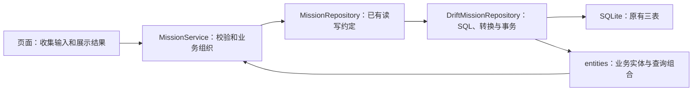

# MissionBook 学习进度

更新日期：2026-10-26。测试可靠性整改后，按用户要求修复“我的”页授权显示，并研究小米超级岛计时通知；随后按新需求接入计划任务到点自动开始、默认提前10分钟提醒设置，冲突时保留当前执行。超级岛尚未实施。此前功能单元与旧检查点保留当时证据。教纲见[教纲](教纲.md)，调整见[变更记录](变更记录.md)。

## 当前检查点

- UI审查重构（2026-10-26）：用户授权直接实现并提交；原有改动先保存推送为`cf64c90`。已落实中性底/文字、小面积品牌与强调、少文本语义图形、三张本地透明纸艺插画、首次可见与展开动效、减少动态效果支持。目标创建直接进入表单；宽屏空库创建/真实导入并排，目录选择后紧凑列表/行动路径并排，窄窗合列并保留导入草稿。范围与制作见[UI审查](../ui设计手册/制作记录/2026-10-26-颜色层级与空态审查.md)。
- 本轮验证：原有基线428项通过；重构后全量432项通过，最后视觉/导入/动效17项与图片首帧截图专项10项通过；30个Dart文件格式检查和最终静态检查无问题，Web构建成功，三张打包素材与源码逐字节一致。截图使用内存库、固定2030日期及系统中文字体，覆盖320双倍字号与390/768/1200/1536/1920宽；不读取用户库。未安装设备包或做Android/Windows实机、升级及性能验收。
- 学习：本轮为助手受托实现与审查，无新增用户复述或独立实现证据，不标记掌握。


- 五项截图反馈后续完善（2026-10-26，0.2.4）：按用户要求，开发前先把当前全部内容提交为 `b8033de`。随后统一输入装饰与间距，执行页按视口高度分配圆环和按钮留白；目标页采用森林绿选中态、主题空态及明确的“已放弃”分类。个人主页改为本机资料与真实行动概览，右上角进入独立设置；资料读写采用独立偏好文件/同源存储，失败保留草稿、系统返回确认、保存防重复均接通。通知增加标准系统秒表兜底，自定义外观异常不中断标准显示/撤销，设置单独诊断执行频道与小米岛能力/焦点权限；超级岛模板展示仍未接入。
- 本轮自动验证：最终 `flutter test --no-pub --reporter expanded` 全量 **428/428通过**；`flutter analyze --no-pub` 无问题；23个本轮Dart文件格式检查与差异空白检查通过。新增回归覆盖本机资料重新读取、损坏/保存失败、系统返回草稿、重复保存与真实END专注汇总、频道关闭与独立焦点权限、已放弃分类大字体、可选外观失败后保留标准通知及高屏留白。截图专项9/9通过，覆盖320/390/768/1200/1536/1920宽及320双倍字体，并核对执行页、目标空态、放弃分类、个人页和设置页的真实Flutter渲染；截图使用隔离内存数据及固定2030测试日期，见[修复说明](../开发/布局反馈与通知修复.md)。
- 本轮APK：`flutter build apk --release --target-platform android-arm64` 成功；版本0.2.4 (6)，24,093,174字节，Flutter引擎与AOT为arm64-v8a（插件另含其他架构原生库），APK v2签名有效且与原0.2.3包证书一致。下载目录交付见[修复说明](../开发/布局反馈与通知修复.md)，复制后SHA-256一致；未安装验收。

- 设备与学习边界：本轮未改变领域表、迁移或用户数据库；没有安装或启动新包，Android后台/锁屏送达和系统外观、小米能力查询结果均待目标设备验收。普通计时通知与超级岛分别记录；不以自动测试宣称已上岛。代码由助手实施，无新增用户复述或独立操作证据，掌握状态不变。


- 最新排错（2026-10-26）：按用户实机问题修复今天页在双栏中的失效刷新、主导航切换被右栏遮挡、主列表换任务持续被点击锁拦住、分栏空隙漏底；当前任务栏统一放到底部，暂停任务经选择器查看，六阶段图标与底部反馈统一。Android 接通静默执行频道、单色图标、紧凑/展开 RemoteViews 与系统秒表；已有广播、事务、稳定通知编号和动作幂等保留。说明、关系图及隔离测试截图见[布局反馈与通知修复](../开发/布局反馈与通知修复.md)。代码由助手实现，目标设备验收及用户掌握均未完成，具体验证见文末本日条目。

- 全部改动审查与 Git 收尾（2026-10-26）：按用户“提交所有 git，主要审查”的要求审查权限页、自动开始、提醒设置、原生唤醒、历史恢复及对应文档/测试。新增两项回归复现：事务内查询跨过计划结束边界后仍写 START；系统调度报错使本地到点计时被30秒重试替换。自动开始现于同一写事务内重新校验时段并复用校验时刻写入唯一执行核心；系统恢复重试与本地到点计时分开，外部通知失败单独提示并继续安排系统唤醒。修复前相关9项通过/2项失败，修复后11/11通过；29个变更Dart文件格式检查、静态分析和差异空白检查通过，全量398/398通过；Android ARM64离线 :app:assembleDebug 构建成功（57秒）。无新表/迁移、无AI实现；未安装设备包或操作用户数据库，未新增用户掌握证据。

- 当前范围（2026-10-26）：用户要求先完善基础功能；AI 需要用户与助手共同设计，当前不进入实现、接口或表结构准备。用户因课程和设备条件暂不能参与真机测试，本地可验证的基础功能继续推进，依赖设备的验收保留明确缺口，不以此阻塞无依赖的开发。
- 历史可靠回看（2026-10-26）：本轮从基础功能核对中复现三个问题：历史按排期时区分组，与设备本地完成日期口径不一致；刷新失败静默保留旧结果且下拉异常外溢；切换执行/取消时 FutureBuilder 沿用旧快照，可能把上一筛选记录带入新筛选。历史页现统一用实际发生时刻的设备本地日期/时间，同筛选刷新失败保留记录并提供重试，筛选切换建立独立查询快照。只修改显示与读取恢复，不改变排期、事件、统计事实或数据库结构；新增独立历史页回归覆盖跨时区的 END/取消、首次读取失败、两类刷新失败与筛选隔离。修复前 1 项通过/4 项失败，修复后 5/5 通过；以 America/Los_Angeles 宿主时区复验同一 5 项通过；flutter analyze --no-pub 无问题，全量396/396通过。未构建安装包、未操作用户数据库或做设备验收；代码由助手实施，无新增用户掌握证据。

- 计划任务自动开始与设置（2026-10-26）：用户要求修改原“固定任务到点只提醒”的规则，并明确冲突时保留当前任务、通知处理。已接通固定任务到点事务 START、前台最近时刻唤醒、Android AlarmManager→短服务/作业→无页面 FlutterEngine；复用唯一 execute/事件核心和全局写锁，不新增业务表或保存 phase。开始前可改期，提前 START 拒绝；开始后锁定，系统延迟按真实时刻开始，错过整个计划时段保留待开始，多个到点任务稳定选一项。我的页可设置关闭、开始时、5/10/15/30/60分钟，默认10分钟；保存后重排，不改变排期；关闭提前提醒仍保留冲突提醒。旧延后按钮移除并拒绝旧回调，旧设置文件兼容读取。完整目录、关系图、自动执行边界和设备清单见[实现说明](../开发/计划任务自动开始.md)。代码由助手实施；用户未复述或独立实现，掌握状态不变。格式检查27个变更Dart文件、静态分析通过；全量391/391通过，其后调度边界9项复验通过。覆盖改期、提前拒绝、取消竞争、失败回滚、单个RUNNING、多连接重复唤醒和重开、查询跨过到点边界、设置持久化/失败与窄屏大字体。原生Kotlin源码直接编译通过；补齐并校验缺失的ARM64调试引擎依赖后，Gradle :app:assembleDebug完整构建通过（2分1秒），生成ARM64调试APK，两个构建输出SHA-256一致。未安装或运行目标手机，未访问用户数据库。

- 我的权限显示（2026-10-26）：用户报告授权后仍显示提示。已删除写死的“尚未接通／授权后不发提醒”文案，权限摘要按真实查询区分未允许、允许、未知和读取失败；只有明确缺失的权限保留授权行，全部允许后显示浅绿正常摘要。回前台重读，查询尚未完成时合并后再查，丢弃返回前捕获的旧结果；撤权恢复相应入口，未知/失败可重试且不声明就绪。相关页面及窄屏大字体样式9项通过，新增3项回归；格式检查与静态分析通过，全量376/376通过。交互规格与视觉说明已同步。没有操作用户数据、构建/安装新包或做物理设备验收；本轮助手实现，用户掌握状态不变。
- 小米超级岛研究（2026-10-26）：用户提供红米 K80 至尊版、HyperOS 3。已核对小米官方客户端通知扩展、计时模板、焦点权限与场景准入，形成[接入调研](../开发/小米超级岛计时通知接入调研.md)。建议先普通系统计时通知，再按实际岛能力及应用权限增强；系统基础倒计时重复场景存在准入限制，任务执行方案需小米评估，未保证通过。现有通知仍为状态文字，未增加系统秒表或小米原生桥，也未申请开发者权限、操控设备设置或进行上岛测试。

- 测试可靠性（2026-10-26）：复查基线为静态分析通过、全量366通过/6失败；其中5项双栏用例只固定仓储时钟，页面查询真实“今天”，隔天找不到任务；另1项材料流程断言错误要求已经切换记录路由。AppShell向今天页传入可控时钟，任务表单默认日期也允许注入时刻，各构造器保留真实时钟默认值；相关测试统一局部时钟，不再读取运行当天拼预期。新增上海跨年列表回归，表单默认日期用UTC/上海跨年场景；材料流程检查原工作区实例、真实保存结果、明确打开记录后的返回链。目录不迁移，测试维护方式见[测试维护约定](../../test/README.md)。相关5个文件54项通过，另以America/Los_Angeles宿主时区运行同一54项通过；全量373/373通过，本轮7个Dart文件格式检查及静态分析通过。没有操作用户数据库或做目标设备验收，未新增用户掌握证据。

- 全部任务时间布局（2026-10-25）：按用户授权直接实现，并按用户澄清取消“课表／列表”选项。固定任务使用现有开始时刻与计划时长按比例排布，自选任务单列，取消任务不占用时段。默认当天，日期前后导航、日期选择、回到今天、全部日期分组、六阶段／目标／以前未开始筛选和完成统计保留。重叠并排，斜纹限定实际交集；多重交集分钟取并集，筛选隐藏任务仍参与冲突并可从说明进入详情。跨午夜裁切并标明续入／续出，短任务有完整阅读入口。字号、配色、顶栏、留白沿用全局主题，运行／暂停跳转独立执行页，刷新复用既有通知。静态检查和10项布局／页面回归通过，390×844组件预览已核对，320宽双倍字号无溢出。未操作用户库、未构建安装包或做实机验收；周视图／课程导入未实现，未新增用户掌握记录。

- 目标页面目录统一（2026-10-25）：用户指出goals未沿用missions的页面组织规则；按既有按业务功能归类原则，将8个平铺文件移至list、form、detail、outline、shared，并把列表／详情共用的目标状态文案放入shared。普通UI和原独立区域保持，页面逻辑、草稿、导航与业务调用不变；更新AppShell、测试导入、页面索引及教学文档链接。静态检查及30项目标列表／节点／关联任务／导入／主页面样式回归通过，逐文件核对8个原文件除导入与状态文案迁移外正文保持一致；无旧源码路径引用，目录变更不新增设备视觉验收或用户掌握结论。

- 执行计时稳定性与暂停询问（2026-10-25）：用户澄清“暂停说明”应在点击暂停后弹窗选填，修正此前助手将其理解为取消填写功能的实现；可留空确认、取消继续专注，确认才保存PAUSE。弹窗保留打开时的事件序号，旧弹窗不能覆盖其它入口后来暂停／恢复的事实，原因随原命令幂等重试。计时故障已用回归复现：inactive仍可见却被当作后台，窗口失焦或恢复到inactive后不刷新；现与resumed共用可见规则，执行页、列表实时时长及日程一致。刷新器幂等启停，不因数据通知或父级重建反复推迟下一秒；暂停／结束不逐秒重绘，隐藏后恢复立即按事件与当前时刻重算。静态检查、执行／同步／日程31项通过，其中新增覆盖失焦、初始inactive、模拟连续180秒、频繁重建、反复后台及路由遮挡、暂停原因和旧弹窗保护、窄屏双倍字体与键盘。全量320项通过、3项失败：两项已复现的历史／今天旧材料入口断言，以及未改动的备份测试仍期待schema8而当前为9。未操作用户执行事实；当前运行的Windows调试实例仍含旧字段，需热重载或重启才载入新实现。未做新的实机交互验收，未新增用户掌握结论。

- 执行页视觉调整（2026-10-25）：按用户新参考突出任务名、细连续圆环和等宽 Focus；环内显示真实运行／暂停状态与当前额度，暂停／继续及结束移到圆环下方，延长降为文字入口。目标摘要白卡按需展开完整方案，可选暂停说明弱化；无新增示例文案。结束报告仍固定确认区，计时、事件、材料和跨页同步规则沿用原实现。静态检查、执行与跨页同步15项回归通过；390×844运行／暂停及320×640双倍字体组件渲染检查通过，窄屏可滚动操作。额外材料回归13项通过、2项失败；两项在修改前也分别复现，均涉及历史／今天旧材料入口断言，本轮未调整这些页面或测试。未构建新安装包、未进行实机验收，助手代写不计入用户掌握。

- 目标状态编辑与 JSON 大纲导入（2026-10-25）：在四页视觉收尾后，继续核对非 AI v1.0 规格。目标详情增加文字编辑与用户明确选择的状态变更；目标页按推进、搁置、达成筛选，放弃目标在菜单查看并可恢复。写事务重读旧版本并避免响应丢失后重复改写；非 ACTIVE 目标无法创建新任务，既有任务/节点保持原事实。目标页同一个新建入口选择手动表单或 JSON 导入；文件与粘贴共用 2 MiB、500 节点、12 层、唯一 key 与禁止额外字段校验，先原位预览，确认后将新目标与完整节点树一次提交。自动回归覆盖事务中断回滚、固定请求重试、页面筛选与状态往返、取消选择保留草稿；Android 模拟器系统选择器读取 JSON 并展示预览，明确放弃草稿，未向用户库注入样例目标。静态分析和 Web/Android 构建通过；本轮实现仍由助手完成，用户掌握状态未变。完整 v1.0 仍有全部任务、统计、通知及材料类型/修正等规格缺口，不能以这两项补齐或四页截图宣称发布完成。

- 四主页面视觉收尾与“我的”实装（2026-10-25）：用户指出仅统一白卡片显得单调后，以当前 UI 手册和任务页为基准，四个主页面统一页头、字号、导航和触控间距；目标状态色、历史日期时间线与材料按需展开、我的提醒状态与备份出口分别承担真实信息层级。短内容的目标详情和目标/任务表单改为从顶栏下方排布。我的查询 Android 通知/准时提醒权限及安装版本，两项系统设置独立可达；本地备份导出同一事务中的 SQLite 逻辑快照、正式附件和 manifest，经系统保存入口交付，取消/失败不报成功。系统自动提醒服务仍未接入，页面明确说明；目标状态编辑、目标 JSON 导入和物理设备验收仍是非 AI v1.0 的功能边界，不因 UI 截图而标记完成。静态分析、298 项测试、Android/Windows 构建通过；Android 模拟器实际保存的备份已独立还原八表并通过外键检查，四页原生截图见[验收目录](../ui设计手册/assets/2026-10-25-四页实机验收/README.md)。本轮代码由助手完成，未增加用户独立掌握记录。

- 界面补正（2026-10-25）：按用户指定正稿重新安排目标卡、详情、树行、任务摘要与顶部归属，保留独立任务/可选归属、开始后锁定、真实记录与草稿保护，不复制原型中的业务跳转或示例数据。目录改为白底紧凑树，收起/添加同一工具栏，建任务统一文字入口；空节点不放假展开，折叠只保护真正被隐藏的子树，父节点报告保留。按压为轻量底色，无扩散水波纹。新增卡片/详情共用的只读节点记录摘要；每个有效节点只计直接完成报告，不继承孩子、不表示掌握或目标达成。方案字段折叠且保留草稿；新任务具体目标在用户单独修改前随名称变化。静态检查与44项相关用例通过，390×844六个真实组件取样（含卡内目录与按下反馈）已目视检查；未做浏览器/设备验收，也未新增用户独立掌握证据。依据、代码和预览见[界面制作记录](../ui设计手册/制作记录/2026-10-25-目标节点与任务归属界面.md)。

- 任务归属单元（2026-10-25）：用户要求继续完整对接，并强调任务可以独立创建、不必绑定节点。schema v8 追加可空目标/节点编号，旧任务保持独立；三种归属、开始前修改/解除、开始后锁定、从节点预填建任务、节点直接任务记录/原位执行、真实路径阅读和重试失效归属选择已接通。任务/排期/方案与归属在同一事务校验保存，提交后重读；固定创建请求避免响应丢失后重复建任务。新增 SQL 归属约束进入 Drift 结构快照；归档保留正在办理的工作区，收起保护报告。目录与调用链见[任务关联目标与节点](U15-任务关联目标与节点.md)。
- 本单元验证：静态检查与全量289项测试通过；包括三种归属、SQL 组合限制、事务回滚、编辑冲突、归档后执行/交材料、固定请求重试、真实文件重开、v1—v7 升级保全及末尾约束失败回滚、节点内执行/报告保护和320宽双倍字体/键盘路径。没有运行新安装包或原生设备升级/视觉验收。实现由助手完成，用户理解和独立实现仍待后续交流，不新增掌握结论。目标编辑/状态操作、导入、备份和 AI 仍未实现；只读节点覆盖摘要由上述界面补正接入。

- 目标节点单元（2026-10-25）：用户授权开始实现，沿表→业务对象→仓储接口/实现→服务→UI 讲解，按最新要求注释语法、输入来源和结果去向。schema v7 追加 goal_nodes 与同级查询索引，复用 GoalService/GoalRepository 和同一数据库；新增父子节点、文字编辑、同级上移下移、子树归档恢复及目标卡内/详情共用节点树均接通。固定创建请求支持重试，旧文字与旧顺序冲突拒绝覆盖，成功才通知重读；列表刷新保留卡片展开，响应丢失后返回也重新读节点。完整思路、目录和图见[目标节点树](U15-目标节点树.md)。任务归属、节点任务与覆盖率、目标状态编辑、导入及 AI 未接入。
- 节点验证：静态检查无问题，全量270项测试通过；v1—v6 真文件升级，v5六表/v6七表逐字段保全、四种 Goal 状态保留；真实文件节点重开、外键与并发新增、调序/归档中途失败回滚、重复请求、编辑冲突、保存前失败/保存后响应丢失、页面返回重读、草稿保护，以及320宽双倍字号/12层节点/键盘遮挡路径通过。390宽组件渲染已目视检查，使用独立内存示例和系统中文字体，不是浏览器或原生设备验收。未构建新安装包或做设备升级验收；无新增用户独立实现证据。

- 目标第一单元（2026-10-24）：用户要求代写时补好中文注释，并沿数据库表→业务对象→仓储接口/实现→业务方法→UI 对接逐步讲解。已实现 Goal 创建、保存、列表与按编号查询的只读详情；名称必填，说明/原因选填，初始正在推进。schema v6 只追加 goals 表，兼容 v1—v5；App 装配独立 GoalService，与任务服务共用数据库。固定创建身份支持失败重试，成功才通知重读，表单保留草稿并保护返回；节点树、任务归属、目标编辑/状态切换和 AI 未接入。完整目录与调用过程见[目标创建与阅读](U15-目标创建与阅读.md)。
- 本单元验证：静态检查无问题，全量249项测试通过。新增覆盖真实文件关闭重开、v5六表逐字段保全、同请求重试/同编号冲突、写入前失败和成功响应丢失、表单返回保护、大字体及创建后重读详情；旧导航测试改为验证真实目标页并按按钮角色定位读屏入口。未构建新的安装包或做 Android/Windows 设备升级、真实视觉验收；助手实现不等于用户已经理解或独立完成。

- 材料阅读与自选排序（2026-10-24）：历史正式图片收为112×104缩略图，记录页图片两列；点击图像直接放大、关闭返回原页，文件名/要求/时间按需展开。结束工作区突出Focus摘要，记录页材料置于时间线前。自选按未开始→执行中/暂停→待补→已结束显示，同阶段保留原序，折叠前也先显示待做项。新增图片查看往返和排序/刷新回归，静态检查无问题、全量239项通过、Web构建通过；390宽隔离浏览器实测历史/记录阅读与展开信息。未更新设备包或声明Android实机验收，用户掌握状态不变。
- 图片查看底色补正：依用户追加截图统一暖白背景、深色文件名及关闭按钮，背景覆盖上下安全区域、内容单独避让；带系统留白的组件测试检查整屏覆盖，静态检查、全量239项及Web构建重新通过，浏览器暖白效果已确认。系统栏真实设备外观未独立验收。
- 材料存储可靠性补查（2026-10-24）：复现并修复同一服务内图片提交与草稿清理交错的问题；文件检查及正式引用提交、清理前重读引用现在串行执行，失败后仍释放队列。新增真实 SQLite 与临时目录回归测试，静态检查无问题，全量 235 项通过；不扩大为跨进程或多标签页验收，用户学习状态不变。
- 材料实现（2026-10-24）：用户授权研究后逐步实施，已接通 TEXT/IMAGE 草稿、稳定批次、原子提交、正式阅读、可选放弃、强制截止和跨日待补入口。新建默认可选材料，材料说明与图片说明选填；仅强制材料要求验收方向与截止。schema v5 追加正式材料及放弃时刻，保留 v1—v4 原数据。Today 原行复用执行/报告/材料工作区，标题仍可独立阅读详情；提交回执原位展示。完整对象、目录和调用图见[实现说明](U12-文本图片材料实现.md)。
- 本轮自动验证：flutter analyze --no-pub 无问题，全量 233 项测试通过；覆盖旧执行路径、v1—v4 真文件升级、批次回滚/重试/冲突、独立连接竞争、截止等值/晚 END、图片解码/大小/私有副本/清理、跨页同步、草稿保护、辅助输入、320 宽双倍字号与原位零新增应用路由。Web 正式构建通过；Android :app:compileDebugKotlin --offline 编译成功。编译成功不等于已打包 APK 或完成设备验收。
- 本轮浏览器实测：隔离访问来源 127.0.0.1:9091，不读写用户既有原生或其他端口数据；实际创建可选任务、开始/暂停/END、选择 PNG、说明留空提交成功；刷新后从历史仍能读取正式图片且不再待补。强制任务在 Today 原行开始/暂停/报告，END 后显示确切截止及待补入口；提交文本成功，原位展示完整正文与回执，Focus 保持 00:22。图片选择曾发现当前 Flutter Web SDK 不支持 encoded ImageDescriptor.width/height，已改跨平台首帧解码，原图字节保留。浏览器截图见[图像保存结果](assets/u12-browser-image-record-20261024.jpg)及[原位文本结果](assets/u12-browser-inline-text-20261024.jpg)。Windows 图片层使用独立临时目录自动验证，尚未对用户正在运行的旧窗口或 Android 实机执行新流程；多进程/多标签页并发编辑不在已验收范围。
- 当前学习状态：代码由助手按本次授权实施，已补中文注释及连续调用说明；用户尚未逐段审阅或独立操作材料模块，不记录为已掌握。正式材料修正、拍照、其他材料类型、目标、备份和 AI 仍待后续单元。

- 本轮研究（2026-10-24）：依用户要求，先将原工作区全部待跟踪改动提交为 `f7fe078`，再核对长期产品思路、五表及创建/执行/查询路径，形成[面向 Agent 的成长数据与开发规划](面向Agent的成长数据与开发规划.md)。当前执行事实能还原应用记录的行为，正式材料、目标关联、帮助与上下文仍有缺口；建议从 U12 承接，提前目标归属核心，未来评价与用户决定分开保存。该路线供用户安排，没有新增业务功能或提升未来对象为本版范围；原有192项测试证据保留，本轮未重跑 Flutter 或设备验收，不新增用户掌握结论。

- 本轮收尾（2026-10-24）：用户确认剩余普通组件收拢后，“开始任务”这一轮完成。已将排期卡片合回详情正文、名称／目标输入合回表单页面，今天页保持三个文件，missions 按功能归类。静态检查无问题，全量192项测试通过；本轮“开始任务＋状态同步＋文件整理”实现与自动验证完成，不扩展新功能。用户理解整体原理和流程，数据库方法尚未细读，未记录为已独立实现。

- 目录阅读入口（2026-10-24）：用户澄清主要困扰是 missions 文件平铺太多、难以找到页面，而非文件行数；当前按 form／detail／execution／record／history／shared 查找。今天页多拆出的日期头部和自选列表已合回 today_page.dart，保留显示转换和原有日程组件三个文件。详见[页面代码索引](../../lib/presentation/README.md)。本轮不扩展功能，旧教程的历史结构不代表当前文件位置。
- 今天页合回验证：静态检查无问题；今天页、显示转换、日程组件、跨页同步相关31项测试通过；差异空白检查通过。没有扩大为本次重新执行全量测试或设备验收。
- 本轮拆分验证：flutter analyze --no-pub 无问题；flutter test --no-pub --reporter expanded 全量192项通过，未修改既有测试断言。与拆分前快照核对，表单保存和丢弃保护、详情操作与导航、执行页命令／报告／监听／计时逻辑保持；8个仅归类文件除引用路径外保持。索引和相关文档185个本地链接均存在，git diff检查无空白错误。未做新的设备界面验收，未改动本轮范围之外的Android构建配置。

- 当前学习位置：**U15 第二单元“节点树维护”已落地，下一单元为任务归属与节点任务查询**。用户可按节点实现说明逐层阅读；GoalService 组织目标和节点操作，原任务执行/材料逻辑保留。用户已反馈理解前一轮 Stream 解释，但不据此标记整个节点单元已经掌握；新代码由助手实现。
- Web 开发预览：既有用户预览来源保持独立；早期 schema v1 持久化证据见[Web浏览器预览](../开发/Web浏览器预览.md)。本轮源码 schema v5，专用 9091 来源只用于本次材料验收；不将其测试任务混入用户原生数据，不宣称跨端同步。
- 当前理解：2026-10-24用户反馈除数据库方法尚未细读外，已理解组合查询、状态变更通知的一般原理和流程；后续提问已澄清 phase 为阶段、execute统一处理开始／暂停／继续／延长／结束并保存对应事件。当前关注目录定位和组件拆分，不据此标记已经能独立实现。2026-10-23能复述App装配数据库／仓储／服务并逐层传入页面的基本通路仍保留。详情FutureBuilder等待一次查询，今天页使用await＋setState；changes监听只触发这些查询，并非持续订阅数据库查询流。2026-10-21对State的this与widget理解记录保留。
- 用户实测反馈：2026-10-24用户表示“昨天测试了软件，没有问题”；记录为用户测试未发现问题。未说明平台及具体场景，不据此推定双平台、进程重启或旧库升级验收完成。
- 已有理解：继承关系；`executor` 没传时使用 `driftDatabase` 提供的连接配置，再交给 `super`。依据见[2026-10-19 历史检查点](开发执行计划.md#7-当前学习检查点2026-10-19)。U03 其他配置仍待确认，按需要回查，不强制倒回课程。
- 实际验证：本轮全量 233 项及静态检查通过，具体边界见本节。既有 192 项记录保留为当时的执行闭环证据，用户旧版本反馈不扩大为新材料模块已验收。
- 用户本轮目标：按照现有架构完成文本/图片、可选与强制材料流程，保留低负担提交、清晰任务提示、合理 UI 与必要中文注释，并提供完整实现思路供阅读。
- 阅读入口补正：今天点击已结束任务先进入完整详情，再“查看执行记录”；运行/暂停仍直达执行。历史直达记录，记录的“任务详情”入口复用已有详情或临时只读查看，返回原页面，不重复堆叠同一任务页面。

## 记录口径

| 轨迹 | 可用状态 | 标记所需证据 |
| --- | --- | --- |
| 实现 | 未开始 / 部分落地 / 本单元落地 / 有缺口 | 当前文件和可定位行为；接口、注释、示例不等于实现 |
| 验证 | 未验证 / 自动检查通过 / 指定平台实测通过 / 失败 | 日期、命令或操作、环境、实际结果与限制；每个平台分别写 |
| 学习 | 未讲 / 已解释、理解待确认 / 能复述当前过程 / 能独立修改并验证 / 待确认 | 用户实际回答或操作，不能由 AI 自评；一次通过不代表长期掌握 |

“待确认”不等于“不会”；用户明确表示未理解时如实记录“未讲通”。历史课缺少证据不要求从头重讲或强制答题。根据实际对话和操作更新，浏览课程卡不改变掌握状态。

## 当前代码与验证证据

| 范围 | 实现证据 | 本次结论与限制 |
| --- | --- | --- |
| 导航与今天页 | [AppShell](../../lib/app_shell.dart)、[TodayPage](../../lib/presentation/today/today_page.dart)、[实时标签](../../lib/presentation/missions/shared/mission_live_status.dart) | 今天固定/自选任务显示阶段与Focus；跨页提交后刷新，当前任务栏跨日恢复；四主页面及“我的”现已实装，原生视觉与备份保存证据见当前检查点；自动提醒仍未接通 |
| 任务与计划对象 | [Mission](../../lib/domain/entities/mission.dart)、[排期](../../lib/domain/entities/mission_schedule_revision.dart)、[方案](../../lib/domain/entities/execution_plan.dart) | 独立自报任务和RETRY来源已接入；可选目标/节点归属和材料放弃已接入；重试新建身份，不复活旧任务 |
| 仓储约定与当前转换 | [MissionRepository](../../lib/domain/repositories/mission_repository.dart)、[当前转换文件](../../lib/data/repositories/drift_mission_repository.dart) | create 与 findScheduledOn 均已接应用；一次查询后用显式 for/readTable/转换函数组装业务列表；仓储读写测试通过 |
| 五张表与开库 | [AppDatabase](../../lib/data/local/app_database.dart)、[事件表](../../lib/data/local/tables/execution_events.dart)、[失败表](../../lib/data/local/tables/failure_records.dart)、[schema v4](../../drift_schemas/drift_schema_v4.json) | 当前版本4；v1/v2/v3增量升级，原事件/报告/失败原因保留；v4新增来源字段，独立文件通过，设备升级待验收 |
| 数据库测试 | [现有测试](../../test/data/local/app_database_test.dart) | 2026-10-20：11/11 通过；含直接调用真实仓储的 6 项测试，应用业务入口及设备持久化未验证 |
| Android 文件通道 | [MainActivity](../../android/app/src/main/kotlin/chat/liuxin/mission_book/MainActivity.kt) | 有原生选文件通道遗留代码，当前 lib 没有对应调用；不算附件功能接通 |
| 其余核心业务 | [领域规则](../需求文档v1.0/领域模型.md) | 材料、目标、AI、通知尚未接通；包依赖和图稿不等于功能交付 |

### 2026-10-19 实际运行的检查

环境：本机 Flutter 3.47.4 / Dart 3.13.3；没有为本次审计安装或升级依赖，没有启动或停止用户桌面。

| 命令或操作 | 结果 | 能证明什么 |
| --- | --- | --- |
| `flutter test --no-pub test/data/local/app_database_test.dart` | 5/5 通过 | 建表和默认值、外键拒绝孤儿关联、排期组合唯一、方案唯一、跨表事务回滚 |
| `dart analyze lib test` | 无问题 | 当前 Dart 源码与测试的静态检查通过 |
| `python3 tool/check_docs.py`（新增教学材料前） | 失败，50 条本地链接缺失 | 既有文档基线有断链；缺失主规格、图片目录旧路径、未随仓库保留的 output 说明。后续复查见变更记录 |
| Windows / Android 正常启动、保存、进程退出再重开 | 未执行且业务链未接通 | 当前不能宣称双平台持久化验收通过 |

## 逐课账本

| 课程 | 实现 | 验证 | 学习 | 下一次更新需要什么 |
| --- | --- | --- | --- | --- |
| U00 基线与路径 | 本地应用规格经审阅恢复，G01文档缺口已修复；G02待各路径实测 | 本轮链接与规格复查见文末 | 待确认 | 每条受影响路线及平台行为证据 |
| U01 界面职责 | 部分落地，顶栏需核对 | 静态检查通过；无本轮 UI 实测 | 待确认 | 指出壳/页面职责，目标设备检查 |
| U02 对象与表 | 创建切片落地 | 数据库基础测试通过 | 局部已有教学记录，整体待确认 | 能以同一任务解释三对象、表、单位和关系 |
| U03 开库过程 | 本单元代码落地，已接应用共享数据库 | 历史开库证据保留；当前迁移与重开验证见最新检查点 | 连接选择已有理解记录；其余待确认、按需回查 | 对应实际对话或操作证据，不强制重复已会内容 |
| U04 转换与事务 | 转换函数、仓储类与三表事务已接入应用 | 原有 11 项数据库/仓储测试继续通过 | 能复述写入接收 Companion 对象；自述仓储讲解已看懂，独立操作证据待确认 | 按当前疑问回查，不重复已完成的实现 |
| U05 创建规则 | 自报/可选/强制策略、FLEXIBLE/FIXED，时刻统一 UTC；强制材料要求及截止校验已接入 | 原创建证据保留；本轮全量233通过 | 既有四输入理解证据保留；材料分支待阅读 | 按用户卡点解释条件字段及参数来源 |
| U06 表单与真实列表 | 本轮补齐既有创建页固定时刻与样式；今天页主动刷新、单行标题、时间轴及自选前三项保留 | 2026-10-23：静态检查通过，全量73/73，创建页8/8；浏览器目视对齐，未更新设备包 | 2026-10-23 能复述共享对象传递、初始化读取及按状态展示的基本通路；今天页 await＋setState 本轮补充，独立实现待确认 | 按后续具体卡点讲解，不重复已能复述的整体装配过程 |
| U07 编辑与取消 | 开始前支持名称、具体目标、排期及材料策略/要求/截止；开始后锁定 | 旧取消/改期证据保留；本轮编辑与表单测试通过 | 旧流程已有理解，新增材料编辑待阅读 | 沿提案→事务比较→追加版本解释 |
| U08 迁移与事件 | 共享核心、真实事件及v1—v4→v5升级已落地 | 冻结快照逐字段保全、结构对照、回滚/中断恢复通过 | 用户理解旧事件列表与去重；新增迁移待确认 | 目标设备升级验收 |
| U09 执行动作 | 统一事务动作、全局RUNNING限制与稳定身份已落地 | 重试、旧命令、并发竞争与页面自动通过 | 助手代写，待讲解/确认 | 用户当前流程验收 |
| U10 结束与结果 | 暂停后报告，END/FailureRecord原子保存，独立冻结记录页已落地 | 草稿/返回/失败、旧报告与真实结果自动通过 | 待确认 | 用户完成/未完成验收 |
| U11 计时与恢复 | 唯一时间规则、可见标签重绘、跨页/跨日恢复已落地 | 隐藏/恢复、暂停冻结、返回直达与文件重开通过 | 待确认 | 浏览器/原生后台重开验收 |
| U12 文字材料 | 文本、可选分流、稳定批次、正式保存及放弃已落地；本轮仅文本/图片主要入口 | 事务/重试/草稿/页面自动通过，浏览器文本实际提交成功 | 已提供注释与完整思路，用户待阅读 | 用户按真实经历试用与提出问题 |
| U13 强制截止 | 创建/编辑截止、END分流、启动/前台补算与完整阶段已落地 | 截止等值/晚END/原子竞争自动通过；浏览器强制待补及提交通过 | 待阅读/确认 | Android/Windows新流程实测 |
| U14 附件与修正 | 五类材料、图片/文件副本、原位拍照源码及追加修正已接通，schema v9 | 附件、修正和材料流程自动回归已纳入当前全量；既有浏览器证据保留，相机设备交互待验收 | 待阅读/确认 | 相机、系统选择、权限和正式附件在目标设备上的验收 |
| U15 目标树与重试 | 目标编辑/状态、节点树、任务可选归属、节点记录与 RETRY 已接通 | 节点、归属、导入及事务/迁移自动回归已纳入当前全量，平台边界见最新检查点 | 按顺序讲解并补具体注释，无新增独立实现证据 | 目标/节点完整操作与设备升级实测 |
| U16 大纲导入 | JSON 文件/粘贴、严格校验、预览、确认后原子写入已接通 | 自动回归纳入当前全量；Android 模拟器系统选择及预览已有记录，物理设备未验收 | 助手实施，用户掌握待确认 | 真实导入成功、取消、错误和重开路径验收 |
| U17 统计与历史 | 全部任务日期/阶段/目标筛选、计划与完成统计、结束/取消历史已接通；本轮修复历史日期与读取恢复 | 当前全量396/396；新增历史5项并以另一宿主时区复验通过 | 待确认 | 基础功能继续核对；设备时区变化、统计小样本复算和长列表实测 |
| U18 通知 | 权限、提醒设置、动作对账与固定任务自动开始已接通；执行通知实时 Focus 仍待补，超级岛仅调研 | 自动回归与原生调试构建已有证据；后台、锁屏、重启及两平台系统送达未完成设备验收 | 助手实施，用户掌握待确认 | 补齐普通执行计时通知；可独立验证的异常恢复继续推进 |
| U19 备份 | 同一事务数据库逻辑快照、全部正式附件、manifest 和系统保存出口已接通；恢复导入不在范围 | 自动回归纳入当前全量；Android 模拟器导出归档独立还原八表和外键校验已有记录 | 助手实施，用户掌握待确认 | 系统保存取消/失败、缺失附件及大数据量的实际交付检查 |
| U20 交付 | 未开始 | 未验证 | 未讲 | 双平台清单与独立小需求演示 |

## 后续记录方式

```text
日期 / 课程：
用户本轮目标或卡点：
实现：改了哪些文件，具体接通什么；或未改代码。
验证：命令 / 设备 / 场景 / 实际结果 / 未覆盖部分。
学习：用户的复述或独立操作证据；没有则写待确认。
设计变化：无，或引用 CHG 编号。
仍未解决：
下一轮起点：一个具体调用、关系或功能单元。
```

先更新当前检查点和对应课程行；同日同一单元的重复反馈合并成一条，只有新增实现、验证或学习证据才补充必要记录。规则变化放入执行计划及变更记录，不把每次道歉或重讲复制为日志。

## 2026-10-23 / 公共返回顶栏统一

- 用户授权：接受公共UI采用presentation/widgets目录，统一新建和详情的返回按钮与居中标题，完成后由用户查看。本轮只处理这一项真实复用，不扩展页面业务。
- 实现：新增[AppTopBar](../../lib/presentation/widgets/app_top_bar.dart)，新建页与详情页各替换一处AppBar。工具栏80，返回按钮48×48、森林绿底与24白色箭头，左边距24，标题沿主题16/24居中。公共组件只接收title、onBack、canGoBack；未传onBack时使用Navigator.maybePop。颜色从已有主题读取，不再拆单独按钮文件或建通用框架。
- 返回职责：新建页仍传入原_requestClose并在保存时禁用返回，系统返回保护保持；详情普通返回。未改变路由层级、表单数据、查询、业务方法、数据库或用户已有两处详情注释。


- 验证：flutter analyze --no-pub无问题；新建8项、详情4项、今天页20项共32/32测试通过，覆盖48触控尺寸、左边距24、390宽标题居中、白色图标、保存禁用与成功后允许返回、继续填写／确认丢弃，以及详情返回刷新。已有320宽双倍字号与键盘回归继续通过。31个lib/test文件格式检查无变化，git diff --check通过。日志：/tmp/missionbook-top-bar-tests.log。
- 预览边界：8085开发服务已收到热重启信号；随后浏览器控制连接断开，当前未取得新版两页的实际截图，不能将上一轮截图当作本轮验证。HTTP GET /返回200，开发服务可访问；控制端应用及浏览器连接暂不可用，重新打开预览的请求未收到响应，已停止等待，需用户刷新后查看。目标实物设备和真实读屏未验收。
- 学习：已说明公共UI的放置职责与目录名属于项目约定，用户授权实施；尚无独立操作或复述新组件的证据，不新增掌握结论。未提交Git。

## 2026-10-23 / U06 补齐新建固定排期与表单样式

- 用户目标：新建任务可填写具体开始时刻；按当前稿单独校准字号、布局和选择框对齐。后续明确临时／节点任务应按真实归属显示，指出返回按钮跨页尚不一致。
- 实现：仅扩展既有create_mission_page.dart与MissionService.create；默认自选，固定时分必填且检查00–23／00–59，结合所选日历日期按上海时区转UTC。业务层再次校验策略／时刻组合和当地日期匹配；沿用原仓储三表事务，不增加表、实体、服务或生产文件。失败保留输入、等待期间锁定、成功原位反馈与重复提交保护保留；只修改时间也需丢弃确认。
- 视觉：标签14/20，输入值18/24（500），年份12/16，设置名及主操作16/24，选项和单位14/20。日期／时长同排且可见边框等高，输入高度68并随字体增长；选择面自身完整圆角，和设置标签居中对齐。标准48圆形返回使用24白色箭头；窄屏大字体纵排，键盘下内容可滚动。小时／分钟／计划单位常驻。
- 交互与边界：日历与时分原位展开，不新增选择页；创建仍为临时、自报，不画未接通的归属、材料下拉和方案按钮。节点创建须带真实关联并保存，编辑须读原归属，此链尚未实现。本次创建切片结束时详情仍用默认返回；随后公共顶栏已统一，见上方“公共返回顶栏统一”记录。创建不自动执行，也没有实现开始提醒。
- 验证：Flutter3.47.4／Dart3.13.3，flutter analyze --no-pub无问题，flutter test --no-pub全量73/73通过，其中创建表单8项、创建业务10项。覆盖UTC跨日、当地日期不匹配、策略字段矛盾、空值／越界时分、切回自选、修改日期、失败重试、防重复、丢弃确认、390宽对齐与320宽双倍字体加键盘。独立临时文件库创建固定任务后关闭重开，通过列表／详情读回同一UTC时刻。日志：/tmp/missionbook-create-final-tests.log。
- 浏览器：当前localhost:8085实际观察了自选／固定样式，白色返回箭头、等高边框、常驻单位与胶囊对齐均已目视检查；未点击保存、未改用户任务数据。最终截图：/tmp/missionbook-create-final-20261023.jpg。未验收Android／Windows实物、真实读屏或新固定任务的浏览器重启持久化；自动测试不替代设备验收。
- 学习：本轮授权代写，保留上一轮“能复述基本调用通路”证据；时间转换和新UI仍待用户阅读理解，不据测试通过标记掌握。用户已有详情页两处注释保留，未提交Git。
- 后续范围决策：用户询问完成方式、验收目标与AI编排是否现在处理，并授权决定。本轮继续仅开放自报，完成方式作当前值展示；待材料提交、截止和阶段闭环接通后再开放可选／强制材料。现有verificationPolicy与verificationCriteria列已存在，当前无需迁移；验收方向是用户说明，不依赖AI。AI动态编排与评价保留长期范围，不预建接口或表。本次仅澄清并记录决策，未改源码、未重跑测试，也不新增掌握结论。

## 2026-10-23 / 用户复述基本调用通路

- 证据：用户仔细阅读代码后，主动说明 App 构造数据库与业务对象、逐层传到页面、初始化时调用接口、依据数据结果及状态显示不同 Widget。
- 理解记录：已能复述整体基本通路。补充区分对象装配与具体业务实现、一次 Future 结果与持续数据库订阅，以及今天页 await＋setState 与详情 FutureBuilder 的两种页面更新写法；当前实际读取本地 SQLite，并非网络接口。
- 实现与验证：本轮仅更新本学习进度，核对当前源码，保留用户正在修改的详情页注释；未改生产代码、未重跑测试、未提交 Git，既有验证与平台验收结论保持。
- 边界：不扩展为已独立实现、掌握全部语法或事务规则；本轮解释的细分概念是否掌握，仍以之后用户反馈为准。

## 2026-10-23 / 自选任务点击反馈留白

- 用户反馈：自选任务点击后的背景紧贴图标和文字，缺少内部间距。
- 实现：仅在 today_page.dart 的自选行点击容器内部增加左右12、上下8的 Padding，并就近说明内部留白与外部行间距的区别；取消自选行同步复用。保留字号、单行省略、行间距和导航，固定日程测量与时间轴保持。无新增文件或业务修改；布局规范同步。
- 验证：今天页20/20测试通过，静态分析无问题；格式与差异检查通过。当前浏览器热重启后已实际核对真实任务的悬停反馈背景，图标、文字四周留白可见；未写入用户数据。
- 学习与边界：样式修正不新增用户掌握结论，目标实物设备未验收。

## 2026-10-23 / 详情绿色排期条对齐设计稿

- 本轮目标：用户明确只调整绿色排期区域的文字、层级与布局，不扩大到整页重做。
- 实现：在既有 mission_detail_page.dart 内以私有组件显示日历/日期与时钟/计划两栏，中间竖线；标签14/20、数值18/24，文案采用“固定时间／自选时间”“计划”“数值 分”，去掉卡内版本号与时区。空间不足时上下排列，保留完整文本和真实时区换算。无新增生产文件、目录、依赖或业务修改。
- 验证：flutter analyze --no-pub 无问题；详情和今天页24/24测试通过，覆盖390宽两栏对齐、320宽双倍字体及原查询/返回行为。本设备浏览器已实际打开原有任务并看到“自选时间／10月23日”“计划／90 分”，未写入数据。格式及差异检查通过。
- 学习与边界：本轮为授权样式修正，没有新增用户掌握证据；实物设备验收待完成，其余详情区域不在本轮调整范围。

## 2026-10-23 / 任务业务入口聚合与实体注释

- 用户目标：application 合并同属任务的薄入口；entities 内用注释说明哪些表达单个业务对象、哪些是查询组合。保留 entities 原目录，不增加 read_models 目录，也不继续扩展页面或业务。
- 实现：新增 [MissionService](../../lib/application/missions/mission_service.dart)，直接承接原 create、日期查询和详情查询；删除 create_mission.dart、get_scheduled_missions.dart、get_mission_detail.dart，App → AppShell → 页面统一传递同一个 missionService。共享仓储及原三个方法体保持，时区资料在这个服务构造时初始化。
- 实体：五个类保留原文件位置、字段和类型，只补类注释。当前三实体分别有对应存储表，但实体使用业务类型，不能把实体类当成建表定义；组合类只持有已有对象，无独立表。

| entities 中的类 | 注释分类 | 当前保存或查询来源 |
| --- | --- | --- |
| Mission | 业务实体 | missions 表；策略使用枚举、时刻使用 DateTime，由仓储转换 |
| MissionScheduleRevision | 业务实体 | mission_schedule_revisions 表的一条完整排期版本 |
| ExecutionPlan | 业务实体 | execution_plans 表；steps 列表由仓储转为 JSON 存储 |
| ScheduledMission | 查询组合 | Mission＋当前排期，供日期列表读取，无独立表 |
| MissionDetail | 查询组合 | Mission＋最新排期＋方案，供详情读取，无独立表 |

下面是**本轮已经落地**的职责关系；聚合服务没有引入新的存储层或提交边界：



- 架构核对：与修改前源码快照比较，三个业务方法体逐一一致；五个模型去除注释后定义一致。仓储除调用者注释外无新增聚合改动，表结构、生成代码、依赖和 schema v1 保持，未访问用户数据库，已有未提交详情页保留。
- 验证：flutter analyze --no-pub 无问题，全量 flutter test --no-pub 66/66 通过，覆盖原创建校验、真实事务和回滚、文件库关闭重开、列表/详情、表单与页面交互。lib/test 格式检查和 git diff --check 均通过。
- 学习：已解释业务实体、存储表和查询组合的区别；用户明确选择以注释澄清，未据此认定已掌握全部转换和调用过程。仍停在当前架构问题，未展开下一页面。
- 设计依据：见变更记录 2026-10-23“合并任务应用入口，entities 仅用注释区分对象职责”；数据落地与平台的当前实现说明已同步。目标设备验收状态不因组织调整变化。

## 2026-10-23 / U07 第一步：只读任务详情页

- 用户授权：一次只落实一个页面，用户通过 Git 查看，代码就近注明用途、输入来源和执行过程。本轮落实详情阅读及其必需的查询和列表入口，不实现第二个页面。
- 实现：固定、自选和取消项点击时传任务 ID；详情另读最新排期与方案，展示完整标题、计划日期/时区/投入、已有说明和材料策略，Why 可展开。等待、失败重试、未找到分别处理，返回保留所选日期并主动刷新。
- 业务边界：所有新增查询均只读，排期历史不覆盖，方案步骤按保存顺序恢复；找不到任务与关联数据不完整分开。依据领域模型 §3、§4.1、§5.1 及界面与交互 §5.2；三步规则下详情阅读是可选分支，今天页进入再返回为两跳。
- 代码阅读顺序如下。UI 私有组件留在页面文件，未额外拆分区域文件；测试替身只补齐新增接口，不改变原创建测试的业务范围。

| 类型 | 文件 | 关注什么 |
| --- | --- | --- |
| 新增 | [MissionDetail](../../lib/domain/entities/mission_detail.dart) | 三个已有业务对象如何组成一份详情；不是新表 |
| 修改 | [仓储接口](../../lib/domain/repositories/mission_repository.dart) | findDetail 的输入、空结果和错误约定 |
| 修改 | [真实仓储](../../lib/data/repositories/drift_mission_repository.dart) | 三表关联、版本倒序取一条、执行 SQL、行转换；steps JSON 反向恢复 |
| 新增 | [任务业务服务](../../lib/application/missions/mission_service.dart) | 当前由 findDetail 接收 ID，检查输入和时区，将结果/错误交回页面 |
| 修改 | [App](../../lib/app.dart)、[AppShell](../../lib/app_shell.dart) | 同一个仓储如何被装配并传递给页面 |
| 修改 | [今天页](../../lib/presentation/today/today_page.dart) | _openDetail 接收任务 ID；await 路由关闭后刷新原日期 |
| 新增 | [详情页](../../lib/presentation/missions/detail/mission_detail_page.dart) | initState 发起一次查询，FutureBuilder 选择状态，内部组件排版 |
| 修改（仅注释） | [列表显示工具](../../lib/presentation/today/today_display.dart) | 业务处理不变，仅把 id 注释更新为已接通详情入口 |

- 验证：全量 flutter test --no-pub 66/66 通过，详情/列表相关 30/30 通过；随后补充非今天日期的进入/返回场景，定向导航检查通过。flutter analyze --no-pub 无问题，lib/test 格式检查与 git diff --check 通过。独立内存库验证三对象完整读取、最新版本与只读历史、取消事实、缺失关联、损坏 JSON、空 ID 和无效时区；Widget 覆盖真实创建后阅读、重试/未找到、换任务旧结果、离页迟到错误、窄屏双倍字体、时区换算、四类任务入口、读屏与双击。原时间轴逐帧等高与连续像素检查继续通过。
- 学习：已有就近注释，尚无用户 Git 阅读后复述或独立操作证据，保持待确认。本次实现不替代用户理解，也不代表 U07 编辑/改期/取消已完成。
- 仍未验证：Android/Windows 实物页面、键盘与读屏、跨进程重开；本轮未构建安装设备包，未访问用户数据库。
- 下一轮起点：停在本页，按用户查看 Git 后的具体问题解释；另一个页面在后续轮次安排。

## 2026-10-20 / 目录维护

- 实现：教学执行计划归入教学目录，UI 参考统一归入版本化 assets，入口、相对链接和调色板工具路径同步；详见 CHG-004。未修改业务代码。
- 验证：文档检查剩余 28 处既有缺失来源引用（原 50 处）；本轮未执行应用测试或设备验收。
- 学习：无新增掌握证据；U03 卡点及下一单元 U04 保留。

### 同日补充：提示词归档

实现：制作过程与工程提示词移入制作记录子目录，课程正文保留教学解释；见 CHG-005。验证：文档检查无新增错误。学习：无新增掌握证据，仍停在 U03。

### 同日补充：删除工具与临时输出

实现：按用户要求删除 tool/、output/，同步现行文档，见 CHG-006。验证：仓库外临时检查器核验后仅余原缺失规格的 16 处引用；业务代码未改。学习：无新增验收，U03 保留。

## 2026-10-20 / U04 当前函数与教学纠正（合并记录）

- 起点：三张表、生成代码、数据库连接类和仓储接口已有，用户询问下一步并要求开始；用户创建转换文件及空函数后，助手提供的教学多次未讲通。
- 实现：用户曾要求直接写完，随后贴出 `missionToCompanion` 空函数继续询问。实际代写完成的是这个函数的全部现有字段转换；没有实现仓储类、排期/方案转换、事务或页面。
- 验证：本会话此前已执行 `dart format`，该文件 `dart analyze` 返回 `No issues found`。历史数据库 5 项测试不覆盖此函数或尚未实现的仓储，本次文档整理未重跑应用检查。
- 学习：用户明确反对代码之后堆解释、机械切断函数和依靠局部规则反复纠偏；没有证据说明当前函数已理解，保持“未讲通”。
- 文档修订：先前 CHG-007 的多次局部修改未解决问题；本次统一解释粒度、代码连续性、必要前提、代写范围与记录口径，修订教纲及当前入口，见 CHG-008。
- 下一轮承接：按用户接下来的具体问题，围绕现有函数的一次完整调用说明目的、参数来源、转换及返回；不原样重发此前答案，不自动转入三表事务。

### 同日续：排期、方案转换与 CRUD 职责

- 实现：按用户授权在现有转换文件添加 `scheduleToCompanion`、`executionPlanToCompanion`，覆盖现有字段；枚举转约定文本、时间转毫秒、步骤列表转 JSON 文本。
- 验证：`dart format lib/data/repositories/drift_mission_repository.dart` 完成；`dart analyze lib/data/repositories/drift_mission_repository.dart` 无问题。未执行数据库保存或设备验收。
- 学习：说明 Companion 构造与执行数据库操作的区别、局部更新与查询反向转换的用途；理解待确认。此前未讲通记录保留，不推断已掌握。
- 下一轮起点：按用户当前疑问继续；三个转换已齐，后续实现仓储 create 的事务保存。无架构或课程顺序变化。

### 同日续：仓储教学的定位与注释缺口

- 用户反馈：实现指导缺少目录变更、具体写入位置及足够的就近解释，无法判断代码写在哪里。已合并到协作入口和执行计划，并按用户要求添加长期记忆更新笔记。
- 实现：本轮仅修订教学说明；实际转换文件仍只有三个转换函数，仓储类未落地。
- 学习：需要先定位 import、文件顶层类与演示调用的位置，再讲构造传参、异步和事务；这些内容仍待确认。无新增测试或设备验证。

### 同日续：仓储验证已执行

- 授权与实现：用户要求“你来修改剩下的”，保留已添加的导入及原有 5 项测试，在 `test/data/local/app_database_test.dart` 新增 6 项真实仓储测试；未改仓储源码或应用入口。
- 场景：正常保存并核对三表及时间、枚举、JSON 步骤；排期归属错误；方案归属错误；首次版本错误；新任务已取消；第三次插入因方案主键重复失败，回滚新任务及排期，并保留原有三表记录。
- 实际验证：2026-10-23，静态检查无问题，最新全量91/91测试通过（含日期精度与连续时间轨道回归）。真实数据库验证取消只修改两个时间字段、保留全部排期与方案、重复/并发请求及失败回滚，文件库关闭重开仍可读回；详情交互、失败重试与真实创建→取消→折叠列表路径通过。浏览器和设备验证边界见文末。
- 边界：独立内存数据库，不访问用户数据文件；不表示全量业务校验、应用保存入口或目标平台持久化已经完成。用户对测试代码的理解待确认。

### 同日续：U05 正常输入业务测试

- 实现：用户写入 `test/application/create_mission_test.dart`，使用记录型测试仓储接收真实 CreateMission 构建的对象；未改业务源码。
- 验证：`flutter test --no-pub test/application/create_mission_test.dart` 1/1 通过；`dart analyze test/application/create_mission_test.dart` 无问题。覆盖标题清理、四个输入、对象归属、默认策略、统一时间及仓储调用一次；不证明数据库写入或设备持久化。
- 学习：用户已将指导代码写入，测试原理与独立修改能力待确认。
- 教学承接：已解释测试调用真实 execute、记录型仓储仅接收结果，以及构造函数 this.repository 的初始化简写；用户要求首次引入测试辅助实现时先说明用途、替代对象与执行边界。理解仍待确认。
- 下一轮起点：先以空白标题说明非法输入拒绝且不调用仓储，再覆盖其余输入与仓储失败向上传递；当前正常路径测试已通过。

### 同日续：U06 应用装配与 Android 预览包

- 实现：用户写入 App 的数据库、真实仓储和 CreateMission 装配，AppShell 接收业务对象；尚未传给 TodayPage，创建表单和真实列表未接通。代码提交 `872feba`。
- 验证：`flutter analyze --no-pub` 无问题。首轮 Android 构建遇到插件元数据缺失，执行 `flutter pub get` 恢复，未升级锁定依赖；补齐 SDK Build-Tools 35.0.0 和 Platform 35。通过本次命令的 JAVA_TOOL_OPTIONS 显式使用本机 7890 代理后，`flutter build apk --release --no-pub --target-platform android-arm64` 成功，APK 约 18.9 MB。
- 产物：复制至 `/sdcard/Download/MissionBook-0.2.2-preview.apk`，源文件与副本 SHA-256 一致。未通过 ADB 安装，用户将自行安装预览；启动、UI 与持久化设备验收仍未完成。
- 学习：用户自述对 initState 与父类调用理解得差不多，独立修改能力待确认。
- 下一轮起点：先根据设备预览反馈，再继续今天页创建入口与表单。

### 同日续：采用 v3 Android 彩色图标

- 实现：用户确认暂用「打开书本＋书签勾」v3 PNG 图标；已替换品牌母版、透明前景、五档 Android 普通/自适应资源并补充圆形 PNG，背景改为深绿 `#173F35`。原始生图与提示词保存在 `assets/branding/`；通知和单色主题沿用原有简化书本勾，其他平台图标暂未替换。
- 验证：15 张 PNG 与确认的导出哈希一致，尺寸、前景透明度、四个 adaptive XML 引用及 1024 px 母版核对通过；aapt2 编译全部 Android 资源成功，相关文件 git diff --check 通过。ARM64 release 构建受依赖下载阻塞，使用本机既有代理重试后仍等待，已终止本轮两次构建；未生成新版 APK，未安装设备验收。
- 学习：本轮为授权的品牌资产替换，不推进课程或标记新知识已掌握；U06 业务实现与教学承接不变。

### 同日续：U05 异常路径测试

- 实现：用户在 `test/application/create_mission_test.dart` 增加 `FailingMissionRepository` 及 6 项异常路径测试；未改业务源码。
- 验证：`dart format test/application/create_mission_test.dart` 完成；`flutter test --no-pub test/application/create_mission_test.dart` 7/7 通过；`dart analyze test/application/create_mission_test.dart` 无问题。覆盖空白标题、非正计划时长、非法日期格式、不存在日期、无效时区不调用仓储，以及仓储异常向上传递；不覆盖真实数据库写入或设备持久化。
- 学习：用户按指导写入测试并主动运行验证；异步断言、异常类型与“校验失败无写入”的边界理解待确认。
- 下一轮起点：进入 U06，先根据设备预览反馈接通今天页加号、创建表单与真实列表；固定时间、材料策略、目标归属与重试仍不在本轮范围。

### 同日续：U06 时区临时方案

- 决策：用户选择先固定 `Asia/Shanghai`，让创建表单先跑通；本轮不新增设备时区依赖。
- 边界：`timeZone` 不是从设备读取，只适用于当前固定地区；后续接入设备 IANA 时区时必须替换并重新验证表单及相关日期行为。
- 下一轮起点：今天页加号 → 新建任务表单（标题/日期/计划时长）→ `CreateMission.execute` → 成功回执；随后接仓储查询与真实列表。

## 2026-10-21 / U06 页面开发起点

- 用户目标：开始页面开发，要求具体思路、代码位置和就近中文注释。
- 源码核对：App 已创建真实数据库、仓储和 CreateMission，并传给 AppShell；TodayPage 已接收业务对象，AppShell 已在 build 内传递；加号仍禁用，没有表单或真实列表。
- 本轮指导：先完成 AppShell → TodayPage 的业务对象传递，解释实例属性、widget 与 const 的关系；随后进入默认创建表单。现行规格位于用户工作区的 docs/需求文档v1.0/，保留既有目录移动及源码修改。
- 实现：参数传递已由用户写入源码；本轮继续指导新建表单的标题/分钟输入、控制器生命周期、带丢弃确认的返回及加号路由，表单代码待用户落地。验证：只读核对，未重跑检查或设备验收。学习：用户自述理解 build 重建与业务对象复用，独立修改能力待确认。
- 下一轮起点：核对参数传递落地，再实现标题、日期、分钟输入及真实保存；成功原位反馈、失败保留输入、阻止重复提交、有内容离开需确认。固定时间、材料及归属分支继续保留未实现状态。

### 同日续：表单修正、注释与 Git 提交

- 用户授权：修正代码、丰富新增表单页的 Widget 注释并提交 Git。
- 实现：确认框显式使用 showDialog<bool>，返回监听显式使用 PopScope<void>；修正“读取输入”注释。就近解释组件树、child/children、Scaffold/AppBar/SafeArea/ListView/TextField、装饰配置、控制器生命周期、回调与导航返回值；保留已有页面结构和用户修改，格式化三个相关 Dart 文件。
- 验证：flutter analyze --no-pub 无问题，git diff --check 通过；未运行目标设备，不宣称键盘、返回和持久化实测通过。
- 学习：输入与返回处理代码已由用户写入；用户表示许多 Widget 尚不理解，本轮补充源码注释，不据此标记掌握。
- 提交范围：本轮三份 Dart 文件及学习进度；工作区已有需求文档目录移动保留，不纳入本次提交。日期、时区、保存动作、重复提交保护与真实列表继续待实现。

### 同日续：默认日期输入落地

- 用户授权代写本轮日期输入，不扩展到时区、保存或查询。
- 实现：create_mission_page.dart 在 initState 取设备当地日期并格式化为 YYYY-MM-DD，创建日期控制器；新增带格式说明的输入框；返回判断比较初始日期，覆盖仅修改或清空日期的情况；dispose 释放日期控制器，保留其他输入及注释。
- 验证：dart format 完成，flutter analyze --no-pub 无问题；未实际运行设备界面，日期输入和返回交互待验收。日期合法性校验尚未从表单触发，仍由现有业务入口在后续保存时负责。
- 学习：本轮为授权代写，无新增用户掌握证据。下一轮：明确排期 IANA 时区来源与展示，再接真实保存；当前默认日期来自设备当地日历，不代表已取得排期时区。

### 同日续：上海时区与保存教学

- 用户明确当前默认排期时区为 Asia/Shanghai，不接自动设备识别或时区选择器。
- 本轮指导：默认日期改按上海日历计算；表单读取标题/日期/分钟，调用现有 CreateMission.execute，提供提交中防重复、失败保留输入、成功原位反馈及返回处理。指导代码未代写，未执行该方案的静态检查或设备验证；用户理解待确认。
- 当前已有 CreateMission 构造函数初始化时区数据库，页面采用已初始化的数据解析上海时区。没有改变业务入口或数据库结构。

### 同日续：上海时区与真实保存落地

- 用户授权完善当前表单代码；保留其已添加的时区导入及状态属性，修复 initState 重复声明 today。
- 实现：默认日期按 Asia/Shanghai 计算并展示排期时区；读取三个输入、分钟转整数后调用已有 CreateMission.execute；保存期间锁定输入与返回，拒绝重复提交；失败保留输入、显示原因并允许重试；成功原位反馈并锁定表单，主动返回不再询问丢弃。新增返回处理标记避免重复打开确认框，不增加页面、业务接口或数据库结构。
- 验证：新增两项 Widget 测试，覆盖上海日期/排期参数、等待事务/重复点击/成功锁定、失败保留输入并重试；与原业务测试及数据库/仓储测试合跑 14/14 通过。flutter analyze --no-pub 无问题；git diff --check 通过。表单测试使用可控测试仓储，原数据库测试使用内存库；不等同于 Android/Windows 文件持久化和真实设备键盘、返回验收。
- 学习：授权代写，保留就近组件和调用注释；无新增用户掌握证据。下一步：查询所选日期的真实任务并接今天页；本轮未添加查询或自动刷新，也未执行 Git 提交。

### 2026-10-21：UI 正稿补充目标导入预览

- 设计产物：用户授权继续生成页面原型。新增[第 13 张目标导入预览](../ui设计手册/prototypes/13-目标导入预览设计说明.md)、图片、提示词和协议样例，沿用目标页内创建区，不新增必经页面；保留原有 12 张及全部应用源码。
- 核验：目视核对根节点对齐、4 节点与 2 层关系、尚未导入状态、已有目标数量和按钮文案；样例结构/计数与文件引用检查通过。三步路径为设计层检查，未调用系统选择器、未实现导入或验证设备。
- 学习：无新增用户掌握证据。应用学习进度仍为 U06，目标与导入课程 U15/U16 未因图片生成而完成。

### 2026-10-21：拉取云端并合并本地代码

- 合并来源：云端 `40a47e2`（5 个新提交）与本地 `c12ea4e`；合并前工作区干净，已建立 `backup/before-cloud-merge-20261021-135040` 备份分支。
- 用户指定图片以云端为主：`docs/ui设计手册/` 按云端版本统一，当前为 13 张页面/状态图；本地独有补图及说明保留在上述备份分支。仅清理云端新说明文末多余空行，不改设计内容。
- 代码：接入云端创建表单、上海默认日期与真实保存，保留本地 TodayPage 布局练习、Android v3 图标和 U05 异常测试；练习文字仍是静态内容，不代表真实任务列表。学习记录保留两边历史，U05 正常/异常测试已完成，U06 查询和真实列表仍待实现。
- 验证：`flutter analyze --no-pub` 无问题；`flutter test --no-pub` 20/20 通过（业务 7、数据库/仓储 11、表单 2）；设计机器清单 13 项引用均存在。未做 Android/Windows 设备操作、键盘/返回或文件持久化验收，无新增用户掌握证据。

### 2026-10-21：应用 v4「MB 书脊」Android 图标

- 用户选择五组 Logo 中的第 04 版并授权应用。正式图按确认轮廓整理为 SVG，深绿背景与米白标记统一；替换 Android 五档普通/圆形/自适应前景 PNG，并更新通知 PNG；Android 13 采用同轮廓的专用单色 VectorDrawable。旧 v3 母版归档，其他平台入口未替换。
- 验证：20 张 PNG 尺寸/透明度、四份 adaptive XML、前景安全区和单色路径检查通过，aapt2 编译全部资源成功。使用 Java 21 及本次进程的现有代理构建 ARM64 release 成功；核对最终 APK 的 15 张启动 PNG 与源码逐像素一致，两份 v33 单色引用及轮廓均正确。产物及哈希见 [品牌资源记录](../../assets/branding/README.md#v4-本轮安装包验证)。
- 边界：未安装设备、未实际验证启动器或主题图标，不把资源打包成功记成设备验收。通知 PNG 源码已更新，当前未使用资源会被 release 收缩移除。仅授权品牌资源替换，U06 业务及用户掌握状态不变。

### 2026-10-21：今天页人工测试样本已写入 Android 模拟器

- 用户要求：造一些数据，由用户实际测试页面。
- 目标：当前前台的 emulator-5554，chat.liuxin.mission_book 的 files/mission_book.sqlite。原有 2 个任务及关联记录共 6 行逐字段保留；先备份，再离线事务追加并原子替换，无表结构变更。
- 样本：新增 12 个任务、14 条排期和 12 份执行方案，标题均带【测试】，ID 前缀 demo-20261021-。今天 4 固定、4 自选、1 取消；明天 2、昨天 1。包含同一固定时刻、长标题、从今天改到明天及从昨天改回今天的样本，没有伪造执行/完成/材料事实。
- 备份与清单：C:\Users\Liuxin\Documents\ChatGPT\MissionBook\test-data\20261021-184230，含 before.sqlite、manifest.json、verification.json、种子脚本、说明和当前画面截图。写入后总计 14 个任务、16 条排期、14 份方案；SQLite 完整性和外键检查通过。
- 运行核对：重启发现安装包仍含热更新前静态页面，随后用当前代码构建 Android x64 debug 包并通过 adb install -r 覆盖安装，保留数据。模拟器冷启动后已目视及语义核对固定 09:00、14:00 A/B、17:30 顺序，自选分区及长标题。安装后再次读回确认全部 12 个样本和原有 6 行仍在。
- 边界：这是本地文件冷启动读取与显示的模拟器证据；取消展开、切日、交互操作由用户继续测试，没有新增用户掌握结论；未验收实物设备或 Windows。样本未写入应用启动逻辑，不会每次打开重新插入。

### 2026-10-21：按用户反馈改为主动刷新，展开转换及页面调用关系

- 用户反馈：持续查询是否过于频繁；希望下拉刷新、新增后刷新。旧 query.watch().map 和只读列表/集合 for 的嵌套无法理解，查询阶段显得散乱；页面一次改动太大，方法注释没有与整体过程相连。
- 实现：watchScheduledOn 改为 Future<List<ScheduledMission>> findScheduledOn；业务入口改名 GetScheduledMissions。仓储按关联、筛选、排序、get 执行、逐行 readTable/转换、返回的顺序组织。保留 SQL 规则和既有反向转换，将链式 map 展开为命名变量和普通 for。
- 页面：取消 StreamBuilder、生命周期观察及午夜计时器，统一 _loadMissions；首次进入、下拉、切日期、重试和新建页关闭后读取一次。build 只组装布局，_buildContent 选择状态，展示组件只分区和画行。注释标明调用者、参数来源、执行时机及结果去向，增加请求序号防止旧日期结果覆盖新日期。
- 取舍：watch 是关联表变化后的响应式查询，并非定时不停轮询，不能仅凭它判断性能差。主动刷新是本页当前交互选择，减少隐式订阅；代价是后台其他位置写入不会即时显示，需显式刷新。选择的日期保留，下拉刷新所选日期，跨日可点“回到今天”。关闭创建页即重新读取，取消返回也读取一次，沿用原有 void 路由返回约定。
- 验证：静态分析通过，30/30 测试通过；覆盖一次查询快照、下拉空列表刷新、普通 build 不查库、新建返回、乱序请求、排序和最新版本。Android x64 debug 包构建及覆盖安装通过，模拟器列表正常；14 个任务、16 条排期和 14 份方案全部保留，未修改数据库。备份在本任务 test-data/manual-refresh-20261021-192005。
- 教学：当前不能记为用户理解。先解释旧表达式各层的输入输出与现在展开后的转换，再沿一个 _loadMissions 调用讲页面，不重复倾倒整页实现。完整说明和当前小流程图见 U06-今天页真实列表.md。

### 2026-10-21：今天页配色与时间轴修正

- 用户反馈：页面颜色和样式偏离当前参考，固定计划的圆点缺少串联竖线。
- 原因：Flutter 颜色令牌仍是旧版灰绿/米黄，区块标题沿默认 Material 大字号，计划行只放圆点图标；底部导航也仍是默认横条样式。
- 实现：AppColors 对齐当前正稿 JSON 的暖白、森林绿、柑橘、柔和底和文字/分隔线，AppTheme 对齐 28/36、18/24、16/24、14/20 字体角色；强调面配深色文字。固定计划每行用随真实行高铺满的绘制列，首尾止于节点，中间行连续；文字放大时节点跟随第一行中心，长标题增加高度也不会断线。统一自选任务图标和间距，白色胶囊导航以森林绿选中面和柑橘内容呈现。
- 范围：仅主题与显示组件；沿用既有日期选择、主动刷新、排序、创建和导航切换。没有添加无业务依据的当前任务高亮、开始动作或样例完成状态，也未修改任务数据。
- 验证：静态分析无问题，全量 30/30 测试通过；现有窄屏测试补充三条固定记录、长标题、相邻轨道 x 对齐与 y 连续验证。9 个颜色角色与正稿 JSON 一致；Android x64 debug 构建和覆盖安装通过，已目视核对实际连续时间轴和胶囊导航。原有 14 个任务、16 条排期和 14 份方案逐字段保留。
- 图与备份：C:\Users\Liuxin\Documents\ChatGPT\MissionBook\ui-review\today-style-20261021-194036，含前后截图、数据库备份和核验记录。
- 学习：本轮为样式修正，没有新增用户掌握结论；查询转换和 _loadMissions 的讲解检查点保留。

### 2026-10-22：今天页收拢为 UI 与显示转换两个文件

- 用户授权：合并今天页文件，明确区分 UI 与用到的转换方法。
- 实现：today_page.dart 集中页面状态、交互和全部布局；原页头、固定区、自选区、共用文字四份文件合并删除。局部组件改为私有类，三个复用的 UI 构建函数改为 StatelessWidget。today_display.dart 保留两个显示结果类型，以顶层函数替代 TodayDisplay 静态工具类；页面通过 display 导入前缀明确转换归属。没有新增文件。
- 验证：dart format 完成，flutter analyze --no-pub 无问题，flutter test --no-pub 全量 34/34 通过，git diff --check 通过。现有页面测试改为检查重建后可见数据和查询次数，解除对内部区域类型的依赖；转换、时区、排序、折叠和时间轴检查保留。未运行目标设备。
- 学习：本轮为授权重构，未新增用户掌握证据；仍沿一次加载与显示过程继续解释，不推进新业务。

### 2026-10-22：业务链路自检问题修复与可读性整理

- 用户授权：修复自检问题，优先可维护、语义明确、容易沿代码理解，避免没有必要的语法糖。
- 实现：在既有 mission_schedule_revision.dart 内提供 validateScheduledDate，创建和查询共用格式/年月日校验；用明确的年月日变量和 UTC 日历逐项比较，不把排期日期解释成设备当地午夜。日期字符串仍原样参与查询和保存。查询入口改为 async/await，让输入与仓储异常统一通过 Future 返回。
- UI：导航触屏和读屏共用 selectPage 回调，语义节点具备按钮、启用及选中状态；表单保留外置视觉标签，将读屏标签绑定到输入节点，保留编辑动作和当前值并避免重复朗读。三种创建按钮文案用普通 if/else 准备，保留原表单样式和保存/返回保护。
- 维护：补充公开业务对象、仓储和转换函数的文档注释，写清参数含义、时区/单位、异常与事务边界，清除过时的“以后由页面收集”说明；修正原有两处格式偏差。没有新增生产文件、依赖、数据库表、页面、状态管理或其他业务功能。
- 验证：当前环境全量 39/39 通过；仅给测试命令设置 TZ=Pacific/Apia 后全量再次 39/39 通过，覆盖原来 2011-12-30 在当地被跳过而上海排期应合法的回归。静态分析无问题，27 个 lib/test Dart 文件格式检查通过，git diff --check 通过。文件测试使用专属临时目录并关闭重开连接，不触及用户数据；不能等同于设备进程重启或真实读屏验收。
- 学习：本轮为授权代写及质量修复，没有新增用户理解或独立操作证据；继续承接 U06 的查询、转换和页面调用过程。

### 2026-10-22：本设备 Web 数据库适配与浏览器实测

- 用户授权：适配本设备浏览器运行，并提交当前 Git。先将前几轮页面收拢和质量修复提交为 `5d15f38`，再开始本轮平台适配。
- 实现：AppDatabase 新增 DriftWebOptions，浏览器通过 Worker + SQLite WASM 连接 OPFS/IndexedDB；原生应用支持目录、schema v1、三张表及业务入口保持。纯内存回退会被拒绝，避免临时数据被当作持久化成功。浏览器页标题和语言对齐 MissionBook / 中文。
- 依赖与资源：只补充 Flutter SDK 自带的 flutter_web_plugins；Drift 2.34.0、drift_flutter 0.3.1、sqlite3 3.5.2 均未升级。新增 tool/drift_worker.dart 和配套 JS，使用项目锁定依赖编译；WASM 取 sqlite3 3.5.2 官方发布并核对 SHA-256。记录资源来源、编译命令、许可及忽略本机 .deps 文件。
- 排错：flutter pub get 恢复元数据后发现现有通知 Web 插件漏声明 SDK 注册库，已显式补齐。官方 Drift 2.34.0 预编译 Worker 与本项目 sqlite3 3.5.2 WASM 实测出现 xFileControl 接口不匹配，改为用当前 lock 编译 Worker 后消除；没有修改依赖缓存或生成注册代码。
- 验证：静态分析无问题，39/39 原有及质量回归测试通过。Web release 构建与 WASM dry run 通过；资源 GET 返回 200，内容哈希匹配源码。当前设备的 Codex 内置浏览器实际打开 http://127.0.0.1:8085，经真实表单保存一条【Web验收】20 分钟任务；返回列表自动刷新、整页刷新、关闭页面后重新打开均只读回一条。截图与启动命令见开发说明。样本只在该浏览器来源中，未注入应用启动逻辑，也未改原生用户数据库。
- 边界与学习：本轮验证当前创建/查询链路，不等于浏览器通知、附件、备份或其他浏览器全部验收；尚无用户掌握证据。U06 教学起点保持。

### 2026-10-22：浏览器测试样本与列表标题单行省略

- 用户授权：补充测试数据，随后补固定时间样本；固定和自选任务名称只显示一行，超出宽度显示省略号。
- 数据：当前浏览器 http://127.0.0.1:8085 新增 8 条自选任务（今天 5、明天 2、昨天 1）及 7 条固定任务（今天 5、明天 2），均带【测试】前缀。今天固定时刻为上海时间 09:00、14:00 A/B、17:30、21:00；明天为 09:30、19:00，含长标题和不同计划分钟数。原有【Web验收】任务保留。
- 写入与验证：自选任务经真实表单创建；固定任务用一次性调试脚本调用已有仓储，整批事务提交，固定时刻按 Asia/Shanghai 转成 UTC。脚本校验原有 27 行逐字段不变、外键和完整性通过，新增 21 行后共 48 行（16 个任务及各自排期、方案）；脚本和入口调用已移除，main.dart 恢复。移除后热重启仍显示今天固定任务，切换明天读回 2 固定和 2 自选；浏览器已返回今天，样本不会在启动时重复插入。
- 界面：today_page.dart 的共用任务名称使用单行省略，固定、自选及取消区一致；完整文本保留在数据库与读屏语义中。同步界面规格，并调整既有窄屏长标题测试，检查长短标题实际高度一致和时间轴连续。
- 代码验证：flutter analyze --no-pub 无问题；今天页相关 7/7 Widget 测试通过；已在当前浏览器观察两种任务标题的省略效果，截图见[单行标题预览](../开发/assets/web-title-ellipsis-20261022.jpg)。未验收 Android/Windows 实物，不新增用户掌握结论。

### 2026-10-22：计划时段高亮、直线进度与紧凑透视

- 用户决策：绿色轨道按真实时间向下推进；固定项按“开始至计划时长结束”高亮，空档不高亮。后续要求缩小标题、保留克制透视，并明确轨道维持直线。
- 实现：显示投影保留固定开始绝对时刻及计划分钟数，以纯函数判断半开时段和相邻节点进度；固定区域每秒读时钟，后台恢复重读，卸载时释放定时器。无需重查数据库或写入执行事实；同刻/重叠任务独立判断。绿色节点表示时间已经经过，不表示完成。
- 视觉：标题基准从18/24调为16/22，辅助为12/18；固定项标题按焦点距离缩放至88%–100%，轻透视最大0.045弧度，焦点切换280ms。当前项增加上下留白；时间、节点与标题对齐，绿色轨道始终笔直且连续。系统减少动效时关闭倾斜与过渡，保留单行省略与真实文本。
- 数据：为观察当前高亮，经一次性仓储脚本补入【测试】当前计划时段高亮与绿色时间线，上海时间2026-10-22 15:30开始、计划30分钟；共17个任务、17条排期、17份方案。脚本及入口调用已经移除，保留原有样本和主入口。
- 验证：静态分析和全量44/44测试通过；覆盖开始/结束边界、空档、重叠、跨午夜、UTC一致性、相同节点时刻、时钟回拨、后台恢复、定时刷新不查库、窄屏双倍字体与轨道连续。当前浏览器已实际观察计划高亮和远近层次；最终直线版代码检查与测试通过。热重启遇到旧调试连接超时后已重启8085预览服务，但应用内浏览器控制连接变为不可用，最后一屏需刷新后核对。目标实物设备未验收，无新增用户掌握证据。

### 2026-10-22：轨道段与激活卡片等高联动

- 用户澄清：要调整的是左右高度联动。每条任务对应自己的轨道段，卡片激活后增高，对应段也同步等高拉长；透视与伸缩过程中保持一致。
- 实现：卡片和轨道段共用 cardHeight，段间连接独立为8像素；同一个 AnimationController 驱动焦点、激活留白、颜色及左右高度，透视只作用于卡片内部文字，卡片上下边界始终稳定可比。取消激活同步缩回，邻项自然让位。每段按自身计划时长填充，最后一项也有完整段；原有激活区间、数据库及用户数据保持。
- 验证：flutter analyze --no-pub 无问题，全量46/46测试通过。新增回归在放大和缩回各4个中间帧逐项比较卡片/轨道顶部与底部，并验证邻项位移、8像素连接及全程不额外查库；新增本项计划进度的独立边界/重叠检查。无新增用户掌握证据，目标实物设备未验收。
- 浏览器：连接已恢复，并重新打开当前8085预览。16:01后原15:30/30分钟样本已结束，当前为空档，现场画面没有激活卡片；已观察逐项等高轨道布局，激活伸缩的中间帧由上述Widget测试验证。[最新布局截图](../开发/assets/web-synced-track-height-20261022.jpg)。

### 2026-10-22：连续连线与可观察的激活样本

- 用户反馈：连接看起来断开，页面没有激活项。定位到段间8像素连接固定使用浅灰1像素，以及节点外侧1.5像素背景圈造成视觉断点；之前15:30/30分钟样本已到期。
- 修复：已到达下一节点的连接改用与轨道一致的绿色2.5像素，未到达底轨统一1.5像素；移除节点外侧留白。到达本项时先接通节点，再在节点以下按本项计划时长推进，避免绿色节点与进度头分离。轨道段和卡片仍逐帧等高，透视与高亮规则保持。
- 样本：一次性经仓储追加【测试】当前激活卡片与连续时间线，上海2026-10-22 16:00开始、计划90分钟（至17:30），方便本轮持续观察；临时脚本和主入口调用已移除，保留所有原有记录。
- 验证：静态分析及全量47/47测试通过。新增实际渲染像素检查，从过去任务顶部逐像素检查到激活节点下方，覆盖段间连接与圆点两侧，要求整列森林绿无灰白断点；原伸缩逐帧等高检查继续通过。移除临时脚本后已重启并在当前浏览器实际看到连续绿线、16:00激活卡片和“现在”；未验收实物设备，无新增掌握结论。

### 2026-10-22：以激活项为焦点的双向紧凑日程

- 用户要求：当前项最大，上下两端最小，逐级递减，以减少计划日程占用。
- 实现：标题12–16随两侧归一化距离递增；非激活项标题与计划时长并为一行，上下留白2–6，激活项展开两行且上下留白12。重叠激活项均最大；窄屏/系统大字体不足以并排时保留两行。时长先下移再左移、反向收拢，标题宽度随后释放；保持单一动画、直线轨道及卡片/段高联动。
- 验证：静态分析通过，全量48/48测试通过；七项日程检查两端最小、向激活项逐级增高、切换焦点及紧凑总高度；原伸缩测试逐帧补充文字不相撞、时长不越界，原绿色像素连续和窄屏双倍字体检查继续通过。已在当前浏览器观察真实16:00–17:30激活项与上下递减，截图见[紧凑日程](../开发/assets/web-compact-focus-timeline-20261022.jpg)。
- 学习与边界：本轮授权调整UI，未写入数据，无新增用户理解/独立操作证据；未验收Android/Windows实物设备。

### 2026-10-22：首个圆点上方线头修正

- 实现：首项可见轨道从圆点中心开始，其余段顶部接续，布局段仍与卡片等高。
- 验证：静态分析通过，今天页12/12测试通过，像素检查首节点上方无灰绿线头且下方保持连续；已在当前浏览器目视核对，截图见[圆点起笔](../开发/assets/web-timeline-first-node-20261022.jpg)。未验收目标实物设备，无新增用户掌握证据。

### 2026-10-22：空数据时两个区域标题常驻

- 用户反馈：所选日期没有固定任务时，“计划日程”标题和“全部任务”入口被整体隐藏；按理标题应始终显示。
- 实现：today_page.dart 查询成功后固定区、自选区常驻渲染，空的一侧用一行弱化提示占位（“这一天还没有固定任务/自选任务”，新增共用 _SectionEmptyHint）；移除整页“这一天还没有任务”空态和“这一天没有未取消的任务”替换文案，创建入口统一为页头加号。固定区空列表不启动每秒时钟，didUpdateWidget 检测空↔有任务切换后恢复。同步界面规格 §4.1 与变更记录。
- 验证：flutter analyze --no-pub 无问题，全量 55/55 测试通过，git diff --check 通过；新增空数据区域常驻与空固定列表不读秒级时钟回归，更新两处原空态断言。未验收目标实物设备（浏览器 8085 预览需重启后才能看到本改动），无新增用户掌握证据。

### 2026-10-22：自选时间同步紧凑比例

- 实现：自选标题14/20、时长12/18，两行间距2，图标底32、图标20、图标列48，行间距8；展开/收起文字12、图标18，触控高度至少48，取消自选项沿用。前三项预览和展开/收起行为保持。
- 验证：静态分析通过，全量48/48测试通过；浏览器已目视核对，截图见[自选区紧凑预览](../开发/assets/web-flexible-compact-20261022.jpg)。未验收目标实物设备，无新增用户理解或独立操作证据。

### 2026-10-23：公共确认框与新建页丢弃保护

- 实现：新增 AppConfirmDialog，封装双按钮展示和 bool 结果；新建页继续负责输入检查、保存及退出保护。白底24圆角，森林绿继续按钮和描边放弃按钮，窄屏/大字体纵排并支持滚动。范围与职责见颜色与布局规范和本日变更记录。
- 自动验证：静态分析无问题，全量76/76测试通过；新增公共框结果、读屏名称、390宽等宽按钮、320宽双倍字体及矮视口滚动检查，并扩展新建页空表单/遮罩/系统返回保护回归。
- 学习：用户授权代为实现以查看效果；尚无本轮复述或独立操作证据，不标记已掌握。Android/Windows设备效果待验收。
- 浏览器验证：本机8085预览实测390宽横排、320宽纵排；输入“阅读 Flutter”后继续填写保留标题，明确放弃才回今天页，列表未新增任务。截图：[标准宽度](../开发/assets/web-confirm-dialog-20261023.jpg)、[窄屏](../开发/assets/web-confirm-dialog-narrow-20261023.jpg)。该证据为浏览器实测，不替代Android/Windows设备验收。
- 用户反馈（2026-10-23）：用户明确认可本轮公共确认框效果；记录为外观方案已认可。此反馈不等同于Android/Windows设备实测或独立实现能力证明。
### 2026-10-23：开始 U07 取消任务的数据写入讲解

- 用户同意继续取消任务这一完整单元。当前先说明取消事实和仓储事务：任务不存在报错，已取消直接返回，首次取消只更新 cancelledAt / updatedAt，保留排期和执行方案。
- 已核对：现有三表没有执行事件；后续接入 START 时须在同一写事务内补入开始事实校验。当前无需改表或升级 schema，今天页关闭详情后的主动刷新已存在。
- 实现：本轮先提供仓储方法的用户操作指导，取消接口、服务入口及页面尚未落地。学习：已开始讲解，用户独立实现和理解待确认；不沿用公共确认框的测试结果作为取消功能验收。

### 2026-10-23：U07 取消任务完整切片落地

- 授权：用户明确选择由助手实现完整流程、用户结合代码学习；此前仓储示例只作为讲解历史，不代表用户已经写入。当前已补齐完整生产链路，讲解见[取消任务](U07-取消任务.md)。
- 实现：MissionRepository 约定 cancel，MissionService 校验编号，真实仓储在事务内重读并仅更新 cancelledAt/updatedAt；已取消直接成功，保留首次时间。详情复用 AppConfirmDialog，保存期间防重复及阻止离页，失败原位重试，成功后重新查询取消事实。返回列表复用既有原日期刷新；原任务、排期历史和方案保留。
- 自动验证：flutter analyze --no-pub 无问题，全量88/88通过。新增5项真实仓储/文件持久化验证与7项详情交互验证，扩展真实创建→取消→列表折叠→再次阅读路径。覆盖事务失败回滚、并发/重复、缺失输入、读取与保存错误区分、换任务/离页迟到结果及窄屏双倍字体。git diff --check 通过。
- 浏览器实测：只在本机8085创建并操作 `【取消验收】保留原计划` 样本；保留任务不写入，明确确认显示取消时间，返回进入折叠列表。整页刷新后再次打开，原取消时间、20分钟排期和具体目标仍在。截图见[确认](../开发/assets/web-cancel-confirm-20261023.jpg)、[详情](../开发/assets/web-cancel-detail-20261023.jpg)、[列表](../开发/assets/web-cancel-list-20261023.jpg)。未操作原生用户数据库。
- 边界：数据库 schema v1和已有今天页生产修改保持；当前无 START 事实，U08/U09 必须补同一写事务内开始/取消互斥检查。编辑、改期、执行、Android/Windows实物验收和本轮用户理解仍未完成，不把取消切片记为整个U07完成。

### 2026-10-23：今天页已取消区域样式收敛

- 用户反馈已取消分区上下边框、划线标题与展开样式突兀。局部覆盖 ExpansionTile 形状、次级色和18图标，去除展开上下边线；标题取消删除线，使用次级色与500字重，自选图标弱化。保留折叠、状态文字、点击详情及48触控区域。
- 验证：flutter analyze --no-pub无问题，今天页20/20测试通过（包括真实取消返回折叠、固定/自选取消项详情入口、窄屏与读屏）；浏览器热重启后已展开核对，无上下边线，标题和图标自然融入页面。截图见[调整效果](../开发/assets/web-cancel-section-soft-20261023.jpg)。本轮未重新安装目标设备，不标记用户理解或认可。

### 2026-10-23：已取消标题按压反馈改为柔和圆角

- 用户指出标题按住时出现的整行直角灰底突兀。本轮在取消分区局部 Theme 中设置头部 ListTile 的16圆角、左右12留白及主色透明反馈（悬停4%、按压8%、焦点10%），保持键盘焦点和点击提示。标题之外的数据与取消流程不变。
- 验证：静态检查无问题，今天页20/20测试通过；浏览器热重启后实际600ms长按标题，正常展开，交互底色四角圆润，截图见[圆角反馈](../开发/assets/web-cancel-feedback-20261023.jpg)。未更新原生设备安装包，不标记用户已认可。

### 2026-10-23：参考原稿的底部右侧已取消入口

- 已实现：取消入口改为底部右对齐的图标、文字、数量徽标和箭头；细线与页面两侧对齐。默认折叠、展开列表占整行，按压反馈限于16圆角的紧凑按钮。移除上轮整行 ExpansionTile 及其导致标题内缩的方案。尚未实现的待补材料入口不占位。
- 已验证：静态检查无问题，今天页20/20测试通过；浏览器320宽与默认视口检查折叠、展开和600ms按压，入口及记录无溢出。截图见[折叠](../开发/assets/web-cancel-footer-collapsed-20261023.jpg)、[展开](../开发/assets/web-cancel-footer-mobile-20261023.jpg)。未安装或验收原生设备，用户理解与认可未确认。

### 2026-10-23：创建任务日期选择的精度异常修复

- 已定位并修复：1280物理像素/3像素比时，日历宽378.666…，跨1至9999年的月份滚动累计触发Flutter精度断言。创建页日历改为整数逻辑宽度并居中，日期范围及保存规则不变。
- 验证：回归测试先复现完全相同的异常，再通过打开、翻月、选择和重新打开；静态检查与全量89/89测试通过。Web开发预览已热重启，原生设备未更新或验收；本轮为助手修复，不新增用户掌握记录。

### 2026-10-23：连续时间轨道与唯一当前时间参照

- 已实现：今天页轨道独立于单条任务的计划时长，绿色连续推进到当前时间短针。标题下显示实际上海时间“现在 HH:mm”；一个未来项、任务间空档及末项之后均有参照，其他日期隐藏当前时间短针。临近节点保留12像素可读间距；固定任务原高亮与动画测量保留。
- 已验证：静态检查和全量91/91通过，今天页22项；新增单个未来项的像素级推进、空心未来节点、跨日/回拨与空档验证，原时钟暂停/恢复、无额外查询、稳定时段文字不重建、轨道连续和逐帧对齐仍通过。浏览器390/320宽核对；[单个未来项](../开发/assets/web-timeline-single-future-20261023.jpg)、[任务空档](../开发/assets/web-timeline-between-tasks-20261023.jpg)。Web只新增两个标注样本，原生设备未更新或验收；不新增用户掌握记录。

### 2026-10-23：云端同步后承接编辑与改期

- 已同步：main提交`98f7547`推送成功，HEAD、origin/main及远端refs/heads/main逐项一致。原提交包括取消、确认框、日期精度与时间轴修改；本轮编辑代码是在该提交之后新增，尚未提交或推送。
- 已实现：详情进入共用MissionFormPage编辑；名称、具体目标、日期、时长及固定／自选切换带入原值，保存成功直接回详情重读并提示更新。原create_mission_page.dart改名为mission_form_page.dart；创建行为与原有保护保留。
- 数据规则：在同一事务重读并比较原快照，取消或旧快照冲突时保留草稿并明确提示；无改动与相同请求不写入；只有有效排期变化才追加完整新版本。名称、目标和新排期原子提交，其余元数据及旧版本原样保留。创建与编辑共用排期输入校验；沿用原时区，未改钟面时刻时保留秒与毫秒。
- 验证：全量106/106通过，新增真实仓储8项、页面7项；静态分析与差异空白检查通过。涵盖固定转自选、并发/重复、同毫秒冲突、缺失/取消、事务失败回滚、文件库关闭重开、草稿与系统返回、原时区精度、320宽双倍字体和真实列表改期路径。
- 浏览器：只经真实表单创建`【改期验收】阅读计划`，改成`【改期验收】明天阅读`、2026-10-24自选35分钟及具体目标；原日期移除，新日期读回，整页刷新后再次切到24日仍在。截图见[编辑表单](../开发/assets/web-edit-form-20261023.jpg)、[返回详情](../开发/assets/web-edit-detail-20261023.jpg)、[新日期列表](../开发/assets/web-edit-rescheduled-list-20261023.jpg)。未操作原生用户数据库、未更新Android/Windows安装。
- 学习与边界：用户自述已理解此前完整流程；不将其扩展为掌握本轮新代码。其余元数据控件、材料策略/截止编辑、历史阅读入口与START互斥校验尚待对应切片，详见[编辑与改期](U07-编辑任务与改期.md)。


### 2026-10-23：三页字体与排布统一

- 实现：AppTypography与AppLayout集中管理文字角色和页面留白；今天页任务统一16、正文与计划统一14，创建/编辑输入统一18，详情正文与操作显式采用主题。保留主体28、弹框20和短辅助12，去除局部缩字例外。
- 验证：106/106通过；390×844核对今天、详情、创建三页，320×568创建页可滚动，既有320宽双倍字体/键盘/日历用例仍通过。原生设备未更新或验收。见[统一规范](../ui设计手册/颜色与布局规范.md)。
- 用户掌握：未新增理解或独立实现证据；此前状态保留。本轮与此前编辑改期代码均在本地，尚未提交或推送。


### 2026-10-23：日程窗口重设计（待用户验收）

- 已落地：0/1/多项日程、当前时段附近窗口、完整当日日程、七天选择、自选分区与真实安排概览；保留创建/详情/编辑/取消刷新链路。图片使用内置image_gen更新今天页参考稿。
- 已去除旧透视测量与倾斜，动效使用240ms轻量过渡；计划时间与执行状态严格分开。执行、暂停及材料状态只记录设计约定，尚无数据接入。
- 验证边界：修改中曾运行旧版回归，出现旧轨道断言及页面滚动定位失败；对应断言已调整。用户随后明确自行验证，最终版本只格式化，未重新运行测试或进行设备验收。未提交、推送或新增用户掌握记录。


### 2026-10-23：移除底部已取消入口，修正单项日程竖线

- 按用户要求删除今天页底部“已取消”分区及其专用展开组件；已有详情中的取消状态和数据保留，固定/自选列表继续沿用既有过滤规则。
- 单项同时为首尾，旧布局把竖线高度设为0；改为首尾各收进12像素、中间行连接到边界，单项也有穿过节点的竖线。节点中心按时间文字行高对齐。移除不再使用的showTimeline开关，用isFirst/isLast表达位置。
- 仅格式化并调整已有相关断言，按用户要求未运行测试或界面验收，等待用户审查。

### 2026-10-23：今天页重设计后的字号收敛

- 按现有 AppTypography 统一：固定与自选标题16/24；时长、当前时间、状态、进度说明、空态和概览标签14/20；区内查看全部、添加和展开操作14/20、600。保留页标题28、概览数值20及星期/时区短标识12；未改变业务流程。
- 验证：静态分析通过；今天页与日程组件17/17测试通过，含320宽双倍字体。同步修正真实列表测试的居中滚动定位和中文环境返回按钮定位。差异空白检查通过。
- 浏览器连接中断，未目视验收808预览，未更新原生安装包；本轮为助手实现，不新增用户掌握记录。

### 2026-10-23：用户确认界面验收，开始 U08 教学

- 用户明确反馈已完成上一轮界面验收；未指明验收设备，不扩展为全部平台验收或代码理解证明。
- U08 起点核对：AppDatabase 仍为 schemaVersion 1，注册 Missions、MissionScheduleRevisions、ExecutionPlans 三表，暂无执行事件模型/表。先讲事件业务模型，再完成序列规则、v1快照及v2增量迁移与验证；本条不表示 U08 已实现。
- 本轮依据当前实际存在的 docs/需求文档v1.0/领域模型.md、数据模型.md 和数据落地与平台.md；教学文档部分旧 docs/v1.0 引用待统一维护。


### 2026-10-23：需求修缮与 U08 当前边界

- 用户亲自完成 ExecutionEvent 定义并反馈检查通过；随后复习事件属性及阶段流转，并反馈明白。不扩展为已掌握数据库迁移、状态校验或全部执行闭环。
- 本轮仅修改文档：修订恢复本地应用规格、统一目录引用和已验收今天页规范，补执行操作身份/旧序号、结束报告两次提交、不可变历史边界和U08验收矩阵。新约定见领域模型§9.1—9.3；未修改用户事件代码、数据库版本或业务实现。
- U08待完成：事件合法性与阶段计算、v1结构快照、v2增量迁移及真实存储验证。U09联验动作/全局竞争，U10联验END/FailureRecord，U12/U13联验材料阶段。
- 文档验证：52份Markdown、527处本地链接/锚点全部通过，根入口可达性通过，设计令牌JSON解析通过；六阶段、END分流及新增操作身份规则经交叉复查。仅文档修订，没有将U08标记为实现或运行验证完成。

### 2026-10-23：U08 单条事件字段校验

- 实现：用户同意开始执行本轮切片；助手新增[字段规则](../../lib/domain/rules/execution_event_rules.dart)及[规则测试](../../test/domain/execution_event_rules_test.dart)。检查非空身份、正序号、UTC时刻、动作专属字段及END材料选择；不修改事件对象，不查询或保存数据。
- 验证：新增8项测试全部通过，包含全部策略×报告结果×材料选择的组合、非法专属字段、缺失值和分钟边界；flutter analyze --no-pub 无问题。
- 边界：当前只由测试调用，尚未接入生产写入；时间线顺序、状态流转、排期归属、操作身份与事务校验、阶段推导和v2迁移待实现。单条校验通过不等于整次操作可以保存。
- 学习：用户明确对校验用途及具体实现存在疑问；本轮沿实际函数继续解释，理解待确认，不以助手实现和测试通过标记用户掌握。
### 2026-10-23：U08 单任务事件时间线校验

- 承接：用户明确反馈已看懂上一轮规则与测试，并同意继续。新增 validateExecutionHistory，仍在[事件规则文件](../../lib/domain/rules/execution_event_rules.dart)；新增[时间线测试](../../test/domain/execution_history_rules_test.dart)，保留已有单条规则与测试。
- 实现：要求传入按序号升序的完整任务事件，逐条检查字段、任务归属、事件编号唯一、序号连续、时间非递减及五类动作流转；取消任务只允许空事件。内部四种执行状态仅用于推演，不是持久化阶段，EXTEND不改变状态。非法输入明确拒绝，不排序或修补原列表。
- 验证：领域规则共34项测试通过（原8项＋本轮26项），覆盖四种前置执行状态×五种动作、重复/缺号/乱序、时间相同及倒退、混任务/重复编号、取消与字段规则复用；flutter analyze --no-pub 无问题。
- 边界：尚无生产调用和数据库写入；排期归属、事务竞争、操作重试、END所需失败记录及完整六阶段仍未实现。本轮不宣称全局唯一执行中任务或U08完成。中文注释说明参数、临时状态、循环和动作分支；用户对时间线代码的理解待确认。
### 2026-10-23：U08 结束前四阶段推导

- 学习依据：用户明确复述一个任务关联事件列表，既检查单条值，也检查列表事件顺序，记录为能复述两层校验关系；不扩展为掌握迁移或阶段推导。
- 实现：新增[阶段枚举](../../lib/domain/entities/mission_phase.dart)、[阶段推导](../../lib/domain/rules/execution_event_rules.dart)和[推导测试](../../test/domain/mission_phase_rules_test.dart)。先调用时间线校验，再从取消事实和事件计算待开始、执行中、已暂停、已取消；阶段不持久化，EXTEND不改变阶段。
- 切片边界：依据教纲U08六阶段全量联验留至U13，当前仅实现结束前四阶段。包含合法END时明确抛出UnsupportedError，避免在FailureRecord和材料事实未接入时误判闭环；U10接报告/必要失败记录，U12/U13补材料分支及完整六阶段。没有新增材料表、页面或数据库字段。
- 验证：新增11项阶段测试通过，领域规则合计45项通过，静态分析通过。覆盖四阶段、继续/多轮暂停、执行中和暂停中延长、重复推导一致、非法时间线与取消冲突不被掩盖、END未支持边界。当前仅测试调用，生产和设备路径仍未接入。
### 2026-10-23：执行事实、阶段与未来AI边界设计审查

- 用户认为当前实现笨重，要求继续认真推导以避免后续AI介入的问题。本轮停止扩功能，核对现有规则、阶段函数、仓储/服务及业务和未来方向规格，形成[设计审查](U08-执行事实与阶段设计审查.md)，并加入文档入口和AGENTS开发入口。
- 结论：同任务多事件和确定性校验保留；执行推演应提取唯一核心，避免校验与阶段函数重复循环。完整阶段需要报告、材料、失败及取消等一致事实，现有四阶段函数不能作为完整生产查询。重构尚未执行，当前业务代码不变。
- AI边界：未来评价和重试独立于任务闭环，判断不覆盖用户报告与材料；建议经用户决定后走统一业务入口，旧建议须复核事实。模型上下文协议、评价存储、触发和重试策略仍待真实功能定稿，不声称AI接入已设计完或已实现。
- 验证：本轮为文档审查，未重跑业务测试；45项领域规则仍是上一轮基线。数据库迁移、全局并发、END完整链和设备路径仍待后续验证。下一步先依审查收敛重复推演，再接事件表和迁移。
### 2026-10-23：设计审查结论落地，移除重复推演

- 授权：用户要求完整更新后再继续，本轮落实规则重构、接口支持范围及文档同步，不扩展材料/AI/数据库功能。
- 代码：时间线校验主体提取为唯一私有核心 _replayExecutionHistory，返回私有执行状态；validateExecutionHistory复用核心，仅判断合法；derivePreEndMissionPhase复用同一核心映射结束前阶段。删除重复的mission_phase_rules.dart及原deriveMissionPhase入口，测试调用方同步。业务枚举按现行规格列全六值，但结束后两个阶段的事实查询和操作仍未实现，不以声明代替交付。
- 资料：设计审查由计划改为当前实现并保留剩余缺口；AGENTS、教纲、数据事实来源和本进度同步，旧文件链接指向当前规则文件。历史记录保留原时间点证据，以本条和当前检查点为准。
- 验证：47项领域规则测试、静态分析通过；新增END后非法尾事件优先报错、阶段入口拒绝跳号及混任务回归。全量148项测试通过；文档53份、548处本地链接/锚点通过，根入口可达性和差异空白检查通过。现有页面重复点击测试仍有一次点击未命中的警告，无测试失败；本轮不改页面测试或用户界面。
- 边界与学习：纯规则尚未接生产，不宣称数据库迁移、并发、六阶段闭环或AI已完成；本轮助手实现，用户对新结构的独立理解待确认。下一步才进入事件表与v1→v2迁移。

### 2026-10-23：U08 事件表与v1→v2保数据迁移落地

- 承接：用户明确表示理解去掉的重复推演并同意继续。记录为自述理解本轮去重，不扩展为独立实现证明；本轮由助手实现迁移，用户对迁移的新理解待确认。
- 实现：修改前重新导出并核对v1快照，原文件哈希未变。新增ExecutionEvents表及v2快照；事件主键、任务/排期外键、任务内序号唯一、START/END部分唯一索引和基本CHECK就绪。AppDatabase版本2，新装默认创建全部结构，旧库仅追加事件表/索引，原三表不改写。结构和版本标记同一事务提交，解决提交后开库中断的重复升级边界；未知版本明确失败，不删库兜底。
- 验证：新增10项数据库测试通过，来自冻结v1快照的独立文件库保留所有旧行/列、多版本排期、取消事实与方案；事件保存重开可读；迁移中途失败全部回滚，排除故障后重试成功；升级提交后开库中断再重开成功。新装与升级的结构验证、外键和唯一性均通过。静态分析无问题，全量158项测试通过。54份Markdown、565处本地链接/锚点与根入口可达性检查通过，差异空白检查通过。
- 既有提示：全量测试仍有旧文件测试同时构造独立数据库的Drift调试警告，以及今天页重复点击未命中警告；核对旧日志同样存在，没有测试失败，没有关闭全局警告来隐藏问题。生成工具仍提示SDK/分析器版本差异，但生成成功，静态分析通过，未升级依赖。
- 边界：测试仅使用专属临时库，没有打开或迁移用户原生/浏览器数据，没有更新设备安装包。未提交Git。事件表尚未接入正式执行仓储/服务，开始/取消/编辑互斥与幂等留到真实事务链路；完整END与材料阶段按既定课程联验。讲解见[事件表与保数据迁移](U08-事件表与保数据迁移.md)。

### 2026-10-23：自报执行闭环与详情原稿修正

- 提交与授权：用户要求先提交已有改动，再代为实现完整执行流程。已有工作本地提交2577c06；随后完成自报执行链路，本轮新增代码尚未提交。用户返回自行测试，并指出详情样式偏离原稿；不标记外观已认可或流程已验收。
- 实现：固定身份命令、事务内重读与单条/时间线规则、跨任务RUNNING限制、开始后编辑/取消互斥、END与未完成记录原子保存、基于事件的时间统计、当前任务恢复及真实历史入口接通。schema v3兼容v1/v2旧库；材料策略写入暂不开放，完整六阶段与设备验收未完成。
- 自动验证：功能基线全量175项和静态检查通过；本轮布局改动后相关35项通过，另复核静态检查。覆盖重试不重复延长、旧报告冲突保留输入、END失败回滚、独立文件连接竞争与重开；不能用此证据替代用户验收。
- 视觉修正：按任务详情原稿恢复标题/徽标、Why分隔、行动方案与编号连接、材料卡；底部固定开始按钮，编辑/取消进入顶栏更多菜单。执行面板提供正文/底部操作的布局出口，保持唯一动作状态与保存逻辑，不复制一套START处理。未编造目标路径、步骤或材料事实。
- 预览：本机localhost:808已启动供用户自行操作，本轮不控制浏览器，不注入任务或修改用户执行事实。原生设备安装/升级未执行。

### 2026-10-24：三页职责与跨页同步最终回归

- 实现：删除详情内拼接全部执行状态的面板，独立执行/记录，详情修改与取消直接可见；从执行页临时查看只读详情再回同一执行实例。运行、暂停、报告、结束分别显示适用布局和按钮，无实际材料/评价时省略。
- 同步：事务提交后广播失效通知，今天固定/自选行、全局活动栏、详情、执行页和历史按事实刷新。Focus使用唯一时间规则，运行标签每秒重绘但不查库；隐藏/后台停止刷新，恢复追上时刻。退出执行页不写暂停/结束，再次点击直接进入执行页。进程内changeRevision仅合并重复刷新，不是任务阶段、事件序号或数据库版本。
- 恢复：保留报告草稿及原序号，外部恢复或结束时禁止旧提交；未知结果用原身份重试。结束使用冻结摘要和真实时间线；取消历史可找回。自报再次尝试明确保存新任务及RETRY来源，原事实不改。
- 数据：schema v4兼容v1/v2/v3，保留已冻结的旧快照；独立v3文件的任务、排期、方案、事件、报告和失败原因逐字段验证，旧任务来源为空，新装/升级结构与外键通过。未删库或代用户执行任务；原生安装/后台重开仍待用户验收。
- 验证：全量189项测试通过；其中15项执行/跨页重点回归覆盖返回栈、详情返回原执行实例、跨日入口、通知同步、实时标签、冻结结果、取消记录、RETRY、丢失响应、外部状态变更保留草稿。静态检查及文档链接结果见本轮交付，不以自动测试替代用户浏览器外观认可。
- 学习：助手完成实现，尚未讲解新状态同步结构，不标记用户已经掌握。说明及图见[任务页面与执行状态流转](任务页面与执行状态流转.md)。
- 验收修正：结束报告底部文案缩为“确认结束 / 取消报告”，暂停语义保留在正文；标签居中、补足内边距，大字体仍自动纵排。已有执行回归补充按钮文字单行容纳检查，相关8项及静态检查通过；本轮未改变事件保存或状态流转，模拟器外观待用户热重载查看。
- 阅读路径修正：按用户反馈区分任务列表与历史的入口意图。今天的已结束任务保留详情的原排期、Why与行动方案，提供“查看执行记录”，记录返回仍是原详情；历史仍直达结果并可临时看详情。从记录返回已有详情、或临时详情返回原记录，都复用原页面实例，快速重复触发只处理一次。相关38项与静态检查通过；仅调整阅读导航，数据库、事件、报告及时间统计不变。用户新一轮设备验收待完成。

### 2026-10-24：自报执行闭环状态同步总图

- 依据：提交 `ceaafd7`，逐项核对命令、事务、广播、页面重读、阶段与时长推导及相关表结构，不是只按提交说明转述。
- 产物：[执行闭环与状态同步总图](assets/u08/执行闭环与状态同步总图.png)、[矢量版](assets/u08/执行闭环与状态同步总图.svg)、读图说明[任务页面与执行状态流转](任务页面与执行状态流转.md)、制作记录[U08-执行闭环状态同步图](制作记录/U08-执行闭环状态同步图-制作记录.md)。
- 覆盖：操作意图 / 已保存事实 / 派生结果三层；START 与 END 的写入差异；`changes` 广播后五个页面各自重读；记录页冻结快照；五表关系与 schema v4。
- 验证：图经 Chrome 无头截图分块核对三轮，修正标签压框、命令字段超宽与广播连线；未修改业务代码，未新增设备验收或用户掌握证据。材料、AI 评价与完整六阶段仍待后续。

### 2026-10-24：开始任务数据流注释与通知验证

- 授权与范围：用户要求先完善代码再讲解，报告昨天测试软件未发现问题。本轮只整理开始/同步相关注释、详情查询局部命名及说明，补测试；未改交互、数据库结构或执行规则，未操作用户数据，未提交Git。
- 实现：明确任务、排期、行动方案、执行事件、失败记录各自用途；区分数据库行与业务对象；说明查询排期用于日期筛选/计划绑定，阶段由任务和执行/失败事实推导。补齐_notify发送、listen登记回调、主动重读、失败不通知及成功重试仍通知的就近注释；更正数据模型遗留的“只完善规格”说法。
- 验证：flutter analyze --no-pub无问题；开始/执行/跨页3个测试文件合计32项通过；flutter test --no-pub全量192项通过。新增3项直接检查收到通知可重读START且列表/详情一致、START插入故障回滚且零通知/计数不变/原命令可重试、运行冲突不发通知。既有并发测试仍有多数据库实例调试提示，测试通过；没有屏蔽提示。
- 学习与边界：用户已了解广播大意，数据组合、回调和推导仍未讲通，保留当前卡点。用户实测平台和具体场景未提供，不据此标记双平台、原生重启或升级通过；本轮未做新的界面/设备验收。阅读入口见[从一个任务看懂查询与通知](任务页面与执行状态流转.md#从一个任务看懂查询与通知)。

### 2026-10-25：代码质量复查整改与文档对齐

- 授权与范围：用户要求开多个智能体复查代码质量问题，属实项修复并更新文档；确认 1-6 为文档滞后（文档追代码）、7 以现行代码口径为准只改文档、8 保留“修正同类型”约束并补进规格。无表结构变化、无迁移，未操作用户数据。
- 实现：详见[变更记录](变更记录.md)同日条目。要点：删除零调用死入口 deriveSelfReportMissionPhase；MissionDetail 统一“END 报告完成”判定；材料截止下限、节点记录口径、时间预算公式收敛进 domain；失败记录 trigger 常量与时钟注入；reconcileEvidenceDeadlines 增加廉价候选预筛；记录页订阅 changes 随事实刷新（修复超时状态不更新）；规格与教学文档同步。
- 验证：flutter analyze --no-pub 0 告警；flutter test 全量 331 项全部通过（此前 328 通过 / 3 个既有失败：备份版本断言与两个材料流用例，均按证据修复）。目标设备实机验收未做，测试通过不替代。
- 学习与边界：本轮为普通实现任务，无新教学内容，用户掌握状态不变。

### 2026-10-25：复审其他 AI 的整改与时间轴更新

- 授权与范围：用户要求审查并处理上一轮未提交修改，保留有依据的收敛，修复实际遗漏。源码、暂存差异、规格及测试由 Codex 核对；Command Code 的文档检索在8轮上限退出，未形成可验收结论，没有作为审查证据。
- 实现：记录页增加打开时重读、可见待补强制材料的截止检查、前台恢复刷新、串行合并及失败重试；材料草稿保留。时间轴随当前时刻延伸实际区间，短条显示分列预留高度，全部日期纳入实际覆盖日，并复用时间规则处理回拨。截止补算筛掉已关闭/未结束与旧排期，仍在原事务按领域规则复查。U08 与页面流转文档按现状更新，旧图明确标注为历史快照。详情见[变更记录](变更记录.md)本次复审条目。
- 验证：新增8项回归，已有补算用例增加候选读取次数断言；flutter analyze --no-pub 无问题；flutter test --no-pub 全量343/343通过。无表结构变更，未操作用户数据库，未做目标设备实机验收。
- 学习与边界：本轮为审查和排错，用户掌握状态不变；旧 PNG/SVG 未重绘，不能视为当前完整流程图。

### 2026-10-26：实机问题排查——双栏导航、状态同步与通知

- 授权与实现：用户要求研究并解决实机截图中的问题。保留本轮前已有界面改动，在其上修复：Today 不再因自己打开子页而忽略 changes；主导航先问草稿再清空右栏，主列表换对象替换右栏链；阅读链与缩放时页面实例仍保留。任务表单、目标表单、结束报告和材料保留离开保护。统一工作区背景，移除顶部展开任务卡，底部保留紧凑摘要，多个暂停任务通过选择器进入；今天、自选、全部任务及短时阅读项共用阶段图标，标签共用注入时钟，操作反馈使用主题化底部 Snackbar。
- 系统通知：沿用同一事件/阶段/时间规则，增加 Focus、投影时刻、额度和校时提示；Android 执行频道为静默低重要性，紧凑与展开自定义布局保留系统外框、停止/继续按钮及旧动作校验。原插件生成意图后由 NotificationAppearance 定制内容，系统异步入队最多等待320ms，END 撤销先使待呈现操作失效；运行使用系统 Chronometer，暂停显示冻结值，END 仍撤销。主引擎与计划后台引擎均接通。未接入小米超级岛私有 API，Windows 原分发链保留。
- 自动验证：全量 flutter test --no-pub 为416/416通过；收尾补齐“一小时以上 Focus 文案”和异步外观撤销后，专项重新验证暂停冻结、延长不恢复、继续累计、小时格式、时钟回拨及END清除。Android分发/通知组合最终13项通过，检查频道、单色图标、动作身份、自定义摘要传递及外观通道失败时仍撤销系统通知；P0/相关布局与目标36项通过，含320宽双倍字体、底部任务栏、任务选择、任务/报告草稿及导航链。静态检查无问题，格式检查与差异空白检查通过。
- 图像验证：隔离内存任务的真实 Flutter 渲染覆盖320/390/768/1200/1536/1920宽及320双倍字体；复核双栏执行和结束后左侧即时变更截图，最终截图专项1项通过。截图使用固定2030测试日期、事件推导12:34专注，不读取用户数据库；不能当作目标 Android 通知外观验收。
- Android编译：:app:compileDebugKotlin 与 :app:processDebugResources 在 -Ptarget-platform=android-arm64 --offline 下成功。首次未限定架构的离线构建因缺少ARMv7/x86_64引擎缓存失败，限定本机目标后通过；未更换依赖。最终 release 预览包已构建成功（24,092,502字节），Flutter引擎和AOT产物为arm64；保留现有本地预览签名，未安装。发布构建曾因Flutter3.47的 --no-pub 跳过发布注册重建而引用开发插件，核对本机Flutter tools后，改用带默认pub步骤的发布命令成功；打包文档已补正。
- 文档：同步界面/平台规格、布局规范、页面索引和小米岛调研中的普通计时通知进展；新增本轮关系图及源码地图。本轮新增本地链接检查通过；旧记录中的历史截图缺失链接仍保留，不将这些旧缺口写成已通过。
- 设备、数据与学习：无数据库结构或迁移变化，没有重建、修改用户任务数据，没有安装或启动用户设备上的新包，没有提交Git。Android厂商通知大小/折叠/深浅色/锁屏/后台与重开、系统安全区及系统兼容黑边仍待用户验收；仅确认应用内paneGap漏底已修复。助手代为排错，无新增用户复述或独立操作证据，掌握状态不变。

- 本轮APK交付：`/sdcard/Download/MissionBook-0.2.3-ui-fixes-20261026-arm64.apk`，复制后SHA-256与构建产物一致：`18bf4185cfeea6aba7656636389db8d301772eb2ef0837426191a8a9ae15a4d3`。包内三枚单色状态图标、紧凑/展开通知布局均存在；核对压缩后的紧凑布局仍含大字体单行调整，APK v2签名验证通过。未以这些检查替代安装、锁屏、通知外观或后台验收。

### 2026-10-26：语义图形与动效UI重构收尾

- 实现：见本页当前检查点及[审查记录](../ui设计手册/制作记录/2026-10-26-颜色层级与空态审查.md)。三张素材、正式效果截图、提示词、颜色角色SVG/JSON、规格和页面索引纳入同一次Git交付；现有改动的基线提交与重构提交分开保存。
- 自动验证：全量`flutter test --no-pub`432/432通过；最后去重导入按钮后视觉/导入/动效17/17通过，补齐截图等待图片首帧后的自适应专项10/10通过。`flutter analyze --no-pub`无问题，30个Dart文件格式检查及`git diff --check`通过；`flutter build web --no-pub`成功（最终53.3秒），三张素材在构建包中逐字节一致。新增动效测试核对隐藏页延迟播放、首次显示完成后停止、返回不重播、减少动态效果直接最终状态；宽屏导入/创建并排及缩窗草稿保留有回归。既有目标创建、状态、导入重试、节点/任务、日期与执行路径复用原回归。
- 视觉：正式样本见[手机目标](assets/ui-review-20261026/goals-empty-390.png)、[宽屏空库](assets/ui-review-20261026/goals-empty-1280.png)、[宽屏路径](assets/ui-review-20261026/goals-1920.png)、[平板目标](assets/ui-review-20261026/goals-768.png)、[空日程](assets/ui-review-20261026/today-empty-390.png)、[空历史](assets/ui-review-20261026/history-empty-390.png)、[结束工作区](assets/ui-review-20261026/ended-split-1280.png)。素材透明边缘、图文和宽度重排已目视复核；最终截图已在图片首帧解码后刷新，避免将测试环境的空占位误作界面效果。
- 边界：没有数据库/迁移、执行事件或用户材料改写；没有安装/启动新设备包，未验收实际Android/Windows触控、TalkBack、系统安全区或动态性能。用户掌握状态不变。

- 2026-10-26 APK交付：按用户要求以源码`24d2896`构建`0.2.4+6`发布预览包，`flutter pub get`未改动锁文件、`flutter analyze --no-pub`无问题；带默认pub步骤的`flutter build apk --release --target-platform android-arm64`成功（Gradle 406.7秒）。APK为28,851,023字节，Flutter引擎与业务AOT的ELF为ARM64；JNI/相机插件额外携带ARMv7/x86_64库，不将其误写为全部native库均仅ARM64。ZIP完整性、三张插画与源码逐字节一致、APK v2签名通过，证书与此前`0.2.3+5`交付包相同。已复制到`/sdcard/Download/MissionBook-0.2.4-ui-motion-20261026-24d2896-arm64.apk`，源文件和下载副本SHA-256一致：`b563112c1bad18afd8dfa9d0252c74f68b55582443828e01ebbf569ad9089a8a`。本轮只恢复依赖、静态检查和打包，未重跑上一轮432项回归；无业务代码、数据库或用户数据修改。由用户自行覆盖安装与运行，尚未将此包标记为设备验收通过，学习掌握状态不变。

### 2026-10-27：目标分类空态统一

- 根据用户安装后的平板截图，修复进行中与搁置、达成空态使用不同视觉骨架的问题；放弃分类一并统一。共用既有纸艺素材、留白与卡片结构；仅使用真实的进行中目标作为次栏入口，并保留创建、导入和回到进行中。已放弃查询不能推断其他分类是否为空。
- 手机和平板窄窗改为纵向排列，宽屏按内容空间分栏；文字放大时推迟分栏。插画切换时有限入场，并遵循系统减少动态效果设置。目标状态和保存规则没有改变；导入草稿在状态切换和窗口缩放时继续保留。
- 本轮属于助手代为实现；测试和截图不代表用户已掌握或 Android/Windows 实机验收。
- 验证：静态分析无问题；全量 433 项测试通过，随后新增分类空态创建/导入入口回归，目标页专项 8 项通过。截图复核见[搁置空态](assets/ui-review-20261027/goals-empty-paused-no-active-1280.png)与[达成空态](assets/ui-review-20261027/goals-empty-achieved-1280.png)。
