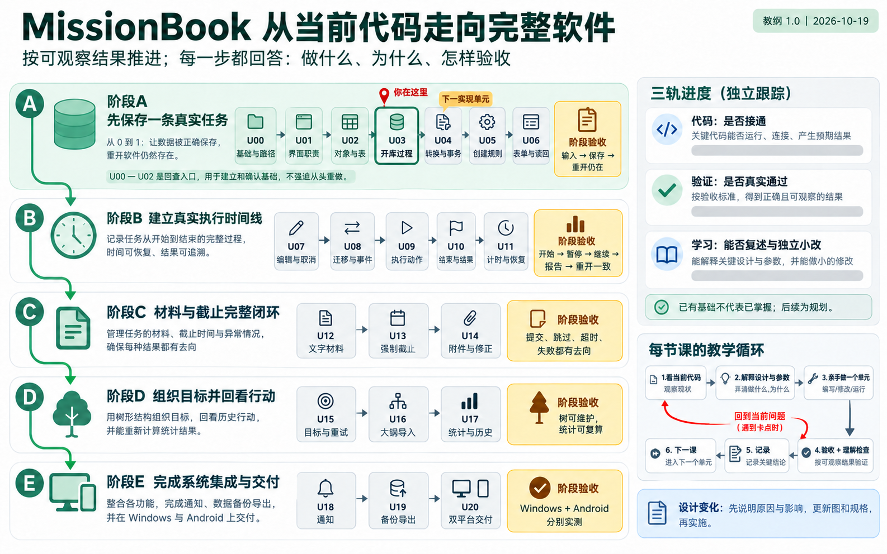
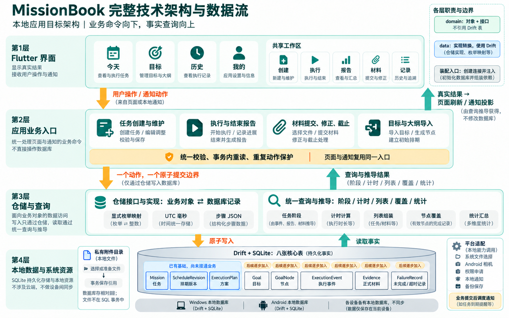

# MissionBook 学习开发教纲

教纲版本：1.0 · 建立日期：2026-10-19。适用起点：能读懂部分 Dart / Flutter 代码，需要沿实际调用逐步解释。

这份教纲负责“接下来做什么、为什么、怎样判断设计合理、怎样验收”。它依据当前代码和既有规格编排，不把目标规格当成已实现功能，也不承诺未来设计永远不调整。

优先通过[完整功能图解](完整功能图解.md)看全貌：七张生图覆盖产品功能、任务生命周期、报告与材料、目标大纲、完整架构、系统流程和开发路线。下面的文字用于逐课补充设计依据与验收。

## 1. 从哪里继续

当前停在 **U03：数据库何时真正打开**。继承关系及 `executor` 的选择过程已有理解记录，不重新讲一遍；接下来只讲 `schemaVersion → migration → beforeOpen → 普通查询`。首课见[当前课：数据库打开过程](当前课-数据库打开过程.md)。

代码进度、验证证据和学习掌握分别记在[学习进度](学习进度.md)。课程顺序与设计调整记在[变更记录](变更记录.md)。教学讲法继续遵守[开发执行计划](开发执行计划.md)，不另立相互冲突的原则。

完整地图用于知道方向；每次只展开当前一个功能单元。U00—U02 是回查入口，不要求为了课程编号从头重写。一个单元可以分数轮解释；不按天数、代码行数或虚构的完成百分比推进。

## 2. 要建成的结果与依据

目前可由现存规格确认的本地产品目标是：Windows / Android 各自保存数据；独立任务能创建、执行、报告、补材料并重开恢复；再加入目标大纲、导入、统计、通知与备份导出。当前不实现 AI 评价、跨设备同步、备份恢复或导入合并。长期愿景不能自动扩大本轮交付范围。

| 结果 | 对应课程 | 依据与交付检查 |
| --- | --- | --- |
| 创建任务，保存后读回，重开仍在 | U03—U06 | [数据模型](../v1.0/数据模型.md)、[存储事务](../v1.0/数据落地与平台.md#2-存储格式与事务)；原子保存三对象，页面显示真实查询结果 |
| 可编辑排期、取消、执行、报告并查看事实 | U07—U11 | [领域模型](../v1.0/领域模型.md)；合法事件、唯一执行中任务、统一阶段与时长 |
| 正式材料、截止、附件与修正 | U12—U14 | [材料规则](../v1.0/领域模型.md#7-evidence-与草稿)、[文件规则](../v1.0/数据落地与平台.md#4-evidence-附件)；草稿和正式事实分开 |
| 目标树、大纲导入、覆盖与历史 | U15—U17 | [目标规则](../v1.0/领域模型.md#2-goal-与-goalnode)、[导入协议](../v1.0/数据落地与平台.md#5-goal-outline-导入) |
| 通知、备份与双平台交付 | U18—U20 | [数据落地与平台](../v1.0/数据落地与平台.md)；真实设备验证，不以构建成功替代 |

**范围缺口 G01：** 仓库被多处引用的 `docs/v1.0/本地应用规格.md` 缺失。本表是基于现存规格的课程覆盖映射，不能代替缺失的正式交付规格。U00 要恢复或核对这份基线；在此之前，已明确的数据库、创建链路可继续，存在歧义的统计口径和最终交付清单不能宣称定稿。

**交互缺口 G02：** [三步交互原则](../ui设计手册/三步交互原则.md)要求从任一顶层入口到操作反馈最多三次必经页面跳转，系统选择器及必要返回也计数。旧[界面与交互](../v1.0/界面与交互.md)的结束、材料多页链尚未全部收敛。相应课程开始前必须先画正常、取消、错误和材料分支，再确定路由；不能照旧图逐页写完才发现超限。

## 3. 整体路线与依赖

这是教学主线，不是所有模块之间都存在技术依赖。例如通知与备份可以在所依赖事实稳定后分别开发；默认串行是为了减少同时引入的概念。若调整顺序，先登记原因和依赖再推进。首次加表或加列时就处理迁移；U08 只是第一次专门讲迁移的课程，不允许在此前发生结构变化时跳过它。

### 阶段 A：从当前基础得到第一个真实结果

| 单元 | 做什么及前置 | 为什么、设计取舍 | 完成后的观察与掌握证据 |
| --- | --- | --- | --- |
| U00 基线与三步路径 | 用现存规格列最终场景；核对缺失规格；为创建、执行、材料、导入、备份画路径。可与 U03 并行整理 | 先约束结果，避免从单张页面图推导整个产品。未决分支标为待设计，不以猜测补齐 | 明确哪些目标确定、哪些待核；逐条数跳数。用户能说明“页面少”不等于省略确认和错误处理 |
| U01 导航与页面职责回查 | 读 `App → AppShell → TodayPage`；核对主题、安全区、滚动、页头与窄屏。只修真实问题 | 壳管理顶层导航，页面管理自身内容；容器依据最终内容决定。源码仍有空 AppBar，需实测顶部占位 | 目标平台无多余顶栏、溢出、键盘遮挡。能指出一个布局改动影响局部还是全局；本课不能算新建任务已实现 |
| U02 同一任务的对象与表 | 用“阅读 20 分钟”对照 Mission、排期、方案及三张表；复查字段、单位、空值和唯一约束 | 业务对象表达含义，表表达存储；data 仓储负责转换。无需重新建模或增加所有未来字段 | 能指出三个 ID 与 missionId 的关系，区分计划日期与 UTC 时刻，说明 Set 不是去除重复数据行 |
| U03 数据库打开过程（当前） | 沿现有 `AppDatabase` 跟踪配置读取者、首次建表、版本变化、打开回调；见首课 | 构造连接配置不等于已经保存；工具生成代码也不等于生成用户数据库。一次只讲一条开库顺序 | 能解释谁读 schemaVersion、谁传 details、为何要 await 外键开启。现有内存测试 5/5 仅证明数据库基础 |
| U04 仓储转换与事务 | 前置 U03。实现 `DriftMissionRepository.create`，完成枚举、毫秒时间、steps JSON 映射及三表写入 | 数据库实现承接已有接口；事务只有一个提交边界。先不用页面拼接三次保存，也不新增通用仓储框架 | 成功读回三条关联记录；任一写入失败无半条任务。测试实际仓储方法，不能复用“手写事务测试”冒充已覆盖 |
| U05 创建业务流程 | 前置 U04。用户输入 → 校验 → 生成 ID/时间 → 三对象 → 仓储；规定统一失败结果 | 构造函数和非空列不足以保证业务合法。页面即时提示提升体验，业务入口仍负责校验；依赖数据库的条件在写事务内重验 | 空白标题、非正分钟、无效日期、FIXED/FLEXIBLE 字段矛盾被拒绝且无写入；同一创建调用的时间和关联 ID 一致 |
| U06 创建表单与真实列表 | 前置 U01、U05，创建路径先过 U00。接通应用数据库生命周期、创建表单、成功反馈、加载/空/错误/列表与订阅释放 | 用一次真实读写闭环验证分工。先开放已可完整兑现的独立自报任务；材料策略暂不可选并明确后续课程，不伪装成最终全部能力 | 保存“阅读 20 分钟”只出现一次；失败保留输入；杀掉应用进程再重开仍在；Android/Windows 分别记录。能独立追踪点击→业务→仓储→SQLite→查询→页面 |

### 阶段 B：执行事实形成可靠时间线

| 单元 | 做什么及前置 | 为什么、设计取舍 | 完成后的观察与掌握证据 |
| --- | --- | --- | --- |
| U07 编辑、改期与取消 | 前置 U06。元数据编辑、排期追加版本、取消入口；写入前重读任务事实 | 修改排期保存完整快照，不能覆盖历史；纯元数据修改不制造新排期。开始后的锁定规则在 U09 连验 | A/1 改到 A/2，旧版本仍在；取消无 END 和失败记录；重复请求不重复改写。能解释“取消”和“执行后未完成”差异 |
| U08 迁移、事件与阶段推导 | 前置 U07。新增执行事件所需模型/表和迁移，保留 v1 任务；建立阶段计算和事件序列规则 | 保存 START/PAUSE 等事实，统一推导阶段；不用页面布尔值另建状态。先不建不使用的材料表 | 旧库升级后任务保留；非法时间顺序、重复 START/END、重复 sequence 被拒绝。用已实现的阶段样例解释推导；六阶段全部联验留至 U13 |
| U09 开始、暂停、继续、延长 | 前置 U08。每次动作经同一业务入口，在写事务内读事实、校验、分配序号、追加事件 | 处理重复点击及两个任务竞争开始。按钮禁用不能代替数据库边界上的保护 | 全局最多一个 RUNNING，多任务可 PAUSED；暂停后 EXTEND 不恢复计时；设备时间倒退拒绝非法事件。能解释第二个 START 为什么失败 |
| U10 结束报告与结果 | 前置 U09，结束路径先过 U00。实现 END、未完成 FailureRecord、结果事实视图；确认提交前不提前写 END | 完成报告与材料/AI 判断分开。取消确认、继续执行的细节依据领域和交互规则核对；必要事实同一事务保存 | 自报完成直接关闭；未完成可不填原因且记录完整；重复提交不重复 END；结果无虚构评分。能区分自报完成、结束和通过验证 |
| U11 时长、生命周期与恢复 | 前置 U10。由事件算专注/暂停/总时长；页面计时只刷新；切后台/跨午夜/重开验证 | 定时器不是事实存储。不能用 Timer 每秒自增的数字作为持久化时长；测试时钟可注入但不另建复杂时间框架 | 运行中关闭应用不隐式暂停；暂停期间不算专注；重开一致，日期跨越正确。能手算一条 START/PAUSE/RESUME/END 时间线 |

### 阶段 C：材料、截止与可恢复的文件操作

| 单元 | 做什么及前置 | 为什么、设计取舍 | 完成后的观察与掌握证据 |
| --- | --- | --- | --- |
| U12 文字材料和可选分流 | 前置 U11。迁移 Evidence、材料放弃字段，接入文字/代码/手动记录草稿；开放可选材料策略 | 草稿属于编辑状态，正式材料是历史事实；选择稍后提交、直接结束和跳过分别留正确事实，不存第二份阶段字段 | 选择补材料才进入 EVIDENCE_PENDING；至少一条有效材料才可整批提交；失败保留草稿；跳过后关闭。能指出草稿什么时候成为正式事实 |
| U13 强制材料与截止竞争 | 前置 U12。开放强制策略、截止设置、启动/前台补算；事务内捕获时刻，首次提交与超时互斥 | 截止不强制终止尚在执行的任务；到期失败记录要真实提交，不能随业务拒绝异常一起回滚 | 截止前提交成功；now 等于截止即超时；晚 END 同时写超时；重复补算只一条记录。六阶段与全部 END 分流按规格联验 |
| U14 附件与正式修正 | 前置 U13，文件路径先过 U00。系统选择、Android 拍照、私有副本、相对键、不可变修正链及孤立文件清理 | 文件准备在事务前，正式引用在事务中；新修正保留旧文件和记录。数据库回滚不能自动回滚文件系统 | 超过 20 MiB 拒绝；来源文件删除后正式副本可读；权限拒绝/取消/拷贝失败/缺失可解释；清理不碰正式引用；修正无分叉。Windows 图片走文件选择 |

### 阶段 D：目标与回看

| 单元 | 做什么及前置 | 为什么、设计取舍 | 完成后的观察与掌握证据 |
| --- | --- | --- | --- |
| U15 目标树、归属与再次尝试 | 前置 U14；Goal/GoalNode 及 Mission 归属、RETRY 字段分小步迁移。实现树、状态、归档/恢复、关联任务和重试 | 独立任务先成立，再增加组织关系。目标状态不改旧任务；重试创建新任务，不复活或覆盖历史 | 父子同 Goal、无环、有效祖先；归档子树不删记录；非 ACTIVE 目标禁止新任务；旧任务可继续；重试保留来源但有新事件。能说清归属与血缘的差异 |
| U16 大纲 JSON 导入 | 前置 U15。读取/粘贴→结构校验→预览→确认→一次事务创建规范化树 | JSON 是输入协议，不是运行时数据库；用户确认前不写入。系统选择器也算跳转 | 2 MiB、500 节点、12 层边界；重复 key、未知字段/版本拒绝；取消和写失败均零残留。能指出预览与提交的界线 |
| U17 Today、历史与覆盖统计 | 前置 U15，G01 日期口径先核清；查询统一聚合、过滤与空状态 | 把指标追到原始事实，拒绝“完成记录=掌握度”。计划日期、END 活动日期、材料提交时刻不可混算 | 过期待开始不自动推明天；零节点显示暂无节点；父节点不自动继承子节点完成；跨时区分组可复算。用户用小样本手算对照页面 |

### 阶段 E：系统集成与交付

| 单元 | 做什么及前置 | 为什么、设计取舍 | 完成后的观察与掌握证据 |
| --- | --- | --- | --- |
| U18 通知、权限与对账 | 前置 U11、U13，事实投影稳定。开始提醒、执行摘要、延后偏好、启动/系统重启对账、平台权限 | 通知调用同一业务入口；调度在提交后，失败不回滚任务。通知不是计时器，也不是阶段真相 | FIXED 提醒不自动 START；FLEXIBLE 不设开始提醒；延后偏好重开保留；重复/过期按钮安全；拒权仍能应用内操作。两平台按实际能力记录 |
| U19 一致备份导出 | 前置 U14、U15，备份路径先过 U00。数据库一致快照＋正式附件＋manifest，交给系统保存 | 不能写入中只复制数据库主文件；不能遗漏已引用附件；本版仅导出，恢复不进入本课 | 缺失附件明确失败；归档数据库可独立检查，附件引用齐全，无草稿、缓存和通知元数据；取消导出不改源数据 |
| U20 双平台交付与复盘 | 前置全部必需课程及 G01/G02 收敛。新装、升级、进程退出、权限、宽窄屏、键盘、图标、错误恢复与打包 | 自动测试证明规则，设备操作证明环境；将证据落实到平台/版本/场景，不以截图和构建冒充验收 | Windows 与 Android 各跑交付清单；保留原记录升级；三步分支全部实走；未验收项列明。用户能独立实现一个小需求并说明影响与回退 |

## 4. 下一单元 U04 怎样拆成可理解的过程

U04 是下一个实现单元，需先结束 U03 的当前疑问。它按下面三轮展开，不一次塞出整个创建功能。

1. **先看转换。** 取同一个“阅读 20 分钟”的 Mission，指出 id/title/createdAt 的来源。把 selfReport 显式映射为稳定存储文本，把 DateTime 映射为毫秒，解释字段缺省、显式 null 和实际值的区别。再对照排期与方案，不同时讲页面状态管理。
2. **再写一个完整保存过程。** 在 data 仓储实现接口；先检查接口约定的同一 missionId、初始版本、未取消等条件，在同一个 `transaction` 中依序 await 三次写入。未来涉及数据库旧事实的校验必须在事务里重读，页面不能承担这个责任。
3. **最后验证并口述。** 用实际仓储方法创建并读回；故意让后续写入失败，检查全部回滚。用户独立指出新增一个可空字段需要改哪些位置；没有口述/独立修改证据时只记“代码验证通过”，不记“已掌握”。

预计首次涉及文件：新建 `lib/data/repositories/drift_mission_repository.dart`；新增对应仓储行为测试。若必须改变现有接口或模型，先解释现有约定哪里不够，并在变更记录留下差异；不会为了凑目录提前创建一套 DTO、Service、DAO、Provider。

U05 才引入创建业务入口；U06 才将该入口接到表单与查询。每轮代码按完整功能组织，解释按当前卡住的一条值传递链组织。

## 5. 架构是否合理：每次用同一组问题判断

图为整版目标架构，源码现状以[学习进度](学习进度.md)为准。完整业务分支与图的语义见[完整功能图解](完整功能图解.md)，原先的三层基础图保留在[配图说明](配图说明.md)供局部讲解。

| 检查点 | 本项目的当前选择 | 什么时候应调整 |
| --- | --- | --- |
| 规则放在哪里 | 页面收集输入和呈现结果；创建/执行业务入口组织一次动作；仓储实现转换与数据库事务；纯推导保持可单独测试 | 页面、通知各复制一份规则时应收敛入口；只做一次转发的空层不值得保留 |
| 谁拥有事务 | 简单创建由仓储实现完成原子写入；跨表动作必须有且只有一个明确提交边界 | 接入目标、材料等后若一个入口调用多个各自提交的仓储，必须先设计共享事务，不允许半条业务成功 |
| 谁依赖谁 | domain 对象与接口不引用 Drift 表；data 实现依赖 domain 和 Drift；应用装配持有数据库与实现，再注入调用者 | 发现 domain 被数据库生成类型渗透，或页面到处创建数据库连接时回查职责 |
| 是否过度设计 | 保留已存在的三层职责；在具体业务需要时增加小的流程对象。先用构造参数传依赖 | 有实际生命周期、订阅或重复状态问题时再决定状态管理库；不因教程流行就全量换框架 |
| 事实是否重复 | 事件、END、材料、取消时间是真实记录；阶段和统计集中推导 | 新字段可由事实算出时，先证明为何需要持久化，避免多个可写状态互相冲突 |
| 对失败是否完整 | 业务事务失败不留半条记录；提交失败保留当前草稿，进程退出不保证草稿恢复；文件准备与通知调度有独立失败处理 | 新外部副作用跨越数据库事务时补失败路径和恢复，不把全部事情塞进长事务 |

这些是针对 MissionBook 的设计判断，不是 Flutter 语法强制。Flutter 官方强调职责分离，同时将额外 domain/use-case 层列为条件性选择；这里保留已有 domain，是因为任务事件、材料与截止已有明确规则需求。见[官方架构建议](https://docs.flutter.dev/app-architecture/recommendations)。

事务内的异步数据库操作需要等待完成，查询流在事务提交后才收到外部可见更新；U04/U06 据此安排。见 [Drift 事务文档](https://drift.simonbinder.eu/dart_api/transactions/)。结构升级必须考虑旧数据并验证迁移，见 [Drift 迁移文档](https://drift.simonbinder.eu/migrations/)。资料核对日期：2026-10-19；代码写法仍以项目锁定依赖为准，不顺手升级依赖。

## 6. 每轮教学固定交付什么

每轮开始核对当前文件与[学习进度](学习进度.md)，随后给出以下内容；不用每次向用户复读规则。

| 顺序 | 交付内容 |
| --- | --- |
| 目标 | 本轮一个可观察结果，接上哪一课，暂不开放哪些能力 |
| 设计 | 对应规格；一张必要的关系/流程图；目标组件树或调用链；为何这样分工；一个常见替代方案及代价 |
| 实现 | 明确新增、替换、保留的位置；关键字段中文含义、单位/空值；每个值由用户、调用者、系统、框架或我们写定中的谁提供 |
| 验收 | 一个正常场景、与本轮风险相关的失败/边界场景；命令/设备/实际结果，缺少的证据明确列出 |
| 掌握 | 让用户沿一条调用复述，或独立改一个小条件；不是照抄后询问“懂了吗” |
| 记录 | 分别更新实现、验证、掌握；记录当前卡点；有设计或顺序变化则更新变更记录，下一轮从这里继续 |

用户说“看不懂”时停止新增功能，先定位一个值或一个调用；不重讲已会的继承，也不以加长文章应对过载。默认让用户亲自写实现；明确要求代写或排错时才接手该范围。本轮是设计教纲，因此只新增教学材料、入口和工作约定。

## 7. 配图与维护规则

- 架构职责变化、状态/业务流程分支变化、组件树和参数传递难以理解时生成对应解释图；每个语法点不强行配一张海报。
- 架构和完整功能流程优先使用内置生图生成的图片，先提供总图再展开分支图，帮助直观看到模块、输入输出、判断和回路；课程按钮地图作为辅助入口。
- 图先有可审阅的文字语义，再生成并检查中文、箭头、阶段标签。标清“当前已有 / 待实现 / 建议方案”，不能用图代替源码证据。
- 图片服务于这一课：同一任务贯穿图与代码，必要时局部放大；正式图放本目录 assets，适用课程写在图解说明，提示词统一放本目录制作记录，旧图的替换原因写进变更记录。
- 教纲负责顺序，学习进度负责当前状态，变更记录负责调整历史；业务规则仍只在原规格中定义。可视化视图是某日快照，点击浏览或发起学习不会自动修改掌握状态。
- 日后每完成一轮教学就更新记录；不创建后台计划任务，不在用户未参与时自动宣称教学推进。

## 8. 暂缓事项不是遗忘

AI 规划/评价、云端账户和同步、跨设备接力、备份恢复、复杂 Provider 接入、全量架构框架和无使用者的接口都不进入当前课程。触发新增需求时先核对[未来方向](../v1.0/未来方向.md)，记录目标、成本、影响和验收，再决定插课或改版。
