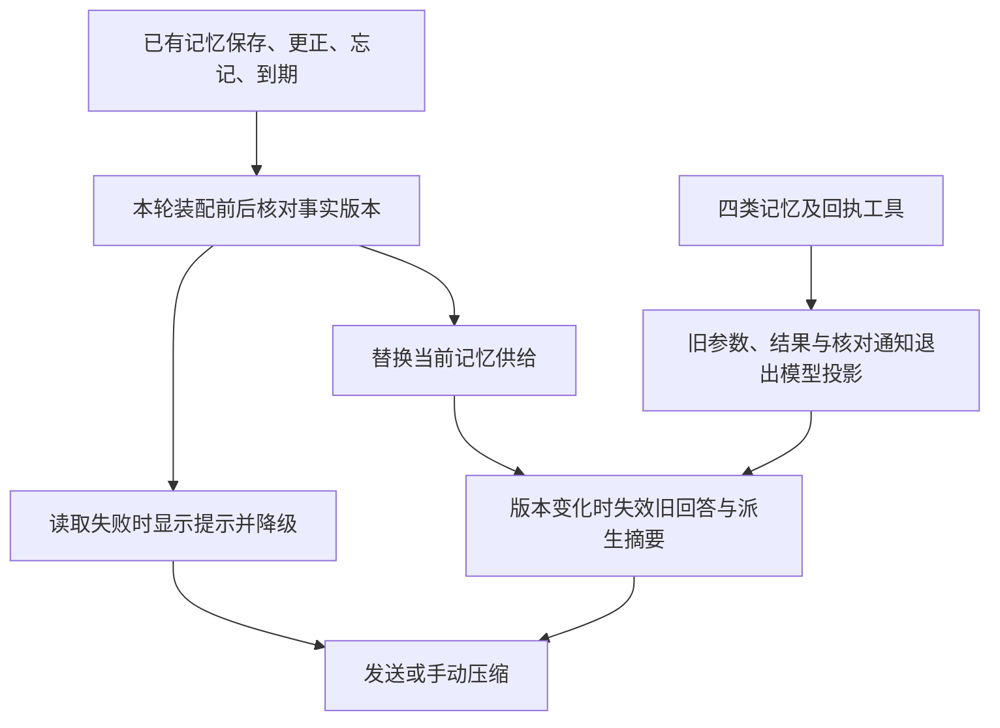

# 长期记忆

> 2026-11-13 接续收尾：话题身份召回、整句别名、记忆版本派生失效、读取失败提示、派生缓存与工具结果上限已接入。当前 `schemaVersion` 18、新装 25 表，以 [current_schema_test.dart](../../../../test/data/local/current_schema_test.dart) 为结构核对依据。验证结果见文末及[本机复验记录](../../../审查/2026-11-13-长期记忆本机复验.md)，模块入口见[助手与总结总览](总览.md)。

## 数据模型

| 表 | 字段与用途 |
| --- | --- |
| `memory_items` | id、layer、topic_id、content、certainty、importance、created_at、updated_at、expires_at、forgotten、user_edited、source_kind、source_ref、goal_id；索引覆盖 layer、topic、goal 与更新时间的组合 |
| `memory_topics` | id、canonical_name、kind、goal_id、created_at；主题按目标作用域隔离 |
| `memory_topic_aliases` | topic_id、alias、normalized_alias；同义说法归入同一主题，供写入消解与检索召回 |
| `memory_versions` | id、item_id、change_kind、before_json、after_json、reason、operation_id、actor、created_at；追加式历史，禁止静默覆盖 |
| `memory_episodes` | item_id、source_refs_json；将情节记忆关联到来源引用，随记忆条目读取 |
| `memory_procedures` | item_id、steps_json、trigger_context、source_refs_json；保存流程步骤、触发条件与来源引用 |
| `memory_usage` | item_id、recall_count、inject_count、last_used_at；由成功读取/注入后的派生使用统计参与排序，不属于版本快照 |
| `app_settings` | key、value、updated_at；当前保存记忆抽取开关，随完整备份导出 |

`layer` 取 `identity / semantic / episodic / procedural / observation`，是独立列，不再由 kind 兼任。`certainty` 取 `stated / inferred / unverified` 三态。`importance` 为 1–100，默认 50。`source_kind` 取 `user / assistant / extraction / manual / reflection`，`source_ref` 记录会话与消息位置等可追溯依据。

五层语义与生命周期：

| 层 | 当前写入 | 注入位置 |
| --- | --- | --- |
| identity 身份与稳定偏好 | 用户/AI/抽取 | 稳定块或话题命中块，优先用户更正 |
| semantic 语义事实 | 用户/AI/抽取 | 稳定块、目标块或话题块 |
| procedural 习惯做法与流程 | AI/用户 | 目标块或话题块 |
| observation 待验证观察 | AI/用户，固定 unverified | 观察块，明确不作事实 |
| episodic 情节记忆 | 用户/AI/反思动作按来源引用写入 | 目标块、话题块或情节专用块，按检索命中注入 |

`episodic` 与 `procedural` 已有派生表、反思动作写入与读取路径；通用 save 同步新增、更正、换层及来源，省略步骤或触发条件时保留原值，换层清理旧派生行。仓储专项已覆盖这些路径及反思逐动作回滚。`memory_usage` 已接入召回、成功替换记忆块后的注入记录与评分，控制器关闭等待统计写入排空；记录器对条目及召回/注入种类分别按 30 秒节流，以 best-effort 异步写入，失败不阻断发送，计数不是每次访问的精确审计。FTS5 与 embedding 当前仍未引入。

## 写入闭环

```text
AI saveMemory → 工具校验本轮 basis / 固定更正快照
  → MemoryService.save → 仓储事务（凭据拦截、主题与版本检查）
  → 主题消解：canonical_name 或 alias 命中 → 复用主题；否则新建主题并写别名
  → 乐观锁：expectedVersion 与 14 字段快照比较
  → 墓碑：同作用域同正文的 forgotten 条目阻止恢复
  → NOOP / UPDATE / ADD / BLOCK + reason + 目标 id
  → 每次实际变更写 memory_versions（before/after/reason/actor/operation_id）
```

- **NOOP**：归一化后正文、层、确认程度、期限、主题与重要度完全相同；原条目由用户编辑时自动写入保持原样。
- **UPDATE**：用户手动编辑，或 AI 携带 `id`、原快照与逐字原话的明确更正；回执带 `previousContent`。
- **ADD**：无同主题冲突时按给定确认程度新增；同主题不同正文时原条目不变，新说法以 `unverified` 新增并带回执 `keptId`。
- **BLOCK**：`changed`（快照不一致）、`protected_memory`（墓碑）、`forgotten_memory`、`existing_id`（自动写入携带已存在 id）。
- 凭据正则覆盖正文、主题、别名与来源引用；每次实际写入与回执在同一事务内保存。记忆保存回执同时提供请求 `id`（若有）与实际生效条目的 `resultId`；冲突保留原事实时，`resultId` 指向新建条目，`keptId` 指向保留条目。
- 回执区分请求 id、实际生效 `resultId` 与保留条目 `keptId`；不能假定回执 `entityId` 恒等于最终结果条目。条目版本不包含派生 usage，统计更新不应使更正快照失效。
- 已修时间衰减的毫秒/天换算错误。所有 AI save certainty 均校验本轮原话依据；带 id 的更正必须 stated，不能用 unverified 绕过更正门控。AI 更正保留既有人工保护，但不会把新条目标为用户手动编辑；版本 actor 与 resultId 分别记录实际写入者和结果。

## 工具

- `saveMemory`：content、layer、certainty、topic、aliases、importance、goalId、basis、expiresAt。有同义说法时必须登记 `aliases`，例如正文“我习惯早上跑步”登记“晨跑”“早上跑步”；别名同时用于检索与每轮自动注入。所有 AI save 的 certainty（stated、inferred、unverified）均须以 basis 逐字引用本轮最后一条用户消息的连续原文，保留换行与标点，不得拼接、改写或引用工具/网页内容；content 可概括。工具专项已覆盖依据接受/拒绝边界。observation 固定 unverified；带 id 的更正必须 stated 并先固定原快照。该工具门控不等于语义授权证明，也不表示手动编辑及后台反思共用同一工具入口。
- `getMemory`：支持 goalId、layer、search、offset/limit、fullContent；结果按评分排序并标注 layer、topic、aliases、certainty 与版本快照，供清理清单固定使用。
- `manageMemory`：按固定 selectionId 与 itemId 批量忘记，清单变化整批零写入。

## 检索

`queryMemory` 过滤墓碑、过期、目标与层级；关键词同时匹配正文、主题名、主题别名（LIKE 转义 `%` 与 `_`），中文按二字片段回退。排序为确定性加权：

```text
score = 相关性×4 + 确认程度×2 + 层级×1 + 重要度×0.5 + 目标亲和×0.8 + 新鲜度×2 + 使用信号×0.25
相关性：正文完整命中 1.0；主题/别名命中 0.95；部分命中 0.25～0.75；无关键词 0.5
确认程度：用户编辑 1.0；stated 0.8；inferred 0.5；unverified 0.25
层级：identity 1.0；semantic 0.8；procedural 0.7；episodic 0.5；observation 0.2
新鲜度：0.5^(距今天数/90)，过期额外减 3
使用信号：`log2(1 + recallCount + 2×injectCount)`，统计只存于 `memory_usage`，不改变版本快照
```

完整评分先在 SQL 内排序再截断有限候选，Dart 复用 SQL 相关度完成一致排序。同分次序为 `user_edited DESC, updated_at DESC, id ASC`。有限候选与情节/流程读取共用最多 16 键的缓存，以本连接写入计数与数据库版本戳失效；事务内禁用缓存，跨过过期时间或排名边界可能变化时重新查询。跨连接更正后的候选与事实版本失效已有文件库专项。流程字段同时随话题候选联表读取，防止该条未进入派生候选时遗漏步骤。

已登记别名支持“检索词包含别名”与“别名包含检索词”两个方向，因此整句提问可以命中短别名。当前没有向量或通用同义消解器。真实 B 用例的整句含“习惯”，可按中文片段命中“我习惯早上跑步”；修复点是允许已命中的较早 identity 进入话题块。单独查询未登记别名的“晨跑”仍无字面命中，该用例只验证整句召回。

## 上下文装配

`MemoryContextAssembler` 位于应用层，每轮发送前纯读记忆与任务事实，不调模型、不走 AndReconcile。当前装配 stable、goal、topic、episode、procedure、unverified 及可选 goalBrief；各块有局部预算，同时检查最终 JSON 总量。

当前实现与装配专项覆盖：

1. **最终序列化 JSON 的估算总量 ≤800 tokens**，包含结构开销、goalBrief、标记和流程字段。这是应用估算，不是供应商 tokenizer 的精确计数。
2. stable 同时可选全局 identity 与 semantic 的 stated 条目；话题命中包含 identity 并优先注入，按条目去重，超额整条省略并标 `omitted`，正文最多 160 个 Unicode 字符后标截断。
3. 无目标时只装配全局记忆；引用目标时只可装配全局与该目标，其他目标不能混入。日记本“全部记忆”的浏览范围不能直接当作助手注入范围。
4. goalBrief 经 `MissionService.findForGoal` 只读装配任务标题、完整派生阶段、日期与计划时长，并在同一总预算内截取；不补算材料截止、不复制可写时间线。
5. 读取或装配失败返回带 warning 的空块，聊天页在消息列表外显示可读提示，恢复后清除。发送继续完成，旧供给退出投影。异常正文不会进入提示。控制器 `lastMemoryInjection` 保留条目、层级、确认程度、所属块与原因。

预算、stable 的 identity/semantic 交错装配、目标隔离、情节/流程字段已有实现及定向测试。它们证明装配行为，不等于真实模型一定采纳，也不代表性能门槛已全部达标。

## 注入与压缩

`mission_book_context` 与 `mission_book_memory` 都通过 `AgentSession.replaceContext` 替换同来源块。记忆携带 `sourceRevision`，由更正/遗忘版本数和已到期条目数组成，新增和 usage 不改变该版本。装配前后版本不一致时本轮返回降级提示，避免混入并发变化的事实。文本及版本均相同时不追加记录。

记忆版本变化时，保守失效此前使用旧版本记忆的模型回答及其调用参数，恢复受影响摘要中的原始用户消息和工具配对后重建投影。因话题选择而换块、但版本相同时，原回答继续保留。版本为全局保守边界，其他目标发生更正也可能使当前会话依赖旧版本的回答退出模型上下文。原始聊天、工具回执与版本记录仍可追溯。

当前代码将可替换供给标为 pinned，在压缩时排除摘要输入并保留当前块；新摘要写 `safetyVersion: 1`，连续压缩承接安全摘要，普通核对通知不永久固定。回放保留历史投影顺序，再以 `context_projection_reset` 记录旧投影重建。

应用在挂接会话时注册 `getMemory / saveMemory / manageMemory / getOperation` 失效策略。发送、继续和手动压缩前，旧调用中的记忆参数、结果、同轮模型说明及未知写入核对通知退出投影，依赖摘要恢复后重建。`getOperation` 同时承载其他业务回执，其旧结果也会刷新，编号可供重新读取。手动压缩先通过与发送相同的记忆装配入口核对当前版本。原 transcript、用户原话、备份和持久回执保留历史。



## 抽取与开关

用户消息持久化时由 `analysis_conversation_memory` 触发器按 `app_settings.memory.extraction.enabled` 决定是否排记忆任务；`AnalysisService` 读取同一开关决定是否领取自动 memory/reflection 任务。关闭后不再排新自动抽取任务，已有记忆仍检索并注入；已发出的网络请求不保证取消，但模型返回后、落库前再次检查开关、主会话占用与服务关闭状态，拒绝迟到发布。设置读取失败保留最近成功值，初始默认开启，不能重新打开已关闭状态。开关位于“助手设置 → 自动总结 → 自动整理对话记忆”，即时单独保存，与任务/节点/目标三层的“保存设置”相互独立，随完整备份导出恢复。

后台提取仍只接收带用户原文 `quote` 的 `identity / semantic / procedural` 且 `certainty='stated'`，不走未验证观察；提示词要求同时返回正文关键说法与常见同义别名。

## 忘记与墓碑

忘记写墓碑（`forgotten=1`、`user_edited=1`）并追加版本，不物理删除；同作用域同正文的新写入被 `protected_memory` 阻止，不按来源判断。过期条目不再注入或检索，但保留原行与版本。

## 日记本

`MemoryPage` 支持目标筛选、层级筛选、过期筛选、来源/原话/有效期/载入范围展示与未验证标注；编辑弹层可选择层级、确认程度、主题与同义别名，观察层强制未验证。别名用逗号分隔，保存时写入主题别名表并在编辑时回显；列表读取同一仓储与评分，不新增中间页。

### 用户体验与待验收路径

以下按现有页面文案核对，步骤说明不代表设备验收已经通过。

1. 打开“助手设置 → AI 日记本”（软件设置中的“AI 助手设置”也可进入）。搜索框常驻，展开默认折叠的“筛选”可使用“记忆层”“目标范围（含全局记忆）”和“包含过期”；收起后标题显示启用条件数量，展开“来源与有效期”核对来源、别名、期限与载入范围。选择目标仍包含全局条目；“全部记忆”可浏览所有目标，不表示所有目标都注入助手。
2. 点“添加记忆”或卡片编辑，填写内容、层级、确认程度、重要度、主题、同义别名和有效期。例如主题“运动习惯”、别名“晨跑，早上跑步”，再搜索“晨跑”验证。新增目前保存为全局记忆，不会继承列表目标筛选；更正保留原 goalId，弹层没有目标改绑选项。观察层强制未验证。
3. 从目标页面打开关联助手，明确表达需记住的目标相关信息，核对工具实际传入的 goalId 与保存结果；新建工具调用未传 goalId 时为全局，更正未传时保留原作用域，当前引用不会自动补成保存参数。不能仅因自然语言提到某目标或从目标页进入就推断绑定成功。回到日记本筛选该目标核对，再切换其他目标验证注入隔离、情节/流程及目标 brief。此项真机交互尚未验收，交由接续开发验证。
4. 在“助手设置 → 自动总结 → 自动整理对话记忆”关闭开关（即时单独保存）。发送新消息检查不再新排自动抽取，已有记忆仍可使用；开启后验证恢复。任务、节点、目标开关仍需“保存设置”。界面实际名称不是“自动抽取记忆”。
5. 在聊天输入区点按或长按预算圆环，打开“上下文与用量 → 压缩早期对话”；运行、初始化或待核对未知结果时入口禁用。面板展示预算与用量，不展示逐条记忆清单。长对话自动压缩与连续压缩已有脚本专项通过，真实模型及真机交互仍待接续复验。
6. 点卡片“忘记记忆”，在“忘记这条记忆？”中确认“忘记”。再发相关问题，检查新请求、旧摘要及工具结果投影；不能只用日记本条目消失判断成功。墓碑保护同范围同正文；原对话日志与既有备份仍保留历史。getMemory 传播已有脚本回归，其他记忆工具和真实模型清理仍待接续。
7. 打开“软件设置 → 数据备份”或“助手设置 → 数据备份”，导出前选择本机资源，业务数据与材料原件始终一起导出；导入先选择 ZIP、校验预览，再确认替换并重建工作区。核对记忆、派生表、usage、版本、墓碑与抽取开关往返；旧格式或结构不匹配直接拒绝。详见[数据备份与恢复](../数据备份与恢复/README.md)。

## 备份与恢复

完整备份为 formatVersion 2：`database.json` 保存当前全部 25 表行数据，`manifest.json` 保存 schemaVersion、结构指纹与附件清单。指纹基于版本、表列及索引/触发器名称，不是 SQL 定义全文的哈希。恢复只接受同版本、同指纹、同表列集合，不执行备份包内提供的 SQL/DDL；应用自身仍执行参数化 INSERT、清空表、停用/重建当前库触发器与外键检查。因此不能概括为“完全不执行 SQL”。`app_settings` 中的抽取开关随行数据一起往返。

## 阶段交接验证与接续开发

2026-11-13 用户要求暂时保持当前有限实现、更新文档并完整提交推送，改由自己的电脑继续开发。因此停止性能调查、运行时、模型预算和工具有界化的在途任务，保留已落地代码；没有把未返回的成员任务计作完成。交接时仅修复新模型预算测试的编译错误、流程控制 lint 与旧连接检查断言，并格式化对应文件，未继续扩展功能。

### 本次交接实跑

接续机器于 2026-11-13 完成[本机复验](../../../审查/2026-11-13-长期记忆本机复验.md)。真实模型 10 通过、1 无别名同义召回失败，Android 模拟器 4 条流程通过，单并发混合 5k p95 为 3.867 ms。下表保留交接时原始结果。

| 命令 / 范围 | 实际结果 | 结论边界 |
| --- | --- | --- |
| `flutter analyze --no-pub` | 通过，0 issue | 包含根工程与当前测试代码 |
| `flutter test --no-pub --reporter expanded` | 1036 通过、45 跳过、1 失败，退出码 1 | 唯一失败为混合 5k 性能；跳过不算通过，真实模型与环境门控专项未默认执行 |
| 模型预算 + 生命周期两文件专项 | 40 通过 | 脚本模型验证路由、预算、完成状态与生命周期，不是供应商效果验收 |
| `packages/agent_core` 中 `dart analyze` | 通过，0 issue | 当前包代码与测试 |
| `packages/agent_core` 中 `dart test --reporter expanded` | 140 通过、1 跳过 | 跳过项要求 `DEEPSEEK_API_KEY`，本次未注入凭据 |
| `MEMORY_COMPACTION=1` 两文件压缩专项 | 9 通过 | 覆盖手动/自动压缩、连续摘要、旧摘要、getMemory→忘记→压缩→重开；使用脚本模型，不等于真实回答验收 |

根工程全量已运行仓储契约、派生同步、反思拒绝/回滚、usage、basis、800 估算预算、目标隔离、日记本、抽取停机及备份真实写入失败回滚等专项。最初交接预检发现的新测试编译错误和旧空正文成功断言已修正并复验；上表是修正后的结果，不能将其写成全量通过。验证期间不读测试凭据、不发起真实模型请求、不安装或清除设备数据。

性能失败位于 [memory_contract_completion_test.dart](../../../../test/data/memory_contract_completion_test.dart) 的“5k 真实注入 SQL 候选有界且预热后 p95 小于 5ms”：5000 条混合数据、topic=alpha、预热 10 次、采样 100 次，交接全量中 p50=4.518 ms、p95=6.280 ms、max=9.228 ms，门槛为严格小于 5 ms。此前单并发三文件基准仍为 p95=5.181 ms，故不能只归因为并发噪声。其他 5k 夹具曾约 2.9–3.0 ms 不能覆盖该失败；不放宽门槛、不删除用例。

### 历史模型与效果证据

- 先前真实 DeepSeek 工具用例 1 通过；adoption 6 通过、1 失败。失败项“采纳 3”当时在压缩前没有注入 semantic 通勤记忆；当前已补 stable semantic，脚本回归通过，但没有对交接树重新运行真实 DeepSeek，因此保留真实模型失败与待复验结论。
- S6-A 显式别名召回有历史通过证据；S6-B 无别名脚本场景历史失败。真实 B 场景曾通过的断言仅检查上下文，不证明通用同义能力或回答采纳。
- 更早 Flutter 全量 921/41、1k/5k p95 2.516/4.729 ms 等属于历史快照，不能作为交接树验收。原始运行输出保存在执行机的仓库外临时目录，未作为仓库文件同步；可按下列命令在接续机器复现。

### 接续优先级

以下保留交接时的待办背景。本机后续已实现派生缓存、跨连接回归、四类工具失效、记忆版本派生清理及工具结果上限，最新验收见[本机记录](../../../审查/2026-11-13-长期记忆本机复验.md)。

1. 优化混合 5k 装配查询/缓存/派生读取，先定位耗时，保留完整评分后截断候选、800 预算、目标隔离及性能断言；补另一数据库连接写入后的候选缓存失效测试。
2. 完成所有携带记忆正文的工具结果与衍生摘要失效策略。当前应用仅注册 getMemory；不能据此保证 saveMemory、其他工具输出或用户原话中的内容被遗忘。保留 transcript、日志和用户原话，不用删除原始对话制造通过。
3. 工具单节点超长标题/元数据与通用 `ToolOutput` 硬上限尚未落地；当前分页、片段上限不等于所有结果都有总预算。对应有界返回任务停止时未留下生产改动。
4. 在官方 DeepSeek 端点上重跑工具、长对话、跨会话、目标级记忆、观察、冲突、连续压缩及遗忘后的真实采纳；凭据仅从仓库外注入进程环境，禁止写进代码、文档、配置或日志，测试结束轮换临时 key。
5. 完成 Android 真机日记本编辑、目标隔离、抽取开关、长对话压缩、遗忘和 formatVersion 2 导出/恢复。已发现在线设备但本轮未安装或操作；schema 18 拒绝旧库，先保留旧数据，不以清库代替兼容。

### 接续命令

先使用项目锁定依赖与可用 Flutter SDK，在仓库根运行：

```bash
flutter pub get
flutter analyze --no-pub
flutter test --no-pub --reporter expanded
MEMORY_COMPACTION=1 flutter test --no-pub test/eval/memory_compaction_paths_test.dart test/eval/memory_multi_compaction_test.dart --reporter expanded
MEMORY_BENCH=1 flutter test --no-pub test/data/memory_contract_completion_test.dart test/data/memory_assembly_completion_test.dart test/eval/memory_latency_benchmark_test.dart --concurrency=1 --reporter expanded
```

再在 `packages/agent_core` 运行 `dart analyze` 与 `dart test --reporter expanded`。效果基线需显式设置 `MEMORY_EVAL=1`；真实模型测试在 `test/manual/`，只有主动准备仓库外凭据后运行，不把默认跳过计作真实模型验证。本轮不标记完整重构完成、目标设备验收或用户掌握。
