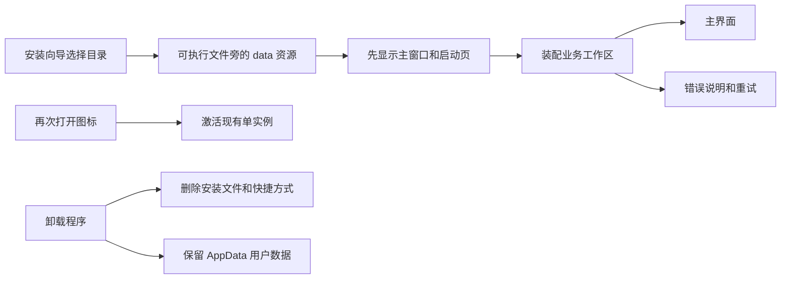
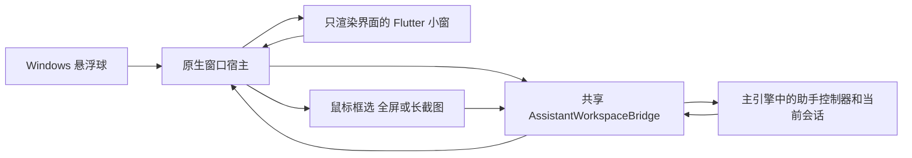

# Windows 桌面助手

在「助手设置 → 跨应用悬浮窗」开启桌面悬浮球。主窗口最小化后，书祺仍可在其他应用上展开。点击头像可选文字、语音、截图和更多，靠边拖动可收起成距屏幕边缘 10 个逻辑像素的绿色短线；点线或向内拖动恢复。功能球和聊天根据所在显示器的 DPI 与可用区域布局，聊天与头像之间留出操作间距。

## 安装器、升级与启动

[Windows 安装器源码](../../../../tool/windows/installer/MissionBook.iss)定义 x64 向导、用户级默认安装目录、路径选择、快捷方式与卸载；[构建脚本](../../../../tool/windows/build_windows_installer.ps1)从独立 Release 目录编译，输出安装程序及 SHA-256 校验值。

安装不会在程序目录保存数据库。`path_provider_windows` 把数据放在 `%APPDATA%\chat.liuxin\Mission Book`；卸载只移除程序和快捷方式，不删除该目录。应用支持任意安装路径：原生入口由可执行文件绝对路径定位 Flutter `data` 并设置插件工作目录。主窗口在 Dart 工作区初始化前可见，初始化失败显示原因和重试入口。当前用户会话仅保留一个 MissionBook 主进程；重复打开会将原窗口恢复到前台。

签名边界与设备验收要求见[Windows 安装器说明](../../../../windows/installer/README.md)。本机出现 `_createDevFS`、数据库只读或启动后点击无响应时，先按[Windows 运行与完整性排错](../../../开发/Windows运行排错.md)检查目录完整性标签，再判断业务代码。
## 调用链

- [WindowsAssistantOverlay](../../../../windows/runner/windows_assistant_overlay.cpp)管理非主窗口、圆形操作区、边缘、DPI 和开关。小窗引擎只渲染 [Windows 悬浮界面](../../../../lib/presentation/assistant/desktop/windows_assistant_overlay.dart)，由主引擎提供草稿、回复、录音、附件和操作快照。主引擎持有数据库和运行时会话。
- [AssistantWorkspaceBridge](../../../../lib/data/assistant/assistant_workspace_bridge.dart)按会话身份处理草稿，合并状态推送。闲置时只推送轻量状态，聊天展开时同步最近 8 条消息。文字和图片与主会话共用草稿。生成时发送键原位切换为停止，语音只把转写回填到输入框，日程写入继续走提案确认。
- [WindowsScreenCapture](../../../../windows/runner/windows_screen_capture.cpp)在用户点击截图后隐藏悬浮窗，冻结所在显示器画面。可用鼠标框选、移动或调边、切换全屏、按 Enter 确认或 Esc 取消。长截图从框选区域或当前显示器开始，用户在原窗口向下滚动，按重叠内容拼接，累计上限为 12 屏或 20000 像素。重叠不可靠时保留之前的进度。
- 确认截图后压缩为符合附件额度的 JPEG，凭本次截图票据加入发起时的会话草稿。悬浮球的图片图标显示待发数量，用户可在聊天里预览、移除、另存记录或选择发送。截图完成或取消后恢复原窗口，打开完整对话、日程或记录由用户点相应入口。
- 「更多 → 应用感知」默认关闭。开启后内存中只记录当前前台进程名和估算时长。发送悬浮消息时，如能读取到该信号，交给当轮使用的模型。主动日程提醒只用本地规则。Windows 开关存于当前用户的本机偏好，截图由用户发起。

## 交付验证

自动验证范围为 Flutter 静态分析和 Windows x64 Release 构建。多屏拖动、混合 DPI、长截图拼接、应用焦点和真实语音留给目标桌面体验。

