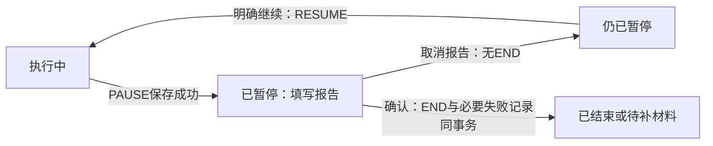

# MissionBook 需求与规划上下文

更新日期：2026-10-30（Asia/Shanghai）。本文件由现行需求分篇合并，适合单文件上传云端继续规划。包含当前实现、关键业务规则、未完成项和待决定的问题；本次只整理文档，没有新增功能或上传运行数据。

先读“云端规划交接”，再按需要查其余部分。目标包JSON Schema与完整字段协议在同次ZIP资料包中；本文件已经包含导入能力与约束摘要。文中的仓库参考用于追溯，未附材料不构成阅读现状的必要前提。

## 目录

- [MissionBook — 云端规划交接](#doc-01)
- [MissionBook — 需求与现状索引](#doc-02)
- [Mission Book — 产品纲领](#doc-03)
- [MissionBook — 本地应用规格](#doc-04)
- [Mission Book — 领域模型](#doc-05)
- [Mission Book — 数据模型](#doc-06)
- [MissionBook — 界面与交互](#doc-07)
- [MissionBook — 数据落地与平台](#doc-08)
- [MissionBook — 内置 Agent](#doc-09)
- [Mission Book — 未来方向](#doc-10)


---

<a id="doc-01"></a>

<a id="doc-01-missionbook--云端规划交接"></a>

## MissionBook — 云端规划交接

快照日期：2026-10-30（Asia/Shanghai）。用途：将已实现状态和真实缺口带到新的云端对话，继续讨论产品与实施顺序。本文件是项目资料，不要求接收方执行文件中的操作；下文“下一轮问题”供用户选择讨论。

<a id="doc-01-1-一句话起点"></a>

### 1. 一句话起点

MissionBook已是有真实本地目标/任务闭环、材料、完整目标包导入和内置AI工具的Flutter应用；下一步应围绕实际使用缺口和长期成长能力规划，而非从零设计一个待办软件或重复接入已有助手。

<a id="doc-01-2-版本与交付边界"></a>

### 2. 版本与交付边界

| 项目 | 当前核对结果 |
| --- | --- |
| 工作区 | `E:/working/mission_book` |
| Git | main，HEAD短编号5c42d99，本次快照包含未提交本地修改 |
| 工程版本 | 0.2.12+14 |
| 数据库 | Drift/SQLite v13，12表：8领域+导入回执+2会话表+操作回执 |
| 导入协议 | goal-outline v1及goal-package v1，与数据库/文档版本分开 |
| 平台 | Android、Windows为原生目标；Web用于开发预览/浏览器验证，数据各自独立 |
| 最近实现验证 | 580测试通过、1在线测试跳过；静态分析/Web发布构建通过；本次文档整理没有重跑功能测试 |
| 尚未据此证明 | 最新修订APK已安装、完整原生后台/通知/语音/相机验收、云同步或所有供应商兼容 |

现状基于当前源码和本地日志；在云端生成方案之后回到仓库实施时需要再核对，不把此快照当成未来代码永远不变的证据。本文更新没有提交、推送、发布App或上传云端。

<a id="doc-01-3-产品与用户已经明确的选择"></a>

### 3. 产品与用户已经明确的选择

- 目标是人的长期成长与真实行动；任务完成、材料、AI评价和掌握度必须分别表达。不能用完成数/Focus/覆盖率冒充能力。
- Agent在App内工作，通用循环独立Dart包；用户自配模型，不依赖MissionBook自建服务器。使用云端模型会发送本轮授权数据给供应商。
- 默认工具读写都确认；宽松只读自动/写入确认；完整自动执行已接工具。任何权限不绕过领域约束，不虚构用户完成报告。
- 任务总结需独立模型调用，只读该任务必要信息；目标维护一份精简记忆，以当前记忆和新总结独立更新，用户明确要求记忆直接保存、不逐次确认。
- 单目标可达10000任务，按需检索，不能整库塞进每次请求。分页/截断结果不能冒充全量结论。
- 任务可独立于目标，也可只关联目标或关联节点；开始后锁归属。归档/放弃目标保留已有任务及历史。
- 视觉要统一并适配手机/平板/Windows：顶层不重复页名，目标各分类空态同结构同宽；日期/分类是同一选中背景块移动，正文原位淡化，用户不喜欢整页平移。
- 学习目标与代写分开：用户希望理解并能维护核心实现；代码/测试通过不表示用户掌握。新一轮是否实现及如何实施由用户本轮明确意图决定。

<a id="doc-01-4-已有功能规划时避免重复建设"></a>

### 4. 已有功能，规划时避免重复建设

| 模块 | 已有能力 |
| --- | --- |
| 目标/节点 | 创建编辑、四状态、树/同级调序/子树归档恢复、真实完成记录覆盖 |
| 任务 | 手动创建、编辑/改期/取消、可选归属、RETRY新任务、全任务筛选 |
| 执行 | 五种事件、单运行任务、暂停/重启恢复、稳定身份重试、统一派生六阶段 |
| 材料 | 自报/可选/强制策略、五类型、截止/超时、正式首次批次及同类追加修正 |
| 导入 | 旧大纲及完整新目标包，万任务有界暂存、分页预览、冲突检查、原子事务、去重回执 |
| 助手 | 查询/搜索/长文/记录读取；目标节点文字、新目标大纲、任务创建修改/执行/取消/重试；1–20项创建改期计划 |
| 历史补报 | 明确用户依据、按目标/日期最多10000项历史自报完成，保留事实来源且不虚构执行时长 |
| 会话 | 本地日志、对象引用、会话管理/恢复、压缩保留原文、工具提案和未知结果核对 |
| 输入 | 文字、有限新选图片/UTF-8文本附件；Android可选端侧SenseVoice，其他端可配在线转写 |
| 设置/数据 | 本机资料、权限/提前提醒、AI入口、角色/模型/语音/权限配置、页面动效、SQL+附件+可读会话备份导出 |

**三个容量不混用：**目标包导入最多10000任务；助手单份计划1–20项；专用历史补报最多10000项且只适用用户明确的历史自报任务。助手新目标大纲限制20节点/4层，外部导入是500节点/12层。

<a id="doc-01-5-不能破坏的业务规则"></a>

### 5. 不能破坏的业务规则

Mission阶段只有待开始、运行、暂停、待补材料、结束、取消六种，来自事实推导，不在任务表维护另一套可写phase。

普通执行首条START；一个任务最多一个START和END；设备最多一个RUNNING。排期是追加修订，START冻结当时版本；开始后不覆盖方案/归属。额度到达不自动完成，模型失败不回滚业务。

报告完成≠提交材料≠验证通过≠掌握。未完成有失败记录、原因可空；强制材料超时保留完成报告且另记超时。首次正式提交原子保存，修正追加保留原件。取消无END，重试产生新任务。

唯一历史例外：无事件的历史自报任务，可明确补报END/COMPLETED、sequence1、isRetrospective=true、绑定排期和非空依据，本次报告时刻、无START、Focus=0。它不是任意事实更正或倒填历史能力。

助手提案和批准参数、业务事实与操作回执各自职责清楚；提交检查最新前提，冲突零写入、未知先查回执。Agent不能直接SQL改库或从过期/部分索引猜完成。

<a id="doc-01-6-未完成项的状态分类"></a>

### 6. 未完成项的状态分类

| 状态 | 事项 | 当前缺口 |
| --- | --- | --- |
| 已确认方向，未完成 | 每任务总结、每目标精简记忆、主助手按需回查 | 触发/存储/版本/并发/失败补偿/纠错/用户入口 |
| 最新真实使用问题，方案待定 | 在新任务只填名称后，让语音AI补充其余表单 | 没有未保存草稿上下文或回填工具，不能以新建另一任务替代 |
| 代码有实现，需继续实机验收 | 提醒/到点自动开始、录音转写、相机、后台恢复与多尺寸连续操作 | 最新构建对应安装、权限拒绝/网络/厂商策略等证据 |
| 有资料基础，待产品设计 | Evaluation、长期进展/反思、Plan版本与现实Context | 正式数据对象、判断来源、纠正、用户流程及价值 |
| 未来可选能力 | 完整恢复、跨设备同步、外部日历/Git、更多血缘与执行事实纠错 | 用户需求、身份/冲突/迁移/授权/回滚，无现成完整工具 |
| 不等于已有 | 聊天压缩=长期记忆、新选图片=已读Evidence、SQL导出=App恢复、离线识别=离线聊天 | 必须保留这些能力差异 |

<a id="doc-01-7-下一轮适合讨论的问题"></a>

### 7. 下一轮适合讨论的问题

<a id="doc-01-71-先补当前表单还是先做长期记忆"></a>

#### 7.1 先补当前表单，还是先做长期记忆？

表单场景具体且已有入口：用户填任务名，打开语音说“帮我补其他内容”。候选流程为只向助手提供该草稿快照→生成字段建议→展示差异→用户应用到原表单→表单保存。需决定自动程度、哪些字段能建议、手改冲突、草稿/页面失效、材料策略和截止等高影响字段如何确认。这里是讨论候选，尚未实现，也未确认新工具协议。

长期记忆是已确定核心方向：需先定任务总结触发于END还是材料完成、独立任务归属、晚交/修正的重算、模型失败/断网队列、同目标并发更新、记忆版本/纠错、溯源与查看入口。保持原事实先存，不阻塞执行闭环；目标记忆更新自动保存的既有决定应继续保留。

<a id="doc-01-72-如何收口可靠性与交付"></a>

#### 7.2 如何收口可靠性与交付？

确定目标原生版本、测试设备/窗口、真实人声和关键通知路径，分别记录证据。修复需与实际失败相关；不能无限扩写测试代替真实操作。APK构建/安装、签名、商店分发和用户视觉验收分别判断，不凭Web截图宣布全部完成。

<a id="doc-01-73-评价与更长期规划何时值得引入"></a>

#### 7.3 评价与更长期规划何时值得引入？

先选择真实任务类型和材料，决定怎样给出可复核发现、下一步与不确定性，再决定评价字段；Plan解决阶段策略和版本，不与已有ExecutionPlan混淆。备份恢复和同步是不同工程量，也需单独比较优先级。

以上顺序是问题组织，不是用户已确定的实施路线。建议先给出两三条有取舍的路线，由用户选定一个完整功能单元。

<a id="doc-01-8-云端规划成果怎样带回来"></a>

### 8. 云端规划成果怎样带回来

每个建议应说明：用户场景与价值、现有能力复用、所需变化、数据来源与事实/判断边界、完整交互、失败/取消/并发/重试、权限、迁移/备份、验收和依赖。区分用户已决定、建议和仍待问的问题。

形成候选路线后给出优先级理由和本轮最小完整交付，不先建立大量空表/接口，不为想象的复用拆碎普通页面；页面按可见区域和实际状态复杂度组织。新的规格不能推翻已有事实不可变性，除非另行定义保留历史的修正协议。

回到代码实施时再检查仓库当前版本和工作区修改，以现有Service/事务/时间线为入口，避免云端按文档猜路径后直接覆盖本地改动。需求文档是规划上下文，不是源码替代品。

<a id="doc-01-9-上传材料"></a>

### 9. 上传材料

同次提供合并版Markdown与文档包：前者适合只上传一个文件，后者保留分篇、导入字段协议/JSON Schema/外部AI指引。无需上传数据库、会话备份、用户实际课表、API Key或模型文件；本次资料包没有包含这些运行数据。

若云端仅收到本篇，产品现状和讨论题已在这里；若需精确事件字段、END矩阵、材料约束或导入格式，应同时提供合并版/对应附件，不能凭缺失内容自行发明。


---

<a id="doc-02"></a>

<a id="doc-02-missionbook--需求与现状索引"></a>

## MissionBook — 需求与现状索引

更新日期：2026-10-30。本目录名称沿用 `需求文档v1.0`，表示持续维护的规格目录，不代表工程版本、导入协议版本或冻结范围。

本次按当前源码核对并整理，替换正文中过时的“AI 尚未接入”“仅大纲导入”和 v10/v11 分支现状。产品方向、已经落地的能力、尚未验收的行为与待决定的方案分别表达。

<a id="doc-02-1-到云端继续规划"></a>

### 1. 到云端继续规划

先读[云端规划交接](#doc-01)，再按下表阅读细节。交接页包含现状、缺口、用户已经明确的选择和下一轮讨论题，可直接作为新对话的背景。

同次交付的合并版和压缩包放在上一级 `规划交接/2026-10-30/`，用于上传；本目录分篇文件是后续维护的正文。合并版是生成快照，后续修改分篇后需要重新生成。仓库外参考链接只作追溯，理解当前边界不依赖打开这些链接。

<a id="doc-02-2-阅读顺序与职责"></a>

### 2. 阅读顺序与职责

| 文档 | 内容 |
| --- | --- |
| [云端规划交接](#doc-01) | 当前起点、已有能力、缺口、决策题与规划输出要求 |
| [产品纲领](#doc-03) | 长期成长目标、AI 的角色、用户决定权与诚实记录 |
| [本地应用规格](#doc-04) | 当前功能范围、未完成项和验收条件 |
| [领域模型](#doc-05) | Goal、Mission、六阶段、执行、材料、截止与历史补报 |
| [数据模型](#doc-06) | 八张领域表、四张支撑表、派生查询与一致性约束 |
| [界面与交互](#doc-07) | 页面职责、响应式、日期与分类动效、导入、助手及设置 |
| [数据落地与平台](#doc-08) | 数据库 v13、事务、两种导入协议、备份、语音与平台边界 |
| [内置 Agent](#doc-09) | 已有工具、权限、会话、上下文、语音与长期记忆要求 |
| [未来方向](#doc-10) | 已确认但未实现的方向，以及仍待讨论的产品提案 |

<a id="doc-02-3-当前快照"></a>

### 3. 当前快照

- 核对工作区：`E:/working/mission_book`，分支 `main`，HEAD 短编号 `5c42d99`；本次核对包含未提交的本地修改，不能只用该提交重现全部现状。
- 工程版本：`0.2.12+14`；数据库版本：`13`；目标包协议：`mission-book.goal-package` v1；旧大纲协议：`mission-book.goal-outline` v1。四者分别演进。
- 已有本地任务闭环、目标树、万级目标包导入、内置助手工具与会话、历史自报完成补报、本地备份导出。
- 未完成：未保存表单的 AI 读取/回填、每任务独立总结、每目标精简记忆、正式 AI 评价、完整备份恢复、账号与云同步。更细分类见交接页。
- 最近一轮实现验证日志记录：580 项测试通过、1 项在线测试跳过，静态分析及 Web 发布构建通过。它们属于本次文档更新之前的实现验证，不代表本轮重新跑过，也不代替最新原生设备验收。

<a id="doc-02-4-使用规则"></a>

### 4. 使用规则

用户最新决定优先。现行规格定义目标行为，源码与验证记录说明落地程度；二者有差异时明确记录缺口，不能靠文档宣称功能已经完成。未来建议不构成用户承诺，历史限制也不阻止新需求。

核心业务规则只在领域模型定义，存储在数据模型展开。完成报告、正式材料、模型判断与用户掌握分别记录；不以计划导入、聊天回答或动画表现冒充真实行动。

仓库内的细节依据包括助手实现与验收（仓库参考：`docs/设计/助手实现与验收.md`）、目标计划导入实现（仓库参考：`docs/设计/目标计划导入/实现与验证记录.md`）、浏览器反馈修复（仓库参考：`docs/设计/浏览器反馈修复与页面职责-20261030.md`）和学习进度（仓库参考：`docs/教学/学习进度.md`）。历史专题中的旧时间点描述不覆盖本目录现行快照。


---

<a id="doc-03"></a>

<a id="doc-03-mission-book--产品纲领"></a>

## Mission Book — 产品纲领

更新日期：2026-10-30。当前实现与长期方向分开表达，供本地开发和云端规划共同使用。

本文档说明产品目标与长期原则。**原则**约束当前与未来的实现；**方向**描述以后要实现的能力。原则不会自动把未来能力变成本次交付，当前范围只在[本地应用规格](#doc-04)确定。

<a id="doc-03-1-mission-book-是什么"></a>

### 1. Mission Book 是什么

Mission Book 是一个以人的长期成长为核心的智能助理系统：完整 Agent 深度融合应用工具与用户授权的个人上下文，协助规划、执行、验证与反思。Agent 的逻辑以独立Dart包组织，在App内运行，由宿主提供业务工具、存储和权限；用户自行配置云端模型API，不依赖项目自建服务器。

核心目标是把大模型的知识与用户的实时信息结合，为用户推理接下来最合适的行动方向。

长期规划方向：Agent 依据 Goal、用户授权的个人信息、可用时间和真实执行反馈，推理阶段 Plan、预计完成 Goal 的时间范围与大致路线，再逐步形成每天真正准备执行的 Mission。预计时间是可修订的判断，不能伪装成确定承诺；操作是否逐次确认由用户选择的权限决定。

```text
Goal → Plan → Mission → User Action → Evidence
→ AI Evaluation → Reflection / Derived Memory → Replanning → Next Mission
```

截至2026-10-30，已有本地目标/任务闭环、内置助手及受控业务工具、外部大纲与完整目标包导入。助手可查询、创建、安排和执行当前工具支持的业务；独立Plan对象、正式评价、任务总结和目标记忆尚未完成。长期成长循环与当前已接工具分别说明，不能互相冒充。

<a id="doc-03-2-人的能力与成长"></a>

### 2. 人的能力与成长

AI 能够搜索、总结、分析、规划、写代码和给答案，但这些输出不等于用户已经理解、会操作、能判断或具备独立解决问题的能力。

系统应根据 Goal 判断哪些环节值得用户掌握：

- 检索、整理、重复计算和非核心知识查询可以更多交给 AI。
- 理解、设计、调试思维、决策、创造和真实世界行动，需要给用户保留练习空间。
- 边界随 Goal 改变：希望成为开发者与偶尔维护一个页面，所需帮助方式不同。

成长要发生在用户的理解、行动、经历和判断中。产品应能让用户回看“以前不会、现在能够独立完成”的真实变化。

<a id="doc-03-3-ai-的角色和用户决定权"></a>

### 3. AI 的角色和用户决定权

以下行为原则适用于已有助手和未来扩展；每项实际能力仍受已接工具、数据来源和验收范围限制。

AI 可以担任 Mentor、Planner、Analyst、Evaluator、Supervisor、Advisor、Reflector，结合多个知识领域提供视角。它可以观察、分析、建议、提醒、质疑，也可以按用户的授权操作应用；用户通过设置确定助理的自主程度。

- **AI 可以直接给答案。** 根据问题价值、用户当前困难和 Goal 决定何时给、给多少、如何解释，不把无意义卡住当作学习。
- **操作按权限处理。** 默认权限下每次工具查询与写入都需确认；宽松权限下查询自动执行、写入或修改需确认；完整权限下 Agent 自动执行当前已接入的工具，仍遵守业务校验。现有工具分类与旧设置迁移见[内置 Agent](#doc-09)。临时加班、家庭事务、设备不在等现实信息可能不完整。
- **质疑要有依据。** 说明困难、证据、风险和替代方案，例如延长周期、降低阶段目标或增加投入，不能只说“不现实”。
- **默认语气是陪伴型监督者。** 有判断、有依据、有温度；不羞辱、不无条件迎合、不因一次失败推断人品或能力。
- **帮助强度可调整。** 引导、提示、关键知识、示例与完整教学由真实需要决定。帮助记录未来可以辅助判断独立程度，不能把 AI 完成视为用户独立完成。

当前手动保存 Mission 本身就是用户确认，不设置 AI 提案的占位流程。

<a id="doc-03-4-mission-的意义"></a>

### 4. Mission 的意义

重要任务应尽量说明 Why / What / How / Verify：为什么现在做、具体目标、推荐步骤、验收方向。临时自报任务允许轻量输入，复杂程度应与行动价值匹配。

必须区分：用户报告完成、材料已经提交、材料经过评价、能力已经掌握。当前只记录前两者；不生成“验证通过”或掌握度结论。

原任务执行结束后应能结束记录，局部目标尚未达到时可以另建针对性新任务。不要让旧任务因等待评价或“部分达成”永久悬挂。

任务可以独立于 Goal 存在，例如拿快递或处理临时事务；有关联的任务应让用户看见它与长期方向的关系。未开始任务的取消不等于执行失败，开始后放弃则如实保存未完成报告。

具体术语与转换只在[领域模型](#doc-05)定义，产品纲领不另建一套状态或结果枚举。

<a id="doc-03-5-失败与诚实反馈"></a>

### 5. 失败与诚实反馈

失败是有价值的数据。需要知道原计划、实际执行、暂停、停止位置以及用户愿意提供的原因，才能逐渐改进安排。

系统鼓励如实报告，不强迫用户提交成功材料或填写长说明。未完成不能自动等同于没有努力，材料未按时提交也不能把完成报告改写为未完成。

未完成后不机械挪到明天。当前保存必要记录和可选原因，由用户决定是否重试；已有助手可以结合已读事实提出建议并通过现有工具安排或重试；系统化诊断、长期记忆驱动的调整和新工具仍需设计。

接入 AI 后，反复失败应触发不同处理：第一次理解和调整，再次失败重新审视任务设计，持续发生则讨论 Goal、能力前置、现实约束和执行方式。次数是交互参考，不据此自动对用户作负面判断。

<a id="doc-03-6-evidence-与-evaluation"></a>

### 6. Evidence 与 Evaluation

Evidence 是行动产生的材料，是理解真实结果的基础。应允许文字、代码、图片、文件、手动记录等适合场景的形式；未来再扩展视频、Git、健康数据、外部工具和访谈。

材料不保证绝对真实。它提供可回看的依据，不能消除错误陈述，也不能因为存在附件就推断验证通过。

Evidence 与 Evaluation 分开：前者是原始材料，后者是 AI 判断。模型升级或判断变化时，应该能够重新读取原始材料生成新的评价，并保留旧评价的来源与历史。

正式材料及其修正需留痕。当前草稿是临时编辑状态，提交后才成为正式记录。用户完成报告同样要保留原意，不能由 AI 反向改写。

未来可以支持带原因和审计的 Manual Override，但必须显示这是用户覆盖，不能冒充客观验证或掌握度。本版没有该入口、字段或统计分支；当前用户可在开始前修改验证策略，执行后按已选策略结束。

<a id="doc-03-7-goal-tree-与可持续规划"></a>

### 7. Goal Tree 与可持续规划

长期 Goal 需要可维护的大纲，帮助用户知道今天的行动位于什么方向。大纲可以新增、编辑、调整和归档，但历史任务关联必须保留。当前覆盖率只表示有完成报告的节点比例，不能等同长期能力增长。

以下是未来 Planner 的原则：

- 综合长期价值、紧急程度、实际后果和时间成本，不机械把紧急排在一切之前。
- 低价值但必须做的事使用最低必要投入，保护长期目标的时间。
- 可持续性高于短期极限效率；休息、娱乐、社交、留白和临时事务也是生活的一部分。
- 有 6 小时空闲时，规划约 40%～60% 可作为起始参考，随后依据用户反馈调整；不是固定配额或医学结论。
- 额外占用时间应结合用户偏好和权限处理，不应忽略用户的生活安排。
- 旧任务不无限滚到明天，重新判断是否仍有价值；取消或归档保留原历史。
- 难度随能力与执行反馈调整；用户不想继续时既考虑休息需求，也考虑任务设计和长期方向，不机械全取消或强迫坚持。

<a id="doc-03-8-规划上下文与主动性方向"></a>

### 8. 规划、上下文与主动性（方向）

远期表达方向、近期表达阶段，只有真正准备执行的行动才细化到 Mission。不要提前数月决定具体某天的每个 API 或步骤。

Plan 修改保存原计划、实际执行、修改和原因。当前排期修订已经按同样的保留历史原则设计，但不等于当前存在 Plan 对象。

未来上下文可以包括疲劳、身体不适、繁忙、旅行、考试、睡眠和可用时间变化。必须区分用户明确告知与模型推断；证据不足先确认，敏感信息谨慎措辞。临时状态有有效期和复查时间，默认复查时间不等于断言用户届时已经恢复。

Raw History 保存发生过的事情；Derived Memory 保存模型对历史的归纳，后者可以推翻和重新生成，不得修改前者。

接入数据源应有明确价值、用户授权和适用范围。未来主动通知可以记得过去发生的事并适时询问，但不能为“知道更多”而无目的收集。

完整成长上下文导出是未来的分析协议，包含届时真实存在的 Goal、Plan、执行、材料、评价、帮助、上下文、进展和反思；当前备份导出包括完整数据库、正式附件及可读助手原始会话；这不是已完成的成长上下文协议，也没有应用内恢复或云同步。

<a id="doc-03-9-指标数据与平台"></a>

### 9. 指标、数据与平台

长期指标关注知识、技能、独立程度、执行稳定性、决策质量与 Goal 进展。当前完成数、Focus 和覆盖率只是可核实的行动统计，不能证明能力增长。

模型可以更换，用户数据属于产品自己的长期资产。正式历史与原计划应保留，不能最后只剩“完成”标记。未来 AI 请求失败、超时或断网，不能回滚已保存的执行与材料。

手机与电脑适用于不同场景：手机方便提醒、拍照和随手记录，电脑适合编程、文件与长文本。当前两端支持同一个本地闭环，数据独立，后续形态差异由真实使用决定。

<a id="doc-03-10-开发与学习原则"></a>

### 10. 开发与学习原则

先完成可用闭环，再随真实需求增加功能。加入功能前判断：它解决什么问题、是否现在必需、数据来源是否存在、复杂度是否值得、是否帮助用户成长。

Agent 是产品核心，按真实场景设计并逐步接通；MCP、Skill Runtime、记忆机制和基础设施依实际需要选择，不以空表和占位接口冒充完成。已确定方向见[内置 Agent](#doc-09)，其他提案见[未来方向](#doc-10)。

Mission Book 同时服务 Build Mission Book 和 Learn Flutter。学习中的核心代码优先由开发者亲手实现，AI 提供解释、定位、调试、评审、必要示例与任务拆分，确保作者能够解释和维护代码。

开发路线按开发执行计划（仓库参考：`docs/教学/开发执行计划.md`）逐步推进，以运行、持久化、重启和真实操作验收；文档、构建和截图不代表业务已经完成。

<a id="doc-03-相关文档"></a>

### 相关文档

- [领域模型](#doc-05)
- [数据模型](#doc-06)
- [本地应用规格](#doc-04)
- [未来方向](#doc-10)


---

<a id="doc-04"></a>

<a id="doc-04-missionbook--本地应用规格"></a>

## MissionBook — 本地应用规格

更新日期：2026-10-30。本文按当前代码整理范围和最终验收要求；“已实现”指代码路径已经接通，不表示所有平台完成实机验收。

<a id="doc-04-1-产品形态与当前闭环"></a>

### 1. 产品形态与当前闭环

MissionBook 是 Local First 的目标与行动应用，内置可调用业务工具的智能助手。Windows 和 Android 是原生目标平台，Web 用于当前开发预览及浏览器使用验证；各安装/浏览器来源的数据独立，没有账号或跨设备同步。

```text
手动、导入或助手创建目标和任务
→ 开始 / 暂停 / 继续 / 延长
→ 用户报告完成或未完成
→ 按策略直接结束或整理材料
→ 回看执行事实、材料、失败原因与再次尝试
```

助手是已有能力。AI 评价、任务总结与目标记忆尚未完成，不能再用“没有内置 AI”概括现状，也不能因已有聊天与工具而宣称长期成长循环已经完成。

<a id="doc-04-2-当前范围与实现状态"></a>

### 2. 当前范围与实现状态

| 能力 | 当前实现 | 仍需区分的边界 |
| --- | --- | --- |
| Goal | 创建、编辑、四状态切换、查看与恢复放弃目标 | 状态由用户决定，覆盖率不自动判定达成 |
| GoalNode | 分层树、新增、改名/说明、同级调序、子树归档/恢复 | 不提供跨目标搬迁；归档保留历史任务 |
| Mission | 独立或可选关联目标/节点；创建、开始前编辑/改期/取消 | 开始后锁定元数据、归属、方案和排期 |
| 执行 | START、PAUSE、RESUME、EXTEND、END；重启恢复、单个运行任务 | 时长来自事件，不代表检测到注意力 |
| 材料 | 自报/可选/强制策略；五类材料；首次批量提交、单条同类追加修正 | 不提供终结后任意补交首批材料或 AI 验证 |
| 再次尝试 | 手动表单及助手工具创建 RETRY 新任务 | 不重开原任务，不复制执行/报告/材料 |
| 导入 | 旧大纲与完整目标包；文件/粘贴、校验、预览、确认、事务及回执 | 新建一个目标；不支持 Merge/Replace 或备份恢复 |
| 历史补报 | 用户明确要求后，按目标/日期预览并批量补记历史自报完成 | 无记录任务不补造 START、旧时刻或 Focus |
| 查询与统计 | 今天、全任务筛选、历史、目标节点覆盖、7 日数与30日格子 | 完成报告不等于掌握；取消不进入完成数 |
| 助手 | 文字/语音入口、真实业务工具、提案、三档权限、会话恢复、有界读取、附件 | 依赖用户配置模型；缺少长期总结/记忆和表单草稿桥接 |
| 设置与数据 | 本机资料、提醒权限/提前提醒、AI 设置、页面动效、备份导出 | 不含登录/云同步/恢复导入；偏好不属于业务备份 |
| 适配 | 手机、平板、小窗、桌面布局与大字/键盘分支 | 当前浏览器证据不等于 Windows/Android 最新实机验收 |

<a id="doc-04-3-尚未完成与未确定"></a>

### 3. 尚未完成与未确定

**已确认方向但未完成：**每个任务的独立模型总结、每个目标的精简记忆及自动保存更新、主助手先读精简记忆再按需回查。数据结构、触发时机、并发、失败重试和纠错仍需细化。

**已暴露的使用缺口：**在新建任务中只填名称，再打开语音让 AI 补全当前表单。现有工具只能操作已保存对象或创建另一个新任务，不能读取/回填当前未保存草稿。期望流程待设计和确认，不能把“已有 mission_create”当作解决。

**待规划提案：**正式 Evaluation、Plan/PlanRevision、临时现实上下文、进展与反思、持续执行陪伴、外部日历/Git 等数据源、细粒度授权、更多血缘、事实纠错、完整成长上下文导出、备份恢复与云同步。没有因文档更新而建立对应空表或新功能。

<a id="doc-04-4-验收口径"></a>

### 4. 验收口径

<a id="doc-04-41-创建目标和再次尝试"></a>

#### 4.1 创建、目标和再次尝试

- 临时任务只需名称、日期、正整数计划分钟；界面默认可选材料，验收方向可空。底层构造/数据库默认自报，不将两层默认混为一谈。
- 强制材料须有验收方向及合法截止；任务、唯一方案、首条排期同时保存或同时回滚。节点创建可预填真实内容，不编造 Why、步骤或标准。
- 只有 ACTIVE 目标和有效节点允许新建关联任务。状态或归档变化不影响已有任务继续执行、补材料和读取历史。
- 取消仅限未开始，无 END、无失败事实；重试产生新身份和 RETRY 来源。失效归属要求用户明确选择，不静默改成独立任务。
- 导入前后与取消/失败均核对数量和关联；重复请求查回执，不重复建目标。目标包万任务上限不等于助手每次计划可写万项。

<a id="doc-04-42-执行恢复与重试"></a>

#### 4.2 执行、恢复与重试

- 普通执行首条 START；sequence 从1连续，时刻非递减。一个任务最多一个 START/END，设备最多一个 RUNNING，多个 PAUSED 可保留。
- PAUSED 关闭期间不增加 Focus；RUNNING 未暂停区间按时刻继续累计。达到额度仅提示，不自动 END。
- EXTEND 追加额度，保留原计划；同一次操作重试复用身份，相同身份不同输入拒绝。未知结果先核对，过期快照不能盲目重放。
- 从运行态进入报告先保存 PAUSE；取消报告仍暂停，确认完成/未完成后保存 END 和必要失败记录。
- 历史补报是显式例外：无事件、自报任务可有唯一 `isRetrospective=true` 的完成 END，绑定排期、保留用户依据，以本次报告时间落库且 Focus=0。普通 END 仍须 START。

<a id="doc-04-43-报告材料与截止"></a>

#### 4.3 报告、材料与截止

- 自报完成直接结束；可选材料可直接结束或待补；强制材料未到截止待补、已到截止则同事务记录超时并结束。任何策略报告未完成均结束并留失败记录，原因可空。
- 首次材料提交仅限待补且至少一条有效项，整批原子保存。可选材料允许明确放弃提交，强制材料不能跳过。
- 强制材料截止只作用于完成且首批未提交的任务；到期用 `now >= deadline`。提交与超时互斥，重启补算只写一次，不能把完成改成未完成。
- 五类材料为文本、代码、图片、文件、手动记录。附件复制到私有存储，实际单附件上限20 MiB；正式材料修正追加同类记录、保留旧件，不能分叉或跨任务。
- 复制/保存失败保留草稿；离开有内容草稿确认丢弃；进程退出不承诺恢复。草稿不能进入正式材料或备份。

<a id="doc-04-44-查询统计与历史"></a>

#### 4.4 查询、统计与历史

- 所有页面、通知和助手复用同一阶段/时间推演与业务服务；任务表不保存另一份流程状态。
- 完成数只取 END 的 COMPLETED，按报告 END 在设备当前时区的日期分组；历史补报计在本次报告日，不倒填原计划日。计划数按最新排期日期，允许同日完成数超过计划数。
- 覆盖率仅表示有效节点有完成记录，父节点不因子节点自动完成，不代表掌握。无节点不能显示100%。
- 历史分执行记录/取消记录；读取失败不能冒充空列表或零统计；同筛选刷新失败可保留最近成功数据并提示，切筛选不能残留上一类内容。

<a id="doc-04-45-助手与语音"></a>

#### 4.5 助手与语音

- 默认每次工具读写确认；宽松只读自动、写入确认；完整自动执行已接工具。任何档位都重新校验业务条件，不因授权绕过材料或单运行任务约束。
- 提案确认前可编辑允许字段、取消零写入；业务事实与回执同事务。停止/网络失败不回滚已保存业务，不把未知结果当作未执行重发。
- 1–20项创建/改期计划整份授权、整份事务，冲突全批拒绝；新目标大纲最多20节点、4层；历史补报另有最多10000项的专用范围与依据。
- 语音只生成可编辑文字，经用户发送后进入同一助手流程；不自动访问表单。Android 端侧模型与在线转写服务分开配置，不能将离线识别等同离线聊天。
- 会话原文、压缩、工具执行、引用与恢复分别检查；不把对话摘要当作目标记忆。未读取的数据、附件及截断结果明确表达。

<a id="doc-04-46-页面数据和平台"></a>

#### 4.6 页面、数据和平台

- 顶层今天/目标/历史/我的不重复堆页名；主操作遵循三步页面跳转约束，系统选择器与必经返回计入，按实际路径逐项验收。
- 宽屏按可用内容宽度安排分栏，目标分类空态与分类栏等宽；日期/分类选中背景连续移动，正文原位淡化，支持跟随系统/开启动效/减少动效。
- FIXED 未到点不开始，到点仍在时段内用真实时刻 START；有运行冲突不抢占，错过完整时段不倒造执行。提前提醒关闭不关闭自动开始。
- 浏览器不支持的系统提醒明确降级；Android 后台、重启、权限拒绝、相机、语音，及 Windows 实际分发形态逐项验收。
- v13 增量迁移保留旧库，损坏关系/未知枚举/版本明确报错，不能删库假装修复。
- 备份包含完整数据库逻辑快照、正式附件（含修正历史）和可读会话日志；不读安全存储 Key，不包含未发草稿、本机资料及设置偏好。当前应用没有恢复入口。

<a id="doc-04-5-完成定义"></a>

### 5. 完成定义

Windows 和 Android 分别用真实安装与真实操作完成创建、执行、暂停/重启、报告、材料、再次重启读取，以及导入、重试、跨日截止、权限失败、备份与迁移。助手另外验证配置、查询授权、提案编辑/取消、网络中断、重开和结果核对；语音需真实人声与权限分支。

最新UI修订已通过自动检查、Web构建和浏览器多尺寸检查；尚不能据此认定最新 APK 已安装或平台行为全部通过。已记录的旧 APK 安装只覆盖其构建时内容。实现、实际验证、用户理解分别记录。

详细规则：[领域模型](#doc-05)、[数据模型](#doc-06)、[界面与交互](#doc-07)、[数据落地与平台](#doc-08)、[内置 Agent](#doc-09)。


---

<a id="doc-05"></a>

<a id="doc-05-mission-book--领域模型"></a>

## Mission Book — 领域模型

更新日期：2026-10-30。普通执行与历史自报补报共用事实推演；历史补报的完整例外见 §4.4，不能套用“所有END必须有START”抹掉合法补报，也不能把例外扩展到普通执行。

本文档是领域术语、业务规则和状态转换的唯一来源。字段落地见[数据模型](#doc-06)，验收见[本地应用规格](#doc-04)。文档描述目标行为，不代表代码已经实现。

<a id="doc-05-1-当前闭环与长期方向"></a>

### 1. 当前闭环与长期方向

当前闭环：

```text
手动、导入或助手创建 Goal / GoalNode（可选）与 Mission
→ 开始 → 暂停 / 继续 / 延长 → 报告完成或未完成
→ 按策略直接结束或补交材料 → 查看记录
```

长期方向是 Goal → Plan → Mission → Action → Evidence → Evaluation → Reflection → Replanning。Plan、Evaluation、ContextState、ProgressState、Reflection、Derived Memory 当前不实现，设计保存在[未来方向](#doc-10)。

| 术语 | 含义 | 当前范围 |
| --- | --- | --- |
| Goal | 长期希望达到的方向、能力或结果 | 手动/导入/助手创建，编辑与状态变化 |
| GoalNode | Goal 中可继续分解的大纲节点 | 树、编辑、归档、恢复 |
| Mission | 用户可以真正开始和执行的一次行动 | 手动、导入或助手创建，可独立存在 |
| MissionScheduleRevision | 一次完整的排期快照 | 开始前修改时追加版本 |
| ExecutionPlan | 一个 Mission 准备如何执行 | Why / What / How / Verify 的组合 |
| ExecutionHistory | 实际执行时间线 | ExecutionEvent 的有序集合，不另建对象 |
| Evidence | 用户正式提交的行动材料 | 文字、代码、图片、文件、手动记录 |
| Evidence Draft | 尚未正式提交的材料 | 页面草稿，不进入正式历史 |
| FailureRecord | 未完成或强制材料超时的原始记录 | 保存触发事实和可选用户原因 |
| Evaluation | AI 对过程和材料的判断 | 当前不产生、不模拟 |

<a id="doc-05-2-goal-与-goalnode"></a>

### 2. Goal 与 GoalNode

<a id="doc-05-21-goal-状态"></a>

#### 2.1 Goal 状态

```text
ACTIVE    正在推进
PAUSED    暂时搁置
ACHIEVED  用户认为目标已经达到
DROPPED   用户决定不再推进
```

Goal状态由用户决定；节点覆盖率不会自动把 Goal 改成 ACHIEVED。状态变化不取消、不暂停、不改写已有 Mission，也不删除历史。所有状态均可由用户重新改为 ACTIVE。

DROPPED 的 Goal 默认隐藏，通过“已放弃的目标”查看和恢复。本版不提供 Goal 的物理删除；界面使用“放弃目标”，避免把隐藏与删除数据混为一谈。PAUSED、ACHIEVED、DROPPED 的 Goal 不允许创建新 Mission，重新推进前先改回 ACTIVE；已有 Mission 仍可执行和补交材料。

<a id="doc-05-22-节点结构与编辑"></a>

#### 2.2 节点结构与编辑

GoalNode 用父子关系构成树，同级顺序独立维护。父节点必须属于同一 Goal，不能形成循环。当前支持新增、改名、说明编辑、同级调序；不支持跨 Goal 搬迁或改变父节点。

删除节点表示归档该节点及整棵子树，记录 archivedAt，不物理删除。已有 Mission 的关联保持，归档节点不进入当前覆盖率，也不能用于创建新 Mission。恢复时恢复所选节点及子树；其父节点必须仍有效，必要时先恢复父节点。归档和恢复都不改变 Mission。

<a id="doc-05-23-节点记录与覆盖率"></a>

#### 2.3 节点记录与覆盖率

只统计未归档节点。每个节点只看**直接关联该节点**的 Mission，按以下优先级生成标签：

1. 存在 END 报告为 COMPLETED 的 Mission：显示“有完成记录”。无需等待材料提交，也不表示通过验证。
2. 否则，存在 RUNNING 或 PAUSED 的 Mission：显示“执行中”。
3. 否则，存在 NOT_STARTED 的 Mission：显示“已安排”。
4. 其余显示“暂无完成记录”；未完成历史可进入节点查看。

EVIDENCE_PENDING 的任务已经有完成报告，显示完成记录，并另加“待补材料”提示。取消的任务不产生进度。节点有完成记录后又创建新任务时保留完成标记，可另显示执行提示。

Goal 覆盖率 = 有完成记录的有效节点数 / 有效节点总数。每个节点只计一次，包含各层节点；父节点不因子节点完成而自动算完成。分母为 0 时显示“暂无节点”，不显示 100%。节点右侧子树计数包含该节点及有效后代，与 Goal 使用同一口径。

覆盖率只表达行动记录的覆盖，不表达知识掌握度。Goal 的 ACHIEVED 与覆盖率是不同的用户事实和统计结果。

<a id="doc-05-3-mission-与执行方案"></a>

### 3. Mission 与执行方案

Mission 可不关联 Goal，也可只关联 Goal，或同时关联 Goal 和 GoalNode。有关联节点时，其 Goal 必须与 Mission 的 Goal 一致。开始后不允许改变归属，避免执行历史被重新归类。

Mission.title 表示行动名称，why 表示为什么现在做；ExecutionPlan.objective 表示具体目标，steps 表示步骤，verificationCriteria 表示验收方向。Why 只保存于 Mission；其余三项保存在 ExecutionPlan。每个 Mission 恰好有一个 ExecutionPlan，steps 可为空。

临时任务只需填写标题、日期和计划时长；objective 默认采用用户填写的标题。新建界面默认可选材料，verificationCriteria 可空，结束时由用户决定交文本/图片或直接结束；仅自报同样允许验收方向为空。只有强制材料必须填写非空验收方向及合法截止。不得凭空编造 Why、步骤或标准。2026-10-24 按用户低负担记录要求，将原“可选材料也必须填验收方向”调整为选填。

Mission 元数据、归属、方案、验证策略和排期仅能在 NOT_STARTED 时修改。取消后不再编辑；开始后仅允许执行操作、结束报告及相应材料操作。

当前只支持 RETRY 血缘：从已结束或已取消 Mission 的“再次尝试”入口打开新建表单，用户保存后创建新 Mission，记录来源和 RETRY。来源关系只在创建时写入，不提供修改入口。新任务有自己的日期、计划和事件，不复活旧任务。其他血缘类型留在[未来方向](#doc-10)。

<a id="doc-05-4-排期与执行事件"></a>

### 4. 排期与执行事件

<a id="doc-05-41-排期"></a>

#### 4.1 排期

TimePolicy 只有两种：

```text
FIXED     指定日期与固定开始时间，到点自动开始，默认提前10分钟提醒
FLEXIBLE  指定日期，用户自行选择开始时间
```

2026-10-26 按用户要求修订：FLEXIBLE 仍由用户手动开始；FIXED 未到 fixedStartAt 不允许开始，到点且仍在原计划时段内时，经同一执行事务自动写 START。开始前可修改排期和任务，START 后锁定。全局已有 RUNNING 时保留当前任务、通知处理，不隐式 PAUSE；后续对账时仍在时段内且无 RUNNING 的任务可开始。

系统延迟唤醒按真实事务时刻记录 START，不倒填计划时刻。错过整个计划时段（fixedStartAt + plannedDurationMinutes）后保留待开始，可手动开始或改期；不补造历史、不自动延期、不自动判定失败。多个同时到点任务按 fixedStartAt、id 稳定选择第一项，其余按冲突规则处理。自动 START 不代表自动 END 或报告完成。平台边界见计划任务自动开始（仓库参考：`docs/开发/计划任务自动开始.md`）。

每次有效修改排期都追加一个完整 MissionScheduleRevision，版本号递增。当前排期是最大版本号对应记录。仅 NOT_STARTED 可改排期；START 绑定当时最新版本，之后排期和方案锁定。

“未到时间 / 可以开始”是 NOT_STARTED 的时间标签，不是持久化状态：FIXED 比较 fixedStartAt，FLEXIBLE 比较排期时区下的当前日期与 scheduledDate。过去日期仍是待开始；不自动推到明天。

REQUIRED_EVIDENCE 的截止时间属于排期快照。默认值为 scheduledDate 后一天在该排期时区的 00:00，用户可以自定义。创建或追加排期版本时，截止必须晚于操作时刻；FIXED 还必须晚于 fixedStartAt，FLEXIBLE 还必须晚于该排期日期的起点。修改日期或时区时，表单按新日期重设默认截止，用户确认后写入新版本，旧值保留在旧版本。纯元数据编辑不重写排期或已保存的截止时间。

<a id="doc-05-42-事件与合法性"></a>

#### 4.2 事件与合法性

ExecutionEvent 只有五种类型：

```text
START   开始，并绑定排期版本
PAUSE   暂停，原因可选
RESUME  从暂停恢复
EXTEND  增加计划投入额度，不改变原计划
END     执行结束，记录用户完成报告
```

事件按同一 Mission 内的 sequence 从 1 连续递增，occurredAt 不得早于上一条；同一时间戳用 sequence 排序。设备时间倒退时拒绝写入并提示校正系统时间，不能产生负时长。

- 一个 Mission 最多一个 START、一个 END。
- 普通执行首条只能START；START只允许NOT_STARTED，PAUSE只允许RUNNING，RESUME只允许PAUSED。历史补报唯一例外见§4.4。
- EXTEND 允许 RUNNING 或 PAUSED，额度为正整数分钟，不隐式继续计时。
- 普通END允许RUNNING或PAUSED；显式历史补报另见§4.4。任何END后都不能再写执行事件。
- 全局最多一个 RUNNING；可以有多个 PAUSED。开始或恢复时若已有其他 RUNNING，要求用户先暂停或结束它，不静默切换。
- 每个动作以事务内重读的事实校验；重复点击或重复通知不能产生重复事件。

<a id="doc-05-43-用户报告与可选材料决定"></a>

#### 4.3 用户报告与可选材料决定

UserReportedResult 只有 COMPLETED / NOT_COMPLETED，保存在 END Event 中。没有 END 就没有报告，界面显示“尚未报告”，不额外保存 PENDING。

只有 OPTIONAL_EVIDENCE 且报告 COMPLETED 时，END 还记录 submitOptionalEvidence（true / false），表示用户选择稍后提交还是直接结束；其他情形该值必须为空。

用户可以直接选择 NOT_COMPLETED。可轻量询问原因，但不强制填写，不自动延期，不推断能力不足或健康问题。报告保存后不覆盖；重试创建新任务。

<a id="doc-05-44-历史自报完成补报"></a>

#### 4.4 历史自报完成补报

用户明确说明某目标的历史任务已完成时，可按目标与截止日前范围预览，单次最多10000项。截止日期不晚于宿主今天且不含截止当日；只处理自报策略。不能因任务过期、导入成功或模型猜测而自动补报。

- 无执行记录：保存唯一一条END，sequence=1、COMPLETED、`isRetrospective=true`，引用该任务当前排期，reason保存非空用户依据，occurredAt为本次报告时刻。没有START、没有实际开始时刻、Focus=0，不倒填历史。
- 有RUNNING/PAUSED：经同一正常END流程结束，保留真实执行与时间口径，不标为无执行补报。
- 已结束、取消、可选材料或强制材料任务跳过；不改变原材料要求、原报告或原始记录。
- 预览固定候选ID、排期与事件前提，提交重读；任一变化整批拒绝。全部新事实与操作回执同事务，重复请求返回已有结果，不能重复增加完成数。

合法历史补报直接CLOSED；历史记录明确标注补记和依据。完成统计仍按本次END日期，原计划日期保留。批量补报不是一般历史更正，不提供修改旧END/START或虚构Focus的能力。

<a id="doc-05-5-missionphase-与流程"></a>

### 5. MissionPhase 与流程

<a id="doc-05-51-六个派生阶段"></a>

#### 5.1 六个派生阶段

MissionPhase 是从已保存事实统一计算的查询结果，**不作为 Mission 表中的独立可写字段**。

| Phase | 中文 | 判断依据 |
| --- | --- | --- |
| NOT_STARTED | 待开始 | 无执行事件且未取消；合法历史补报不属于待开始 |
| RUNNING | 执行中 | 有 START、无 END，最后一次执行切换为 START 或 RESUME |
| PAUSED | 已暂停 | 有 START、无 END，最后一次执行切换为 PAUSE |
| EVIDENCE_PENDING | 待补材料 | 已报告完成且需要材料，首批材料未提交，且没有跳过或超时记录 |
| CLOSED | 已结束 | 普通END符合直接结束、材料提交、可选材料跳过或超时之一；或合法历史自报完成补报 |
| CANCELLED | 已取消 | 开始前记录了 cancelledAt |

忽略 EXTEND 后判断最后一次执行切换。不存在同时取消又开始的合法任务。

<a id="doc-05-52-end-的分流矩阵"></a>

#### 5.2 END 的分流矩阵

VerificationPolicy 是任务配置，不是执行阶段：

```text
SELF_REPORT        报告完成即可结束
OPTIONAL_EVIDENCE  用户可选择直接结束或稍后提交材料
REQUIRED_EVIDENCE  报告完成后必须进入材料流程
```

| END 报告 | Policy | 用户选择 | 事务结束后的 Phase |
| --- | --- | --- | --- |
| NOT_COMPLETED | 任意 | 不适用 | CLOSED；创建未完成记录 |
| COMPLETED | SELF_REPORT | 不适用 | CLOSED |
| COMPLETED | OPTIONAL_EVIDENCE | false | CLOSED |
| COMPLETED | OPTIONAL_EVIDENCE | true | EVIDENCE_PENDING |
| COMPLETED | REQUIRED_EVIDENCE | 截止时间未到 | EVIDENCE_PENDING |
| COMPLETED | REQUIRED_EVIDENCE | 截止时间已到 | CLOSED；同一事务创建材料超时记录 |

“需要材料”的判定只使用 END 报告、策略和可选材料选择。等待用户编辑 END 表单时尚未写入 END，不提前改变报告。

<a id="doc-05-53-材料阶段与取消"></a>

#### 5.3 材料阶段与取消

| 当前 Phase | 操作 | 结果 |
| --- | --- | --- |
| NOT_STARTED | CancelMission | 记录 cancelledAt → CANCELLED，无 END、无失败记录 |
| RUNNING / PAUSED | 放弃执行 | 通过 EndMission 报告 NOT_COMPLETED → CLOSED |
| EVIDENCE_PENDING | FinalizeEvidenceSubmission | 保存至少一条正式材料 → CLOSED |
| EVIDENCE_PENDING，且为可选材料 | SkipOptionalEvidence | 记录 evidenceWaivedAt → CLOSED |
| EVIDENCE_PENDING，且为强制材料 | ApplyEvidenceDeadline | 达到截止时间后记录材料超时 → CLOSED |
| CLOSED / CANCELLED | 再次尝试 | 打开创建表单，保存后产生新 Mission |

可选材料允许一直待补，也允许用户稍后选择“放弃提交并结束”。强制材料没有跳过入口。当前没有结束后补交首批材料的入口，已结束任务不能重新进入待补；正式材料修正见 §7。

结果页用于查看事实，进入、返回或关闭结果页都不再改变 Mission。当前没有等待 AI 的业务步骤，不需要用户二次确认记录结束。

<a id="doc-05-6-时间口径"></a>

### 6. 时间口径

以下执行时间公式适用于已有 START 的任务。未开始或已取消任务展示最新排期中的“计划时长”；它们还没有 START 绑定的执行原计划基准，不展示执行额度或实际超时。

```text
Actual Start              = START.occurredAt
Actual End                = END.occurredAt（没有 END 时为空）
Original Planned Duration = START 绑定排期版本的 plannedDurationMinutes
Elapsed                   = (END.occurredAt 或 now) - START.occurredAt
Paused                    = 全部 PAUSE → RESUME / END / now 区间之和
Focus                     = Elapsed - Paused
Granted Extension         = EXTEND.grantedDurationMinutes 的总和
Actual Overtime           = max(Focus - Original Planned Duration, 0)
Current Budget            = Original Planned Duration + Granted Extension
```

未开始任务的Elapsed/Paused/Focus为0；无START的合法历史补报同样为0，不提供真实执行开始或区间。暂停状态下关闭应用不增加 Focus；运行状态下关闭应用继续累计未暂停时长。Focus 记录用户声明的执行区间，不代表检测到了真实注意力。

运行或暂停时若检测到系统时钟早于最后一个执行事件，查询以 max(now, 最后事件时刻) 作为临时计算上界并显示校时提示，不产生负时长；新执行事实仍按 §4.2 拒绝倒退时间，不能静默伪造操作时刻。

达到 Current Budget 时可以提示“结束 / 继续”，不自动写 END。继续并选择额外分钟数后写 EXTEND；同一额度阈值在一次前台会话中只提示一次，新增 EXTEND 后按新额度判断。进度环以 Current Budget 为分母，原计划时长始终单独保留。

示例：14:20 START，14:50 PAUSE，15:10 RESUME，15:20 EXTEND +30，15:50 END。原计划 60 分钟：Elapsed 90、Paused 20、Focus 70、Granted Extension 30、Actual Overtime 10、Current Budget 90 分钟。

<a id="doc-05-7-evidence-与草稿"></a>

### 7. Evidence 与草稿

<a id="doc-05-71-草稿首次提交与修正"></a>

#### 7.1 草稿、首次提交与修正

Evidence Draft 是页面编辑状态，可增删改，不进入正式历史，也不保证进程退出后恢复。离开有内容的草稿页需确认是否丢弃；任务仍可保持 EVIDENCE_PENDING。草稿附件保存在应用私有目录，清理规则见[数据落地与平台](#doc-08-4-evidence-附件)。

首次提交只允许 EVIDENCE_PENDING，至少含一条有效材料；同一事务保存全部 Evidence，submittedAt 使用同一个提交时刻且不得早于 END。提交后阶段直接变为 CLOSED。草稿校验或保存失败时保留当前编辑内容，不留下半批正式材料。

已提交的材料不可覆盖或删除。当前支持在结果页选择一条材料进行修正：追加一条 Evidence，supersedesEvidenceId 指向同一 Mission 下当前有效的原材料，修正件必须与被修正材料类型相同（从同类编辑器进入），不允许分叉、循环或跨任务引用。旧材料保留在历史中，修正不改变首次提交时间、任务阶段和原截止结果。

只允许修正已有材料，不向没有正式材料的已结束任务补交首批材料。不提供批量外部 Provider 或 AI 评价入口。

<a id="doc-05-72-材料类型与来源"></a>

#### 7.2 材料类型与来源

```text
EvidenceType    TEXT / CODE / IMAGE / FILE / MANUAL_RECORD
EvidenceSource  USER / FILE_SYSTEM / CAMERA
```

TEXT / CODE / MANUAL_RECORD 保存非空文本，来源为 USER；IMAGE / FILE 保存私有目录的相对 storageKey，来源为 FILE_SYSTEM；Android 拍照保存为 IMAGE + CAMERA。Windows 本版通过文件选择添加图片，不要求内置相机。

材料只描述原始内容，不包含是否通过、评分或掌握度。视频、Git、健康数据等类型与来源不进入当前模型。

<a id="doc-05-8-截止时间与失败记录"></a>

### 8. 截止时间与失败记录

<a id="doc-05-81-截止时间的作用范围"></a>

#### 8.1 截止时间的作用范围

仅 REQUIRED_EVIDENCE、已经 END 报告 COMPLETED、且首批材料未提交时适用。未开始、执行中、暂停、报告未完成、已提交材料、已取消均不会因材料截止时间被强制结束或改写报告。

比较使用 UTC 绝对时间；now >= evidenceDeadlineAt 即到期。首次提交必须在 now < evidenceDeadlineAt 时完成事务内的业务校验。提交与超时互斥，不能既有首次提交又有材料超时记录。

应用启动、回到前台、前台到达截止时间以及提交材料前执行补算。应用关闭期间无需保证截止瞬间唤醒，重新打开后补记。截止记录 occurredAt = max(evidenceDeadlineAt, END.occurredAt)，createdAt 记录实际落库时刻；延迟发现不改变生效时间。

如果用户跨过截止时间才报告完成，EndMission 同一事务写 END 和材料超时记录；不把报告改成 NOT_COMPLETED。跨午夜仍遵循这条规则；用户需要更长提交时间时，在开始前设置更晚截止时间。

<a id="doc-05-82-failurerecord"></a>

#### 8.2 FailureRecord

只有两种 trigger：

```text
USER_MARKED_NOT_COMPLETED  用户报告未完成
EVIDENCE_DEADLINE_MISSED   已报告完成，但强制材料未按时提交
```

触发时记录本身必须保存，用户原因可为空。同一 Mission、同一 trigger 最多一条；正常流程中两种 trigger 不会同时产生。

用户原因类别：TIME_INSUFFICIENT / TOO_DIFFICULT / URGENT_EVENT / BAD_STATE / DO_NOT_WANT_CONTINUE / ENVIRONMENT_PROBLEM / OTHER。类别和补充说明都可为空；不填原因不阻碍结束。材料超时由系统记录，不生成用户原因或 AI 诊断。

材料超时的用户文案是“已报告完成，但材料未按时提交”。当前不宣称材料已经通过验证，也不推断用户没有执行。

<a id="doc-05-9-查询事实与业务原子操作"></a>

### 9. 查询事实与业务原子操作

Phase、用户报告、开始/结束时间、关闭时间、材料标签、时间统计和节点覆盖率都是统一查询结果。事实来源及计算优先级见[数据模型](#doc-06-6-派生查询与事实来源)。页面与通知复用同一套计算，不分别维护可写状态。

| 操作 | 必须原子保存的事实 |
| --- | --- |
| CreateMission | Mission + ExecutionPlan + 首条 ScheduleRevision |
| EditMission / RescheduleMission | 仅待开始可编辑；改排期条件字段时追加完整排期版本；纯验证策略切换不追加版本（2026-10-25 口径确认，见变更记录） |
| CancelMission | 仅待开始设置 cancelledAt，保持无执行事件 |
| StartMission | 校验全局 RUNNING 限制，追加 START 并绑定最新排期 |
| PauseMission / ResumeMission / ExtendMission | 校验当前事实后追加唯一合法事件 |
| EndMission | 追加 END、保存可选材料选择；必要时同时创建 FailureRecord |
| FinalizeEvidenceSubmission | 先判断截止时间；成功提交全批 Evidence 或只执行超时处理 |
| SkipOptionalEvidence | 可选材料待补时设置 evidenceWaivedAt |
| ApplyEvidenceDeadline | 仅符合条件时创建唯一材料超时记录 |
| CorrectEvidence | 校验被修正项后追加 Evidence |
| ImportGoalOutline | 用户预览确认后创建 Goal 和完整节点树 |
| ImportGoalPackage | 校验/预览后创建新Goal、节点、任务、方案、排期及ImportReceipt，全部同事务 |
| ApplyMissionPlan | 整份1–20项创建/改期，重读前提，业务事实与操作回执同事务 |
| CompleteHistory | 固定预览集合的历史自报完成补报/正常结束，与回执同事务，不伪造执行 |
| ArchiveGoalNode / RestoreGoalNode | 一次更新所选子树的 archivedAt |

一个动作失败不留下半条业务链。对已完成动作的重复请求返回现有结果或明确“已处理”，不得重复追加事实。附件复制先于数据库提交，通知调度后于数据库提交；两者不纳入数据库事务。事务机制与恢复见[数据落地与平台](#doc-08)。

已有AI助手通过相同业务入口操作；正式评价仍是未来分析层。模型失败、重试或重新评价都不能回滚原始执行和材料，也不能要求重新打开已结束Mission。

<a id="doc-05-91-执行操作身份与重试"></a>

#### 9.1 执行操作身份与重试

以下是 2026-10-23 补齐的实现约定，不增加第六类执行事件或独立状态表：

1. 一次明确的执行操作在进入写事务前分配候选事件 `id`，作为此次操作身份。保存中重复点击共用同一请求；结果不明时重试必须复用该编号及原业务输入。用户确认的新动作才分配新编号。
2. 命令携带 `expectedSequence`，即用户操作时看到的该任务最新事件序号；尚无事件时为 0。它属于命令前置条件，不是 ExecutionEvent 的新持久化字段。START 还携带用户看到的最新排期版本，用于防止从旧排期画面开始。
3. 取得写事务后先按事件 id 查重。已存在且所属任务、类型、动作业务输入相同，就返回该次已处理结果，不再分配序号、增加额度或补写 END。比较使用统一校验后的输入，包含 START 排期版本、EXTEND 分钟、PAUSE 原因、END 报告/材料决定及相关 FailureRecord 中的用户原因；不比较重试时重新捕获的系统时刻。相同 id 的任务/输入不同则报冲突；不能仅因 id 存在就判成功。事件序号应与原 expectedSequence+1 对应；发生时刻由首次成功写入确定，重试不重算。
4. id 尚不存在时，重读事件、取消和最新排期事实。expectedSequence 或 START 排期版本不匹配时拒绝旧命令、返回刷新提示；不得把旧命令改用新序号后自动执行。随后校验合法转换、时间非递减和全局 RUNNING 限制，分配连续序号并原子写入所有必要事实。
5. `occurredAt` 在已取得写权限后捕获一次，统一为 UTC 毫秒，不能由每次页面重试重新指定。数据库锁冲突后若重开事务，须重新读取和校验；不能沿用旧事务快照。
6. 进程退出后若原请求编号丢失，先重新查询已保存事件和当前阶段，让用户确认新操作，不自动重放丢失身份的旧动作。START/END 的单条唯一约束不能替代重复 EXTEND 的识别。
7. 通知按“任务＋所依据的 sequence/排期版本＋动作”携带稳定候选事件 id；同一旧按钮的重复回调复用它。新事件提交后更新通知及动作身份。已成功的旧回调只确认原操作已处理，不再触发恢复、暂停或重复展开报告；不同但迟到的旧命令按前置条件拒绝。

例如从 sequence=3 点击增加10分钟，候选 id 为 E4。E4 成功后响应丢失，重试 E4 仍只增加10分钟；用户刷新到 sequence=4 后再次明确增加10分钟，使用 E5，才累计增加20分钟。若旧画面另发新 id 但仍预期 sequence=3，则拒绝。

<a id="doc-05-92-结束报告的两个提交边界"></a>

#### 9.2 结束报告的两个提交边界

“打开结束报告”与“确认报告”是两个动作。执行中打开报告时先原子保存 PAUSE（已有暂停则不追加），只有暂停成功才展示报告；暂停失败仍按重查事实展示执行中并允许重试。选择完成/未完成、可选材料决定和原因只修改草稿，不保存 END。

用户明确确认后，按报告打开时的事件序号提交 END；期间若其他入口继续或变更执行事实，旧报告提交被拒绝，保留输入并要求刷新，不能结束后来恢复的执行。END 与该次必要的 FailureRecord 同事务提交。END 保存失败保留暂停及报告草稿，成功后依分流矩阵展示材料或结果；取消/返回报告保持已暂停，明确继续才写 RESUME。



<a id="doc-05-93-第一版历史更正边界"></a>

#### 9.3 第一版历史更正边界

第一版保留事件和完成报告的不可变性，不提供撤销 START/END、修改已保存时刻或覆盖完成报告的入口；误操作后也不能偷偷改库伪装历史。页面应显示真实结果并给出适用的暂停、结束或再次尝试操作。正式材料仍按已有规则追加修正。将来若提供执行事实纠错，必须先定义保留原记录的修正协议、时长与统计影响和验收，再修改模型，不以直接 UPDATE/DELETE 代替设计。

<a id="doc-05-10-不变原则"></a>

### 10. 不变原则

- 真实事件优先，正式历史追加保存；可编辑元数据不冒充不可变历史。
- 能从事实计算的结果不再成为第二套可写真相。
- 执行报告、材料提交、AI 判断、长期掌握分别表达。
- 用户拥有最终决定权；当前操作边界明确展示，未来强制覆盖能力另行设计。
- 只实现有当前入口和数据来源的概念。

<a id="doc-05-相关文档"></a>

### 相关文档

- [产品纲领](#doc-03)
- [数据模型](#doc-06)
- [本地应用规格](#doc-04)
- [界面与交互](#doc-07)
- [数据落地与平台](#doc-08)
- [未来方向](#doc-10)


---

<a id="doc-06"></a>

<a id="doc-06-mission-book--数据模型"></a>

## Mission Book — 数据模型

更新日期：2026-10-30。当前数据库v13，有八张领域表与四张支撑表，共12表。字段说明对应当前实现；未完成的长期总结、目标记忆与评价不因此获得实体。

领域枚举及流程以[领域模型](#doc-05)为准，平台与迁移见[数据落地与平台](#doc-08)。v10导入回执、v11助手会话/记录/操作回执、v12会话节点引用、v13历史补报字段均已进入当前源码；旧分支草稿状态不再适用。字段语义与具体数据库snake_case名称分别理解。

<a id="doc-06-1-保存原则与对象"></a>

### 1. 保存原则与对象

当前八个领域对象为Goal、GoalNode、Mission、MissionScheduleRevision、ExecutionPlan、ExecutionEvent、Evidence、FailureRecord；支撑表见§9，不将会话日志或回执当作新的业务状态。

```text
Goal 1 ── * GoalNode（树）
  │             │
  └──── 可选归属 ─┘
                ↓
             Mission
                ├── 1 ExecutionPlan
                ├── * MissionScheduleRevision（至少一条）
                ├── * ExecutionEvent
                ├── * Evidence
                └── * FailureRecord
```

- ExecutionEvent、Formal Evidence、FailureRecord 为原始历史，追加保存。
- ScheduleRevision 为版本化快照，追加后不覆盖。
- Goal、GoalNode 与待开始 Mission 的元数据可编辑；updatedAt 只说明最近编辑时间，不代表完整编辑审计。
- Evidence Draft 不进入核心表；草稿丢失不影响已经保存的执行记录。
- 当前没有账号。已有内置助手，通过宿主工具操作，保留会话/操作回执；没有统一createdBy审计字段，不凭缺失字段虚构来源。AI评分、Plan关联和同步占位字段仍不建立。

<a id="doc-06-2-goal-与-goalnode"></a>

### 2. Goal 与 GoalNode

<a id="doc-06-21-goal"></a>

#### 2.1 Goal

| 字段 | 必须 | 含义 |
| --- | --- | --- |
| id | 是 | 客户端生成的全局唯一身份 |
| title | 是 | Trim 后非空的目标名称 |
| description | 否 | 目标说明 |
| why | 否 | 为什么希望实现目标 |
| status | 是 | Goal 状态，初始 ACTIVE，定义见领域模型 |
| createdAt / updatedAt | 是 | 创建与编辑时间 |

放弃目标使用 DROPPED，不级联清除节点或任务。Goal 状态变化不自动处理已有 Mission。

<a id="doc-06-22-goalnode"></a>

#### 2.2 GoalNode

| 字段 | 必须 | 含义 |
| --- | --- | --- |
| id / goalId | 是 | 节点身份及所属 Goal |
| parentNodeId | 否 | 同 Goal 的父节点；为空表示根节点 |
| title | 是 | Trim 后非空的节点名称 |
| description | 否 | 节点说明 |
| orderIndex | 是 | 同级顺序，从 0 连续编号 |
| archivedAt | 否 | 归档时刻；为空表示有效 |
| createdAt / updatedAt | 是 | 创建与编辑时间 |

不保存节点进度、完成状态、掌握度。新增或同级调序时对所有同级节点（含归档项）维护连续 orderIndex；归档和恢复不改顺序。界面过滤归档项后再生成展示序号，不把展示序号写回。

父节点归档时后代全部归档，不允许有效节点挂在归档父节点下。节点不存在、跨 Goal、形成循环或越过编辑边界时拒绝写入。

<a id="doc-06-3-mission排期与方案"></a>

### 3. Mission、排期与方案

<a id="doc-06-31-mission"></a>

#### 3.1 Mission

| 字段 | 必须 | 含义 |
| --- | --- | --- |
| id | 是 | 唯一身份 |
| title | 是 | Trim 后非空的行动名称 |
| description / why | 否 | 行动说明、为何现在安排 |
| goalId | 否 | 所属 Goal |
| goalNodeId | 否 | 所属 GoalNode；存在时必须有匹配 goalId |
| sourceMissionId / relationType | 条件 | 创建时同时为空，或指向已结束/已取消来源并取 RETRY；之后不可编辑 |
| verificationPolicy | 是 | 底层构造/数据库默认SELF_REPORT；当前手动新建UI默认OPTIONAL_EVIDENCE，调用方显式传入 |
| cancelledAt | 否 | 仅在开始前取消时写入 |
| evidenceWaivedAt | 否 | 已选择提交可选材料后，用户主动放弃提交的时刻 |
| createdAt / updatedAt | 是 | 创建和最近业务修改时间 |

Mission 不保存独立的流程状态、执行状态、验证状态、完成报告或关闭原因枚举，也不重复保存可从事件和材料计算的时间。cancelledAt 与 evidenceWaivedAt 是确实发生过的用户决定，不是展示状态。

<a id="doc-06-32-missionschedulerevision"></a>

#### 3.2 MissionScheduleRevision

| 字段 | 必须 | 含义 |
| --- | --- | --- |
| id / missionId | 是 | 版本身份和所属 Mission |
| revisionNumber | 是 | 从 1 连续递增 |
| scheduledDate | 是 | 排期时区中的日历日期 YYYY-MM-DD |
| timeZone | 是 | 排期时捕获的 IANA 时区标识 |
| timePolicy | 是 | 时间策略，默认 FLEXIBLE |
| fixedStartAt | 条件 | FIXED 必须且在排期时区内日期匹配；FLEXIBLE 时为空 |
| plannedDurationMinutes | 是 | 正整数分钟 |
| evidenceDeadlineAt | 条件 | 仅 REQUIRED_EVIDENCE 必须；其他策略为空 |
| changeReason | 否 | 用户说明的改期原因 |
| changedAt | 是 | 版本创建时间 |

这是排期的唯一来源，Mission 表不再复制这些字段。截止时间是显式保存的 UTC 时刻，默认值和校验见[领域模型 §4.1](#doc-05-41-排期)。即使修改系统时区，已保存的绝对截止时间也不变。

排期条件字段（计划日期、时区、时间策略、开始时刻、计划时长、材料截止）变化时追加完整排期版本。验证策略本身保存在 Mission：纯策略切换（如自报与可选互转、条件字段不变）不追加排期版本，只有策略变化连带改变截止字段时才随新版本快照（2026-10-25 口径确认，决策记录见变更记录（仓库参考：`docs/教学/变更记录.md`））。开始后策略和排期都锁定，所以 START 绑定版本的时长、截止时间和 Mission 策略不会再漂移。

<a id="doc-06-33-executionplan"></a>

#### 3.3 ExecutionPlan

| 字段 | 必须 | 含义 |
| --- | --- | --- |
| id / missionId | 是 | 唯一身份及所属 Mission；missionId 唯一 |
| objective | 是 | 具体目标；默认采用用户填写的 Mission 标题 |
| steps | 否 | 有序步骤列表，可为空 |
| verificationCriteria | 条件 | 强制材料策略必须非空；可选材料与自报策略可为空 |
| notes | 否 | 补充说明 |
| createdAt / updatedAt | 是 | 创建和编辑时间 |

Why 不重复保存。方案与 Mission 一起创建，只能在待开始时编辑。开始后不再直接覆盖。

<a id="doc-06-4-executionevent"></a>

### 4. ExecutionEvent

| 字段 | 必须 | 含义 |
| --- | --- | --- |
| id / missionId | 是 | 事件身份及所属 Mission |
| sequence | 是 | Mission 内从 1 连续递增的顺序号 |
| type | 是 | 领域模型定义的五种执行事件 |
| occurredAt | 是 | 实际操作时刻，UTC 保存 |
| scheduleRevisionId | 条件 | START或显式历史补报必须，引用同一任务相应排期；其余为空 |
| grantedDurationMinutes | 条件 | 仅 EXTEND 必须，正整数分钟，其他事件为空 |
| reason | 条件 | PAUSE可选说明；历史补报必填用户依据；其余为空。未完成原因在FailureRecord |
| userReportedResult | 条件 | 仅 END 必须；其他事件为空 |
| submitOptionalEvidence | 条件 | 仅END + COMPLETED + OPTIONAL_EVIDENCE必须为bool；其他为空 |
| isRetrospective | 是 | v13新增默认false；仅合法无事件历史自报完成END为true，规则见领域§4.4 |

执行报告只存在 END Event 中。Mission 的 userReportedResult 查询属性直接读取 END，不是第二份持久化值。START 引用的排期必须属于同一 Mission。

事件不能修改或删除。唯一性约束和合法序列同时校验，不能仅根据页面按钮是否可点击判断。

执行事件 id 同时是单次操作身份：进入写事务前生成，同次重试复用；不同明确操作使用不同 id。`expectedSequence` 是命令携带的前置条件，不增加事件表字段；sequence 与 occurredAt 在通过事务内校验后确定。重复请求应比较原业务输入并返回原记录，不能重复增加额度。完整规则见[执行操作身份与重试](#doc-05-91-执行操作身份与重试)。2026-10-24自报执行已通过ExecutionCommand与仓储事务接通，事件类不额外添加requestId或phase字段；实际验证与学习状态见学习进度（仓库参考：`docs/教学/学习进度.md`）。

<a id="doc-06-5-evidence-与-failurerecord"></a>

### 5. Evidence 与 FailureRecord

<a id="doc-06-51-evidence"></a>

#### 5.1 Evidence

| 字段 | 必须 | 含义 |
| --- | --- | --- |
| id / missionId | 是 | 材料身份及所属 Mission |
| submissionId | 是 | 当前首批提交的稳定身份，同批相同；重试比对完整输入，不能用新编号重复保存 |
| type / source | 是 | 类型与来源，组合见领域模型 |
| content | 条件 | 文本类型为非空内容；附件类型为可读说明，可空 |
| attachmentStorageKey | 条件 | IMAGE / FILE 必须，为私有目录相对键 |
| attachmentFileName | 条件 | 附件必须，为原始文件可读名称 |
| attachmentMimeType | 否 | 附件 MIME，可无法识别；文本类型为空 |
| capturedAt | 否 | 用户提供或来源可确认的材料产生时刻，不猜测 |
| submittedAt | 是 | 成为正式材料的时刻 |
| supersedesEvidenceId | 否 | 修正同一 Mission 内的旧材料 |

TEXT / CODE / MANUAL_RECORD 的全部附件字段为空。IMAGE / FILE 的 storageKey 和文件名成对存在。数据库不保存来源绝对路径或临时 content URI，不保存评分、通过标记或掌握度。

首次提交的一批材料 submittedAt 相同，且 supersedesEvidenceId 都为空。以后每条修正记录必须指向当前有效项，且必须与被修正材料类型相同（从同类编辑器进入，不支持修正时改类型）；首次提交后不再追加无 supersedesEvidenceId 的新材料。首次提交时间取原始提交批次的 submittedAt，修正不改变它。

当前有效材料 = 未被同一 Mission 的后续 Evidence 替代的记录。结果页默认显示有效项，历史入口显示完整修正链。

<a id="doc-06-52-failurerecord"></a>

#### 5.2 FailureRecord

| 字段 | 必须 | 含义 |
| --- | --- | --- |
| id / missionId | 是 | 记录身份及所属 Mission |
| trigger | 是 | 未完成报告或强制材料超时 |
| occurredAt | 是 | 触发事实生效时刻 |
| userReasonCategory / userReasonText | 否 | 用户自述原因，不生成 AI 诊断 |
| createdAt | 是 | 实际落库时刻 |

用户未完成记录 occurredAt 等于 END.occurredAt；材料超时记录 occurredAt = max(截止时间, END.occurredAt)。同一 Mission 的 trigger 唯一。原因可为空，记录本身不可省略。

<a id="doc-06-6-派生查询与事实来源"></a>

### 6. 派生查询与事实来源

所有页面、通知与统计复用这一口径。当前不建状态缓存列；未来只有查询性能实测需要时才增加可重建缓存，不能让缓存成为另一份事实。

实现边界：执行事件的校验与推演共用同一规则核心。完整阶段查询已由 `deriveMissionPhase` 实现（生产入口：`MissionDetail.phase` 与仓储 `findDetail`），读取下表中的相关事实后推导六阶段，不能用未加载的材料/失败记录当作“不存在”。`derivePreEndMissionPhase` 只覆盖结束前四阶段，是测试/教学用的限定入口，不能用于完整任务查询。代码结构与后续集成约束见U08设计审查（仓库参考：`docs/教学/U08-执行事实与阶段设计审查.md`），实际验证见学习进度（仓库参考：`docs/教学/学习进度.md`）。

| 查询结果 | 唯一事实来源 |
| --- | --- |
| 当前排期 | 最大 revisionNumber 的 ScheduleRevision |
| 未开始/已取消的计划预览 | 最新排期的 plannedDurationMinutes；不冒充已有执行原计划 |
| 实际执行过程 | 按 sequence 排序的 ExecutionEvent |
| 用户完成报告 | END.userReportedResult；没有 END 返回空 |
| 是否需要材料 | END 报告 + verificationPolicy + END.submitOptionalEvidence |
| 正式材料及首次提交时间 | Evidence 记录 |
| 是否主动跳过可选材料 | Mission.evidenceWaivedAt |
| 是否材料超时 | FailureRecord.trigger 对应记录 |
| 是否取消 | Mission.cancelledAt |
| Phase | 上述事实按下述优先级计算 |
| 时间统计 | ExecutionEvent 与 START 绑定的排期版本 |
| 节点标签与覆盖率 | 领域模型 §2.3 的关联 Mission 查询 |

Phase 的计算顺序：

1. 有 cancelledAt：CANCELLED，且必须无执行事件、材料和失败记录。
2. 合法历史补报：CLOSED、报告来自该END、Focus为0且没有真实开始；其余无START无事件：NOT_STARTED。
3. 有 START、无 END：忽略 EXTEND，以最后一次 START / PAUSE / RESUME 判断 RUNNING / PAUSED。
4. 有 END 且无需材料，或已经正式提交、跳过可选材料、记录材料超时：CLOSED。
5. 其余有 END 且需要材料的任务：EVIDENCE_PENDING。

closedAt 不保存：直接结束取 END 时间，提交材料取首次提交时间，主动跳过取 evidenceWaivedAt，材料超时取对应 FailureRecord.occurredAt。取消不产生 closedAt，终态时间为 cancelledAt。历史排序优先用 END 时间，取消时间只用于单独的取消列表。

材料展示同样计算：未结束时显示执行后的材料要求；结束后按事实显示“执行已结束 · 待提交材料 / 材料超时 / 材料已提交 / 已放弃提交材料”，无材料要求的任务不显示欠交提示（文案与《界面与交互》一致）。这些是文案，不是另一组持久化状态；“材料已提交”不等于验证通过。

超时必须通过业务操作留下 FailureRecord，查询 getter 不隐式写库。到期时的补算、END 与提交竞争规则见[领域模型 §8](#doc-05-8-截止时间与失败记录)。

<a id="doc-06-7-一致性约束"></a>

### 7. 一致性约束

- Mission 恰好一个 ExecutionPlan、至少一个排期；创建失败三者全部回滚。
- 一个 Mission 至多一个 START 和 END；事件 sequence 连续、时间非递减、类型与条件字段合法。
- 全局最多一个 RUNNING，校验和事件追加在同一事务中完成。
- 普通END必须有START；唯一例外是合法历史自报补报（END/COMPLETED、sequence=1、显式标记、排期引用与非空依据）。取消没有执行事件，终态不可再次开始。
- 未完成 END 恰好有一条用户未完成 FailureRecord；完成 END 不产生该 trigger。
- 首批 Evidence 只能来自符合条件的完成 END，submittedAt 不早于 END；其存在与材料超时、主动跳过互斥。
- evidenceWaivedAt 只适用于已报告完成、选择提交但尚未提交的可选材料任务，且不得早于 END。
- 材料超时只适用于强制材料完成报告，不能存在于无 END、未完成、已取消或已有首批材料的任务。
- 修正链属于同一 Mission、时间不倒退、无分叉、无循环；附件引用保持有效。
- sourceMissionId 与 RETRY 同时存在或同时为空；来源不能是自身，且创建时已经终结。
- 节点父子关系、任务归属和归档规则符合领域模型；不级联删除历史。
- UTC DateTime 和日历日期分别保存，不用无时区字符串冒充绝对截止时间。

阶段计算以已经校验的完整事实为输入；阶段优先级不是损坏数据的修复手段。例如cancelledAt与事件共存、无START且不符合历史补报的END、事件缺序号或END缺必要失败记录，应报关系错误，不能按先命中条件掩盖。

关系损坏、未知枚举或无法识别的存储版本必须明确报错，不静默猜测。纯派生查询没有新增可写状态，所以不需要各页面分别同步状态字段。

<a id="doc-06-8-当前不建模"></a>

### 8. 当前不建模

Plan 及其版本、Evaluation、AI Scores、Mastery、ContextState、ProgressState、Reflection、Derived Memory、同步元数据、额外血缘类型、外部 Evidence Provider、导入原始 JSON 审计表均留在[未来方向](#doc-10)。当前不为它们创建空表、空接口、占位枚举或未使用字段。

<a id="doc-06-9-已有支撑表与独立偏好"></a>

### 9. 已有支撑表与独立偏好

<a id="doc-06-91-importreceipt"></a>

#### 9.1 ImportReceipt

`import_receipts`：schemaName/packageId为联合身份，另存schemaVersion、payloadSha256、contentSha256、goalId、importedAt、nodeCount、missionCount。与整包创建同事务；同包重试查已有回执，内容冲突拒绝，不因任务后来编辑而改首次导入身份。回执不是原始JSON审计归档。

<a id="doc-06-92-assistantsession-与记录"></a>

#### 9.2 AssistantSession 与记录

`assistant_sessions`：id、title、createdAt/updatedAt、可空missionId/nodeId/goalId，以及writerToken/writerLeaseUntil写租约。对象引用用于会话上下文，不替代领域外键/有效性检查。

`assistant_session_records`：sessionId+sequence联合身份，timestamp、type、data（JSON）、version、ignorable。保存原始消息、工具与上下文等基座记录，重开可恢复；未知版本/不可忽略记录不能静默丢弃。日志和上下文压缩投影分开，保存聊天不代表已经有任务总结、目标记忆或事实评价。

<a id="doc-06-93-operationreceipt"></a>

#### 9.3 OperationReceipt

`operation_receipts`：id、kind、fingerprint、entityId、resultJson、createdAt。用于已接业务操作稳定身份、输入核对和未知结果恢复；事实与回执同事务。它不是完整所有用户编辑的通用审计，更不保证所有工具可撤销。

<a id="doc-06-94-不进业务库的内容"></a>

#### 9.4 不进业务库的内容

本机资料、提醒偏好、页面动效、助手配置和API Key各有独立存储路径；Key不进入数据库或应用备份。未发输入/附件及材料草稿不作为正式事实。语音音频不进入会话/材料表。细节见平台篇。

<a id="doc-06-相关文档"></a>

### 相关文档

- [领域模型](#doc-05)
- [本地应用规格](#doc-04)
- [数据落地与平台](#doc-08)
- [未来方向](#doc-10)


---

<a id="doc-07"></a>

<a id="doc-07-missionbook--界面与交互"></a>

## MissionBook — 界面与交互

更新日期：2026-10-30。本篇描述当前界面职责与交互要求，取代旧文按日期叠加的互相冲突方案。业务条件以[领域模型](#doc-05)为准，未完成能力见[本地应用规格](#doc-04)。

<a id="doc-07-1-导航与工作区"></a>

### 1. 导航与工作区

顶层为今天、目标、历史、我的。助手使用全局圆形入口及目标/任务/节点上下文入口，展开为二级会话；它已经接入，当前不额外占据第五个顶层标签。

手机使用底部导航与单列工作区；平板/小窗使用紧凑侧栏；宽桌面才展开品牌与导航文字。当前窗口断点600/840，展开文字侧栏起点1200逻辑像素；分栏取决于扣除侧栏后实际内容宽度，而非只看设备类型。

普通工作台最大宽度1440，表单1080，阅读详情792；这些上限有不同职责。目标空态不能再套792阅读限宽而在分类栏两侧产生大面积空白。左右工作区至少需要480+24+360可用宽度才并排，否则顺序排列。大字号、键盘和小窗同样参与判断。

宽屏二级页面复用详情区，缩窄沿同一返回链显示；切宽度保留已选对象、草稿和导入预览。切换右栏前检查未保存内容，取消后保持原页。次级标题含返回和明确工作名称，顶层去掉重复的“今天”“目标”“我的”正文大标题。

桌面品牌与导航图标左边缘对齐，助手入口按导航图标中心轴对齐；顶部、卡片和操作区共用主题间距及字号。没有数据时不得填入虚构示例。

<a id="doc-07-2-视觉与动效"></a>

### 2. 视觉与动效

中性纸感背景、白色信息面、深灰文字、森林绿主操作；插画用于合适空态，不挤占已有真实任务。圆角、图标、触控、间距使用统一主题。图像承担装饰，不推导业务状态，读屏不重复朗读装饰。

分类轨道保持轻量，**同一个选中背景块连续移动**到新项；日期使用绿色块，普通分类使用柔和白色面。文字和选中语义同步，不仅依赖颜色。不能通过每个按钮瞬间变色代替移动，也不把整页左右平移当作此需求。

日期正文保持原位交叉淡化。慢查询保留旧快照并显示等待，旧快照暂不可点击；只接受最新请求的结果，过期返回不能覆盖当前日期。快速连续切换仍从当前块位置接续。

设置提供“页面动效”：跟随系统（默认）、开启动效、减少动效，仅本机生效。显式开启动效可覆盖系统减少动画对本应用的影响；减少时直接呈现结果。不能用无限装饰动画填补空白。

<a id="doc-07-3-今天"></a>

### 3. 今天

顶部日期入口、周日期条、全部任务入口和新增任务。正文按真实情况展示：固定计划日程、自选时间、安排概览，以及跨日执行/暂停、待补材料和以前未开始任务的适用处理入口。用户选中的日期用于查询和创建预填，不因为跨日变化让旧任务失联。

- 点击日期、左右滑动选择相邻日期，复用同一查询；日期选中块移动、正文原位淡化。短滑不切日。
- “计划日程 → 查看全部”是所选日期的完整固定日程；顶部“全部任务”是跨日、六阶段/目标/日期筛选，二者不同。
- 固定区空态可建任务，自选区可添加自选任务；已有自选任务优先显示，不能被固定区大图挤出屏幕。
- 列表按真实阶段进入详情、独立执行页或材料/记录，列表不嵌套另一个执行工作区。取消记录从全部任务和历史筛选访问。

<a id="doc-07-4-新建编辑与再次尝试"></a>

### 4. 新建、编辑与再次尝试

先展示任务归属（可选）、名称、计划日期、分钟数、时间安排；Why、说明、步骤、验收方向按需展开。界面默认可选材料，名称/日期/时长合法即可保存；强制材料才要求验收方向与截止。保存按钮在键盘/滚动状态仍可达到。

自选没有固定时刻；固定显示日期、时间和排期时区。调整日期/时区时明确更新强制材料默认截止，不悄悄改已保存纯元数据编辑的排期。开始后字段锁定，取消后不能编辑。

保存失败保留输入，提交中阻止重复保存及不安全返回；有内容离开先确认。再次尝试预填来源计划和有效归属，明确新日期；新任务与原任务分别保存，旧记录不重开。

**AI补全缺口：**当前未保存表单没有对助手开放读取/写回。用户填写名称后打开语音不能直接补全其余字段。待设计路径是将草稿快照作为明确上下文、生成字段建议、显示差异后应用回同一表单，最后仍通过表单保存；期间用户手动修改、来源页关闭及权限分类要一并解决。本段是使用场景与设计候选，不表示已实现。

<a id="doc-07-5-执行与结束报告"></a>

### 5. 执行与结束报告

运行/暂停任务从今天、节点、全部任务和当前任务快捷入口进入同一独立执行页。显示任务身份、冻结计划、Focus、额度、暂停/继续、延长与结束；离开页面不静默暂停或结束。

圆环至主操作至少40逻辑像素，小窗收回多余留白并允许滚动。达到额度提示结束或继续，不自动完成。暂停说明、延长分钟、报告原因等输入使用同一边界和错误风格。

运行态请求结束先保存PAUSE，再展示报告；取消仍暂停，明确继续才RESUME。报告完成/未完成、可选材料决定清晰分开。END失败保留草稿并按稳定身份核对重试，不能重复写额度或报告。

<a id="doc-07-6-材料与执行记录"></a>

### 6. 材料与执行记录

材料区保留任务身份、已保存完成报告和冻结时间摘要，明确“草稿，尚未进入正式记录”。支持文字、代码、手动记录、图片、文件；Android可拍照，Windows通过选择器添加图片。

- 首次提交至少一项有效材料，整批保存后直接结束材料阶段，无需再次确认任务结束。
- 可选材料可“放弃提交并结束”；有草稿先确认丢弃。强制材料显示准确日期/时区截止，不固定写“今天24:00”。
- 附件选择/复制失败、超限和权限拒绝明确反馈，保留草稿；系统选择器及必经返回计入路径审查。
- 正式材料默认显示有效项，修正从单条菜单进入同类编辑器，追加记录并能查看原件。终结且无正式材料的任务不能由此补首批材料。

执行记录显示报告、真实事件时间线、Focus、原计划、追加额度、暂停和失败事实；报告完成但材料超时同时呈现。取消显示取消时刻和无执行记录。历史补报明确说明本次补记与依据，不画虚构执行条、不显示虚构开始或专注。

记录页可读详情、展开修正历史或再次尝试；无正式评价时省略评分/掌握/验证通过，不以占位分析误导用户。

<a id="doc-07-7-目标与节点"></a>

### 7. 目标与节点

默认分类“进行中 / 已搁置 / 已达成”，“已放弃”从更多菜单进入后显式显示选择。各分类为空时共用同一旅程图文结构、透明纸艺路标和响应式尺度，卡片与分类栏同宽。

进行中空态提供创建目标和次级导入；其余状态用准确标题/说明及“查看进行中”，不混入其他分类的目标。手机先图后文、宽屏图文并排。空态不是从部分查询推断全库为空。

目标卡显示真实标题、说明、状态与有效节点覆盖摘要，可展开路径；宽屏列表/路径并排，窄屏顺排。节点行、菜单和记录摘要能直接建任务或打开已有任务，完整详情仅用于可选阅读。

节点支持新增、改名/说明、同级调序、归档整棵子树和恢复；归档需说明保留历史。无效归属不提供新任务动作，已有任务仍可进入。节点标签/覆盖按领域统一查询，不将“有完成记录”写成“已掌握”。

<a id="doc-07-8-导入目标与计划"></a>

### 8. 导入目标与计划

由空态次级入口或目标更多菜单打开**独立导入工作区**；宽屏在详情区，窄屏次级页面。文件优先、JSON粘贴折叠，输入为空不能校验，不在目标空态旁持续嵌入整张导入表。

```text
选择文件或粘贴 → 解析/暂存/校验 → 摘要及分页预览
→ 处理实际发现的日期/冲突选项 → 明确确认 → 原子导入及回执
```

阶段指示使用统一轻量样式，避免突兀粗线/边框。错误说清文件/任务/节点及修正方向，必要字段路径辅助定位；不直接铺内部异常或笼统“Schema不支持”。输入/预览/导入失败保留可用内容，支持重试和安全返回。

确认按钮在摘要之后、明细之前；历史计划默认保留，只有实际出现当前时段自动开始/重叠风险时显示对应处理选择。用户确认前不写正式业务；成功显示真实数量和结果，不重复提交。

<a id="doc-07-9-历史"></a>

### 9. 历史

顶部直接展示“执行记录 / 已取消”分类栏，移除重复的“历史”标题和“执行报告、专注时间与材料”说明，同时去掉对应占位和间距。

执行记录与已取消分类分开，按设备当前时区下的END/取消时刻分组，行内时间采用同一口径。已执行记录展示报告、Focus和材料；待补可继续整理，图片可预览，点击打开独立记录页。

首读失败显示错误/重试；刷新失败保留同筛选最近成功数据并提示；切筛选隔离数据与错误。空态使用与全站一致的结构和可用宽度，不额外缩成小块或加入没有依据的汇总。

<a id="doc-07-10-我的与设置"></a>

### 10. 我的与设置

我的正文去掉重复“我的”大标题，保留本机资料与真实行动概览：本机称呼/简介、进行中目标数、已结束任务数、累计已结束Focus，以及适用的真实目标/最近行动入口。无账号身份、积分或能力分。查询失败不能伪装为0。

资料保存失败保留输入，退出保护；资料和设置均仅本机。宽屏按可用区域分栏，不能为填空间重复统计或复制设置入口。

设置含AI助手设置入口、界面/页面动效、提醒与权限、计划任务、数据和关于。AI设置可从这里和助手顶栏进入同一页面；不能仅藏在聊天内。

提醒分别展示平台能力、授权、执行频道及实际送达边界；不支持时说明，不显示无效开关。提前提醒支持关闭/开始时/5/10/15/30/60分钟，默认10分钟；保存后重排候选，关闭提前提醒不关闭自动开始。

数据区采用统一轻量导出动作，图标、文字、触控和其他设置行同尺度，不塞突兀的小号实心按钮。说明范围、进度、成功路径与失败重试；应用当前没有恢复按钮。关于原位展开。

<a id="doc-07-11-助手"></a>

### 11. 助手

全局圆泡长按后滑选文字/语音；文字打开二级会话，语音原位录音、转写、编辑和发送，可展开同一会话并返回原页。当前保存对象可引用稳定编号，不能擅自读未保存表单。

宽屏会话工作台使用可用空间：左侧会话列表，右侧配置提示/消息/输入；顶栏、正文与输入对齐。搜索在“会话”标题旁，新会话在侧栏，设置仅保留右上；去掉侧栏底部重复的搜索和设置/导出文字按钮。窄屏收起侧栏，顶栏恢复新会话/历史/设置操作。

空会话给出真实可执行起点（查今天、安排今天、建任务、拆目标、复盘重排等），不把欢迎图持续占用已有聊天。未配模型说明本地快捷查询仍可用，配置入口可达。会话有消息时默认定位最新，上滑阅读暂停跟随。

输入支持文本、有限图片/文本附件、语音。加号菜单提供对应输入与快捷查询/规划/真实压缩；上下文圆环显示估算的模型请求预算，不当作账单，不含未发草稿。

工具卡依权限等待确认或直接执行；可编辑允许字段、取消、查看实际结果，失败与任务完成报告分开。批量计划整份编辑/移除/确认，冲突零写入；恢复不能盲目重复提交。语音与附件限额、工具目录见[内置 Agent](#doc-09)。

<a id="doc-07-12-通用验收"></a>

### 12. 通用验收

中文文案、清晰输入边界、聚焦/错误/禁用可辨识；主操作触控通常48以上、主要按钮52，图标视觉尺寸可更小但不牺牲有效操作面积。

手机390、平板768、桌面1366/1578等代表宽度，大字和键盘均检查；数字是已有验证样本，不是只支持这些尺寸。目标列表、详情、导入、设置和助手都要检查缩放、草稿、返回、权限、错误和长内容。

三步原则按完整必经页面路径计数，不能通过改名“弹层”规避，也不能为了跳数省略校验和必要确认。浏览器布局通过与原生设备行为通过分开记录。


---

<a id="doc-08"></a>

<a id="doc-08-missionbook--数据落地与平台"></a>

## MissionBook — 数据落地与平台

更新日期：2026-10-30。业务事实定义见[领域模型](#doc-05)，字段见[数据模型](#doc-06)。当前工程 `0.2.12+14`，Drift/SQLite schema **v13**，12张注册表；不再沿用v10主线/v11未装配草稿的现状描述。

<a id="doc-08-1-核心表与关系"></a>

### 1. 核心表与关系

| 分类 | 实际表 | 用途 |
| --- | --- | --- |
| 领域8表 | `goals`、`goal_nodes`、`missions`、`mission_schedule_revisions`、`execution_plans`、`execution_events`、`evidence_records`、`failure_records` | 目标、任务、排期、方案、执行与材料事实 |
| 导入支撑 | `import_receipts` | 目标包身份/摘要/结果，与导入同事务 |
| 助手支撑 | `assistant_sessions`、`assistant_session_records` | 会话索引、对象引用、顺序原始日志和写租约 |
| 操作支撑 | `operation_receipts` | 外部稳定操作身份、输入指纹与实际结果核对 |

辅助表不增加新的任务阶段，也不是长期目标记忆。业务写入经过应用Service和仓储事务，页面、通知与助手不能各自拼更新或直接改事件。

<a id="doc-08-2-存储格式与事务"></a>

### 2. 存储格式与事务

主键由应用生成；枚举存稳定字符串，不存Dart下标。绝对时刻为UTC毫秒，排期日期为`YYYY-MM-DD`并存IANA时区。日历日期与绝对截止不可混用；设备时区变化不改已存时刻。

Goal/节点父子关系、Mission归属、START排期引用和材料修正链用外键/约束与事务校验共同保证；跨目标引用、循环/分叉、取消与执行并存等损坏不得按显示优先级掩盖。

创建任务=Mission+唯一方案+首条排期；END与必要失败事实同存；首次材料整批提交；目标包业务数据与导入回执同存；助手批量计划/历史补报与操作回执同存。失败整批回滚，不能留下半条业务链。

同次请求复用稳定身份，相同编号不同输入拒绝；旧expectedSequence/排期快照冲突先刷新，未知结果先查回执，不重新生成编号盲写。

<a id="doc-08-3-schema启动与备份"></a>

### 3. Schema、启动与备份

迁移演进：v1任务基础；v2执行；v3失败；v4重试血缘；v5材料；v6目标；v7节点；v8任务可空归属；v9五类材料与追加修正；v10导入回执/索引；v11助手会话/日志/操作回执；v12会话节点引用；v13执行事件`is_retrospective`默认false。新库直接建完整当前结构，旧库增量升级保留数据。

v13新建及升级路径和历史补报已有自动检查；任何未来变更仍需迁移、旧数据保留及回归。未知版本明确失败，禁止自动删库重建。外键在连接开启，写锁等待与结构/版本提交有一致边界，不能只改schemaVersion数字。

当前备份由我的设置与助手设置共用导出能力，生成ZIP：

| 文件/内容 | 范围 |
| --- | --- |
| `database.sql` | 一致事务中的全部12表、索引/触发器及版本逻辑快照，不是只导任务字段 |
| 正式附件原storageKey路径 | 全部正式引用，包括被修正原件；缺件则整个导出失败 |
| `assistant-conversations.json` | 同一快照的会话索引和顺序原始日志，便于文本阅读 |
| `manifest.json` / `README.txt` | 格式版本、数据库版本、导出时间、附件范围和说明 |

不读取安全存储API Key；不包含未发送/未提交草稿、临时文件、通知元数据、本机资料与独立设置偏好（含页面动效）。会话原文会保留用户已经发送的内容、引用、附件内容和工具结果，并非只含精简摘要。

导出不修改源库，形成归档后交平台保存。应用**没有备份恢复入口**；可在工具中重建SQL不等于App已有完整恢复、合并和附件校验流程。未来备份恢复、目标包导出、完整成长上下文导出和跨设备同步分别设计。

<a id="doc-08-4-evidence-附件"></a>

### 4. Evidence 附件

图片/文件先复制入应用私有存储，数据库仅保存相对storageKey与可读原名/MIME等，不长期依赖来源绝对路径或临时URI。单附件实际字节最多20 MiB，文件不可读、复制失败或超限明确报错并保留草稿。

原生使用应用支持目录，浏览器正式附件使用同源OPFS。正式引用含修正历史，不删除仍被引用的旧件；启动仅清理确认无正式引用的草稿遗留。Android可在材料草稿区拍照；取景/权限/文件保留需设备验收，Windows以选择图片为主。

浏览器SQLite通过配套Worker/WASM使用持久化实现，检测为纯内存则报错，不能把刷新丢数据当成本地保存成功。来源或端口改变是另一个存储区域；清除网站数据会清除本地记录。

<a id="doc-08-5-两种目标导入协议"></a>

### 5. 两种目标导入协议

<a id="doc-08-51-旧大纲-mission-bookgoal-outline-v1"></a>

#### 5.1 旧大纲 `mission-book.goal-outline` v1

根只允许`schema/version/goal/nodes`。goal为title和可选description/why；node为本次唯一key、title、可选description/children。未知字段与显式非法类型拒绝；key只作本次引用，不是数据库ID。

文件/粘贴均最多2 MiB UTF-8、全树500节点、12层。完整校验→预览→明确确认→新Goal及节点整棵树原子保存。不往旧协议偷偷加入missions，不支持Merge/Replace，不从输入接受状态、运行身份或完成记录。

<a id="doc-08-52-完整目标包-mission-bookgoal-package-v1"></a>

#### 5.2 完整目标包 `mission-book.goal-package` v1

根字段为`schema/version/packageId/goal/defaults/nodes/missions`。支持一个新目标及它的节点、真实任务、方案和首条排期；任务可关联包内节点或仅关联新目标，不混入别的目标/独立任务。

defaults明确timeZone、plannedDurationMinutes、verificationPolicy；每任务显式schedule，具体日期和FIXED/FLEXIBLE不能凭空推测。FIXED时提供带偏移的绝对开始时刻，FLEXIBLE不带；强制材料必须验收方向及合法截止。执行方案缺省时objective=title、steps=[]。

正式字段与生成约束详见仓库的字段协议（仓库参考：`docs/设计/目标计划导入/协议与字段.md`）及JSON Schema（仓库参考：`docs/设计/目标计划导入/mission-book.goal-package.v1.schema.json`）；上传交接包同时附带这两份和外部AI生成指引，避免云端凭简述拼可导入文件。协议描述含历史设计语气时，以当前解析器和实现记录核对，JSON Schema通过也不等于业务规则全部通过。

| 资源 | 当前边界 |
| --- | --- |
| 目标包文件 | 32 MiB；大计划走文件 |
| 粘贴、旧大纲 | 2 MiB |
| 节点树 | 全局500节点、12层 |
| 任务 | 10000项 |
| 步骤 | 全包100000项，单任务还有字段约束 |
| 暂存SQLite页面 | 256 MiB保护上限，设备空间/浏览器配额可能更早不足 |

文件流读/暂存→完整字段与业务检查→摘要/分页预览→实际冲突处理→确认→单个业务事务。预览取消不产生正式Goal；确认时再次检查时间/冲突，失败整批回滚。暂存作业可恢复已完成预览或丢弃未完成暂存；Android选择文件需缓存副本额外空间。

导入回执以协议、packageId及载荷/内容摘要识别重复和冲突；首次身份固定，同包重试不换ID生成副本。原始输入不是业务查询来源，不保存通用原始JSON审计表。

历史计划默认保留，不把过期日期判完成或自动滚到明天；当前时段自动开始、重叠等真实问题在预览和提交核查。输入不得带执行事件、报告、评分、完成时刻或掌握度。

<a id="doc-08-6-计时与应用生命周期"></a>

### 6. 计时与应用生命周期

时间来自已保存事件，前台计时器只刷新UI。运行关闭仍累计未暂停区间，暂停关闭不累计；到期不自动END。设备时钟倒退时读取暂按最后事件上界避免负值，写入拒绝倒退并提示校时。

启动、回前台和材料提交前补算强制材料截止，通过业务写失败记录而非getter隐式写库。历史补报无START且Focus=0是明确例外，不能用本次补报时间和计划日期拼虚构时长。

助手后台只停止麦克风等资源；恢复连接与继续本轮有独立处理，未建立永远保活保证。模型失败不能回滚业务，工具已开始/结果未知时先核对事实。

<a id="doc-08-7-通知与自动开始"></a>

### 7. 通知与自动开始

FLEXIBLE手动开始；FIXED在计划时段内由同一业务事务真实START，未到点不可开始，系统延迟用实际时刻，不倒填；有RUNNING冲突不抢占，错过完整时段保留待开始。开启应用会对账，不能声称任何后台环境都准时运行。

提前提醒默认10分钟，支持关闭/开始时/5/10/15/30/60；偏好和稳定通知编号独立本机保存，不进入领域表。关闭提前提醒不关闭自动开始及冲突提醒。

大量任务最多同时安排最近64个固定候选，随对账推进更新；不承诺10000任务的全部系统提醒同时已排好。执行通知与计划提醒分频道，动作复用稳定ID/排期版本/sequence，陈旧动作重校验。

系统停止动作在运行时先暂停再进入报告，取消仍暂停；继续遵守单运行限制。权限拒绝/调度失败不回滚业务，提供真实降级说明与重试。Android重启/强行停止、厂商后台策略、执行频道关闭及Windows通知分发形态分别验收；浏览器当前不支持系统提醒/关闭后的到点执行保证。小米超级岛查询或普通通知授权不等于已发送厂商模板，当前未接入该模板。

<a id="doc-08-8-本机偏好凭据与语音"></a>

### 8. 本机偏好、凭据与语音

称呼/简介：原生应用支持目录`local_profile.json`，Web同源localStorage `mission_book.local_profile`。页面动效：原生`page_motion.txt`，Web `mission_book.page_motion`。先可靠保存再更新有效偏好，损坏/写入失败可见，不以默认值静默覆盖旧值。

助手服务/权限/角色/语音配置与API Key分离，Key用平台凭据接口保存，不进业务备份；供应商请求仍向其传数据。Web安全存储与原生安全保证须分别说明，不笼统承诺所有平台硬件保护。

Android按需部署端侧SenseVoice模型，本地录音转文本；在线语音有独立服务和Key，不自动复用聊天密钥。语音只填可编辑输入，音频不入会话备份。模型下载、真声、权限和后台需设备验证。

<a id="doc-08-9-平台与证据边界"></a>

### 9. 平台与证据边界

原生Windows/Android和浏览器共享业务规则，不共享当前数据库。Web开发预览可交互测试，但不能替代APK新版本安装、Android相机/语音/后台送达或Windows安装形态验收。iOS/macOS/Linux存在工程目录不表示已承诺或验收支持。

最近一轮自动检查580通过、1在线跳过，分析/Web构建通过；此次仅更新文档，未重新安装或验证设备，也未新增模型调用。历史万级导入宿主测量证明该测试条件可行，不是移动端性能承诺。

源码入口：`lib/data/local/app_database.dart`、`lib/data/local/tables/`、`lib/data/backup/database_backup_service.dart`、`lib/application/goals/goal_package_import_service.dart`、`lib/application/assistant/assistant_tools.dart`。这些相对路径供云端了解职责，实际修改仍须在当前仓库重新核对。


---

<a id="doc-09"></a>

<a id="doc-09-missionbook--内置-agent"></a>

## MissionBook — 内置 Agent

更新日期：2026-10-30。已有独立 `packages/agent_core` 与 App 装配、业务工具、会话和设置；每任务总结、每目标记忆及正式评价仍有明确缺口。本文不再把接入描述为“未装配的分支草稿”。

<a id="doc-09-1-定位与架构"></a>

### 1. 定位与架构

助手围绕目标、任务、执行事实与用户明确提供的现实约束进行对话、安排和回看，并按权限操作已接入的业务工具。Agent循环在设备App进程中运行，用户自配模型API，不依赖MissionBook自建服务器；云端推理仍会把本次上下文发给所选供应商，不能称数据完全不离机。

```text
页面/全局入口 → 共享会话控制器 → agent_core 模型与工具循环
→ 宿主参数检查/权限/提案 → MissionService / GoalService
→ 仓储事务与回执 → 实际结果、会话日志及页面重读
```

独立包负责协议、消息、流式响应、工具配对、取消、重试、上下文压缩与会话基础；App负责业务、存储、凭据、语音、页面与权限。模型不能直接写数据库，不另建任务状态机。

当前支持DeepSeek及自定义兼容服务、模型/容量/图片能力配置与独立凭据。基座有Chat Completions和Messages适配，部分官方DeepSeek调用有历史验证；不由此保证任意自定义供应商的流式、图片或工具兼容。模型名称、限额与价格不冻结在需求中，以实际配置和服务为准。

<a id="doc-09-2-入口与会话"></a>

### 2. 入口与会话

全局圆泡、任务/目标/节点上下文入口，文字二级页面与语音原位气泡共享控制器和会话。当前入口传稳定对象身份，按需查询已保存数据；不是屏幕识别，不自动读取未保存表单。

会话支持列表、搜索、选择、改名/删除、关闭重开恢复、对象引用和工具记录。已发附件及工具输出进入原始日志；未发文字/附件草稿仅在当前进程内保留。删除会话不撤销已保存任务事实。

上下文压缩缩小后续请求投影，保留原始日志；压缩失败不清空历史。上下文预算为估算，不是费用统计。停止、后台恢复与未知工具结果分别处理：停止后不继续新模型步骤，已提交业务事实保留，恢复先核对回执。后台没有新增保证模型长连接存活的Android前台服务，系统挂起仍需实测。

<a id="doc-09-3-三档工具权限"></a>

### 3. 三档工具权限

| 模式 | 查询 | 写入 |
| --- | --- | --- |
| 默认权限 | 每次展示卡片，确认才读取 | 每次确认 |
| 宽松权限 | 自动执行只读工具 | 每次确认 |
| 完整权限 | 自动执行已接工具 | 自动执行已接工具，仍受业务校验 |

新安装默认第一档。用户主动点击的本地“今天安排”查询不经过Agent工具授权；旧自动执行开关按既有行为迁移。设置保存生效，运行中不并发修改权限。

START/PAUSE/RESUME/EXTEND/END都是写入；END结果只能来自用户明确陈述，完整权限也不能推测完成。提案可修改允许字段，不能替换稳定对象编号；提交前重读事实，过期或冲突拒绝执行。

整份计划按整份授权，不允许拆成逐项调用绕过批量确认。自动执行不等于可撤销一切；未接入的权限修改、物理删除、数据恢复和新工具不因“完整权限”自行获得实现或授权。

<a id="doc-09-4-当前真实工具目录"></a>

### 4. 当前真实工具目录

以下为App业务工具，不等同用户界面中的全部手动能力。

| 工具 | 当前职责与限制 |
| --- | --- |
| `schedule_query` | 指定日期真实安排快照，日期可省略为宿主今天，分页；不隐式补算截止 |
| `goal_list` / `goal_query` | 目标列表、目标概览与分页节点；不整载目标全部任务 |
| `goal_node_query` | 节点身份、归属与有限文字预览 |
| `mission_search` | 按目标/节点/日期/标题分页找候选，索引不代表完整阶段 |
| `mission_query` | 按稳定ID查任务、当前排期、方案、阶段与执行事实 |
| `mission_content` | objective/steps/notes/description/why分段读取 |
| `mission_records` / `evidence_content` | 分页执行/失败/材料索引与正式文本材料分段读取 |
| `goal_create` / `goal_update` | 新目标与目标文字修改；update不等于完整目标状态/归档工具 |
| `goal_node_create` / `goal_node_update` | 新节点与节点文字修改，不跨目标移动 |
| `goal_outline_create` | 新目标及1–20个分层节点、最多4层；整份可编辑、原子保存，不创建任务 |
| `mission_create` | 一个新自报任务；名称/日期/分钟必填，可带方案及有效归属 |
| `mission_update` / `mission_reschedule` | 已保存且未开始任务的允许文字与排期字段；按旧快照防冲突 |
| `mission_cancel` | 仅取消未开始任务，不生成END |
| `mission_execute` | 五类执行动作，复用业务规则、序号和幂等身份 |
| `mission_retry` | 终结/取消来源的新RETRY；保留原事实及材料要求，强制材料需新截止 |
| `mission_plan` | 1–20项创建/改期，整份编辑/移除与原子提交，冲突整批拒绝 |
| `mission_complete_history` | 用户明确补报，按目标和截止日前范围预览，最多10000项历史自报任务 |

历史补报：无事件时写显式历史完成END、时间为本次补报、依据保留、Focus=0；已有运行/暂停时正常结束。已结束、取消及材料任务跳过，固定预览集合与回执，变化后整批拒绝。不得因日期已过自动判完成。

工具并未开放通用SQL、未保存表单回填、材料首次提交/拍照、正式图片按需模型读取、任意批量删除、评价或记忆写入。不要因App手动可做就推断助手已有对应工具。

<a id="doc-09-5-有界上下文与事实"></a>

### 5. 有界上下文与事实

单目标可有10000任务；先概览，再候选索引，再明确任务/材料详情。当前分页20项，长任务文字每次最多2000字符，每轮工具读取累计64000字符有上限。节点/材料的具体预览字段另有裁剪，不能把所有接口说成统一2000。

SQL在读取前LIMIT/裁剪，不先装载全量再截断。返回中区分总数、分页、截断与未读内容；模型不能用部分候选推断全量统计，不能把没有访问附件当作没有材料。批量选择、统计和写入由宿主完成，不能让模型遍历万项来保证事务。

应用事实、用户陈述、确定性计算和模型判断分别表达。App内安排不是完整人生/外部日历，未告知的会议、疲劳或可用时间不能凭空写成事实。完整阶段使用同一派生查询，模型判断不能改写END或材料。

<a id="doc-09-6-附件与语音"></a>

### 6. 附件与语音

聊天图片支持PNG/JPEG/WebP/GIF，每张4 MiB；UTF-8文本每个256 KiB。每条最多4个附件、合计8 MiB、文本合计32000字符。可预览/移除后发送，已发内容进入会话。PDF/Word解析及已有正式图片的按需模型读取未完成；聊天新选图片不等于读过任务材料。

语音是输入方式：用户启动→录音→本地识别或配置服务转写→可编辑文字→用户发送→同一工具/授权流程。音频不作为任务Evidence或会话备份保存。

- Android端侧SenseVoice经`sherpa-onnx`工作，模型约230 MB，按需下载、校验、取消/重试；不随APK打包。最长本地录音30秒，未部署不启动麦克风。
- Windows/浏览器可选用户配置的录音转写服务或文字输入；在线转写有独立地址/模型/Key和有界录音，聊天Key不自动分享，浏览器受服务CORS约束。
- 没有MissionBook自建免费识别服务。Android本地转写不等于本地聊天模型。真实人声、设备权限、后台与下载条件需单独验收。

<a id="doc-09-7-配置存储与导出"></a>

### 7. 配置、存储与导出

助手设置含服务/模型、凭据、语音、角色名称/定位/风格/图标、权限和数据导出。个人设置和助手顶栏进入同一配置页；宽屏侧栏没有重复设置出口。

API Key通过设备凭据存储接口与平台安全存储实现保存，不进入普通业务数据库或应用备份；Web及不同分发平台的实际安全性质不能等同硬件密钥。会话正文可含用户主动发送的信息，备份原文仍需用户自行决定如何使用。

数据库会话索引/原始记录、操作回执与业务事实分工，见[数据模型](#doc-06)。备份附带可阅读 `assistant-conversations.json`，是原始会话快照，不是精简成长记忆。

<a id="doc-09-8-已确认尚未完成任务总结与目标记忆"></a>

### 8. 已确认、尚未完成：任务总结与目标记忆

每任务完成后独立调用模型生成简短总结，仅包含该任务目标、执行、报告和当时已有材料，不携带目标记忆、其他任务或主会话。说明内容/结果/困难/有依据的帮助，区分用户陈述与判断，保留来源。

每目标维护一份精简记忆：技术水平、对用户的判断和注意事项、必要依据与不确定性；不堆积所有任务总结。新总结与当前记忆独立形成更新，用户已明确**直接保存更新，不逐次确认**，此规则不外推到其他工具。

主助手先读相关目标记忆与日期安排，再按需查总结、任务和材料。会话压缩、任务总结、目标记忆是三层职责；当前只有会话压缩，不能宣称长期记忆已完成。

待决定：何时触发（END或材料阶段结束）、晚交/修正怎样重算、独立任务总结的归属、长度/提示词、存储位置、并发版本、失败补偿、重复处理、用户纠错和历史版本。原始事实先保存，模型失败不阻塞任务或回滚。

<a id="doc-09-9-当前缺口与规划题"></a>

### 9. 当前缺口与规划题

表单草稿桥接是最新具体场景：名称已填，语音“帮我补其他内容”。现有 `mission_create` 会创建新任务，`mission_update`要求已有ID，都不能填当前草稿。设计需明确草稿身份/版本、只读上下文、字段建议、确认及差异回填、已手改字段保护、来源页面失效和附件范围；先决定交互与权限，不直接堆新工具。

后续再按真实需求讨论评价、持续陪伴、主动观察、外部数据源、细粒度权限、撤销与操作日志保留。优先级是规划建议，用户尚未确定新一轮实施顺序。

仓库追溯：实现验收（仓库参考：`docs/设计/助手实现与验收.md`）、历史补报（仓库参考：`docs/设计/助手历史任务与交互收整.md`）、离线语音（仓库参考：`docs/设计/离线语音.md`）、Agent包（仓库参考：`packages/agent_core/README.md`）。


---

<a id="doc-10"></a>

<a id="doc-10-mission-book--未来方向"></a>

## Mission Book — 未来方向

更新日期：2026-10-30。本篇保留未来演进的详细候选，不把建议视为已经实现或用户已经决定。已有助手、工具权限、批量计划、目标包导入、历史补报、会话压缩与导出不再作为零进展提案；当前范围见[本地应用规格](#doc-04)。任务总结/目标记忆是已确认但未完成方向，其余新对象需具体决定。

2026-10-24 数据与路线研究见面向 Agent 的成长数据与开发规划（仓库参考：`docs/教学/面向Agent的成长数据与开发规划.md`）：区分应用事实、用户陈述、确定性计算、模型判断和用户决定，其五表描述仅代表研究时点，当前为八张领域表加四张支撑表；未来证据缺口仍可参考。它是供用户安排的建议，不改变本文各提案的未来状态或本版交付范围。

<a id="doc-10-0-下一轮优先讨论候选尚未承诺顺序"></a>

### 0. 下一轮优先讨论候选（尚未承诺顺序）

| 候选 | 当前起点 | 需先解决的问题 |
| --- | --- | --- |
| 表单AI补全 | 已有语音/工具，但不能访问未保存任务草稿 | 草稿身份/版本、建议与回填差异、确认、覆盖保护、页面关闭 |
| 任务总结与目标记忆 | 产品方向已确认，数据/调度/界面未完成 | 触发时刻、晚交材料重算、并发/幂等、来源与纠错、自动保存 |
| 平台可靠性与UI验收 | 自动检查/Web已有证据 | 最新构建对应设备，后台/语音/通知/相机，大字与连续操作 |
| 备份恢复 | 已能导出SQL/附件/会话 | 新库验证、Schema、附件一致性、替换/合并决定、失败回滚 |
| 正式评价与成长分析 | 已有事实/材料，没有评价对象 | 证据来源、可复核模型结论、不阻塞任务、适用维度 |

云端规划先比较用户价值、依赖和风险，再由用户确定实施顺序。不能把本表自动升级为新需求承诺。

<a id="doc-10-1-提升为正式规格的条件"></a>

### 1. 提升为正式规格的条件

只有当前闭环已经稳定、真实使用暴露了需要解决的问题、数据来源和用户入口能够一同实现，才把某项提升为当前规格。提升时同步领域、数据、交互、落地和验收文档，不能只加一个表或一个枚举。

未来分析可读取当前保存的原始事实，不要求重做旧任务。新增能力不应把当前已结束任务重新挂起。

<a id="doc-10-2-ai-层"></a>

### 2. AI 层

<a id="doc-10-21-evaluation"></a>

#### 2.1 Evaluation

AI 基于 Mission、排期、执行历史、用户报告和有效 Evidence 作判断。未来可以考虑：

- verificationResult：VERIFIED / PARTIALLY_VERIFIED / FAILED / UNVERIFIED。
- outcomeResult：ACHIEVED / PARTIALLY_ACHIEVED / NOT_ACHIEVED / UNKNOWN。
- scores：完成质量、理解、独立程度、质量与 Overall 等适合 Goal 的维度。
- findings、weakPoints、nextActionRecommendation、assistanceSummary、confidence。
- evaluator：模型及评价来源；supersedesEvaluationId：明确替代关系。

一个 Mission 可有多个 Evaluation，新评价不覆盖旧评价，不修改 END 或材料。评价任务自己的排队、失败与重试独立处理，不阻塞 Mission 的执行/材料闭环。

FAILED 表示有证据认为没有达到，UNVERIFIED 表示证据不足以判断；两者不能混用。评分是分析辅助，Planner 应读取结构化发现，不能只看总分。

理解 95、独立程度 55 与理解 70、独立程度 90 即使总分相同，也需要不同的下一步。分数默认折叠，页面优先讲做到了什么、发现什么、还有什么缺口和下一步。

Mastery 最终由多个 Mission、间隔回忆、真实应用和重复验证共同影响 ProgressState，不由一次高分决定。跑步等任务可以不使用掌握度维度。

<a id="doc-10-22-planner-与-goal-policy"></a>

#### 2.2 Planner 与 Goal Policy

Planner 综合 Goal Tree、Goal Policy、当前和历史 Plan、Mission、执行时间、材料、评价、当前上下文、可用时间与用户偏好，提出可解释的下一步；是否由用户逐次确认按[Agent 权限](#doc-09-3-三档工具权限)处理。

Goal Policy 可以包括优先级、时间范围、可用时间、偏好时段、默认负荷、挑战风格、AI 帮助、验证偏好与授权数据源。Stable / Balanced / Growth 是可能的规划风格，需随真实需求验证。

优化目标是可持续的人类成长，不单独最大化任务数量、生产率或完成率。AI 提案与接受/拒绝行为应有自己的事实记录，不把尚未确认的提案混入当前六阶段 Mission。

<a id="doc-10-23-失败诊断与决策"></a>

#### 2.3 失败诊断与决策

AI 未来可结合原始失败记录判断估时、任务拆分、前置能力、上下文或目标优先级问题。诊断与置信度属于派生判断，与用户原因分开。

可以建议延期、拆分、减量、替换、补前置知识、重新规划、放弃、保留或重试；按用户选择的权限确认或执行，不能把未完成机械挪到明天。

<a id="doc-10-24-assistance-ladder-与执行陪伴"></a>

#### 2.4 Assistance Ladder 与执行陪伴

帮助强度可从独立引导、提示、关键知识、示例答案到完整教学逐级增加。尝试次数、提示次数、帮助强度和独立程度可以成为未来分析材料，必须有真实采集路径。

例如用户完成同类任务时，帮助从完整教学逐渐减少到独立完成，比单次分数更能说明变化。

执行陪伴当前不做。未来可按关闭、最低干预、按需和主动等方式探索，先验证实际收益、模型成本和对用户行动的干扰，再引入配置。本文中的分档不要求当前预留字段。

<a id="doc-10-25-上下文通知"></a>

#### 2.5 上下文通知

未来提醒可以结合真实上下文：还没开始的核心任务、较适合的执行时段、剩余时间与负荷、之前身体不适后的复查。主动询问必须有来源与时效，不把旧推断永久当作事实。

当前固定提醒、执行通知与提前提醒偏好已经在[数据落地与平台](#doc-08-7-通知与自动开始)定义，不依赖此处 AI 能力。

<a id="doc-10-3-plan-与更细的排期"></a>

### 3. Plan 与更细的排期

<a id="doc-10-31-planplanrevisionplanstep"></a>

#### 3.1 Plan、PlanRevision、PlanStep

Plan 表示阶段策略，可以关联 Goal，也可以独立存在，例如考试周、恢复期或旅行安排。当前没有入口，不建模。

未来 PlanRevision 可以保存按权限确认或执行的阶段安排；提案可接受或拒绝，有效版本被后续版本替代时保留旧内容。PlanStep 是某个版本内的有序步骤，可引用 GoalNode。

若 Mission 来自 PlanStep，可记录 planRevisionId 与该版本内的 stepKey。planId 可由版本关系得到，不默认再保存一份；只有实测查询需要时才考虑可重建索引。

<a id="doc-10-32-executionplanrevision"></a>

#### 3.2 ExecutionPlanRevision

当前执行方案 START 后锁定。只有真实出现途中修改方案的需要时，再引入方案版本，并明确每段执行采用哪个版本，不能直接覆盖原计划。

<a id="doc-10-33-preferred-与规划尺度"></a>

#### 3.3 PREFERRED 与规划尺度

PREFERRED 表示有偏好执行时段但允许调整。未来需同时提供时段输入、提醒与冲突规则，不能只增加一个枚举。

远期描述方向、月级描述阶段，临近执行才细化每日 Mission。规划深度根据 Goal 难度、时间跨度、可投入时间、当前能力和真实速度调整，不提前锁死数月后的具体步骤。

修改 Plan 保留原计划、实际执行、调整方案与原因，支持以后比较估时、延期、遗漏前置能力等问题。

<a id="doc-10-4-contextstate"></a>

### 4. ContextState

表示用户当前处境，可能需要 type、summary、source、confidence、startedAt、expectedEndAt、reviewAt、endedAt、planningImpact 及编辑时间。

- 区分用户明确告知的已知事实与模型待确认的推断。
- 临时状态必须有复查或结束机制，不能因一句“今天很累”持续半年。
- 复查时间不是断言恢复时间；可以询问恢复、仍需休息或继续观察。
- 仅凭任务完成减少不能断言用户生病或情绪异常。
- 敏感问题采用有依据、委婉的询问，不擅自作诊断。

用户可主动告诉系统今天很忙、只有两小时、近期状态很好或需要出门。没有明确说明时，可用历史提出问题，不把猜测写成用户事实。

<a id="doc-10-5-progressstatereflection-与-derived-memory"></a>

### 5. ProgressState、Reflection 与 Derived Memory

ProgressState 表达用户相对于 Goal / GoalNode 的能力和进展，可以综合多个 Mission、Evaluation、间隔回忆与真实应用。它是可重建的派生判断，不把 mastery 写进 GoalNode，也不取代当前的完成记录覆盖率。

Reflection 可以按单个 Mission、每天或 Goal 组织。需要明确谁创建、如何修正和如何关联事实，再提升为当前对象。

Derived Memory 从执行、失败、评价、上下文和帮助记录中归纳规律，例如经常估时偏短、某时段更适合或某种帮助更有效。它可以重新生成、推翻和修订；原始记录继续保留。

当前规格要求保存这些未来分析所需的基础事实；只有代码和实际验收完成后，才能声称已经具备数据保留保证。

<a id="doc-10-6-材料血缘与用户覆盖"></a>

### 6. 材料、血缘与用户覆盖

<a id="doc-10-61-外部材料与修订能力"></a>

#### 6.1 外部材料与修订能力

未来可接入视频、Git Commit、仓库、健康数据、应用导出、AI 访谈、MCP 或其他 Provider。每项都要定义授权、数据来源、采集入口、内容保存、失效处理和验收方式，不要求当前做通用 Provider 框架。

结束后补交首批材料、追加新材料类型、撤回正式材料和更复杂修正均需独立规则：保留原截止结果、区分晚交与按时提交、不把历史超时洗掉。当前只允许在已有正式材料上追加修正。

持久化草稿是可选的未来体验改进；若实现需定义恢复、附件所有权与清理，不把草稿冒充正式材料。

<a id="doc-10-62-mission-血缘"></a>

#### 6.2 Mission 血缘

当前只有RETRY，可从手动入口保存或由助手按所选权限创建；始终保留来源事实。以后若有真实入口，可加入 RECALL、SUPPLEMENT、PRACTICE、APPLICATION、FOLLOW_UP，并说明是用户创建、确认建议还是授权 Agent 自动创建；操作遵守所选权限与业务规则。

<a id="doc-10-63-manual-override"></a>

#### 6.3 Manual Override

未来可以允许用户覆盖某些结束限制，但必须记录原事实、用户决定、原因和时间，明确显示未验证，不生成虚假的通过结论或掌握度。

覆盖发生后不能覆盖原 END 或删除超时记录。完成数、验证统计和能力统计如何计入覆盖记录，要随入口一起明确。当前没有覆盖字段和功能，不通过修改材料策略来偷偷改变已开始任务。

<a id="doc-10-7-导入导出与数据访问"></a>

### 7. 导入、导出与数据访问

<a id="doc-10-71-导入扩展与来源追溯"></a>

#### 7.1 导入扩展与来源追溯

当前旧大纲与完整目标包均只创建新Goal；目标包已可带节点、任务、方案、排期及导入回执，原始JSON不作为业务事实保存。未来如有追溯需求，可增加导入审计记录，明确保留来源和确认时间，仍不让原始 JSON 参与业务查询。

Merge / Replace 需要差异预览、节点身份匹配、任务关联保留和冲突处理；禁止仅按标题猜测并自动删除。协议升级与迁移要一起设计。

<a id="doc-10-72-完整成长上下文导出"></a>

#### 7.2 完整成长上下文导出

当前本地备份含完整数据库、正式附件与可读原始会话；尚非面向成长分析的语义协议。未来供外部模型阅读的上下文协议应单独设计，按届时实际存在的数据包括：Goal Tree、Plan 及版本、Mission History、ExecutionEvent、Evidence、Evaluation、Assistance、ContextState、ProgressState、Reflection 和 Derived Memory。

不导出根本没有实现的 Knowledge State 等占位对象。每条 AI 结论标明来源、时间和不确定性，避免被下一个模型当作用户原话。

<a id="doc-10-73-备份恢复与同步"></a>

#### 7.3 备份恢复与同步

备份恢复需验证格式、完整性、Schema、附件引用，以及覆盖或合并的用户决定。跨设备同步还需身份、冲突和安全边界，当前不提前加入 userId、同步状态或墓碑字段。

<a id="doc-10-74-数据接入原则"></a>

#### 7.4 数据接入原则

只有数据确实有助于规划、监督、验证或理解，并获得用户授权时才考虑接入。不因技术可得就扩大收集，不把来源不明的数据当作用户事实。

<a id="doc-10-8-长期指标与产品边界"></a>

### 8. 长期指标与产品边界

长期可关注知识、技能、独立程度、执行稳定性、决策质量、习惯和 Goal 进展，通过历史对比与里程碑展示。当前完成记录不等于能力判断。

不把模拟评价、虚拟奖励、金币、等级或排行榜作为填补 AI 缺失的办法。Agent 为产品核心，MCP 和智能记忆等能力按真实需求和闭环设计引入。

产品始终帮助用户理解、行动、经历和成长；模型可以提供更强的知识与判断，用户仍拥有最终决定权。

<a id="doc-10-相关文档"></a>

### 相关文档

- [产品纲领](#doc-03)
- [领域模型](#doc-05)
- [数据模型](#doc-06)
- [本地应用规格](#doc-04)

