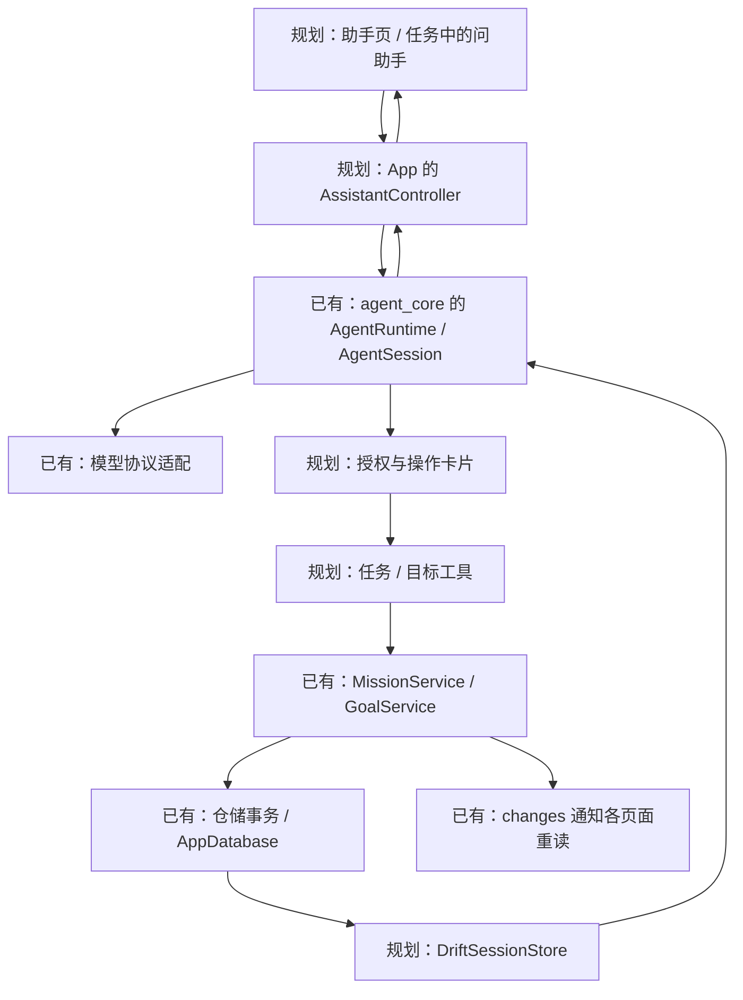

# Agent 接入 App：职责、交互与实施顺序

日期：2026-10-29。状态：源码核对后的设计草案；本轮没有接入业务代码或修改数据库。

用户已确认：助手作为独立主导航，和今天、目标并列；目标、任务详情同时保留“问助手”入口。沿用自配供应商 API、无自建服务器、多供应商、DeepSeek 优先和精简可读的方向。权限具体分类、后台主动性等未决项仍以[内置 Agent](../需求文档v1.0/内置Agent.md)为准。

## 1. 接入后的使用过程

助手的价值是围绕真实目标、任务和材料完成工作。对话是入口，操作卡片承担预览、确认和实际结果展示。

| 用户从哪里进入 | 带入什么 | 一次交互的结果 |
| --- | --- | --- |
| 助手主导航：“今天先做什么？” | 当前日期、时区和获授权的数据范围 | 查询真实任务，给出有来源的建议；任务引用可点击打开 |
| 任务详情：“这一步不会” | 明确的任务编号，输入框上方显示引用标签 | 按需读方案、用户选择的材料；解释可以留在会话里，也可提出修改方案 |
| 目标详情：“下周怎么安排？” | 当前目标编号 | 按需读目标、相关任务、日期安排；形成计划草案，按权限保存 |
| 上传截图：“根据课表安排学习” | 用户选择的图片及说明 | 识别不确定内容、澄清时间，再形成可检查的方案；识别图片不直接等于写入任务 |

贯穿例子：“把明天的单词复习挪到后天。”

1. 工具按日期查找任务；有重名或多个候选时显示选择，不能自行猜编号。
2. 读取所选任务的当前排期和执行事实。已开始任务不能按现有规则改期。
3. 形成结构化变更：任务编号、原排期版本、新日期及相关字段。卡片文字由 App 根据这些值生成。
4. 当前模式需要确认时，展示“明天 → 后天”“保持 30 分钟”，提供“确认调整 / 取消”；修改方案后原确认失效。
5. 提交时在业务事务里重新检查原版本、任务状态和权限；冲突就刷新方案，不覆盖用户刚做的修改。
6. 保存成功后显示“已调整”和“打开任务”；今天、目标、详情继续通过现有服务通知重新查询。

完整权限下，同一操作经过业务检查后直接执行，卡片展示结果，不暗中恢复逐次确认。模型说“已完成”不能代替业务提交结果。

## 2. App 内的界面与导航

建议主导航顺序为“今天 / 目标 / 助手 / 历史 / 我的”，顺序和具体视觉可在原型里微调。手机仍用底部导航，平板和桌面复用侧栏。

助手页面保持四个区域：

- 顶栏：会话标题、新会话、历史入口；模型放在次级入口，不占据正文。
- 对话区：文字、图片、任务或目标引用。读取过程显示“正在查看明天的安排”，技术日志放详情。
- 行动卡片：待确认、执行中、成功、已取消、需要核对；失败原因和重试入口紧邻该操作。
- 输入区：文本、图片、发送或停止。当前任务/目标作为可移除引用标签；模型、思考强度等归到设置或输入区次级菜单。

同一个助手支持多段会话。全局入口继续上次会话；任务入口优先继续该任务最近的会话，也能新建。关联关系是 App 的索引，不把所有任务聊天串成一个无限对话。目标记忆可以被多个相关会话按需读取。

**“带上任务”是显式引用，不是助手持续读取用户当前屏幕。** 用户切换页面后，已发送消息的引用仍指向原任务；发送前由 App 读取最新授权数据。未保存表单内容只有用户主动附加时才作为草稿说明进入对话。

手机从详情点“问助手”时，在原路由上方打开助手，返回回到原详情。宽屏先复用现有详情面板栈，在助手与任务详情之间返回；不一开始就新增第三栏。从助手点击任务卡，同样复用 `openDetailPane`。

关键约束：`AppShell._selectPage` 目前会清空详情栈，因此“问助手”不能简单调用主导航切换。入口需独立打开助手路由，底层仍使用同一会话对象。已有 `DetailPaneController` 的草稿守卫、缩放保留状态规则继续适用。

## 3. 代码怎样接起来

这张图表示调用与数据返回；DriftSessionStore 和业务仓储都使用 AppDatabase，基座不依赖 Flutter 或 MissionBook。

建议随功能新增的文件职责如下，现在不创建空文件：

| 位置 | 负责什么 |
| --- | --- |
| `lib/application/assistant/assistant_controller.dart` | 持有运行时、会话、发送/停止、当前活动和待确认项；生命周期长于页面 |
| `lib/application/assistant/mission_tools.dart` | 任务查询、创建和后续修改；参数转换、权限范围及业务错误映射 |
| `lib/application/assistant/goal_tools.dart` | 目标及节点的查询和后续操作；随该单元增加 |
| `lib/data/assistant/drift_session_store.dart` | 实现包的 SessionStore，按序读写会话记录；维护可重建的列表索引 |
| `lib/data/assistant/assistant_credentials.dart` | 把 credentialKey 映射到设备凭据；不进入聊天或模型配置 JSON |
| `lib/presentation/assistant/assistant_page.dart` | 对话、引用、输入和操作卡片；普通区域先留在同一文件 |
| `lib/presentation/assistant/assistant_settings_page.dart` | 供应商、凭据、连接测试、模型和权限设置 |

现有文件修改集中在 `pubspec.yaml`、`app.dart`、`app_shell.dart`、数据库表/迁移，以及需要实际扩展的业务入口。包通过本地 path 依赖引入，和 App 同一进程运行。CLI 是另一个宿主示例，不放进 Flutter。

装配在 `App` 完成，按需初始化助手。打开页面只获取已有控制器，页面销毁只解除监听，不关闭整个会话。首版建议同一时刻只运行一轮交互，允许切页查看，其他会话提示当前工作尚未结束；暂不增加后台并发调度器。

页面通过 `AgentSession.transcript` 和 `activity` 读取当前快照，再监听 `changes` 并重读，避免只订阅增量导致返回页面时丢字。持久消息与尚未落盘的流式片段分开展示；进程被杀后不能承诺恢复每个未完成字符。

## 4. 存储、配置、图片与设备适配

### 会话放进现有 Drift 数据库

当前 AppDatabase 为 schema v10。初次接入只增加实际使用的会话索引、按 `(sessionId, sequence)` 唯一的会话记录两类数据。记录保留基座的类型和版本；标题、更新时间、关联目标/任务等列表字段是可重建索引，与对应记录在同一事务更新。

不能为了显示会话列表而逐个打开完整历史。SessionStore 的 `listSessionIds` 供核心使用，App 的列表分页查询由 Drift 适配实现提供，不需要扩展所有后端接口。

单会话写入所有权由 App 常驻控制器管理，并在数据库边界验证顺序/冲突；第二运行时或窗口竞争必须测试，不能只用 Dart static 锁宣称跨进程安全。首版发现冲突时明确拒绝第二写入者，不自动抢占活跃会话。

数据库操作按现有后台连接方式执行；不要在一个数据库事务里等待模型网络返回或用户确认。Drift 事务具有原子提交语义，异步操作必须正确等待，参见[官方事务说明](https://drift.simonbinder.eu/dart_api/transactions/)。

`DatabaseBackupService` 当前遍历注册的表，但附件只枚举正式材料。增加会话表后仍需验证备份体积、导出版本和会话一致性；加入聊天图片时补附件清单。当前 App 没有恢复导入入口，不把“纳入导出”写成“可在 App 中恢复”。

### 模型配置与凭据

面向普通使用者先显示“DeepSeek / 自定义服务、API Key、连接测试”。高级设置再显示协议、模型名、上下文、输出预算、思考能力和摘要模型。DeepSeek 用已验证预设；其他供应商保留独立配置和能力校验，不默认都支持 1M、图片或所有思考参数。

连接测试依次验证凭据、可用模型和一条短请求，错误按“凭据无效 / 网络失败 / 不支持的能力”呈现。运行期间切换配置先完成或停止本轮，再重建所需模型装配；不能让同一轮中途换凭据或供应商。

设备凭据可采用 `flutter_secure_storage` 适配现有 `CredentialResolver`。该插件支持 Android、Windows 等平台，Web 要求 HTTPS 或 localhost；具体版本、构建和备份设置在实施时验收，不能从插件声明推定设备验证通过。见[插件维护者说明](https://pub.dev/packages/flutter_secure_storage)。凭据不写进会话、普通数据库备份、日志或源码。

Web 作为独立适配目标：浏览器凭据环境与原生系统存储不同，直连供应商还需实测跨域限制；首版可默认只保留当前网页会话的 Key。不通过临时代理绕开“无自建服务器”的方向。优先完成 Windows 与 Android 使用路径。

### 图片

聊天图片与正式任务材料区分保存，发送聊天图片不意味着提交正式材料。引用已有材料也需要读取授权；拿到存储路径本身不代表获准发送其内容。

按模型能力选择上传或内联；模型不支持图片时明确提示更换模型。DeepSeek 上传后的 fileId 不能替代本地原图：要记录所属供应商、有效期和本地附件关联，过期后可重新上传；切换供应商不能复用旧 fileId。

当前基座的图片块还不能直接理解 App 的本地附件键，接入图片单元时需补请求前的附件解析/引用映射，避免每次上下文或会话导入都复制巨量 base64。该项是实际适配工作，不是假定已有功能。清理聊天附件不能删仍被正式材料或其他会话引用的原图；删除本地会话与删除供应商文件是两个动作。

### 页面与进程生命周期

| 场景 | 建议行为 |
| --- | --- |
| 在 App 内切到今天页 | 本轮继续，助手入口保留活动标记；回来读取会话快照 |
| 窗口缩放、页面重建、暂时失去焦点 | 保留会话和待确认项，不重复发送请求；`inactive` 不直接当作进入后台 |
| 手机隐藏、锁屏或进入后台 | 首版停止后续模型/工具步骤并保留进度；已开始的写入需等待或核对真实结果 |
| 进程被系统关闭后重开 | 读取已提交记录；先核对未知写入，再允许用户继续，不能盲目重放 |
| 等待确认时退出或超时 | 原卡片变成失效/需要重新检查；旧按钮不可继续执行 |

Flutter 官方明确说明进程突然结束时可能没有生命周期通知，因此记录必须在关键步骤及时持久化，不能只在退出时保存。见[AppLifecycleState](https://api.flutter.dev/flutter/dart-ui/AppLifecycleState.html)。后台持续运行与主动提醒另开功能单元，不用一个永不结束的模型循环实现。

## 5. 工具、权限与执行结果

第一批工具从具体用途收敛，读查询按日期/目标/分页返回简短字段，详情和材料按需展开。先做“查日期任务、查任务详情、查目标与节点、创建单个任务”，之后再加改期、执行动作和批量计划。

模型需要的工具参数用稳定编号；标题只是展示。时间由宿主提供当前日期/时区，执行事实时刻仍由写事务生成。模型可以提出 START、PAUSE、RESUME、EXTEND、END 的意图，不能写入任意历史事件、阶段或伪造用户报告。END 等依赖用户陈述的动作随其交互单元单独实现。

### 不能直接套用的现有接口

1. **查询有维护副作用。** `MissionService.findScheduledOn/findDetail/findForGoal` 会先补算材料截止。纯只读工具需提供明确的快照查询路径，复用仓储与完整阶段推导；截止补算继续由现有 App 调度承担。快照注明查询时刻，过期但尚未补记的状态不能伪称已关闭。不能仅因为函数名以 find 开头就设置 `readOnly: true`。
2. **不是所有操作都有可复用身份。** 执行动作已有 `commandId + expectedSequence`；创建已有 `prepareCreation/createPrepared`；编辑每次生成新排期编号，尚无统一操作回执。各工具上线前分别落实固定请求、按身份查询和重复调用处理。
3. **工具异常需要按实际提交边界分类。** 已确认未写入或回滚的业务冲突返回 `ToolRejected`；未知写入保留 outcome_unknown。不能把所有 StateError/Exception 都转成普通失败。
4. **确认内容必须绑定真实输入。** ToolAuthorizer 目前只有 tool/call/cancellation，没有会话身份。首版单运行可由宿主明确绑定当前会话；以后并发时扩展为显式调用上下文，不以全局“当前页面”猜归属。

待确认卡片记录会话、调用、参数摘要、原始快照/版本和权限范围。批准只对应这一份操作；编辑卡片要取消旧调用、形成新提案，不能显示一套参数却执行旧的 `call.input`。

当前授权回调会占用本轮时长预算（默认 15 分钟），不是跨重启的待办系统。首版到期/关闭后让旧批准失效，再由用户发起重新检查；若以后需要“明天再批准”，应实现可持久化的提案流程，不能简单挂住 Future。

三档权限的精确差异尚未确定。建议先把“可读哪些数据”和“哪些动作要确认”分开设置；默认对业务修改展示确认，完整权限按已授权范围直接操作。宽松模式是否自动开始/暂停、批量和取消如何分类留待定稿，不在实现中擅自填空。

写入时将 `ToolContext.idempotencyKey` 映射到固定业务请求。已有命令身份能满足的就复用；对改期等缺少结果身份的操作，随该功能增加最小操作回执，并在**同一业务事务**提交事实和回执。不要在 Service 外面包大事务然后提前触发它的 `_notify()`。

未知结果由宿主先按持久身份核对，再调用 `resolveToolOutcome`。没有可验证结果就继续标记“需要核对”，不展示“重试一下”去重复写入。批量工具未提供整批事务之前，必须逐项报告已成功/失败，不宣称全有或全无。

## 6. 个人上下文与目标记忆

每次请求先放入当前日期/时区、用户这次选择的引用、相关目标记忆以及本轮必要数据。其他目标、历史报告和图片通过获授权的工具按需读取。模型上下文大不代表应该每次把整个数据库发送出去。

从聊天提取“用户说了什么”、任务数据库的事实、规则计算和模型判断时分别标明来源。任务/目标引用用于导航和回查；不直接把模型自由文本中的任意编号当作有权访问的对象。

已有产品方向按独立阶段实现：任务事实提交 → 单任务独立总结 → 当前目标记忆结合新总结更新并自动保存。聊天压缩只管理本会话窗口，不能代替目标记忆。

任务结束后材料可能晚到，因此总结需记录其依据版本；材料提交或修正时标记需要更新。离线只留下可恢复工作状态，失败不回滚任务。目标记忆按目标串行/比较版本更新，避免两份总结互相覆盖；未归属目标的任务仍可有任务总结，不凭空创建目标。用户可查看依据、纠正和恢复记忆版本。上述存储与重试在该单元设计，不现在预建表。

## 7. 实施顺序与验收

| 单元 | 完整交付 | 可观察的验收 |
| --- | --- | --- |
| 1. App 内真实对话与查询 | path 依赖、凭据与模型设置、Drift 会话、助手主导航、任务引用、日期/详情查询工具、流式展示和停止 | 问“今天有什么任务”能返回数据库内容；点卡片打开原任务；切页不断会话，重开可恢复，失败可解释 |
| 2. 第一次真实写入 | 创建单个任务、结构化预览、明确权限、固定业务请求、结果核对、页面同步 | 确认后今天页出现任务；取消零写入；重复点击、提交后中断再恢复都只产生一份任务 |
| 3. 围绕目标完成工作 | 目标工具、图片附件、改期及批量计划、对应回执/冲突控制 | 图片可查看原图与识别结果；并发改期不覆盖新版本；批量结果可核对；新增附件纳入备份 |
| 4. 跨任务积累 | 单任务总结、目标记忆、依据回查和纠正 | 晚交材料能更新总结；断网可重试；记忆更新不改任务事实；主助手按需读取 |

每个单元再做 Windows/Android 的实际入口、键盘遮挡、返回链、应用重启和凭据读取验收；Web 单列验证。布局至少覆盖窄手机、平板竖/横屏和桌面缩放，尤其是原详情里有草稿时打开助手再返回。当前没有这些功能的实现或设备验收证据。

第一单元已经是能查真实任务的助手，第二单元完成“说一句话 → 看具体提案 → 任务落地”的产品闭环。不先铺全量工具、插件系统或通用工作流框架。

## 8. 本轮源码依据

- [App 装配](../../lib/app.dart)、[导航与详情面板](../../lib/app_shell.dart)、[面板栈和草稿守卫](../../lib/presentation/widgets/detail_pane.dart)。
- [任务业务服务](../../lib/application/missions/mission_service.dart)、[目标业务服务](../../lib/application/goals/goal_service.dart)、[事务和幂等](../../lib/data/repositories/drift_mission_repository.dart)。
- [当前数据库](../../lib/data/local/app_database.dart)、[备份导出](../../lib/data/backup/database_backup_service.dart)。
- [运行时和活动快照](../../packages/agent_core/lib/src/sessions/agent_runtime.dart)、[存储接口](../../packages/agent_core/lib/src/sessions/session_store.dart)、[工具与授权接口](../../packages/agent_core/lib/src/tool.dart)。

本轮只完成设计核对、主入口确认和文档归档；没有运行代码测试，没有重新宣称基座或 App 通过新的验收。
