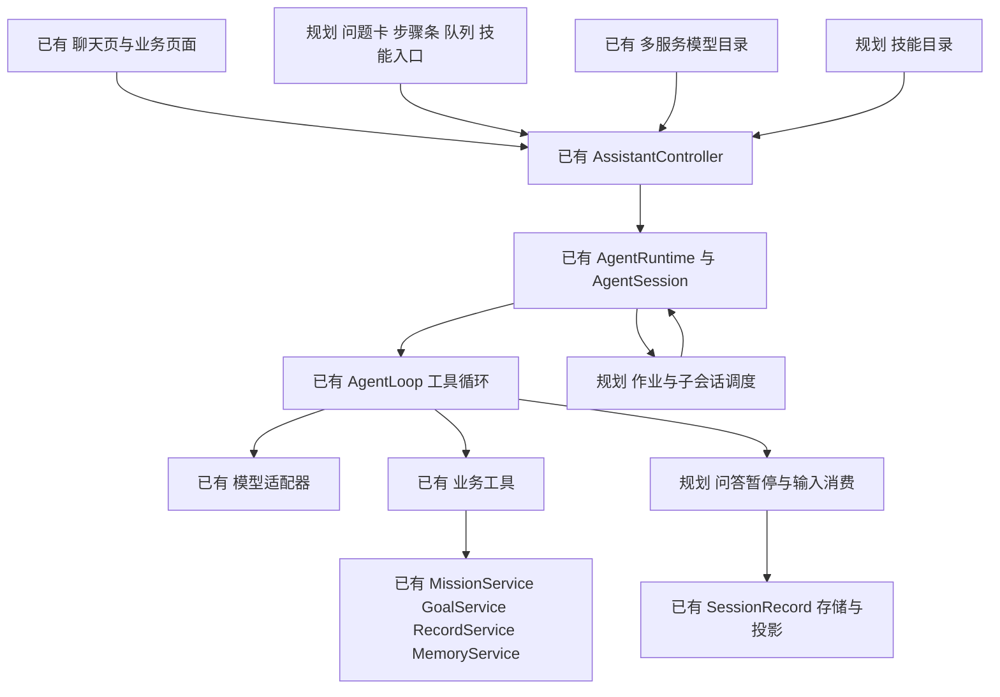

# Agent 能力升级实施计划

编制与修订日期为 2026-11-14。面向接续实现的 AI 与开发者，依据 MissionBook 源码和本地 dsh-Go 源码制定。M01 与 B01 已有实现，本轮接续修复 `13bdd78` 审查发现的 12 类问题。实现、自动化验证与模型/设备验收分别见[工作包记录](工作包与验收.md#实施状态)和[修复记录](../../审查/2026-11-14-助手模型与分支修复.md)。

## 阅读与交接入口

| 文档 | 用途 |
| --- | --- |
| [个人助手与任务联动](个人助手与任务联动.md) | 起始目标与基线盘点；悬浮会话、持续监督及任务联动的同轮规格 |
| [个人助手实施任务书](个人助手实施任务书.md) | 本轮实施和验收入口：权限、状态、工作包及验收门槛 |
| [现状评估与参考源码](现状评估与参考源码.md) | 已有能力、缺口、参考工程真实职责、复用方式与源码地图 |
| [交互与会话规格](交互与会话规格.md) | 结构化追问、执行计划、运行中补充、输入队列与消息分支 |
| [模型管理与技能规格](模型管理与技能规格.md) | 多服务、多模型、凭据、协议、能力元数据、技能加载与调用 |
| [后台任务与协作规格](后台任务与协作规格.md) | 长任务、定时 AI 作业、只读并发、子智能体及扩展能力 |
| [工作包与验收](工作包与验收.md) | 依赖顺序、文件归属、任务交付物、失败场景与统一验收 |

MissionBook 路径为 `E:\working\mission_book`，参考工程路径为 `E:\working\dsh-Go`。个人助手这轮先读产品范围与实施任务书，不按旧工作包自动扩项；其他 Agent 工作包仍按各自依赖实施。

## 依据与状态

- 最初评估基线为 `729d078`。M01/B01 由 `13bdd78` 引入，本轮修复在其上进行，接手时检查实际 HEAD 和工作树。
- dsh-Go 本地参考提交为 `345bb794c4adadae53535900c172041056ed7996`。参考源码固定在该提交，工作包引用的路径均已核对存在。
- 上一轮模型列表获取已有实现和专项验证记录，本计划将它纳入多服务管理继续完善。其真实供应商和物理设备操作仍待验收。
- 问答、计划工具、队列、技能、后台作业与子智能体继续按各工作包规划推进，当前状态登记在工作包记录。

## 产品目标

让用户可以把一个复杂需求交给助手，助手补齐必要信息、展示执行步骤、调用现有业务工具、接收执行中的修正，并报告真实结果。支持多种模型服务，允许按固定技能完成常用流程，并逐步承接后台工作和分工处理。

代表场景为“根据我的目标和已有安排，制定下周复习计划”。目标流程包含以下环节。

1. 读取真实目标、任务、已有安排和相关记录。
2. 通过问题卡片补充可用时间、重点内容等缺失信息。
3. 展示本轮步骤与当前进行项。
4. 用户在执行中补充“周三下午有课”，助手在下一次模型请求前接收修正。
5. 通过已有安排提案和业务工具提交操作，权限行为采用当前用户设置。
6. 报告已保存数量、冲突、跳过项和未完成事项，提供真实对象入口。

## 本计划建议的实施范围

| 级别 | 工作包 | 当前决策 |
| --- | --- | --- |
| 本轮修复 | M01 | 多服务目录已实现，修复协议身份、凭据提交、摘要选择、分页和表单保存，待模型/设备补验及扩展项见工作包记录 |
| 本轮修复 | B01 | 分支、编辑重发和重新回答已实现，修复轮次边界、引用原子保存与文本附件，来源跳转和设备补验见工作包记录 |
| 技术验证 | Q01 | 仅验证等待用户、持久化和恢复闭环；验证不过不进入完整实现 |
| 暂缓 | P01、I01、S01、J01、E01 | 先依据 M01/B01 的真实使用痛点再决定 |
| 当前不做 | R01、A01、E02–E04 | 没有明确收益或安全/运行时边界，暂不建立实现 |

C00 不再作为独立空契约阶段；需要的核心变化随 M01 或 Q01 的实际用户路径最小切入。后续扩展只有在真实用户场景、权限边界、恢复语义和验收证据明确后才建立对应存储与接口。用户后续调整优先于本文排序。

## 架构方向

本轮采用现有 Dart `agent_core` 与 MissionBook 应用层逐项实现协议和行为的路线。dsh-Go 的 Flutter 页面、Dart 客户端、JS 桥接层与 DSH 引擎分别承担职责，迁移须沿完整调用核对。



图中“已有”代表可定位的实现，“规划”代表本计划的增量。详细职责与契约见各专题，实施完成后同步现行架构文档。

## M01 已确认的边界决策

以下决策已由需求方确认，实施时不得用更方便的临时方案替代：

1. **支持有 Key 与无 Key 服务**：无 Key 是 `ModelProfile` 的通用能力，不在 `agent_core` 中判断 Ollama、LM Studio 或其他供应商名称。
2. **停用可恢复，删除配置保留历史**：本项按后续需求调整，模型和整项服务都能显式删除。现行规则见[上下文与工具预算](../../架构/前端/助手与总结/上下文与工具预算.md)。
3. **默认主模型用于新会话**。当前会话主模型通过会话级动作切换，单独修改默认主模型时保留独立摘要选择。
4. **摘要选择全局一个**。未独立选择时跟随默认主模型，全局修改即时同步当前会话并在重开时重新绑定。核心日志保留实际摘要配置快照以支持回放。
5. **不新增业务数据库表或 schema 迁移**：目录和选择使用带版本的安全存储 JSON；凭据只通过受控 `credentialRef` 解析。
6. **一次性清理旧运行来源**：旧固定 profile、`customProfile` 和固定凭据白名单只作为幂等迁移输入，迁移成功后不能与新目录并行读取或写入。

### 层级与依赖边界

```text
lib/presentation/assistant → lib/application/assistant → packages/agent_core
                                      ↑ 契约实现
                               lib/data/assistant
app.dart 装配控制器、存储适配与业务服务
```

- `packages/agent_core` 提供模型能力、请求、会话和运行时抽象，不依赖 `lib`。已有 DeepSeek 协议适配留在核心协议边界，应用层通过 `modelProvider` 传递适配身份，MissionBook 目录与凭据键名由宿主提供。
- `lib/application/assistant` 负责 Provider / Model / Selection、旧配置迁移编排、凭据引用、默认/摘要/会话选择和运行时配置编译。
- `lib/data/assistant` 负责安全存储、目录版本迁移、损坏兜底和备份资源适配；不把凭据明文放入目录、日志或会话。
- `lib/presentation/assistant` 只负责服务/模型表单、列表获取、选择、状态提示和返回/取消交互，不直接读写安全存储或拼接业务请求。
- `lib/domain` 与 `lib/data/local` 的 MissionBook 业务数据和数据库不属于 M01 改动范围。

M01 必须以一个完整变更收口：数据模型、迁移、运行时适配、保存事务、历史恢复、备份、UI、测试和文档同步完成后，才允许判定交付。不得先以孤立模型选择页面或保留新旧双轨的方式宣称完成。

## 统一原则

1. 任务写入经应用服务、事实重读与现有事务。Mission 阶段使用完整 `deriveMissionPhase`，包含 STOP 与 reportPending。
2. 工具副作用使用原命令身份与回执。消息重发、分支、队列恢复、后台重启和子智能体都不能自动重放结果未知的写入。
3. 每个可恢复的用户动作具有稳定编号，接受事实先持久化再更新 UI。日志提交失败时停止依赖该事实的执行。
4. 当前三档权限由用户设置提供。技能、角色、子智能体和模型输出均不能改写授权。信息追问的答复与业务操作授权各自使用对应语义。
5. 执行清单表达本轮 AI 的步骤。任务完成、材料证据、总结评价与用户掌握分别依据对应事实。
6. 前端使用现有主题、控制器和功能分区。新交互验证 48dp 触达区域、320dp 窄屏、双倍字号、键盘遮挡和返回行为。
7. 现有会话、备份、CLI 和脚本模型都是调用方，核心接口调整时同步处理。开发阶段采用当前仓库的数据库与格式策略，不引入平行旧协议实现。
8. 当前会话中的原始数据要有可用路径。对当前自定义配置的归并、凭据引用和已有会话补缺在 M01 明确处理，避免以清空用户数据交付升级。

## 建议默认值与可调整项

以下是为了统一实施而提出的默认方案，用户尚未逐项指定。实现者可依据实测调整，并在变更记录中说明原因与影响。

| 项目 | 建议默认 |
| --- | --- |
| 问题交互 | 每个会话同时一个问题请求，一个请求允许 1–3 个问题 |
| 排队输入 | 每会话最多 32 条，超出时保留用户草稿并提示处理现有队列 |
| 执行计划 | 每轮最多 20 个步骤，复杂工作以子步骤文字或后续计划承接 |
| 模型选择 | 用户显式选择，失败后提供重试或切换入口 |
| 技能调用 | 首期显式选择或 `/技能名`，模型自动发现放在相同契约验收后 |
| 只读工具并发 | 最多 3 个独立读取，写工具按原顺序执行 |
| 子智能体 | 最大同时运行 2 个，初版最大深度 1，初版只授予读取与分析能力 |
| 长任务恢复 | 用户明确停止后保持停止，进程异常结束后显示可恢复状态 |

限制须有明确错误与恢复入口。不得将这些实现默认值变成额外用户审批流程。

## 交给实施 AI 的任务说明

将以下内容连同整个工作树交给实施 AI。

```text
请实现 MissionBook 的 Agent 能力升级。

工程 E:\working\mission_book
参考工程 E:\working\dsh-Go，参考提交 345bb794c4adadae53535900c172041056ed7996
完整规格入口 docs/设计/Agent能力升级/README.md

先遵守 AGENTS.md，读取 docs/README.md、架构入口、助手模块文档以及升级目录全部六篇文档，再检查实际工作树。M01/B01 已实现并修复审查问题，先读工作包实施状态与修复记录，保留当前改动。

先按工作包实施状态补 M01/B01 的剩余验收和扩展项，再依据真实使用决定 Q01。每个工作包实现完整用户路径、持久化和失败恢复，并记录验收证据。后续 E01–E04 按用户追加需求实施。

同一个实现者可以顺序完成全部工作。多位 AI 接续时，以工作包与验收文档明确写入的接口和文件归属交接，共享核心文件的改动串行集成。

实现复用现有 Dart 核心、业务服务、主题与存储。依据参考工程的完整调用学习行为，逐文件核对直接引入源码的来源与许可。新接口类型名可按现有风格细化，但事件语义、身份关系与验收场景须一致。

所有业务写入继续满足当前权限、幂等、事务和未知结果核对规则。问答、队列、计划、技能、分支、后台任务和子智能体须经过正式入口，禁止以空回调、假数据或只有截图的页面交付。

每个工作包交付代码、针对性测试、现行文档同步和明确验证结果。真实模型与目标设备验证分别记录，学习进度不得把代码完成写成用户掌握。已有授权范围内自主排错，遇到真正缺少的信息时准确说明阻塞来源。

阶段完成后按统一验收报告已完成工作包、未完成项、验证命令、设备范围和剩余缺陷。未经要求不提交、推送、发布或清空本机数据。
```

## 本轮交付状态

评估与规划文档已建立，文件路径与相对链接完成本机核对。功能实现、真实模型验收与设备验收由对应工作包逐项记录。本计划形成过程没有新增用户掌握证据。

2026-11-14 M01 已按“服务 / 模型 / 凭据 / 选择”完整落地，B01 已接通消息分支、编辑重发与重新回答（含业务操作的轮次禁止重新回答）。代码与测试见[变更记录](../../教学/变更记录.md#2026-11-14-b01-消息分支编辑重发与重新回答)。真实供应商调用、目标设备交互和桌面逐页视觉复核仍待补；Q01 尚未开始。
