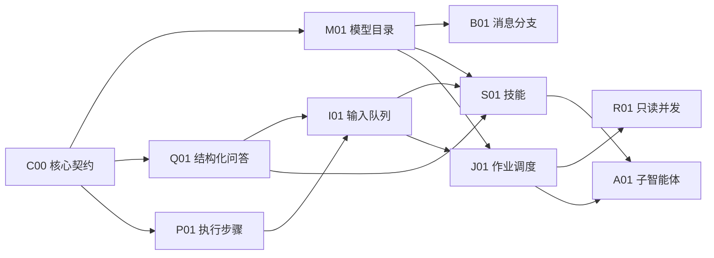

# 工作包与验收

本篇是实施排程和交接记录的统一依据，功能行为分别在各专题定义。最初评估基线为 `729d078`，M01/B01 由 `13bdd78` 引入，本轮接续修复审查发现的问题。

## 实施状态

| 工作包 | 已落地 | 本轮之后的接续事项 |
| --- | --- | --- |
| M01 | 服务/模型目录、凭据引用、默认/摘要/会话选择、模型发现与分页、草稿保存、历史快照恢复。12 类审查问题的相关修复见本轮记录 | 真实供应商两协议的工具/图片/取消验证，原生安全存储与带设置/Key 的备份恢复实测。扩展项包括根级 `/models` 的自动探测与地址回填、能力元数据来源与刷新、额外请求头和批量模型选择 |
| B01 | 消息更多菜单、分支、编辑重发、重新回答，任务/目标/节点引用与分支日志原子建索引，文本与图片附件保留，完整轮次结束边界 | 来源会话跳转入口，原生设备上多轮/附件/重启操作验收。含工具轮次继续禁止自动重新回答 |
| Q01 | 规格已定义 | 依据用户下一步需求验证持久化等待与答复恢复，再接 UI |
| P01/I01/S01/J01/E01 | 规格已定义 | 依总计划决策暂缓 |
| R01/A01/E02–E04 | 评估与扩展方向 | 按追加需求确定运行与权限边界 |

M01/B01 的本轮审查修复与自动化结果见[修复记录](../../审查/2026-11-14-助手模型与分支修复.md)，现行实现见[助手架构](../../架构/前端/助手与总结/总览.md)。后续 AI 先补上述验收与明确选定的扩展项，避免重建已经接通的目录或分支入口。全量测试通过作为自动化验证记录，真实模型与设备验收另行登记。

## 依赖顺序



推荐集成顺序为 C00 → M01 → Q01 → P01 → B01 → I01 → S01 → J01 → R01 → A01。单个 AI 按此顺序实施可以减少核心冲突。多个 AI 接续时可在依赖满足后分别完成应用层页面和独立模型，但核心共有文件串行合入。

## 文件归属与协作

| 文件组 | 协调方式 |
| --- | --- |
| `agent_event.dart`、`agent_result.dart`、`tool.dart`、`session_state.dart`、`agent_runtime.dart`、`agent_loop.dart` | C00 先统一契约，后续工作包由当轮核心实现者合入 |
| `configuration.dart`、`model_registry.dart`、模型 HTTP/协议实现 | M01 负责，后续工具执行改动沿已发布配置契约接入 |
| `assistant_controller.dart`、`assistant_sessions.dart`、`app.dart` | 每次指定一个集成所有者，其他实现者提交所需接口和调用改动 |
| 安全存储、备份资源、模型设置 UI | M01 统一处理，避免多个模型目录来源 |
| 问题卡、步骤条、输入队列区、技能页 | 各工作包分别负责，使用已约定的控制器状态和动作 |
| 任务/目标/记录/记忆业务服务 | 复用现有接口，确有业务变化时交给相应领域实现者 |

文件归属用于避免覆盖改动。单个实现者无需人为建立多人审批步骤。发现接口需要调整时，在同一变更中同步生产调用、测试和文档。

## C00 核心契约和恢复基础

**目标** 统一问答、计划、输入和后续作业的身份、事件与集成位置，建立可执行的回归基线。

**参考** `session_api.dart`、`transcript.dart`，结合本项目现有日志和工具语义。

**修改入口** `tool.dart`、`agent_event.dart`、`agent_result.dart`、`agent_runtime.dart`、`session_state.dart`、`message_codec.dart`、`agent_loop.dart`，以及实际受影响的工具工厂、CLI 和脚本模型。

**交付要求**

- 明确后续事件字段、严格校验、不可变投影与各生产调用的改动清单。
- 核对普通 ToolOutput 调用方，新的工具执行结果契约随 Q01 首个实际交互一起落地。
- 定义 waitingForUser 暂停/恢复、稳定运行身份、执行时间预算和状态快照的统一语义。
- 明确新事件的 copy/apply、原子提交、导入导出、分支和未知写入恢复的测试位置。
- 对已存在的工具与会话完成回归。实际新增字段、事件和存储随各完整功能接入，未使用能力不提前建立空实现。

**完成条件** 契约和当前调用方清单明确，原有脚本模型、CLI、工具执行、会话持久化失败及未知结果测试有可复验基线。Q01 接入时把新增交互日志在内存存储与真实 Drift 之间重开回放的测试作为首个契约实现验收。

## M01 服务目录和模型管理

**目标** 完成[模型管理规格](模型管理与技能规格.md#m01-多服务多模型)的正式路径，当前完成和接续范围以本篇实施状态为准。

**修改入口** `assistant_settings.dart`、安全设置存储、`assistant_configuration.dart`、`assistant_model_catalog.dart`、模型页、模型注册表、协议请求头、`app.dart` 和本机资源备份。

**规划新增** 仅在职责需要时建立 provider/model 目录实体、目录编辑区域和模型能力表单，具体文件名登记在实现记录中。

**重点交付**

- 多服务、多模型、稳定 profileId、独立凭据、能力覆盖与实际请求选择。
- 模型列表地址、分页、取消、过时响应、已有模型保留和手动输入。
- 当前 custom 数据归并、历史配置缺失时浏览和重新绑定、导入历史与分支。
- 主模型/摘要模型选择、运行请求快照、配置更新后的资源释放。
- 动态凭据的收集/恢复及部分失败结果，检查现有 backup/service 与 resource 调用链。

**完成条件** 两服务同编号模型请求隔离、配置删除后历史可查看、归并中断可重试、备份恢复与流式工具调用闭环通过。

## Q01 问题请求和继续执行

**目标** 用户在问题卡中答复后继续同一工作。

**修改入口** C00 的交互事件与恢复、`assistant_controller.dart`、`assistant_sessions.dart`、工具目录、聊天渲染及问题草稿存储。

**规划新增** 问题数据结构、交互控制协作者和问题卡。已有正式类型若已由 C00 提供则直接复用。

**重点交付** 单选/多选/自由填写、跳过、停止、提交去重、问题版本、多工具批次位置、页面与进程恢复。

**完成条件** 从正式聊天接收一个真实模型问题，答复后原 callId 结算一次，本批前后工具各执行一次。持久化失败与重复答复回归通过。

## P01 步骤工具和进度 UI

**目标** 助手执行过程可跟踪、可回看。

**修改入口** `updatePlan` 注册、SessionState 清单投影、聊天输入区与历史轮次展示。

**重点交付** 稳定步骤 id、完整修订、当前进行项、计数、展开、失败/等待/停止状态和业务回执关联。

**完成条件** 正式助手调用工具更新清单，重开后显示同一最后修订。工具失败或停止后清单正确表达实际进度。

## B01 分支、编辑重发和重新回答

**目标** 接通现有 `AgentSession.fork` 并完成 App 对象与附件关系。

**修改入口** 会话协作者、会话索引与存储契约、消息菜单、附件读取、聊天导航、导入导出及备份。

**重点交付** 消息前缀边界、来源导航、引用继承、新分支独立运行、附件缺失提示、模型缺失重绑定与业务副作用原问题处理。

**完成条件** 文本和图片的编辑重发/重答可用，工具完整组不可被切开，原业务操作不会因历史回放自动重做。

## I01 消息补充、排队与撤回

**目标** 运行期间可以补充本轮或排队下一轮。

**修改入口** AgentLoop 消费边界、AgentSession inbox/提交、应用发送状态、输入区队列、附件与草稿、停止/继续和记忆来源定位。

**重点交付** inputId 去重、原子接受/消费/撤回、完成前检查 steer、正常完成后消费 queue、停止与未知结果阻塞的真实状态。

**完成条件** 可控制时序的竞态测试证明不丢消息、不重复执行、工具组完整。真实模型在工具执行中接收到补充后，后续计划依据新输入调整。

## S01 技能目录与四个完整技能

**目标** 把可重复业务流程变成可选择的技能。

**修改入口** 系统提示与上下文装配、技能目录/存储、slash 解析、选择/详情/编辑、资料读取、预算及备份。

**重点交付** 四个内置流程、自定义技能、按需资料、修订快照、工具求交集、错误恢复和显式调用。

**完成条件** 四个技能分别经过真实数据与工具闭环，追问、进度和补充指令可以组合使用，技能更新和重开后的来源可追溯。

## J01 应用级作业调度

**目标** 长工作具备跨页面拥有者、真实状态、停止与恢复。

**修改入口** App 级装配、主/后台请求协调、SessionHandle 拥有关系、作业投影/必要索引、作业列表/详情、通知、关闭及备份恢复。

**重点交付** queued/running 等完整状态、不同会话浏览、问答/审批定位、用户停止、interrupted 与 needsReconciliation、稳定 jobId 和结果引用。

**完成条件** 两个会话间切换时作业及资源正确，重启后能回看真实结果并按身份恢复。Android 后台/锁屏/进程终止行为记录真实设备结果。

## R01 独立读取并发

**目标** 在可验证的依赖和副作用范围内缩短查询耗时。

**修改入口** 工具元数据、AgentLoop 执行批次、取消、结果持久化与全局资源预算。

**重点交付** 工具分类清单、有界并发、原结果顺序、部分失败、日志失败、取消和写入串行。

**完成条件** 注入式时序测试与正式查询数据测试通过，实测耗时和峰值资源有对照数据，工具结果与阶段派生正确。

## A01 子智能体分工

**目标** 主会话可创建并汇总独立子任务。

**修改入口** J01 调度、父子描述与状态、工具范围、上下文供给、结果投递、用量与聊天子任务入口。

**重点交付** 有界并发、独立会话、读取/分析工具范围、父停止传播、迟到结果、去重投递、部分失败、备份与恢复。

**完成条件** 至少两个真实子任务并发处理不同资料，主助手汇总结果带来源。重复投递、父停止和创建中断均不重复执行任务。

## 统一测试与验收矩阵

### 现有回归入口

以下文件在规划时存在，新增断言优先扩展最贴近的已有测试，专项文件随功能实际建立。

| 入口 | 接续用途 |
| --- | --- |
| [session_runtime_test](../../../packages/agent_core/test/session_runtime_test.dart) | 会话恢复、事件持久化、模型选择和运行 |
| [context_compaction_test](../../../packages/agent_core/test/context_compaction_test.dart) | 技能、问答和补充输入的压缩完整性 |
| [file_session_store_test](../../../packages/agent_core/test/file_session_store_test.dart) | 文件日志重开与失败 |
| [assistant_controller_test](../../../test/application/assistant/assistant_controller_test.dart) | 正式控制器和会话行为 |
| [assistant_lifecycle_regression_test](../../../test/application/assistant/assistant_lifecycle_regression_test.dart) | 生命周期、关闭与在途请求 |
| [assistant_execute_mission_test](../../../test/application/assistant/assistant_execute_mission_test.dart) | 真实业务写入与未知结果核对 |
| [assistant_model_budget_test](../../../test/application/assistant/assistant_model_budget_test.dart) | 主模型、摘要模型和上下文预算 |
| [assistant_model_catalog_test](../../../test/application/assistant/assistant_model_catalog_test.dart) | 列表、地址、鉴权、分页、取消和错误 |
| [snapshot_model_recovery_test](../../../packages/agent_core/test/snapshot_model_recovery_test.dart) | 移除配置后的历史快照经真实本机 HTTP 请求完成对话与压缩 |
| [assistant_entry_test](../../../test/presentation/assistant/assistant_entry_test.dart) | 页面入口、草稿、模型页及窄屏 |
| [backup_restore_test](../../../test/application/backup_restore_test.dart) | 当前备份结构和真实恢复 |

### 验证层级

| 层级 | 必须验证的内容 | 报告依据 |
| --- | --- | --- |
| 静态检查 | Dart/Flutter 格式、类型、lint、文档链接 | 实际命令输出 |
| 核心逻辑 | 事件合法性、预算、状态复制、消息组和工具结果 | 注入式单测 |
| 持久化 | 内存与真实 Drift、写失败、租约、重开、导入导出、备份 | 隔离真实库与文件 |
| 页面 | 320dp、双倍字号、键盘、48dp 触达、返回与草稿 | Widget 测试和实际页面 |
| 模型 | 工具、流、取消、思考、图片、追问继续与补充 | 临时凭据驱动的真实模型记录 |
| 设备 | Android/Windows 正式入口、切后台、锁屏、中断和通知 | 目标设备实测 |

测试数据采用隔离数据库和显式测试目录。实际验证不清空用户应用数据。真实模型使用用户明确提供或当前已授权的凭据，日志和文档不包含 Key 明文。

### 建议命令

```powershell
git diff --check
flutter analyze --no-pub
flutter test --no-pub
Push-Location packages/agent_core
dart analyze --fatal-infos
dart test
Pop-Location
```

依赖有变化时先完成对应 `pub get`。格式检查按实际修改文件执行，避免无关格式化扩散。真实模型用例可能由环境变量门控，报告中区分通过、失败、跳过和未运行。

### 全阶段组合验收场景

1. 配置两个服务，获取并选择模型，分别发起真实工具请求。
2. 使用周计划技能，助手读取已有安排、发出问题、展示步骤并产生真实提案。
3. 工具执行中补充“周三下午有课”，同时排队“接着整理材料”，验证本轮修正与后续轮次。
4. 用户停止，队列保持待处理。制造写入应答丢失后验证先核对再继续，原命令只提交一次。
5. 编辑原用户问题后进入分支，验证附件、业务引用、来源与原会话回看。
6. 长任务执行中浏览其他页面，经过追问、完成通知和重启恢复定位结果。
7. 主任务分出两个只读子任务，部分失败、父停止和迟到结果分别验证。
8. 带本机资源备份并恢复，核对模型目录、凭据、技能、队列、问题、计划、作业和父子关系。

## 实施记录格式

各工作包完成后在本篇追加对应记录，包含工作包编号、实际修改文件、采用或调整的契约、验证命令与结果、真实模型范围、目标设备范围、已知缺陷和接续事项。

同步现行助手架构、受影响模块文档、`docs/教学/变更记录.md` 与 `docs/教学/学习进度.md`。代码落地、实际验证、用户掌握分别记录。

## 初始规划验证

最初规划完成了文档结构、源码路径、引用关系、文件行数和工作包覆盖检查。M01/B01 的接续功能验证登记于本轮修复记录，其他工作包按实际实现逐包执行。
