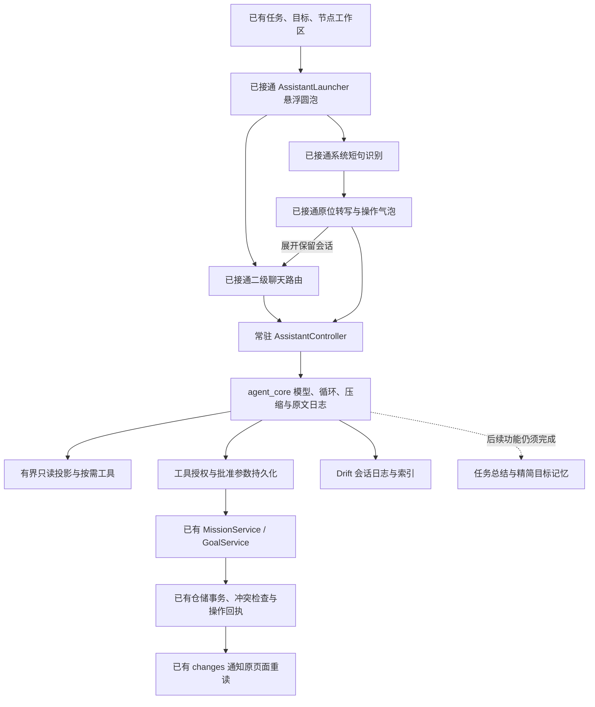

# 助手完整接入：实现与验收

2026-10-29，进行中。用户已授权按确认方案完整开发，并强调功能完善优先。本文件追踪交付证据，不以已有界面或部分测试替代完整交付。基线为 `feat/agent-app-integration` 的 `74ceabe`，实施分支为 `codex/contextual-assistant`。

## 0.2.8 UI 与语音修订

用户最新明确只修改新增 AI 模块，已有任务/目标/今天页界面保留。消息宽度按可用空间计算，手机不横向溢出，平板正文最大 860、用户气泡最大 620；聊天外框 1120，与顶栏和输入区对齐。消息有明确的轮次间距，Markdown 段落间距 8、正文行高 1.5；只读操作收为紧凑展开行。会话记录最大宽度 960，搜索实际标题与会话类型，按日期分组，改名/删除收在更多菜单。

语音浮层最大宽度 360，避开宽屏侧栏、系统安全区与键盘，长内容可滚动。转写直接显示，发送前可改用文字展开同一会话；不在浮层堆放表单。系统语言列表超过 1 秒使用默认语言，启动最多等待 15 秒，结束/取消最多等待 3 秒；启动失败明确显示原因并允许重试/文字输入。控件状态随有效输入/保存变化，改名弹窗的控制器随退出动画结束释放。

[生成参考与实际截图](../教学/制作记录/2026-10-29-助手UI适配修订.md)只说明视觉决策，自动验证和包信息见[0.2.8 验收](../教学/验收记录/2026-10-29-助手UI适配版/)。实际系统语音与键盘仍需设备验证。

## 当前结构

页面只交付对象身份，不抓取整个屏幕或自动读取未保存草稿。文字页面用 Navigator 的二级路由覆盖原工作区，不调用主导航切换或清除 DetailPaneController。语音与文字读取同一个会话和提案。会话绑定稳定对象编号，切页面不能改变待确认提案的对象。

| 位置 | 实际职责 |
| --- | --- |
| [App 装配](../../lib/app.dart) | 常驻控制器、语音服务、存储和生命周期；后台停止后续 Agent 步骤 |
| [入口与气泡](../../lib/presentation/assistant/assistant_launcher.dart) | 独立悬浮圆泡、滑动命中、原位录音转写与同会话展开；宽屏侧栏边缘避让 |
| [上下文与路由](../../lib/presentation/assistant/assistant_scope.dart) | 提供共享依赖、打开二级会话、返回任务/目标 |
| [会话控制器](../../lib/application/assistant/assistant_controller.dart) | 会话选择、引用、发送/停止、提案、结果核对、草稿与设置 |
| [业务工具](../../lib/application/assistant/assistant_tools.dart) | 参数转换与授权后调用已有 Service，不直接写业务表 |
| [只读契约](../../lib/application/assistant/assistant_reader.dart)、[SQLite 投影](../../lib/data/assistant/drift_assistant_reader.dart) | SQL LIMIT 与 substr 在读取前生效，不先装载万任务再裁剪 |
| [语音状态](../../lib/application/assistant/assistant_speech.dart)、[系统识别](../../lib/data/assistant/system_assistant_speech.dart) | 一个 App 一个识别适配；语音只产生文字，不能成为第二条业务写入通道 |
| [会话存储](../../lib/data/assistant/drift_session_store.dart) | 会话日志、对象索引与写租约；v12 给已有 v11 索引补可空节点列 |

批准的最终参数在 `tool_execution_started.input` 中先持久化，再执行工具。模型原调用保持原文；恢复和操作卡片读取 `executedCalls`。编辑提案不能替换任务、目标或节点编号。任务编辑、取消、目标/节点文字修改的事实与操作回执在各自仓储同一事务提交；Service 在事务成功后通知页面。

## 功能核对

- [x] App 装配、全局入口、任务/目标/节点入口、文字二级聊天与方便返回。
- [x] 长按浮出两个圆泡并滑动选择；系统语音转写、检查后发送、原位回复和提案、展开同一会话。
- [x] 确认、编辑、取消、完整权限直接执行、停止、过期快照冲突与未知结果阻止盲目重放。
- [x] 任务创建/查询/编辑/改期/执行/取消、目标与节点创建和文字修改通过已有业务服务。
- [x] 有界目标/节点索引、任务候选分页、长文字分段和每轮 64000 字符累计读取上限；索引明确不代表完整阶段。
- [x] 会话日志恢复、节点引用恢复、会话列表、改名与删除入口；凭据不进入业务备份。
- [x] v1-v11 到 v12 迁移验证，v11 会话/日志/回执逐项保留。
- [x] DeepSeek / 自定义服务配置、协议、容量和图片能力字段实际保存；不同服务的 Key 独立安全存储。保存期间禁止发送、切会话或并发修改，关闭等待保存结束。
- [x] 正式执行/失败/材料索引与文字分段读取，区分修正前后材料、当前版本和未读附件；不把图片附件没有文字当作空材料。
- [ ] 继续核对所有失败恢复和边界交互，补足发现的功能缺口。
- [ ] 图片按需访问与聊天附件、批量计划及长期总结/目标记忆仍需按接入方案后续单元完成，不能因前面的勾选宣称完整 Agent 已交付。
- [x] 当前预览范围的分析、全量回归、Android 打包、共享目录交付和文档证据完成；整套 Agent 的未完成项继续保留。

## 已取得的验证证据

本次 0.2.7 预览版门禁：静态分析无问题；变更涉及的 49 个 Dart 文件格式检查通过；应用全量 516 项通过、1 项出网用例默认跳过；独立 Agent 基座 112 项通过。真实 DeepSeek 另运行 1 项通过。日志与源码指纹归档于[本次验收记录](../教学/验收记录/2026-10-29-助手预览版/)。这些门禁只覆盖当前预览范围，不表示所有待开发功能已完成。

实际 Widget 专项覆盖：320/390/768/1200 宽 AppShell、320 宽两倍字号、原页面草稿/展开保留、长按滑动语音、展开待确认操作与一次提交、键盘空间。另覆盖提案编辑保存与确认、自定义模型设置整表保存。Widget 使用脚本模型和识别适配，不能据此宣称真实麦克风或供应商调用成功。

万任务测试通过：真实导入 10000 任务及 500 节点后，助手仅返回 20 条候选、分页无重复；目标概览不附全量任务。Unicode 长正文逐片重组与原文一致。索引缺省未读取的阶段、方案或材料不会被伪装为不存在。

Web JavaScript release 构建通过；更新到锁定的 sqlite3 3.8.0 官方 WASM，并用当前依赖重编译 Worker。浏览器实际进入助手、展示缺少 Key 提示、执行无 Key 的本地日期查询，无错误日志。Web WASM 模式仍受当前 secure-storage 插件的旧 Web API 限制，不能宣称支持 WASM 构建。

真实 DeepSeek 在隔离内存 SQLite 上验证成功：任务查询、改期提案从 45 分钟编辑为 40 分钟后实际保存、关闭重开仍显示最终批准参数、节点改名、取消创建零写入。用户的临时 Key 只经过进程内存与临时环境，不写入仓库、测试代码、应用配置或 APK。普通全量回归默认跳过此出网用例，实际调用证据单独保存。

Android `0.2.7+9` 预览包构建成功并复制到 `/sdcard/Download/MissionBook-0.2.7-ai-preview-20261029-arm64.apk`，39,618,049 字节；签名与上一版一致，源文件与共享文件 SHA-256 一致。详情见验收记录。本机未连接 ADB 设备，Android/Windows 安装、语音权限和识别质量仍须设备验收。Windows 的系统语音插件支持须单列实机验证。

## 截图与制作

真实 Flutter 渲染截图位于 [实现截图目录](../教学/assets/assistant-implementation-20261029/)，由 [交互测试](../../test/presentation/assistant/assistant_entry_test.dart) 的可选 `UI_CAPTURE_DIR` 生成，使用隔离内存库、脚本模型、识别适配和系统中文字体。图片显示实际代码组件，不替代设备验收。原概念图仍位于 [UI 方案目录](../教学/assets/assistant-ui-20261029/)。

语音适配依据 [speech_to_text 维护者文档](https://pub.dev/packages/speech_to_text)：面向短句指令，系统可提前结束识别，平台可用性和网络依赖由设备决定。原页面不会因模型失败回滚已提交事实。
