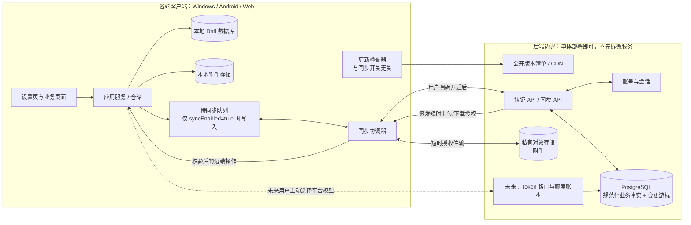
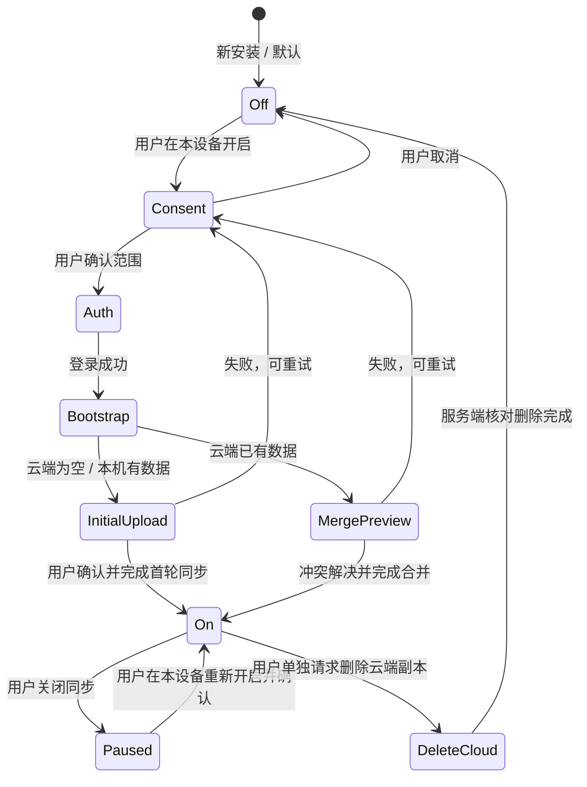

# MissionBook 后端与云端能力设计

> **状态：规划稿，未实现。** 当前应用仍以各设备本地 Drift 数据库为唯一运行数据源；本文定义后续后端边界，不代表已经有账号、云同步、远程更新或 Token 服务。
>
> 设计日期：2026-11-17。依据当前仓库源码；旧版云端规划仅供追溯，不作为本方案约束。

## 1. 结论摘要

1. **保留本地优先。** Windows、Android、浏览器继续可离线使用。云同步是用户在当前设备“设置”里单独开启的功能；新装默认关闭。未开启时，不调用任何云同步、账号资料同步或附件上传接口，不自动上传已有数据。
2. **更新检查与云同步分离。** 版本清单是公开、只读、低数据量服务，与账号无关；可在启动/恢复时低频检查，并提供设置页手动检查。它不受“云端同步”开关控制。
3. **云端同步不是备份恢复。** 同步按操作增量合并，处理跨设备并发；现有完整备份继续负责用户主动导出/整库恢复，不把云端内容静默覆盖成本机库。
4. **同步按设备分别授权。** 用户在一台设备登录或开启同步，不会替另一台设备自动打开同步。登录本身不是同意同步；将来为了 Token 服务登录，也不能自动上传业务数据。
5. **首选数据技术方向是 PostgreSQL + 版本化同步 API + 私有对象存储。** Supabase 可作为托管 PostgreSQL/Auth/Storage 的试点候选，不在本文锁定供应商。Firebase/Firestore 适合文档实时同步，但与当前 Windows 也要支持、关系较多、事件与事务重要的 Drift 数据模型并非首选。
6. **Token 路由是后续独立功能。** “免费 1 元额度”暂按“每个符合条件账号赠送约人民币 ¥1 的模型调用余额”理解，而不是 1 个原始 Token。额度必须由服务端发放与扣减，不能与云同步授权混为一谈，也不在当前阶段预建空接口或表。

## 2. 当前源码基线

- 项目说明确认目标平台为 **Windows、Android、浏览器**，并注明目前没有云端自动同步：[`README.md`](../../README.md)。
- 本地数据库为 Drift/SQLite，当前 `schemaVersion` 为 18，`AppDatabase` 装配 25 张业务/辅助表：[`app_database.dart`](../../lib/data/local/app_database.dart)。本地数据库与事务才是现有事实来源。
- 现有领域写入会通过应用服务和仓储事务保存任务、执行事件、记录、材料及回执；阶段按本地事实派生。远程数据不能通过页面直接写库，也不能另建一套可写阶段。
- 当前附件有独立本机存储与互斥协调；完整备份将业务数据、正式附件、撤销归档原件作为一致快照导出，恢复先校验再原子替换：[`数据备份与恢复`](../架构/前端/数据备份与恢复/README.md)。云同步需要独立的远程对象 ID，不可把本机文件路径或附件存储键当作云端地址。
- 本机资料 `LocalProfile` 是设备偏好，不是账号：[`local_profile.dart`](../../lib/application/settings/local_profile.dart)。API Key 与助手设置存于安全存储；设置页目前包括提醒、备份和关于，没有账号、云同步或版本更新服务。
- 当前已有部分供应商直连能力，但这不等于 MissionBook 有自己的模型路由后端。用户自行配置的 API Key 仍属于 BYOK；不得复制到云同步数据、日志或未来 Token 服务客户端包内。

## 3. 产品不变量与授权边界

### 3.1 云同步默认关闭

- 新安装、清除应用数据、首次登录后的该设备状态均为 `syncEnabled = false`。
- 该值属于**本机安装/设备偏好**，不随云端业务数据同步，也不能被另一设备改写。
- 开关关闭时，SyncService 不得调用 push、pull、bootstrap、附件上传/下载接口；更新清单查询仍可独立工作。
- 开启前用简明确认页说明同步范围、附件可能包含的个人内容、云端保留与删除规则、网络/存储限制；确认后才登录/授权并开始检查云端状态。不得在后台先上传再补告知。
- 云端为空：展示本机待上传数据范围与大小，用户确认后初始化云端副本。
- 云端已有数据：先拉取到隔离暂存区，执行非破坏合并和冲突预览；不能按“最后写入时间”直接覆盖本机。
- 关闭同步会立即停止后续云端读写，未完成队列保留在本机，之后仅在用户重新开启时继续。**关闭不等于删除云端数据**；“删除云端副本/删除账号”是单独、明确、可核对结果的操作。
- 每台设备有独立状态：新设备登录后仍默认关闭；必须由该设备用户单独同意后加入同步。

### 3.2 登录与同步、模型调用分别授权

```text
账号登录 ≠ 云端同步授权 ≠ 将本地内容发送给 AI
```

未来账号可用于登录和领取模型额度，但不会改变 `syncEnabled`。用户选择平台模型并发起一次 AI 请求时，只把该请求所需上下文发送给路由；不得顺带上传整个本地库。登录、同步与每次 AI 内容调用应有分别可见的状态与隐私说明。

### 3.3 云端可读性承诺

第一版若采用普通服务端加密存储，不宣传“端到端加密”或“运营方无法读取”。如果产品要求服务端也不可读，必须在实现前先确定客户端密钥生成、恢复/换机、多人设备加入、服务端索引与 AI 请求边界；这会显著改变数据协议，不能在上线后用一个开关补成 E2EE。

## 4. 目标架构



**数据流原则：** 本地业务操作先提交到 SQLite，云端失败不能阻塞或回滚本地业务操作；开启同步后，将已提交操作可靠地放入本机待同步队列，再由同步服务重试。远端变更经受控的应用数据入口应用到本地事务，刷新现有查询/派生状态；不让 Widget 直接请求后端或直接写远端表。

客户端仍遵守当前分层：页面 → 应用服务/仓储 → 本地数据库；远端 API 是数据来源之一，不替换 Drift 为在线数据库。复杂同步放应用/数据层，不塞入设置页面。Flutter 官方架构指南也强调 UI 与数据层分责、Repository 管理数据及刷新/重试/错误处理；这与项目现有结构一致。

## 5. 同步协议设计

### 5.1 模型：本地优先、增量、可重试

- **不把整个 SQLite 数据库直接上传。** 独立定义 `syncProtocolVersion` 和传输 DTO；它与本地 `schemaVersion=18`、备份 `formatVersion` 分开演进。一个 SQLite 事务可产生多个业务行，但传输应表示为一个可校验的领域操作组。
- 每个操作有全局唯一 `operationId`、`deviceId`、对象类型/ID、协议版本、基于的对象版本、操作时间及内容摘要。服务端以 `(accountId, operationId)` 幂等；重复请求返回首次结果，不重复写入或扣费。
- 远端保存规范化关系数据与按账号递增的变更游标/日志。每次成功应用操作在同一数据库事务中更新事实并写出变更记录。设备按游标拉取，可断线续传；不依赖临时 WebSocket 消息作为唯一数据来源。
- 网络重试只重放同一个 operationId；超时但结果未知时先向服务端核对回执，不能换 ID 再执行。对附件先上传至临时对象并验哈希，元数据操作成功后才引用；失败遗留对象通过定时清理回收。
- 本地待同步队列与源业务写入同一 SQLite 事务提交，保证“业务已保存但队列没记上”的崩溃窗口关闭。只有实现同步功能时才增加对应本地结构，不提前建立空队列表或空接口。
- 拉取游标、设备 ID 和本地开关属于本机同步元数据，不进入用户数据同步；远端拉取应用到 SQLite 时需抑制再次生成出站操作，避免回声循环。

### 5.2 冲突与删除

- 追加事实（执行事件、失败事实、执行报告/材料修正等）按稳定 ID 做集合并入；服务器保存接收序号/时间用于拉取排序，不用设备时钟判定谁“更新”。同一 ID 内容不同应报冲突，不静默覆盖。
- 可编辑对象（目标、节点、任务标题/说明、排期等）采用 `baseRevision` 乐观并发控制。版本未变才提交；版本已变则返回冲突副本，在 UI 中展示双方差异，让用户选保留本机、采用云端或编辑合并。不可对任务阶段做同步字段，因为阶段仍由现有完整规则从事实派生。
- 同步后的删除用墓碑（对象 ID、删除操作 ID、版本、时间）传播，避免另一台离线设备把已删除对象复活。墓碑与被删对象的回收期限、离线设备最长保留策略须在生产前确定。
- 相关行按领域命令聚合提交。例如创建/修改任务及其排期修订不能只传一半；服务器在一事务中验证归属、外键、字段约束和对象版本，再原子接受或拒绝整个操作组。
- 不假设“服务器时间更新的一方胜出”；设备时间可能错误、回拨或离线很久。保留业务发生时间，同时使用服务端序号保障复制顺序。

### 5.3 本地表的建议同步范围

当前是 25 张表的本地数据库，但远端不应照搬所有表。**推荐首版表级策略如下；实施前要与用户确认助手数据是否纳入。**

| 范围 | 当前表/数据 | 建议 |
| --- | --- | --- |
| 核心业务事实 | `goals`, `goal_nodes`, `missions`, `mission_schedule_revisions`, `execution_plans`, `execution_events`, `failure_records`, `evidence_records`, `records`, `user_execution_reports`, `import_receipts` | 主开关开启后同步；保持现有对象 ID 和关系语义。附件原件按私有对象单独传输。`import_receipts` 是否首版同步需验证跨设备重复导入语义。 |
| 高敏感助手数据 | `assistant_sessions`, `assistant_session_records`, `memory_items`, `memory_topics`, `memory_topic_aliases`, `memory_versions`, `memory_episodes`, `memory_procedures` | 默认不随主开关自动开启；另设明确的“助手会话与长期记忆”范围授权。若不授权，助手继续只在本机保存。现有会话表的 `writerToken`/`writerLeaseUntil` 是本机写租约，不能跨设备复制；会话记录以 `(sessionId, sequence)` 为键，实施前需为并发追加设计稳定身份/排序。 |
| 本机运行/派生数据 | `analysis_jobs`, `analysis_versions`, `operation_receipts`, `memory_usage`, `search_usage` | 首版不传。队列、领取状态、去重回执及本地统计不应变成跨设备业务事实；派生摘要优先在本机重建。 |
| 配置与凭据 | `app_settings`、`LocalProfile`、安全存储中的模型/API Key、提醒/动效/语音设置、登录会话、同步游标、设备密钥 | 不整体同步。`app_settings` 混有本机行为选项，按明确的设置白名单另行设计；任何供应商 API Key 都不上传。 |
| 附件 | 当前任务材料、记录附件和撤销归档原件 | 只有在云同步开启并告知范围时才上传；私有存储、账号/对象级鉴权、大小/MIME/哈希校验、配额和删除联动。 |

这张表是**提案而非已实现承诺**。尤其助手会话和长期记忆涉及高敏感内容，主开关是否包含它们必须在 UI 告知、后端数据模型与隐私政策定稿前确定。

### 5.4 设备与同步生命周期



自动同步仅是**尽力而为**：应用启动/恢复时检查、网络可用时退避重试，提供手动“立即同步”。不能依赖系统后台定时器或推送保证必达。推送/实时订阅以后可用于提醒“云端有变化”，实际内容仍用带游标的 pull 获取。

## 6. 版本更新与通知

### 6.1 与数据同步分开的公共更新服务

更新检查只发送产品/平台/当前版本/渠道/协议版本等最低限度元数据，不发送账号、业务数据、附件或 API Key；响应离线失败时不影响本地使用。启动/恢复做低频检查，关于/设置提供手动检查，客户端缓存结果并可关闭非关键提醒。

建议发布清单字段：`productId`、`platform`、`channel`、`version`、`buildNumber`、`minSupportedVersion`、`syncProtocolRange`、`releaseNotes`、`releaseUrl`、`rollout`、`artifactSha256`、`manifestSignature`。清单和安装包不可变版本化；正式发布流水线生成摘要/签名并留存产物来源。

- 更新“推送”首版做**应用内版本检查与提醒**，不是先建设强依赖 FCM 的通知系统。推送消息可能延迟/关闭/丢失，只作补充。
- 默认可跳过/稍后提醒；只有安全修复或协议已无法兼容等明确情况，才设置最低支持版本。即使最低版本已过，仍应允许用户打开本地数据、导出备份；只限制不兼容的远端 API，不以版本门禁锁死本机数据。
- Android 若通过 Google Play 发布，可在平台允许时接入 Play In-App Updates；它属于 Google Play 分发流程。直接 APK 分发则展示官方安装包/下载页并由用户确认安装，不设计静默安装。按 Android Developers 截至 2026-11-17 的安排，开发者验证保护自 2026-09-30 起先在巴西、印度尼西亚、新加坡和泰国的参与商店上线，2027 年起扩大至全球；选定 APK/商店渠道时须核对包名注册与签名要求。Windows 先提供签名安装包下载，不在尚未决定安装包渠道前设计自更新器。Web 通过站点发布部署并提示刷新，不把“远程热更新业务代码”作为后端功能。
- 渠道至少区分 stable 与测试渠道，服务端按平台/渠道发布；生产包不可误读测试渠道。灰度比例由发布服务控制，提供回滚到上一清单版本的能力。

## 7. 账号与未来 Token 路由

### 7.1 现在与将来的边界

现阶段只设计后端兼容边界；不创建空的 Token API、信用表或前端登录流程。未来复用账号身份，但服务模块和数据权限分开：

- 账号/Auth：会话、邮箱验证/登录方式、设备列表、会话吊销、账号删除。
- 同步：只有当前设备的 `syncEnabled=true` 才读写用户内容。
- AI 路由：用户主动选择“MissionBook 平台模型”并提交请求时，服务端持有供应商密钥、选择供应商、流式转发结果并记录最少使用量。供应商密钥绝不能进入 Flutter 包。
- 用户自带 Key（BYOK）仍由用户配置、保存在当前设备安全存储；不得因登录或使用平台额度自动替换/上传。

### 7.2 ¥1 免费额度的可信实现

若“1 元额度”即人民币 ¥1 的服务余额，建议用账本而不是可被客户端修改的 `balance` 字段：

- 每个符合资格的账号以唯一来源键 `signup_grant:<accountId>` 发放一次 100 分（整数分）；并在服务端事务中写入不可变 credit-ledger 记录，重试不重复赠送。
- 每个模型请求有服务端生成/验证的请求 ID；服务端依据实际供应商/模型返回的输入、输出与缓存用量，按**版本化价格表**计算扣费，原子记借记/退款记录。客户端显示值只供展示，不能决定扣费。
- 请求前检查余额并预留上限；成功后按真实用量结算，失败/取消按规则释放预留。并发请求不得透支。余额不足要在流式请求前明确提示。
- 限制单账号/设备/时间的调用频率、每日花费与并发，监控异常滥领；防滥用强度、验证方式、余额是否过期及隐私留存需产品决策。不要依赖不可验证的客户端设备指纹作为唯一资格依据。
- 请求日志默认不记录完整 Prompt/回复；记录计费必需的模型/用量/价格版本/结果状态，设置短期安全日志保留策略。AI 请求的上下文发送与云同步范围互不推导。

## 8. 安全、可靠性与运营基线

- 所有接口 TLS；账号接口限速、登录防滥用；会话可轮换/吊销；服务端按用户隔离，并将每个对象的 `accountId` 归属校验作为核心不变量。
- 数据库每张外露表必须有经过测试的行级隔离策略，文件桶必须私有并有独立对象授权策略；不能以“表权限正确”推断附件安全。后台管理员/服务密钥仅存服务端密钥管理设施，不进入源码、构建参数、客户端配置、日志或备份。
- 若采用 Supabase，publishable key 可随客户端发布，但它不是用户授权；仍须用 Auth + RLS。secret key 会绕过 RLS，只能留在受控后端。Supabase 官方资料注明旧 `anon`/`service_role` key 将于 2026 年底弃用，新项目应使用当前 publishable/secret key。所有新表、Storage 对象规则都必须在部署前做跨账号允许/拒绝回归。
- 附件服务端校验对象归属、长度上限、MIME、哈希与总配额；使用短时授权 URL，避免公开 URL。数据库记录写入与对象存储不构成单一事务，需有待完成标记、重试和孤儿回收。
- 最低运营能力：密钥轮换；请求 ID 和脱敏审计日志；数据库每日备份与恢复演练；对象存储生命周期/删除核验；错误率、延迟、队列堆积与存储成本告警；服务降级/维护页；账号与用户数据删除工单。
- 部署地区、跨境/本地数据要求、隐私政策/用户同意、保留期、导出与删除时限，在上线前根据目标用户和实际运营主体核定；本文不作法律结论。

## 9. 技术方案选择

| 方案 | 与当前项目的适配 | 结论 |
| --- | --- | --- |
| 托管 PostgreSQL + Auth + 私有对象存储（Supabase 是候选） | 当前是 Drift/SQLite 关系模型，存在稳定 ID、外键、事务、追加事件与附件；PostgreSQL 可保留关系完整性，RLS 可做账号级边界，私有 Storage 可单独授权。同步仍由版本化 API/事务函数负责，不把自动生成 CRUD 当完整同步协议。 | **建议先验证的方向**；正式采购前核实部署区域、访问质量、数据位置、备份恢复、价格和目标用户环境。 |
| Firebase Auth + Firestore | 离线 SDK 与文档模型开发快；但当前资料是 Windows、Android、Web 多端关系数据。Firestore 对同一文档多端修改使用 last-write-wins，离线持久化官方列出的支持平台也不包含 Windows，需额外做 Windows 策略与业务冲突层。 | 可作快速原型比较，不建议直接替换 Drift 或将默认离线缓存视为本项目的完整同步/冲突方案。 |
| 自建 API + PostgreSQL + 对象存储 | 对地区、协议、Token 账本、计费和迁移控制更强；但要自行承担 Auth 安全、邮件、备份、监控、升级、可用性与值班。 | 当托管服务区域/合规/访问不满足时选；不是为当前 MVP 过早拆分微服务。 |

**建议部署形态：** 先用一个受控 API/函数服务承接 Auth 回调、同步事务、文件签发与未来 Token 代理；PostgreSQL 为结构化事实库，私有对象存储承接附件；发布清单单独静态托管/CDN。按模块分边界，不按每个能力拆独立微服务。

## 10. 分阶段落地与验收门槛

### 阶段 A：发布清单与版本提醒

发布通道/平台确定后，先交付公开只读清单、设置页手动检查、启动低频检查、缓存/失败文案、渠道隔离和产物签名核验。分别验证 Play、APK、Windows 与 Web 的真实升级路径；构建成功不等同安装升级验收。

### 阶段 B：账号与可选同步最小闭环

先决策部署地区、认证方式、数据范围、加密承诺及删除策略，再做本机默认关闭的开关、明确授权、首次云端状态预览、增量 outbox/pull、冲突与墓碑、附件、设备撤销、账号数据删除。不能只做一个“上传数据库文件”按钮冒充同步。

### 阶段 C：Token 路由与 ¥1 赠额

在账号和同步稳定后另行实施：服务端供应商代理、模型/价格表、一次性赠额、原子余额账本、调用限额、成本告警、超额拒绝、BYOK 与平台模型并存及请求内容隐私说明。Token 后端上线不能自动打开同步。

### 关键验收回归

1. 全新安装同步开关为关闭；启动、登录、创建目标/任务、添加附件、应用恢复时都没有任何同步请求。只有独立更新清单请求可以发生。
2. 仅登录不上传 `goals/missions/records/assistant_sessions` 或附件；不同设备都必须单独同意。
3. 断网时业务照常本机保存；恢复网络后仅一个同步启用设备重试，服务端重复收到相同操作不会产生重复记录。
4. 用两个账号验证数据库行、下载 URL、附件上传/删除全部互相拒绝；撤销设备后旧会话不能再读写。
5. 两设备并发编辑目标/排期能显示冲突；追加执行事件不会因设备时钟落后丢失；墓碑在离线设备回归后不会复活数据。
6. 附件在上传中断、元数据提交失败、恢复重试和删除场景中最终一致，旧本机附件不因云失败被删除。
7. 完整本地备份/恢复与云同步分别回归：恢复继续是用户主动整库替换；同步永不静默整库覆盖。
8. 所有平台分别测试版本比较、渠道隔离、失败重试、用户取消和实际安装/刷新；最低版本门禁不阻止打开/导出本地数据。
9. 未来 Token：赠额跨请求并发只发一次；余额扣减不透支；重试不重复扣款；失败退款有凭证；客户端无法伪造价格/用量/额度。

## 11. 上线前需要定案

- 首发用户与部署区域（中国大陆、北美或全球）及运营/数据处理主体。
- Android 是 Google Play、直接 APK 还是两个渠道；Windows 安装包与签名/更新方式；Web 站点发布方式。
- 首版同步包含范围；助手历史/长期记忆是否独立 opt-in；资料、提醒和偏好是否保持设备私有。
- 是否要求端到端加密，以及忘记密码/换机后的恢复方案。
- 登录方式、未验证账号限制、账号删除和云数据保留期。
- “免费 1 元”币种、发放资格/有效期、适用模型与价格维护负责人、每日硬限额及防滥用等级。

这些选择会影响服务部署、隐私说明和协议，未定前不应直接选云厂商并把客户端绑定到供应商 SDK。

## 12. 研究依据

截至 2026-11-17 查阅官方资料：Flutter《Guide to app architecture》（视图/数据层、Repository、Services 与刷新/错误恢复职责）；Supabase《Row Level Security》《Securing your data》《Storage Access Control》《API keys》（暴露表的 RLS、私有文件策略、发布 key 与仅后端 secret key 的边界）；Firebase《Access data offline》（Firestore 离线缓存及同一文档 last-write-wins）；Android Developers《In-app updates》《Android developer verification》（Play 分发下 flexible/immediate 更新流程、当前 APK/商店分发的验证时间线）。技术文档会变化，正式选型与实施前复核对应官方文档和计划部署区域。
