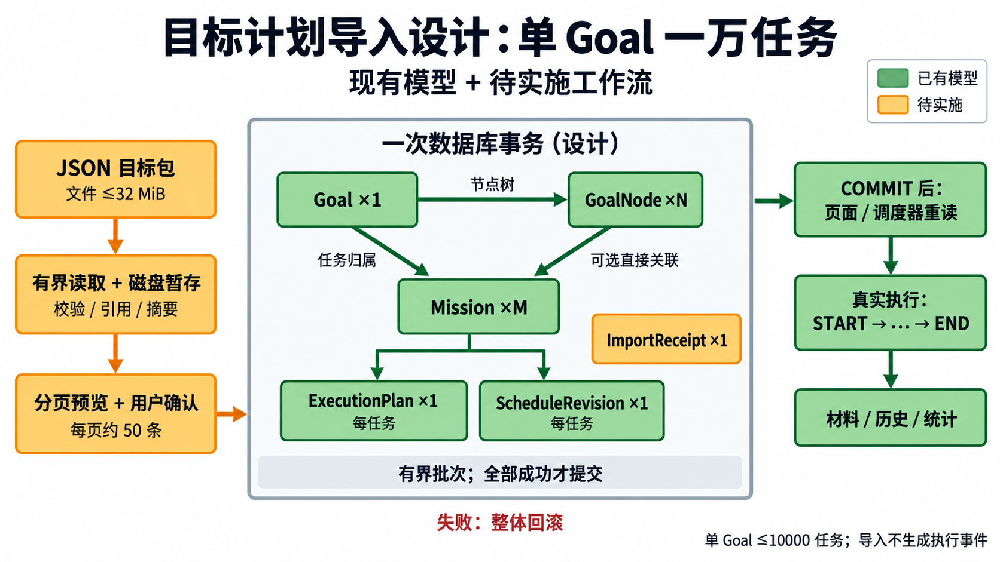

# 目标、课标与可执行任务导入

研究日期：2026-10-27；核对源码：2ddec04。**这是待实施的完整导入方案，当前应用尚不识别 goal-package。** 本轮只增加设计、协议、样例与核验记录，未修改业务代码或用户数据库。

用户当前要解决的问题：把课标交给外部 AI，生成包含完整行动安排的 JSON；软件校验、预览、确认后，创建目标、大纲节点和可以真正开始的任务，接通已有执行、材料及历史功能。

用户随后明确：**单个 Goal 预计约 1 万个任务**，先做好规则、容错和数据结构，再完善 App 导入/导出。因此 1 万条是本方案的设计与验收目标，不能只按小文件流程加大数组上限。

1.0 文档和旧大纲用于追溯设计，不能替代当前场景分析。判断顺序为：用户最新约束 → 真实代码及验证 → 针对缺口提出的更新方案。代码也可能有缺陷；“已经实现”不等于“设计必然正确”。

## 先看结论

- 现有 Goal / GoalNode / Mission / ScheduleRevision / ExecutionPlan 能表达本次主要数据，无须先开发内置 AI 或建立全局 Plan 表。
- 新增独立协议 mission-book.goal-package v1，支持一个目标、完整节点树和已经排到具体日期的任务数组。原 goal-outline v1 继续处理仅大纲输入。
- 每一个 Mission 是一次行动。一个节点可以有多次练习；每周上课需生成多个有具体日期的 Mission，不能靠反复改写同一任务记录课次。
- 导入只创建计划信息。实际开始、暂停、结束、材料和失败事实仍由真实操作产生，导入文件不携带这些记录。
- 批次提交必须跨目标、节点、任务、方案、排期和导入回执原子保存。持久化回执解决重开文件与响应丢失后的重复创建。
- 1 万条任务采用有界流读取、磁盘暂存、分页预览、受控批量事务；同时处理现有逐任务查库和调度全量扫描。协议允许 1 万项不代表设备验收已经通过。

## 本轮文件地图

| 变更 | 文件 | 用途 |
| --- | --- | --- |
| 新增 | [协议与字段](协议与字段.md) | AI 可以填写什么、字段去向及完整性规则 |
| 新增 | [排期与导入配置](排期与导入配置.md) | 开始时刻、重复课程、材料截止、冲突和用户配置 |
| 新增 | [事务与数据结构](事务与数据结构.md) | 身份映射、去重、整包事务、调用链及性能 |
| 新增 | [容错与大数据量](容错与大数据量.md) | 单 Goal 1 万任务的读取、暂存、资源预算、取消和恢复 |
| 新增 | [万级导入作业](万级导入作业.md) | 来源接口、暂存索引、封存摘要、有界批次和作业恢复 |
| 新增 | [App 导入导出衔接](App导入导出衔接.md) | Goal 契约确定后，模板交换、完整归档与 App 恢复的设计顺序 |
| 新增 | [验收与实施顺序](验收与实施顺序.md) | 现状证据、实现顺序和真实设备验收 |
| 新增 | [外部 AI 生成指引](外部AI生成指引.md) | 将课标转换成 JSON 的可复制提示词 |
| 新增 | [JSON Schema](mission-book.goal-package.v1.schema.json) | 可机器检查的结构协议 |
| 新增 | [完整目标包样例](examples/课标试运行.goal-package.v1.json) | 6 个节点、5 个任务、两种时间策略和三种材料策略 |
| 新增 | [当前兼容大纲样例](examples/仅大纲.goal-outline.v1.json) | 现在可用的仅大纲对照，不创建任务 |
| 修改 | [文档入口](../../README.md)、[学习进度](../../教学/学习进度.md)、[变更记录](../../教学/变更记录.md) | 更新研究入口，区分设计、实现、验证和掌握 |
| 仅参考 | lib 当前领域对象、仓储、导入页面、调度器及历史规格 | 本轮不修改 |

## 当前能力与真实缺口

| 场景 | 当前代码 | 本方案需要补齐 |
| --- | --- | --- |
| 文件/粘贴导入大纲 | 严格字段校验、树预览、Goal + Node 单事务 | 按 schema 分流新的完整目标包 |
| 新建任务三件套 | Mission + 首条排期 + ExecutionPlan 同事务 | 多个任务和整个目标树共用一个提交边界 |
| 日期、固定开始、计划时长 | 已存在 | 对文件输入完整校验、默认值展开并预览 |
| 完整行动步骤与备注 | 表和实体能保存；普通创建入口没有 steps / notes 参数 | 补齐创建与开始前编辑入口、页面，并防止编辑时清空导入字段 |
| 归属 | 独立 / 仅目标 / 目标加节点均已存在 | 将文件 nodeKey 映射为应用生成的节点 id |
| 固定时间到点开始 | 已复用事件事务；有 RUNNING 则保留它 | 整包提交后通知现有调度器重读 |
| 完成报告与材料 | 六阶段、三种策略及五类材料已有实现 | 文件只能配置要求，导入后走同一闭环 |
| 重复导入 | 同一个内存请求可重试 | 同一文件重开后用持久化 packageId + 内容摘要识别 |
| 大量课程任务 | 可逐条存储，没有大批量使用验收 | 候选查询、批量装配、索引和规模测试 |
| 每周重复 / 课程依赖 | 尚无持久化重复模板或依赖执行引擎 | 首版导入具体课次；运行时重复和依赖另行定义 |

代码证据：

- [GoalOutlineParser](../../../lib/application/goals/goal_outline_parser.dart)、[GoalService](../../../lib/application/goals/goal_service.dart)、[目标仓储](../../../lib/data/repositories/drift_goal_repository.dart)。
- [MissionService](../../../lib/application/missions/mission_service.dart)：prepareCreation 目前只接收 objective、材料方向等；steps / notes 只有重试来源的复制路径。
- [任务仓储](../../../lib/data/repositories/drift_mission_repository.dart)：create 保存三件套；edit 目前只更新 objective / verificationCriteria 等，尚无 steps / notes 编辑契约。
- [现有调度器](../../../lib/application/missions/planned_mission_scheduler.dart)及[自动开始说明](../../开发/计划任务自动开始.md)。
- [本日功能审查](../../开发/审查记录/2026-10-27-lib功能审查.md)：已有结束报告及查询性能问题，不能被新的导入设计掩盖。

## 课标怎样进入这些对象

| 课标内容 | 承载对象 | 具体例子 |
| --- | --- | --- |
| 课程总目标 | Goal | 能独立完成一个 Flutter 页面 |
| 模块、章节、知识点 | GoalNode 树 | 基础知识 → Widget 组合 |
| 某天的一次学习或练习 | Mission | 11 月 3 日实现 Widget 树 |
| 日期、几点开始、预计多久、材料截止 | MissionScheduleRevision | FIXED、19:00、45 分钟 |
| 本次做什么、怎么做、交什么 | ExecutionPlan | objective、steps、verificationCriteria |
| 真正执行和报告 | ExecutionEvent | START / PAUSE / RESUME / EXTEND / END |
| 真正提交的结果 | Evidence / FailureRecord | 截图、代码、文字、未完成或材料超时事实 |

~~~text
外部 AI + 课标 + 用户排期约束
          ↓
完整目标包（设计中的新协议）
          ↓ 校验、展开默认值、预览、用户确认
一次数据库提交
  ├─ Goal ×1
  ├─ GoalNode ×N：父子关系和同级顺序
  ├─ Mission ×M：关联 Goal，可选直接关联一个 Node
  │    ├─ ExecutionPlan ×1
  │    └─ MissionScheduleRevision ×1：revisionNumber = 1
  └─ ImportReceipt ×1（建议新增的技术回执）
          ↓ 提交成功后
现有页面 / 调度器 / 通知重读数据库
          ↓ 真正开始或用户操作以后
执行事件 → 完成报告 → 材料 / 失败记录 → 历史与统计
~~~

图中目标包导入和回执尚未实现；其余对象已有存储。执行事件、材料、失败表导入时新增条数均为 0。

图中 ScheduleRevision 是 MissionScheduleRevision 的简写；图中上限是设计预算，尚非设备验收结果。[制作记录](../../教学/制作记录/2026-10-27-目标计划万级导入.md)保留制图依据和提示词。

## 样例导入后的确定结果

以样例文件、空库和固定研究时刻 2026-10-27T04:00:00Z 为前提：

- 新增 1 个 ACTIVE 目标、6 个有效节点、5 个待开始任务。
- 5 个任务各有 1 份执行方案、1 条 revisionNumber=1 排期，合计 255 计划分钟。
- 3 个 FIXED、2 个 FLEXIBLE；2 个强制材料、1 个可选材料、2 个自报任务。
- 第 4 个任务没有填写材料截止，展开为上海时间 11 月 6 日 00:00，即 11 月 5 日 16:00Z。
- 第 5 个任务省略 nodeKey，直接属于新目标，不绑定任何节点。
- 数据层共新增 22 条业务记录和 1 条导入回执；没有 START / END、正式材料、失败记录或掌握度。

“待开始”是提交时没有执行事实的推导结果。若用户明确允许导入正处在执行时段的 FIXED 任务，提交后的现有调度器可能立即开始它；不能把“所有情况下导入后永远待开始”写成保证。

## 哪些产品语义需要单独讨论

1. **章节覆盖率。** 当前父节点不继承子节点的完成记录，6 个节点只有 4 个叶节点；只安排叶节点不会让旧“全部节点直接覆盖”达到 100%。导入不能伪造父节点任务补数字。建议新增清楚标注的“叶节点已安排 / 有完成记录”摘要，再单独决定是否统一调整全产品覆盖分母；本轮不改旧统计。
2. **执行步骤的维护。** 既然允许 AI 生成完整步骤，用户必须能在开始前阅读和修改它们；只让导入器写入、表单不能维护不算完整功能。
3. **连续课次。** 到计划时长不会自动 END；上一课仍 RUNNING 时，下一课不能抢占。若要“无人操作也自动结束并切换”，必须另定义真实执行与完成报告规则，不能靠导入 JSON 暗中实现。
4. **长周期重排。** 首版创建一次性的具体课次。重复导入不能偷偷改写已经开始的任务；更新既有学期、追加课程及长期模板需要独立的更新协议与预览差异。

这些是当前分析发现的产品选择；不能把建议标成用户已经确认，也不能用 1.0 的“不包含”拒绝继续分析。

## 文档与标准的作用

本方案的字段与业务选择属于项目设计。JSON Schema 用于结构约束，跨对象引用、默认值展开和提交时的业务条件另行校验；标准中的 format / default 不能被当成必然执行的运行逻辑。参见 [JSON Schema 2020-12 验证规范](https://json-schema.org/draft/2020-12/json-schema-validation)。

当前源码、已有专项复验和本方案样例核验分别记录在[验收与实施顺序](验收与实施顺序.md)；本轮没有证明新协议已能在软件里导入。
