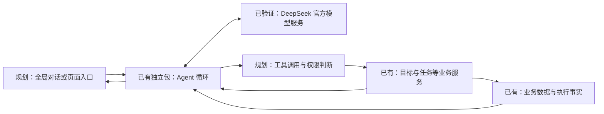
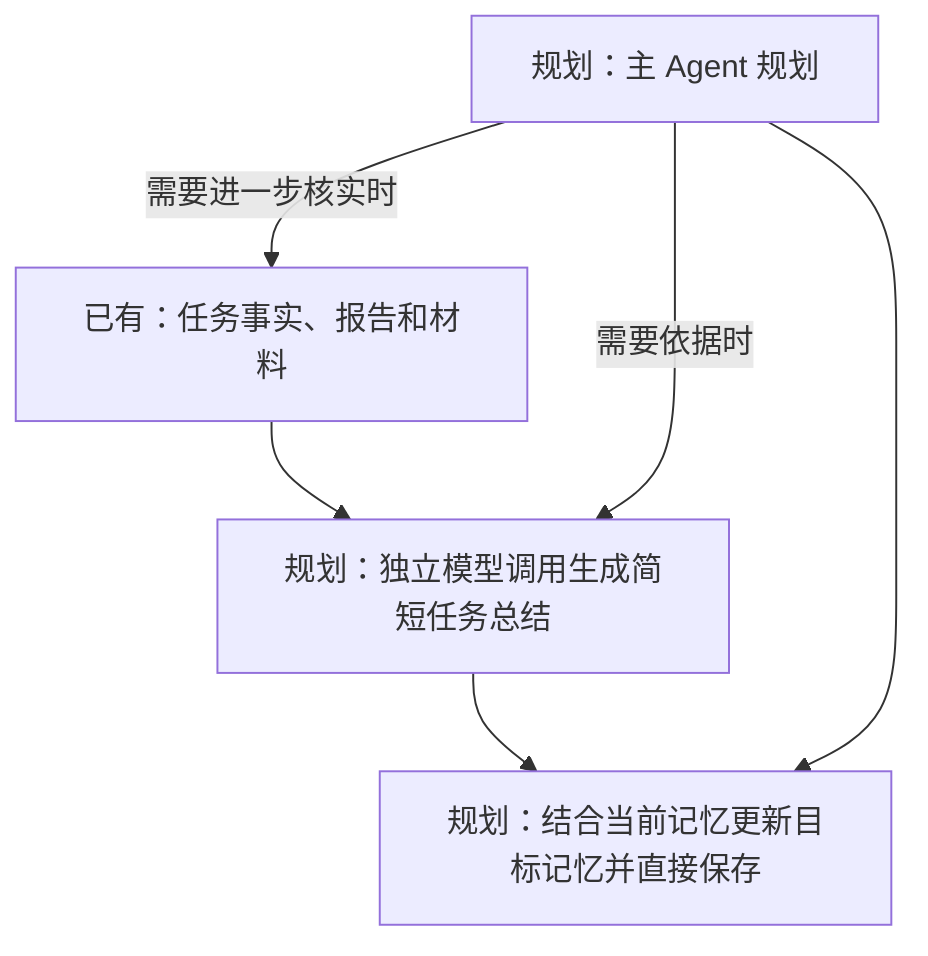

# 内置 Agent：定位、交互与权限

状态：2026-10-29 用户确认保留多供应商，当前优先适配 DeepSeek Flash，并要求先完善独立基座。基座已完成本轮工具、预算、视觉、存储与 CLI 加固，并通过专项及真实 DeepSeek 验证。App 集成、任务总结、目标记忆及本文其余产品要求不因此视为已实现。

接入研究更新：用户在基座提交后启动 App 接入讨论，并确认独立“助手”主导航与目标/任务内“问助手”入口。当前源码映射、交互草案和实施顺序见[Agent 接入 App](../设计/Agent接入App.md)；本轮仅完成研究归档，尚未修改业务代码。

## 1. 产品定位

Mission Book 的核心是以完整智能助理赋能软件。Agent 围绕用户的目标、学习进度、现实安排和偏好持续对话、规划、协助执行、回顾与调整，并按用户设置的权限操作应用。用户可以从全局对话进入，也可以在目标、任务或执行页面围绕当前内容发起交互；两种入口共同服务同一个助理体验。

Agent 核心应在职责上可独立于 Mission Book：负责对话、模型交互、上下文组织、工具调用和行动过程；应用提供具体业务能力、个人数据访问和权限执行。用户要求 Agent 在 App 内工作，不依赖 Mission Book 自建服务器；用户自行配置模型供应商 API。离开应用后，Agent 只有接入对应工具和数据源才有相关能力。首个接入使用 DeepSeek 官方 API，已支持 Messages 与 Chat Completions 协议、多命名配置和独立摘要模型（示例默认 `deepseek-flash`）；两协议的真实流式工具循环、思考和自动压缩已验证，其他供应商的兼容性仍需分别验证。

独立包已具备模型与工具循环和授权回调，尚未接入本图中的 App 入口与业务工具。已有业务基础不表示 Agent 已完成集成；工具读取和写入均须经授权，图中数据回传遵守相同权限。

## 2. 三档操作权限

用户在设置中选择权限，并可调整。权限作用于 Agent 工具操作，不取代应用业务校验。

| 模式 | 用户已确定的方向 |
| --- | --- |
| 默认权限 | AI 的修改基本都需要操作确认。 |
| 宽松权限 | 写入或修改需要确认；其他操作怎样划分待明确。 |
| 完整权限 | 无需逐次确认，Agent 可自主调用应用提供的操作。 |

默认与宽松两档的精确差异尚未定稿：例如开始、暂停会写入执行事件，它们如何归类，以及删除、批量操作、权限设置本身如何处理，需与用户逐项确定，不能把讨论示例当成已确认规则。完整权限的作用范围是最终接入并向 Agent 提供的应用能力；是否按工具、目标或数据源细化配置也待讨论。

授权自动执行时不应暗中恢复逐次确认；操作前重新核对当前权限和业务条件，操作后展示实际结果及失败原因。需要确认时展示待执行内容并等待用户决定；确认后的目标已变化或授权已撤销时重新检查，不能使用过期前提直接写入。可撤销范围、批量行为和操作记录保存期限待设计，不能承诺所有操作都能撤销。

用户另明确：每个目标的记忆更新直接保存，不逐次确认；它是本次已确定的记忆更新规则，不借此推定默认和宽松两档中其他操作的分类。

## 3. 个人上下文与数据来源

Agent 应能利用用户授权的个人信息、目标和目标树、任务及排期、学习进度、执行记录、报告、材料、偏好及现实可用时间，提供合理安排。它只能知道已有或用户提供的信息：App 内计划不自动等于完整个人日历；外部日历等数据源的接入方式、授权和同步需另行设计。

区分应用记录的事实、用户陈述、规则计算和 Agent 判断；判断应能说明来源、适用时间、不确定性并允许纠正。任务完成、提交材料和学习掌握不是同一个结论。聊天记录、长期记忆、来源引用、数据保存和清理方式需要结合真实交互设计，不能假设现有数据已经覆盖所有情况。

读取权限与操作权限分别说明；使用用户选择的云端模型时，请求内容仍会发送给所选供应商，不经过自建服务器不等于数据不离开设备。用户应能了解服务提供方及可能传输的数据。按本次需要组织上下文，并能按需读取更多获授权信息；截断或缺失不能表述为数据不存在。授权和撤销的细粒度方案、凭据管理及模型服务的数据处理方式待定。

## 4. 任务总结、目标记忆与按需回查

每个任务完成后，单独调用模型生成简短任务总结。该次调用只包含总结此任务所需的数据，例如任务目标、执行记录、用户报告及当时已有材料；不携带目标记忆、其他任务历史或主 Agent 对话。总结说明完成内容、结果、困难和有依据的帮助情况，引用任务及依据；用户陈述与模型判断分开，不凭缺失信息推断掌握。

每个目标维护一份精简记忆，主要记录该目标下的技术水平、对用户的评价和注意事项，保留必要依据及不确定性，不把所有任务总结拼入记忆。任务总结形成后，读取该目标的当前记忆和新总结进行独立更新，更新结果自动保存，不逐次确认。用户希望在开发调试中调整总结和记忆的效果；精确长度、提示词、并发更新与版本恢复方案待定。目标记忆的产品形态是每目标一份；实际存储为文件或数据库尚未决定。

主 Agent 规划时先读相关目标的精简记忆，并读取相关日期安排等必要数据；信息不足时查任务总结，仍不确定时按需查看具体任务、报告和材料。不将所有历史或全部总结加入每次模型请求。记忆判断允许核对和纠正；原始任务记录与总结保留，不被模型判断覆盖。

任务事实先独立保存；无网络或模型失败不回滚任务，需支持之后处理和重试。材料晚于任务结束提交或修正时怎样重新总结、任务无目标时如何处理、模型失败与重复处理的具体策略待设计。会话上下文压缩解决长对话窗口问题，任务总结与目标记忆解决跨任务的长期上下文问题，三者分工不同。

## 5. Harness 参考与移植

用户希望以 [DeepSeek Harness](https://github.com/deepseek-ai/deepseek-harness) 为重要参考，完整移植所需 Agent 循环等能力，同时学习源码和 Agent 开发思路。用户已选择在 `packages/agent_core/` 创建独立纯 Dart 包，由 Mission Book 接入业务工具；独立包与主应用一起运行，不要求额外进程或服务器。Harness 主要使用 TypeScript / Node.js，本项目采用 Dart 移植所需能力的方向，不假定其运行时已支持 Android；逐项核对源码、依赖与测试后实现并验证。优先研究模型请求与工具循环、会话持久化与恢复、上下文压缩、工具执行、取消及错误处理。原仓库记忆文档以接入外部记忆服务为主，不等于已实现本项目的任务总结与目标记忆。移植或分发代码前核对 MIT 许可及各实际依赖的许可和保留要求。

学习式实施先追踪对应 Harness 源码，说明设计依据、输入、调用和结果，再完成可运行的完整单元。用户完成文字块示例后，为比赛进度授权助手讲思路并直接实现循环，再结合实际代码理解。本地 Harness 研究基线为 `f3803c9697`，源码路径为 `E:\working\deepseek-harness`。

当前独立基座见[Agent 包说明](../../packages/agent_core/README.md)：通用消息与来源、工具参数校验及逐次授权、顺序执行与结果配对、双协议完整/流式响应、思考与使用量、有限重试、取消和停止边界；配置 JSON 支持默认和摘要模型；每次请求前自动检查上下文预算，模型摘要替换旧投影而保留原文，支持手动和溢出后恢复；会话支持内存/原生追加日志、写锁、关闭重开、未知结果核对、注入上下文、模型切换、导入导出和分支。原生 CLI 与示例可以独立运行。

当前 111 项测试、真实进程中断与文件恢复、跨 isolate 写锁、核心 Web 编译，以及两协议在思考关闭/low 下的真实 DeepSeek 图片识别、工具和压缩验证通过，详见[验证记录](../../packages/agent_core/VALIDATION.md)。模型限额逐个配置，不能统一设为 1M；Flash 当前为 1,048,576 上下文、393,216 输出硬上限，日常输出预算 8,192。MissionBook 集成留到下一阶段；App 凭据管理、权限策略、业务工具、任务总结、目标记忆和设备验收继续按产品需求实施。CLI 从环境获取 Key，`credentialKey` 已允许宿主映射设备安全存储，未决定 App 最终实现。

## 6. 操作与事实边界

Agent 可查询、提出方案和按权限执行应用提供的操作；具体工具目录和每项授权要求待设计。操作走现有业务服务与事务，提交时检查最新事实和前置条件，复用统一执行时间线与完整阶段推导；不能给模型直接绕过规则的数据库写入通道。

操作权限不等于虚构历史：用户报告、材料、执行事件与 AI 评价应区分来源；AI 判断不改写已有原始事实。Agent 代用户发起开始、暂停、结束、报告或材料提交时的授权、来源标识和交互需单独定稿。AI 请求失败不回滚已保存的执行和材料；重复调用、部分成功、超时后的状态查询与重试需要在各真实工具中设计。

## 7. 一个规划交互示例

用户说“今天下午有事，帮我调整学习安排”。Agent 查询获授权的目标、相关任务和已知时间限制；信息不足时询问或明确说明假设。它形成具体更改，并按当前权限等待确认或直接操作。提交时业务服务重新读取任务与排期并校验；成功后告知具体结果，失败或冲突则说明原因。此例是需求示意，不代表功能已经落地。

## 8. 待共同决定

- 两种需确认模式的准确操作分类、执行事件及高影响操作如何授权。
- 主动性：仅响应用户，还是允许定时观察、主动建议和按授权行动。
- 模型供应商协议和配置、API 凭据存储、离线重试、费用与个人数据处理；不依赖项目自建服务器的方向已确定。
- 独立“助手”主导航与目标/任务内入口已确认；导航顺序、卡片细节，以及上下文和长期记忆如何查看、更正、保留或删除继续细化。
- 首批真实工具、批量操作的原子性与恢复方式、操作记录和用户可撤销范围。
- 对话、权限、工具、错误恢复和目标设备的具体验收方法。

相关：[产品纲领](产品纲领.md)、[未来方向](未来方向.md)、[执行事实与阶段设计审查](../教学/U08-执行事实与阶段设计审查.md)。
