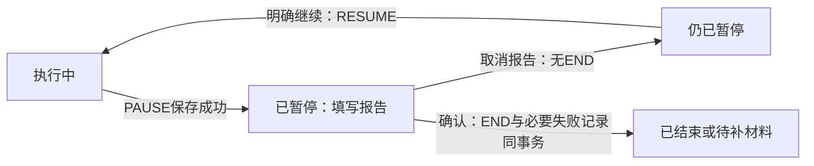

# Mission Book — 领域模型

本文档是领域术语、业务规则和状态转换的唯一来源。字段落地见[数据模型](数据模型.md)，验收见[本地应用规格](本地应用规格.md)。文档描述目标行为，不代表代码已经实现。

## 1. 当前闭环与长期方向

当前闭环：

```text
创建 Goal / GoalNode（可选）→ 手动创建 Mission
→ 开始 → 暂停 / 继续 / 延长 → 报告完成或未完成
→ 按策略直接结束或补交材料 → 查看记录
```

长期方向是 Goal → Plan → Mission → Action → Evidence → Evaluation → Reflection → Replanning。Plan、Evaluation、ContextState、ProgressState、Reflection、Derived Memory 当前不实现，设计保存在[未来方向](未来方向.md)。

| 术语 | 含义 | 当前范围 |
| --- | --- | --- |
| Goal | 长期希望达到的方向、能力或结果 | 手动创建、编辑、变更状态 |
| GoalNode | Goal 中可继续分解的大纲节点 | 树、编辑、归档、恢复 |
| Mission | 用户可以真正开始和执行的一次行动 | 手动创建，可独立存在 |
| MissionScheduleRevision | 一次完整的排期快照 | 开始前修改时追加版本 |
| ExecutionPlan | 一个 Mission 准备如何执行 | Why / What / How / Verify 的组合 |
| ExecutionHistory | 实际执行时间线 | ExecutionEvent 的有序集合，不另建对象 |
| Evidence | 用户正式提交的行动材料 | 文字、代码、图片、文件、手动记录 |
| Evidence Draft | 尚未正式提交的材料 | 页面草稿，不进入正式历史 |
| FailureRecord | 未完成或强制材料超时的原始记录 | 保存触发事实和可选用户原因 |
| Evaluation | AI 对过程和材料的判断 | 当前不产生、不模拟 |

## 2. Goal 与 GoalNode

### 2.1 Goal 状态

```text
ACTIVE    正在推进
PAUSED    暂时搁置
ACHIEVED  用户认为目标已经达到
DROPPED   用户决定不再推进
```

Goal 状态由用户手动设置；节点覆盖率不会自动把 Goal 改成 ACHIEVED。状态变化不取消、不暂停、不改写已有 Mission，也不删除历史。所有状态均可由用户重新改为 ACTIVE。

DROPPED 的 Goal 默认隐藏，通过“已放弃的目标”查看和恢复。本版不提供 Goal 的物理删除；界面使用“放弃目标”，避免把隐藏与删除数据混为一谈。PAUSED、ACHIEVED、DROPPED 的 Goal 不允许创建新 Mission，重新推进前先改回 ACTIVE；已有 Mission 仍可执行和补交材料。

### 2.2 节点结构与编辑

GoalNode 用父子关系构成树，同级顺序独立维护。父节点必须属于同一 Goal，不能形成循环。当前支持新增、改名、说明编辑、同级调序；不支持跨 Goal 搬迁或改变父节点。

删除节点表示归档该节点及整棵子树，记录 archivedAt，不物理删除。已有 Mission 的关联保持，归档节点不进入当前覆盖率，也不能用于创建新 Mission。恢复时恢复所选节点及子树；其父节点必须仍有效，必要时先恢复父节点。归档和恢复都不改变 Mission。

### 2.3 节点记录与覆盖率

只统计未归档节点。每个节点只看**直接关联该节点**的 Mission，按以下优先级生成标签：

1. 存在 END 报告为 COMPLETED 的 Mission：显示“有完成记录”。无需等待材料提交，也不表示通过验证。
2. 否则，存在 RUNNING 或 PAUSED 的 Mission：显示“执行中”。
3. 否则，存在 NOT_STARTED 的 Mission：显示“已安排”。
4. 其余显示“暂无完成记录”；未完成历史可进入节点查看。

EVIDENCE_PENDING 的任务已经有完成报告，显示完成记录，并另加“待补材料”提示。取消的任务不产生进度。节点有完成记录后又创建新任务时保留完成标记，可另显示执行提示。

Goal 覆盖率 = 有完成记录的有效节点数 / 有效节点总数。每个节点只计一次，包含各层节点；父节点不因子节点完成而自动算完成。分母为 0 时显示“暂无节点”，不显示 100%。节点右侧子树计数包含该节点及有效后代，与 Goal 使用同一口径。

覆盖率只表达行动记录的覆盖，不表达知识掌握度。Goal 的 ACHIEVED 与覆盖率是不同的用户事实和统计结果。

## 3. Mission 与执行方案

Mission 可不关联 Goal，也可只关联 Goal，或同时关联 Goal 和 GoalNode。有关联节点时，其 Goal 必须与 Mission 的 Goal 一致。开始后不允许改变归属，避免执行历史被重新归类。

Mission.title 表示行动名称，why 表示为什么现在做；ExecutionPlan.objective 表示具体目标，steps 表示步骤，verificationCriteria 表示验收方向。Why 只保存于 Mission；其余三项保存在 ExecutionPlan。每个 Mission 恰好有一个 ExecutionPlan，steps 可为空。

临时任务只需填写标题、日期和计划时长；objective 默认采用用户填写的标题。新建界面默认可选材料，verificationCriteria 可空，结束时由用户决定交文本/图片或直接结束；仅自报同样允许验收方向为空。只有强制材料必须填写非空验收方向及合法截止。不得凭空编造 Why、步骤或标准。2026-10-24 按用户低负担记录要求，将原“可选材料也必须填验收方向”调整为选填。

Mission 元数据、归属、方案、验证策略和排期仅能在 NOT_STARTED 时修改。取消后不再编辑；开始后仅允许执行操作、结束报告及相应材料操作。

当前只支持 RETRY 血缘：从已结束或已取消 Mission 的“再次尝试”入口打开新建表单，用户保存后创建新 Mission，记录来源和 RETRY。来源关系只在创建时写入，不提供修改入口。新任务有自己的日期、计划和事件，不复活旧任务。其他血缘类型留在[未来方向](未来方向.md)。

## 4. 排期与执行事件

### 4.1 排期

TimePolicy 只有两种：

```text
FIXED     指定日期与固定开始时间，到点提醒
FLEXIBLE  指定日期，用户自行选择开始时间
```

两种策略都由用户手动开始。用户可以提前开始，开始前应展示实际计划日期与时间。到达时间不自动 START、不自动判定失败。

每次有效修改排期都追加一个完整 MissionScheduleRevision，版本号递增。当前排期是最大版本号对应记录。仅 NOT_STARTED 可改排期；START 绑定当时最新版本，之后排期和方案锁定。

“未到时间 / 可以开始”是 NOT_STARTED 的时间标签，不是持久化状态：FIXED 比较 fixedStartAt，FLEXIBLE 比较排期时区下的当前日期与 scheduledDate。过去日期仍是待开始；不自动推到明天。

REQUIRED_EVIDENCE 的截止时间属于排期快照。默认值为 scheduledDate 后一天在该排期时区的 00:00，用户可以自定义。创建或追加排期版本时，截止必须晚于操作时刻；FIXED 还必须晚于 fixedStartAt，FLEXIBLE 还必须晚于该排期日期的起点。修改日期或时区时，表单按新日期重设默认截止，用户确认后写入新版本，旧值保留在旧版本。纯元数据编辑不重写排期或已保存的截止时间。

### 4.2 事件与合法性

ExecutionEvent 只有五种类型：

```text
START   开始，并绑定排期版本
PAUSE   暂停，原因可选
RESUME  从暂停恢复
EXTEND  增加计划投入额度，不改变原计划
END     执行结束，记录用户完成报告
```

事件按同一 Mission 内的 sequence 从 1 连续递增，occurredAt 不得早于上一条；同一时间戳用 sequence 排序。设备时间倒退时拒绝写入并提示校正系统时间，不能产生负时长。

- 一个 Mission 最多一个 START、一个 END。
- START 只允许 NOT_STARTED；PAUSE 只允许 RUNNING；RESUME 只允许 PAUSED。
- EXTEND 允许 RUNNING 或 PAUSED，额度为正整数分钟，不隐式继续计时。
- END 允许 RUNNING 或 PAUSED；END 后不能再写执行事件。
- 全局最多一个 RUNNING；可以有多个 PAUSED。开始或恢复时若已有其他 RUNNING，要求用户先暂停或结束它，不静默切换。
- 每个动作以事务内重读的事实校验；重复点击或重复通知不能产生重复事件。

### 4.3 用户报告与可选材料决定

UserReportedResult 只有 COMPLETED / NOT_COMPLETED，保存在 END Event 中。没有 END 就没有报告，界面显示“尚未报告”，不额外保存 PENDING。

只有 OPTIONAL_EVIDENCE 且报告 COMPLETED 时，END 还记录 submitOptionalEvidence（true / false），表示用户选择稍后提交还是直接结束；其他情形该值必须为空。

用户可以直接选择 NOT_COMPLETED。可轻量询问原因，但不强制填写，不自动延期，不推断能力不足或健康问题。报告保存后不覆盖；重试创建新任务。

## 5. MissionPhase 与流程

### 5.1 六个派生阶段

MissionPhase 是从已保存事实统一计算的查询结果，**不作为 Mission 表中的独立可写字段**。

| Phase | 中文 | 判断依据 |
| --- | --- | --- |
| NOT_STARTED | 待开始 | 无 START，且未取消 |
| RUNNING | 执行中 | 有 START、无 END，最后一次执行切换为 START 或 RESUME |
| PAUSED | 已暂停 | 有 START、无 END，最后一次执行切换为 PAUSE |
| EVIDENCE_PENDING | 待补材料 | 已报告完成且需要材料，首批材料未提交，且没有跳过或超时记录 |
| CLOSED | 已结束 | 已有 END，且符合直接结束、材料提交、可选材料跳过或强制材料超时之一 |
| CANCELLED | 已取消 | 开始前记录了 cancelledAt |

忽略 EXTEND 后判断最后一次执行切换。不存在同时取消又开始的合法任务。

### 5.2 END 的分流矩阵

VerificationPolicy 是任务配置，不是执行阶段：

```text
SELF_REPORT        报告完成即可结束
OPTIONAL_EVIDENCE  用户可选择直接结束或稍后提交材料
REQUIRED_EVIDENCE  报告完成后必须进入材料流程
```

| END 报告 | Policy | 用户选择 | 事务结束后的 Phase |
| --- | --- | --- | --- |
| NOT_COMPLETED | 任意 | 不适用 | CLOSED；创建未完成记录 |
| COMPLETED | SELF_REPORT | 不适用 | CLOSED |
| COMPLETED | OPTIONAL_EVIDENCE | false | CLOSED |
| COMPLETED | OPTIONAL_EVIDENCE | true | EVIDENCE_PENDING |
| COMPLETED | REQUIRED_EVIDENCE | 截止时间未到 | EVIDENCE_PENDING |
| COMPLETED | REQUIRED_EVIDENCE | 截止时间已到 | CLOSED；同一事务创建材料超时记录 |

“需要材料”的判定只使用 END 报告、策略和可选材料选择。等待用户编辑 END 表单时尚未写入 END，不提前改变报告。

### 5.3 材料阶段与取消

| 当前 Phase | 操作 | 结果 |
| --- | --- | --- |
| NOT_STARTED | CancelMission | 记录 cancelledAt → CANCELLED，无 END、无失败记录 |
| RUNNING / PAUSED | 放弃执行 | 通过 EndMission 报告 NOT_COMPLETED → CLOSED |
| EVIDENCE_PENDING | FinalizeEvidenceSubmission | 保存至少一条正式材料 → CLOSED |
| EVIDENCE_PENDING，且为可选材料 | SkipOptionalEvidence | 记录 evidenceWaivedAt → CLOSED |
| EVIDENCE_PENDING，且为强制材料 | ApplyEvidenceDeadline | 达到截止时间后记录材料超时 → CLOSED |
| CLOSED / CANCELLED | 再次尝试 | 打开创建表单，保存后产生新 Mission |

可选材料允许一直待补，也允许用户稍后选择“放弃提交并结束”。强制材料没有跳过入口。当前没有结束后补交首批材料的入口，已结束任务不能重新进入待补；正式材料修正见 §7。

结果页用于查看事实，进入、返回或关闭结果页都不再改变 Mission。当前没有等待 AI 的业务步骤，不需要用户二次确认记录结束。

## 6. 时间口径

以下执行时间公式适用于已有 START 的任务。未开始或已取消任务展示最新排期中的“计划时长”；它们还没有 START 绑定的执行原计划基准，不展示执行额度或实际超时。

```text
Actual Start              = START.occurredAt
Actual End                = END.occurredAt（没有 END 时为空）
Original Planned Duration = START 绑定排期版本的 plannedDurationMinutes
Elapsed                   = (END.occurredAt 或 now) - START.occurredAt
Paused                    = 全部 PAUSE → RESUME / END / now 区间之和
Focus                     = Elapsed - Paused
Granted Extension         = EXTEND.grantedDurationMinutes 的总和
Actual Overtime           = max(Focus - Original Planned Duration, 0)
Current Budget            = Original Planned Duration + Granted Extension
```

未开始任务的 Elapsed / Paused / Focus 为 0。暂停状态下关闭应用不增加 Focus；运行状态下关闭应用继续累计未暂停时长。Focus 记录用户声明的执行区间，不代表检测到了真实注意力。

运行或暂停时若检测到系统时钟早于最后一个执行事件，查询以 max(now, 最后事件时刻) 作为临时计算上界并显示校时提示，不产生负时长；新执行事实仍按 §4.2 拒绝倒退时间，不能静默伪造操作时刻。

达到 Current Budget 时可以提示“结束 / 继续”，不自动写 END。继续并选择额外分钟数后写 EXTEND；同一额度阈值在一次前台会话中只提示一次，新增 EXTEND 后按新额度判断。进度环以 Current Budget 为分母，原计划时长始终单独保留。

示例：14:20 START，14:50 PAUSE，15:10 RESUME，15:20 EXTEND +30，15:50 END。原计划 60 分钟：Elapsed 90、Paused 20、Focus 70、Granted Extension 30、Actual Overtime 10、Current Budget 90 分钟。

## 7. Evidence 与草稿

### 7.1 草稿、首次提交与修正

Evidence Draft 是页面编辑状态，可增删改，不进入正式历史，也不保证进程退出后恢复。离开有内容的草稿页需确认是否丢弃；任务仍可保持 EVIDENCE_PENDING。草稿附件保存在应用私有目录，清理规则见[数据落地与平台](数据落地与平台.md#4-evidence-附件)。

首次提交只允许 EVIDENCE_PENDING，至少含一条有效材料；同一事务保存全部 Evidence，submittedAt 使用同一个提交时刻且不得早于 END。提交后阶段直接变为 CLOSED。草稿校验或保存失败时保留当前编辑内容，不留下半批正式材料。

已提交的材料不可覆盖或删除。当前支持在结果页选择一条材料进行修正：追加一条 Evidence，supersedesEvidenceId 指向同一 Mission 下当前有效的原材料，不允许分叉、循环或跨任务引用。旧材料保留在历史中，修正不改变首次提交时间、任务阶段和原截止结果。

只允许修正已有材料，不向没有正式材料的已结束任务补交首批材料。不提供批量外部 Provider 或 AI 评价入口。

### 7.2 材料类型与来源

```text
EvidenceType    TEXT / CODE / IMAGE / FILE / MANUAL_RECORD
EvidenceSource  USER / FILE_SYSTEM / CAMERA
```

TEXT / CODE / MANUAL_RECORD 保存非空文本，来源为 USER；IMAGE / FILE 保存私有目录的相对 storageKey，来源为 FILE_SYSTEM；Android 拍照保存为 IMAGE + CAMERA。Windows 本版通过文件选择添加图片，不要求内置相机。

材料只描述原始内容，不包含是否通过、评分或掌握度。视频、Git、健康数据等类型与来源不进入当前模型。

## 8. 截止时间与失败记录

### 8.1 截止时间的作用范围

仅 REQUIRED_EVIDENCE、已经 END 报告 COMPLETED、且首批材料未提交时适用。未开始、执行中、暂停、报告未完成、已提交材料、已取消均不会因材料截止时间被强制结束或改写报告。

比较使用 UTC 绝对时间；now >= evidenceDeadlineAt 即到期。首次提交必须在 now < evidenceDeadlineAt 时完成事务内的业务校验。提交与超时互斥，不能既有首次提交又有材料超时记录。

应用启动、回到前台、前台到达截止时间以及提交材料前执行补算。应用关闭期间无需保证截止瞬间唤醒，重新打开后补记。截止记录 occurredAt = max(evidenceDeadlineAt, END.occurredAt)，createdAt 记录实际落库时刻；延迟发现不改变生效时间。

如果用户跨过截止时间才报告完成，EndMission 同一事务写 END 和材料超时记录；不把报告改成 NOT_COMPLETED。跨午夜仍遵循这条规则；用户需要更长提交时间时，在开始前设置更晚截止时间。

### 8.2 FailureRecord

只有两种 trigger：

```text
USER_MARKED_NOT_COMPLETED  用户报告未完成
EVIDENCE_DEADLINE_MISSED   已报告完成，但强制材料未按时提交
```

触发时记录本身必须保存，用户原因可为空。同一 Mission、同一 trigger 最多一条；正常流程中两种 trigger 不会同时产生。

用户原因类别：TIME_INSUFFICIENT / TOO_DIFFICULT / URGENT_EVENT / BAD_STATE / DO_NOT_WANT_CONTINUE / ENVIRONMENT_PROBLEM / OTHER。类别和补充说明都可为空；不填原因不阻碍结束。材料超时由系统记录，不生成用户原因或 AI 诊断。

材料超时的用户文案是“已报告完成，但材料未按时提交”。当前不宣称材料已经通过验证，也不推断用户没有执行。

## 9. 查询事实与业务原子操作

Phase、用户报告、开始/结束时间、关闭时间、材料标签、时间统计和节点覆盖率都是统一查询结果。事实来源及计算优先级见[数据模型](数据模型.md#6-派生查询与事实来源)。页面与通知复用同一套计算，不分别维护可写状态。

| 操作 | 必须原子保存的事实 |
| --- | --- |
| CreateMission | Mission + ExecutionPlan + 首条 ScheduleRevision |
| EditMission / RescheduleMission | 仅待开始可编辑；改排期或验证策略时追加完整排期版本 |
| CancelMission | 仅待开始设置 cancelledAt，保持无执行事件 |
| StartMission | 校验全局 RUNNING 限制，追加 START 并绑定最新排期 |
| PauseMission / ResumeMission / ExtendMission | 校验当前事实后追加唯一合法事件 |
| EndMission | 追加 END、保存可选材料选择；必要时同时创建 FailureRecord |
| FinalizeEvidenceSubmission | 先判断截止时间；成功提交全批 Evidence 或只执行超时处理 |
| SkipOptionalEvidence | 可选材料待补时设置 evidenceWaivedAt |
| ApplyEvidenceDeadline | 仅符合条件时创建唯一材料超时记录 |
| CorrectEvidence | 校验被修正项后追加 Evidence |
| ImportGoalOutline | 用户预览确认后创建 Goal 和完整节点树 |
| ArchiveGoalNode / RestoreGoalNode | 一次更新所选子树的 archivedAt |

一个动作失败不留下半条业务链。对已完成动作的重复请求返回现有结果或明确“已处理”，不得重复追加事实。附件复制先于数据库提交，通知调度后于数据库提交；两者不纳入数据库事务。事务机制与恢复见[数据落地与平台](数据落地与平台.md)。

AI 是未来的分析层；其失败、重试或重新评价都不能回滚原始执行和材料，也不能要求重新打开已结束 Mission。

### 9.1 执行操作身份与重试

以下是 2026-10-23 补齐的实现约定，不增加第六类执行事件或独立状态表：

1. 一次明确的执行操作在进入写事务前分配候选事件 `id`，作为此次操作身份。保存中重复点击共用同一请求；结果不明时重试必须复用该编号及原业务输入。用户确认的新动作才分配新编号。
2. 命令携带 `expectedSequence`，即用户操作时看到的该任务最新事件序号；尚无事件时为 0。它属于命令前置条件，不是 ExecutionEvent 的新持久化字段。START 还携带用户看到的最新排期版本，用于防止从旧排期画面开始。
3. 取得写事务后先按事件 id 查重。已存在且所属任务、类型、动作业务输入相同，就返回该次已处理结果，不再分配序号、增加额度或补写 END。比较使用统一校验后的输入，包含 START 排期版本、EXTEND 分钟、PAUSE 原因、END 报告/材料决定及相关 FailureRecord 中的用户原因；不比较重试时重新捕获的系统时刻。相同 id 的任务/输入不同则报冲突；不能仅因 id 存在就判成功。事件序号应与原 expectedSequence+1 对应；发生时刻由首次成功写入确定，重试不重算。
4. id 尚不存在时，重读事件、取消和最新排期事实。expectedSequence 或 START 排期版本不匹配时拒绝旧命令、返回刷新提示；不得把旧命令改用新序号后自动执行。随后校验合法转换、时间非递减和全局 RUNNING 限制，分配连续序号并原子写入所有必要事实。
5. `occurredAt` 在已取得写权限后捕获一次，统一为 UTC 毫秒，不能由每次页面重试重新指定。数据库锁冲突后若重开事务，须重新读取和校验；不能沿用旧事务快照。
6. 进程退出后若原请求编号丢失，先重新查询已保存事件和当前阶段，让用户确认新操作，不自动重放丢失身份的旧动作。START/END 的单条唯一约束不能替代重复 EXTEND 的识别。
7. 通知按“任务＋所依据的 sequence/排期版本＋动作”携带稳定候选事件 id；同一旧按钮的重复回调复用它。新事件提交后更新通知及动作身份。已成功的旧回调只确认原操作已处理，不再触发恢复、暂停或重复展开报告；不同但迟到的旧命令按前置条件拒绝。

例如从 sequence=3 点击增加10分钟，候选 id 为 E4。E4 成功后响应丢失，重试 E4 仍只增加10分钟；用户刷新到 sequence=4 后再次明确增加10分钟，使用 E5，才累计增加20分钟。若旧画面另发新 id 但仍预期 sequence=3，则拒绝。

### 9.2 结束报告的两个提交边界

“打开结束报告”与“确认报告”是两个动作。执行中打开报告时先原子保存 PAUSE（已有暂停则不追加），只有暂停成功才展示报告；暂停失败仍按重查事实展示执行中并允许重试。选择完成/未完成、可选材料决定和原因只修改草稿，不保存 END。

用户明确确认后，按报告打开时的事件序号提交 END；期间若其他入口继续或变更执行事实，旧报告提交被拒绝，保留输入并要求刷新，不能结束后来恢复的执行。END 与该次必要的 FailureRecord 同事务提交。END 保存失败保留暂停及报告草稿，成功后依分流矩阵展示材料或结果；取消/返回报告保持已暂停，明确继续才写 RESUME。



### 9.3 第一版历史更正边界

第一版保留事件和完成报告的不可变性，不提供撤销 START/END、修改已保存时刻或覆盖完成报告的入口；误操作后也不能偷偷改库伪装历史。页面应显示真实结果并给出适用的暂停、结束或再次尝试操作。正式材料仍按已有规则追加修正。将来若提供执行事实纠错，必须先定义保留原记录的修正协议、时长与统计影响和验收，再修改模型，不以直接 UPDATE/DELETE 代替设计。

## 10. 不变原则

- 真实事件优先，正式历史追加保存；可编辑元数据不冒充不可变历史。
- 能从事实计算的结果不再成为第二套可写真相。
- 执行报告、材料提交、AI 判断、长期掌握分别表达。
- 用户拥有最终决定权；当前操作边界明确展示，未来强制覆盖能力另行设计。
- 只实现有当前入口和数据来源的概念。

## 相关文档

- [产品纲领](产品纲领.md)
- [数据模型](数据模型.md)
- [本地应用规格](本地应用规格.md)
- [界面与交互](界面与交互.md)
- [数据落地与平台](数据落地与平台.md)
- [未来方向](未来方向.md)
