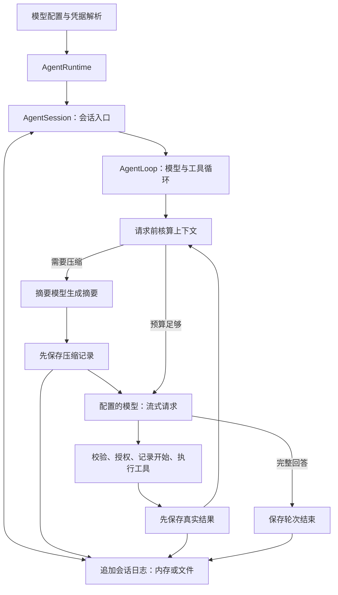

# Agent 基座实施与验收

2026-10-28：用户授权参考 Harness 完成独立 Agent 基座，暂不接入 MissionBook。目标包括自动上下文压缩、模型配置及支撑完整运行的能力；代码按职责命名，中文说明输入与结果。不是复刻 Harness 的 Node/Cordis 插件生态或业务工具。

## 完成要求

| 能力 | 实现及必须验证的行为 |
| --- | --- |
| 消息与工具 | 区分用户、模型、工具、注入上下文和摘要；调用/结果配对、参数校验、逐次授权、顺序执行、异常结果待核对。 |
| 模型配置 | 多个命名配置、默认/摘要模型、接口地址和协议、模型名、输出/上下文预算、思考、温度、超时和有限重试；JSON 读写与校验；配置只保存凭据环境变量名称。 |
| 通信与流式 | DeepSeek Messages 和 Chat Completions；文字/思考/工具参数增量；严格结束判定、使用量、断流、取消、超时、错误类型和退避重试。 |
| 自动压缩 | 请求前估算全部输入预算；旧消息生成摘要、保留近期完整工具组和当前用户输入；原始日志不删除；手动压缩、溢出后压缩恢复、取消/失败不覆盖上下文。 |
| 会话 | 创建、列出、打开、继续对话、模型切换、上下文注入、导出与分支；会话自己持有历史，调用者不再手工拼历史。 |
| 存储与恢复 | 内存与原生文件实现；有版本、有顺序、可验证的追加日志和写锁；恢复中断的模型等待；不重放已开始但无结果的工具，必须核对其结果。 |
| 可观察性 | 模型增量、尝试/重试、工具和压缩事件；最终状态、使用量与失败；关键事实先持久化再对外发布。 |
| 可运行与可读 | 独立命令行入口、可分享的配置样例、离线完整演示、真实 API 验证入口、按一次调用展开的说明；纯 Dart 核心仍能编译 Web。 |
| 回归 | 原有行为继续验证；新增协议、恢复、故障和压缩的专项测试；文件真实重开与中断恢复证据；真实模型流式工具与压缩验证。 |

以上逐项取得证据后才算基座完成。MissionBook 页面、业务 Service 工具、任务总结与目标记忆不在本次接入范围。

## 调用链

这张图对应本轮已经实现的独立基座。各项当前源码、专项测试与真实运行证据见 [VALIDATION.md](VALIDATION.md)，阅读及运行顺序见 [README.md](README.md)。教学学习进度另外区分代码、验证和用户理解。

参考 Harness 基线 `f3803c9697`：`core/agent-loop`、`core/session`、`compaction-basic`、`session-persistence-jsonl`、`llm-deepseek` 和 `llm/retry-policy`。保留职责、日志和恢复原则，使用 Dart 自己的类型、异步和存储实现。
