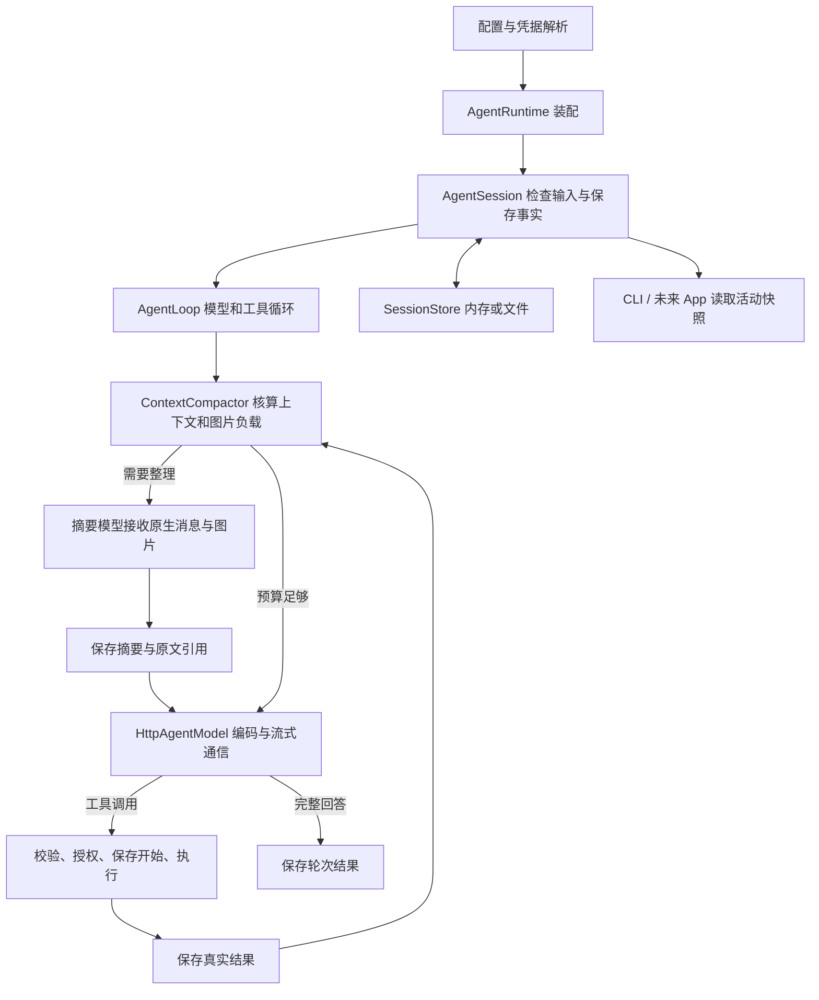

# Agent 基座实施与验收

更新于 2026-10-29。用户要求先完成独立基座，优先适配 DeepSeek Flash，同时保留多供应商，代码精简、语义清晰。MissionBook 页面、业务工具和数据存储接入是下一阶段；本轮没有新增 App 业务表。

## 当前完成范围

| 能力 | 实现及验收要求 |
| --- | --- |
| 消息与工具 | 参数校验、逐次授权、顺序执行、调用/结果配对；执行前落盘。已知业务拒绝与未知写入结果分开；取消不能把已执行操作说成未执行。 |
| 模型配置 | 命名配置、默认/摘要模型、地址和协议、上下文容量、输出硬上限与日常预算分别配置。Flash 为 1,048,576 / 393,216，日常输出 8,192；其他模型使用各自限额。凭据通过标识交给宿主解析。 |
| 通信与流式 | Messages / Chat Completions；文字、思考、工具参数增量；严格结束判定、有限重试与 Retry-After；空闲超时、请求总时长和整轮期限。真实取消中止 HTTP。 |
| 生成控制 | 会话保存思考强度、输出预算、Chat JSON 对象模式；同模型工具往返保留思考。只返回思考时保留记录，报告未完成并允许继续。 |
| 图片 | 识别实际格式、尺寸和大小；链接、内联和 DeepSeek 文件引用；上传、查询、分页、删除与可选有效期；双协议视觉验证。摘要接收原生视觉块，不把 base64 当文字。 |
| 自动压缩 | 字符与图片分别估算，可注入 tokenizer；触发线与硬输入预算分开。完整工具组分块，保留最新用户要求和原始记录，支持手动整理及溢出后恢复。 |
| 会话 | 创建、列出、重命名、关闭重开、继续、模型切换、上下文注入、导出导入和分支；结构化核对结果；界面可重读正在生成的文字与思考快照。 |
| 存储与恢复 | 异步分页、只读打开、删除；内存及带校验的 JSONL。请求规格去重，导入/分支扁平保存，日志体积限额，原子初始化和跨进程/跨 isolate 写租约；未知写入禁止自动重放。 |
| 使用量 | 汇总成功、失败尝试已报告的用量及摘要用量；协议统一输入总数，缓存命中是其中一部分；未完整报告的尝试明确标记。 |
| CLI 与可读性 | 启动装配、命令处理和终端展示分工；原生启动器、离线演示、真实验证脚本和按调用顺序的阅读路线。 |

## 调用链

以上是已实现的独立基座，图中的 App 展示属于规划。用法见 [README](README.md)，源码入口见 [阅读路线](阅读路线.md)，证据见 [VALIDATION](VALIDATION.md)。

## 与 Harness 的关系

参考 `E:\working\deepseek-harness` 基线 `f3803c9697`，核对模型能力与默认预算分离、同模型思考回传、原生视觉摘要、执行事实和持久化恢复。重点涉及 `llm-deepseek` 的 models/defaults/replay、`compaction-basic` 的 summarizer，以及循环、会话和重试实现。

保留职责和约束，用 Dart 类型和异步实现；没有搬入 Node/Cordis 插件体系。文件写租约使用 SQLite 管理连接锁，避免 POSIX 文件锁在同进程多 isolate 下的差异；会话数据仍为 JSONL，纯核心不依赖 `dart:io`。

## 实际边界

- 这是对话、工具、图片、会话与上下文的 Agent 基座，不是 DeepSeek 所有 HTTP 接口的 SDK；Responses、FIM、供应商内建搜索没有在本轮新增。
- 多供应商配置和双协议保留；只有 DeepSeek 做过真实服务验证，其他服务的扩展需要各自验收。
- 估算器是带余量的近似值。活跃会话仍会把原文状态重建到内存，分页文件读取不等于 App 已实现虚拟历史列表；默认文件限额阻止无限增长。
- App 仍需提供业务事务及幂等校验、权限界面、Drift 适配、安全凭据存储、原图与会话备份。未知业务写入必须通过实际服务核对，基座不能猜测提交结果。
- 文件后端在 Windows 验证；没有 Android/iOS 实机验收。核心 JavaScript 编译通过不代表浏览器持久化和运行验收。
