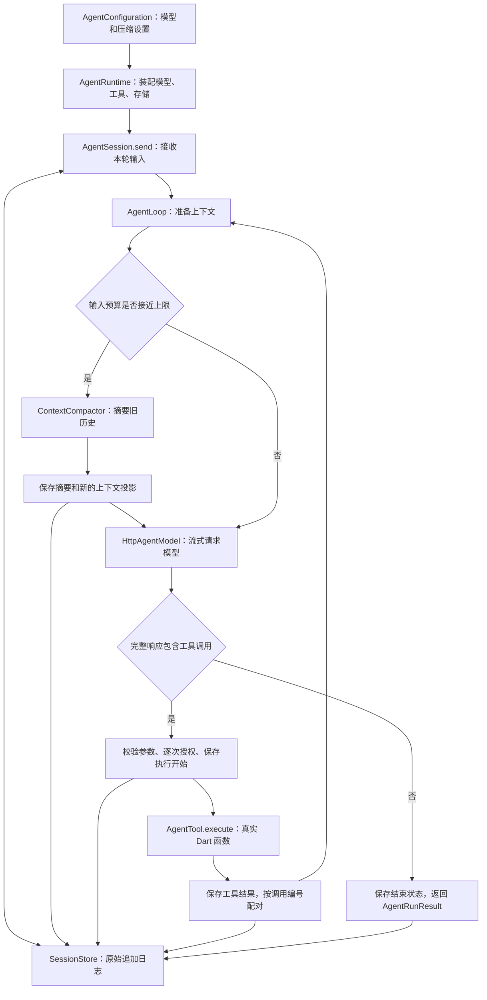

# agent_core

独立纯 Dart Agent 基座，参考 DeepSeek Harness `f3803c9697` 的模型循环、上下文压缩和会话恢复设计。已有流式模型请求、工具循环、自动摘要、多个模型配置、持久会话、导入导出和分支。可以独立在命令行运行；MissionBook 的页面、业务工具、任务总结和目标记忆尚未接入。

实施范围见 [FOUNDATION.md](FOUNDATION.md)，实际验证及边界见 [VALIDATION.md](VALIDATION.md)。

## 先运行，再顺着调用读代码

在本包目录运行不需要 Key 的完整演示：

```powershell
Set-Location E:\working\mission_book\packages\agent_core
dart pub get
dart run example/foundation_demo.dart
```

它用脚本模型演示：背景过长 → 自动摘要 → 调用真实本机时间工具 → 模型依据结果回答 → 关闭并重开 → 继续对话 → 创建分支。脚本摘要用于观察流程，不代表真实模型质量。源文件 [foundation_demo.dart](example/foundation_demo.dart) 可以从 `main()` 顺序阅读。

`example/` 是使用这个包的示例程序，不属于包的公开接口。旧的 [message_demo.dart](example/message_demo.dart) 展示消息块，[agent_demo.dart](example/agent_demo.dart) 只展示最短工具循环。

## 配置 Key 并启动真实 Agent

在同一个 PowerShell 窗口输入 Key，再启动命令行：

```powershell
$agentKeyInput = Read-Host 'DeepSeek API Key' -AsSecureString
$env:DEEPSEEK_API_KEY = [System.Net.NetworkCredential]::new('', $agentKeyInput).Password
dart run bin/agent.dart
```

Key 从当前进程环境读取。这里不自动加载 `.env`；不需要把 Key 写进 Dart 或模型 JSON。当前终端关闭后，这种设置不会成为系统永久配置。

默认用官方 `deepseek-flash`、Messages 协议、流式回答。输入“请查当前时间”可观察真实工具循环。命令行注册了一个本机只读时间工具，其余业务能力由未来宿主提供。

只运行一次、或者恢复已有会话：

```powershell
dart run bin/agent.dart --prompt '请查当前时间'
dart run bin/agent.dart --session 会话编号
```

会话编号在启动时显示，日志默认在本包 `.agent-data/`，也可用 `--sessions 路径` 指定。该目录和本地 `agent.config.json` 已被 Git 忽略。日志保存原始对话与工具结果，供本机恢复和回查。

| 交互命令 | 用途 |
| --- | --- |
| `/models`、`/model 编号` | 列出配置，切换当前会话的对话模型 |
| `/summary-model 编号` | 选择摘要模型，可与对话模型不同 |
| `/list`、`/new`、`/open 编号` | 列出、新建、打开会话 |
| `/history`、`/status` | 查看原始消息、上下文和待核对数量 |
| `/compact` | 手动压缩旧上下文 |
| `/resume` | 从中断处继续，不重复追加上次用户输入 |
| `/export 路径`、`/import 路径` | 导出完整日志，导入为新的独立会话 |
| `/fork` | 按当前历史创建分支并切换过去 |
| `/exit` | 关闭会话和客户端 |

运行中 `Ctrl+C` 请求取消；空闲时退出。已开始的工具需要协作取消，基座会等待真实结果，再保存并结束。

## 设计思路：把一次调用分成五个职责

**配置决定用什么，Session 记住发生了什么，Loop 决定下一步，Model 负责通信，Tool 执行真实操作。** 这样换模型不会改工具，换存储不会改循环，未来接入 App 也不必重写这套过程。



图中全部是当前独立包实现。以“请查当前时间”为例，按下面顺序读：

1. [agent_runtime.dart](lib/src/sessions/agent_runtime.dart) 的 `AgentRuntime` 接收配置、凭据解析函数、工具和存储。`createSession()` 先保存创建记录，再返回 `AgentSession`；调用者只需 `await session.send('请查当前时间')`，下一轮继续 `send()`，历史由会话持有。
2. 同一文件的 `_run()` 保存轮次开始，创建 `AgentLoop`。它把完整原文 `transcript` 与模型当前可见的 `contextMessages` 分开传入。`_observe()` 负责先持久化关键事件，再让界面观察到它。
3. [agent_loop.dart](lib/src/agent_loop.dart) 的 `run()` 接受用户消息，在每次请求前调用 [ContextCompactor.prepare()](lib/src/context/context_compactor.dart)。预算够就继续；预算不足就先调用配置的摘要模型，保存新的上下文投影。
4. [http_agent_model.dart](lib/src/models/http_agent_model.dart) 把通用 `ModelRequest` 交给 [wire_codec.dart](lib/src/models/wire_codec.dart) 编成供应商 JSON，再由 [stream_decoder.dart](lib/src/models/stream_decoder.dart) 组装文字、思考和工具参数。增量可先展示；完整结束后才交付 `ModelResponse`，半截参数绝不拿来执行。
5. 回到循环，`ToolCallBlock` 只是模型提出的调用。`_executeTool()` 根据名字找到注册工具，检查参数 Schema，再等待 `authorize` 返回允许/拒绝。允许后先保存 `ToolExecutionStarted`，才调用 [demo_tools.dart](example/demo_tools.dart) 的真实时间函数。返回的 `ToolOutput` 变成带 `toolCallId` 的 `ToolResultMessage`，进入下一次模型请求。模型依据这个结果给出最终回答。

`await` 表示这一步等异步结果，完成后再向下执行。模型请求、授权等待、工具函数、日志保存分别等待，因此不会把“提出调用”当成“已经执行”。

用户输入、模型回答、工具结果、带来源的 `ContextMessage`、`ContextSummaryMessage` 是不同类型，见 [message.dart](lib/src/message.dart)。普通背景通过 `session.injectContext(source: ..., text: ...)` 提供，保留来源；不要冒充用户亲口说的话。

## 自动压缩为什么不直接删除旧消息

长对话有两个不同需求：模型的下一次输入要变短，已经发生的事情要能回查。因此 `transcript` 保留原始消息；`contextMessages` 是下一次模型使用的投影，其中旧部分可以替换为摘要。

每次请求前，估算器计入系统提示、全部消息、工具说明和协议字段。默认采用 UTF-8 字节数加消息开销的保守估计，**不是供应商精确 tokenizer**；尤其图片数据可能高估。可以实现 `TokenEstimator` 并注入 Runtime 替换它。

压缩过程：

1. 触发线取 `窗口 × triggerRatio` 与 `窗口 − 输出上限 − headroomTokens` 中较小值。
2. 保留近期消息和最新一条用户输入。模型的工具调用及其全部结果视为一个完整组，不能切开；若预算紧张，会减少保留的近期组，但仍保留最后一个完整组和当前用户输入。
3. 把旧部分交给摘要模型，要求区分用户约束、工具事实、模型推测、未完成事项和未知结果。超过摘要模型窗口时，按完整组分块摘要，再合并；受 `maxSummaryCalls` 限制。
4. 只有完整、非空、确实缩小且回到触发线以下的摘要才接受。保存摘要所引用的原消息编号和新投影，再继续原来的模型请求。

手动 `compact()` 使用同一过程。供应商返回明确的上下文溢出错误码时，尝试压缩并恢复该模型请求一次；不会重做此前已经执行的工具。摘要失败、取消或压缩不足时保留原上下文，返回明确错误。单条超大用户输入、系统提示或不可拆分工具组也可能无法压缩，需要缩短该输入/工具结果或提高预算。

`targetRatio` 是选择保留边界时的目标，不保证每次都恰好到这个比例。摘要是模型生成的概括，可能有遗漏；关键事实可用 `messageById()` 回查原文。这种对话压缩与 MissionBook 的任务总结、目标长期记忆职责不同。

## 多个模型配置

复制 [agent.config.example.json](example/agent.config.example.json) 为包根目录的 `agent.config.json`，调整后启动：

```powershell
Copy-Item example/agent.config.example.json agent.config.json
dart run bin/agent.dart --config agent.config.json
```

JSON 包含一个 `profiles` 列表。`defaultModelProfile` 和 `summaryModelProfile` 引用其中的 `id`，它们是配置编号，不一定等于服务端模型名。

| 字段 | 含义 |
| --- | --- |
| `provider`、`model` | 供应商标识和实际请求的模型名 |
| `endpoint`、`protocol` | 完整请求地址和 `messages` / `chatCompletions` 协议 |
| `credentialEnvironment` | 凭据的环境变量名称，如 `DEEPSEEK_API_KEY`，不填 Key 本身 |
| `contextWindowTokens` | 本地采用的预算，可小于供应商真实窗口；默认 64000 是本包策略 |
| `maxOutputTokens`、`streamResponses` | 每次输出上限，是否接收增量 |
| `reasoningEffort` | `off` / `low` / `high` / `max`；供应商及模型必须支持 |
| `temperature` | 可选，省略时使用服务端默认值 |
| `requestTimeoutMs` | 等待响应头或下一段数据的上限；不是整段流式回答的总时长 |
| `retry` | 额外重试次数、初始延迟和延迟上限；只重试模型请求 |
| `context` | 是否自动压缩、触发和目标比例、保留数量、摘要预算与次数上限 |
| `maxSteps` | 一轮最多几步对话模型请求，默认 16；有限重试和摘要分别计数 |

`loadAgentConfiguration()` / `saveAgentConfiguration()` 提供原生 JSON 读写，字段和引用会校验。未知配置字段会报错，避免拼错后静默采用默认值。`context.enabled = false` 关闭自动压缩和自动溢出恢复，仍可手动压缩。

新会话取默认配置；已有会话保存选择的 profile 编号，重开时使用当前配置文件中的同名 profile。每次请求另存当时模型设置、系统提示、工具说明及输入引用，便于追溯；日志不保存 HTTP 凭据。两个协议都已用 DeepSeek 官方服务实测，其他供应商的方言和能力需分别验证。

## 会话、恢复与工具责任

`agent_core.dart` 是纯 Dart 核心入口，含 `MemorySessionStore`；`agent_core_io.dart` 另导出 `FileSessionStore` 和配置文件读写。选择内存存储时，句柄关闭后可用同一 store 重开，但进程退出不会保留；文件存储写入带版本、连续序号和 SHA-256 校验的 JSONL，逐条 flush 后才接受。校验用于检测损坏，不是加密或防篡改签名。

会话一旦运行，拒绝并发 `send()` 或同时改配置；不同会话可各自运行。文件会话持有写锁。打开时只隔离最后一个未完成行，完整坏行或未知版本拒绝自动修改。

| 重开时的已保存事实 | 基座如何处理 |
| --- | --- |
| 用户输入已保存，模型回答尚未完整接受 | 结束旧轮次为 `interrupted`，可 `resume()` |
| 工具调用已接受，尚未保存执行开始 | 记录 `interrupted_not_executed`，不假称执行过 |
| 工具执行开始已保存，但没有结果 | 记录 `outcome_unknown`，阻止继续运行与自动重放 |
| 工具真实结果已保存 | 使用原结果，不再执行这个调用 |

遇到未知结果，宿主先查询实际操作结果，再调用 `resolveToolOutcome(callId, actual, source: ...)` 追加核对事实，之后才允许 `resume()`。原来的未知记录仍保留。命令行只提供只读工具，没有凭空推断外部操作结果的“强行继续”按钮。

未知工具、参数错误、拒绝授权、工具主动返回的已知业务失败，会作为匹配结果交回模型。工具抛出未预期异常时，可能已经产生效果，因此停下等待核对。已开始的工具若取消前已经提交，必须返回真实成功；不要抛出取消来掩盖已提交的操作。基座不能回滚任意 Dart 函数，也不替代宿主事务、幂等和结果查询。

存储失败时停止后续工作，需要关闭并重开核对。完整事实事件在保存后发布，流式预览尚未成为正式事实；若保存工具结果失败，本轮返回对象仍携带进程内拿到的结果，但不能宣称它已经持久化。

导出包含原始记录与摘要；导入先校验所有序号和语义，再创建新会话。`fork(throughMessageId: ...)` 可以从历史边界分支，但不能切开工具调用与结果。背景注入、模型切换、系统提示变更也会记录。

## 事件与停止状态

订阅 `session.events` 查看 `ModelStreamUpdated`、请求尝试/失败、工具开始/结果、压缩和最终事件。`ModelStreamUpdated.purpose` 区分对话与摘要，显示答案时只取 `conversation` 的 `ModelTextDelta`。重试事件带尝试编号和半截文字，宿主应将半截预览标为中断，不与下一次完整回答拼成事实。

`AgentRunResult` 返回本轮消息快照、当前上下文、结束原因、失败、压缩次数和用量：

- `completed` 才提供 `answer`；`maxSteps`、`maxTokens`、`cancelled`、`refused`、`failed` 分别保留原因。
- 最后一步仍要求工具时，结算为未执行并停止，因为没有下一步额度读取结果。被截断的输出不会触发工具。
- `modelSteps` 是对话步骤，`modelAttempts` 含这些步骤的重试；`ContextCompaction.summaryRequests` 是逻辑摘要调用数，不含重试。
- `usage` 汇总已接受响应和成功压缩报告的输入/输出/缓存用量。断流、被取消或失败的摘要可能没有完整用量，因此它不是供应商账单总额。

## 验证与参考

```powershell
dart analyze
dart test
dart run example/foundation_demo.dart
# 以下会使用真实 API，需设置环境变量：
dart run example/foundation_live_smoke.dart
dart run example/foundation_live_smoke.dart --thinking
```

真实验证入口使用文件内合成背景，自动压缩后要求记住项目代号，并调用本机时间工具；分别检查 Messages / Chat Completions 的完整结果、增量、原文保留和最新用户要求。详细运行证据见 [VALIDATION.md](VALIDATION.md)。

Harness 参考职责及 MIT 版权文本见 [THIRD_PARTY_NOTICES.md](THIRD_PARTY_NOTICES.md)。接口依据：[Messages](https://api-docs.deepseek.com/zh-cn/guides/anthropic_api/)、[Chat Completions](https://api-docs.deepseek.com/zh-cn/api/create-chat-completion/)、[思考模式](https://api-docs.deepseek.com/zh-cn/guides/thinking_mode/)。本包没有引入 Node/Cordis 运行时。
