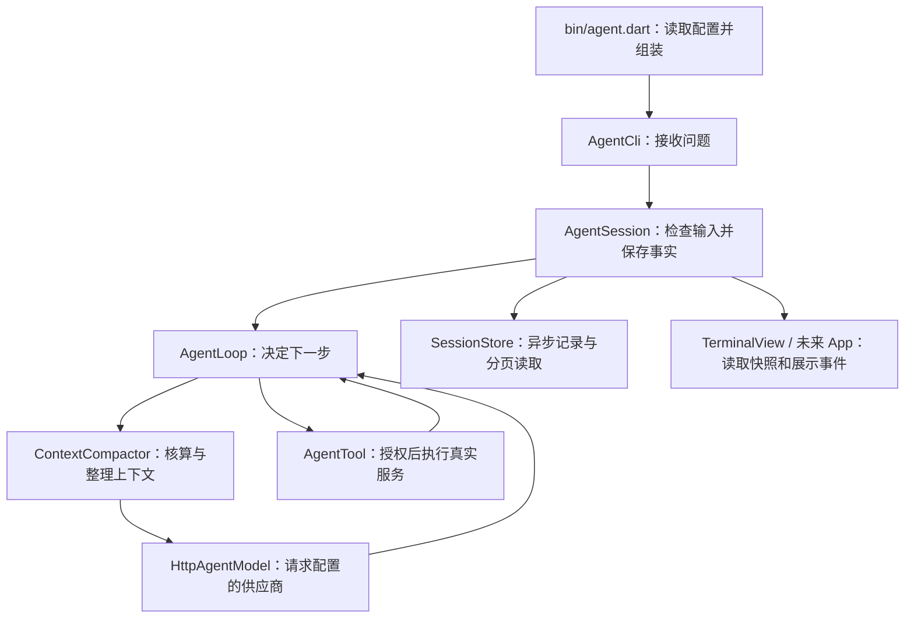

# 沿一次调用阅读 Agent

先运行 `.\run.ps1 --demo`，输入“请查当前时间”。下面都沿这一次调用看，先理解完整路径，再看故障处理。

## 1. 谁把这些对象组装起来

打开 [bin/agent.dart](bin/agent.dart) 的 `main`。`arguments` 来自终端启动参数。解析后，`AgentConfiguration.deepSeek()` 提供默认设置；传了 `--config` 就读取文件。这一步还没有请求模型。

`AgentRuntime` 接收四类东西：模型配置、会话存储、读取凭据的函数、工具及授权规则。新启动调用 `createSession()`，带 `--session` 则调用 `openSession()`。最后交给 `AgentCli.run()`。

这里相当于 Java 应用启动时装配 Service 和 Repository：组装职责集中，具体执行放在各自对象里。

## 2. 输入从哪里进入

打开 [bin/agent_cli.dart](bin/agent_cli.dart) 的 `_handle`。普通文字进入 `_send`；`/model` 等命令调用会话对应方法。`_send` 把文字和可选图片包装成 `UserMessage`，调用 `session.sendMessage()`。

终端颜色、角色名称、等待动画在 [terminal_view.dart](bin/terminal_view.dart)，那里不调用业务工具。以后 App 换一个展示层，仍使用同一个会话入口。

## 3. 会话保存什么

打开 [agent_runtime.dart](lib/src/sessions/agent_runtime.dart) 的 `_run`。先检查当前是否可运行、输入是否适合模型，再保存轮次开始，创建 `AgentLoop`。

`transcript` 是原始事实，`contextMessages` 是本次模型可见的上下文。`onEvent: _observe` 负责把关键事件保存后再通知界面。`activity` 保存当前流式预览，页面回来后可以直接读取，不需要指望事件重播。

## 4. 循环怎样请求模型

打开 [agent_loop.dart](lib/src/agent_loop.dart) 的 `run`。每一步先准备上下文，再创建 `ModelRequest`，交给 `_requests.run()`。后者在 [request_runner.dart](lib/src/models/request_runner.dart)，负责有限重试和每次尝试的用量。

接着到 [http_agent_model.dart](lib/src/models/http_agent_model.dart)：`wire_codec.dart` 编码供应商请求，HTTP 层解析凭据并发出请求，`stream_decoder.dart` 拼接增量。完整响应才交回循环；零散工具参数不会拿去执行。

## 5. 模型说“调用时间工具”之后

回到 `_executeTool`：按名称找到注册工具，检查参数、等待授权、保存执行开始，然后才调用 `execute`。时间工具的真实函数在 [demo_tools.dart](example/demo_tools.dart)，它调用 `DateTime.now()`，并非模型猜时间。

结果变成 `ToolResultMessage`，保存后进入下一次模型请求。模型根据真实结果作答，返回 `AgentRunResult`。`await` 表示等这一阶段完成，再继续下一阶段。

普通业务拒绝看 `ToolOutput.failure` / `ToolRejected`；不能确认是否写入时看 `unknownOutcomes` 与 `resolveToolOutcome`。不要把所有异常统一当成“没有执行”。

## 再按问题读分支

| 想理解的问题 | 文件 |
| --- | --- |
| 模型、预算、凭据标识从哪里来 | [configuration.dart](lib/src/models/configuration.dart) |
| 为什么图片不会占用几十万文字 token | [token_estimator.dart](lib/src/context/token_estimator.dart) |
| 旧消息怎样摘要，原文在哪里 | [context_compactor.dart](lib/src/context/context_compactor.dart) |
| 图片怎样校验和上传 | [image_input.dart](lib/src/models/image_input.dart)、[deepseek_files.dart](lib/src/models/deepseek_files.dart) |
| 重开后如何知道哪些工具需要核对 | [session_state.dart](lib/src/sessions/session_state.dart)、Runtime `_recoverInterruptedTurn` |
| 存储怎样适配未来数据库 | [session_store.dart](lib/src/sessions/session_store.dart) |
| 文件校验、分页和写锁 | [file_session_store.dart](lib/src/io/file_session_store.dart) |

当前公开接口的使用和限制见 [README](README.md)，实际验证见 [VALIDATION](VALIDATION.md)。实现完成与用户已经掌握分别记录，不需要一次读懂所有分支。
